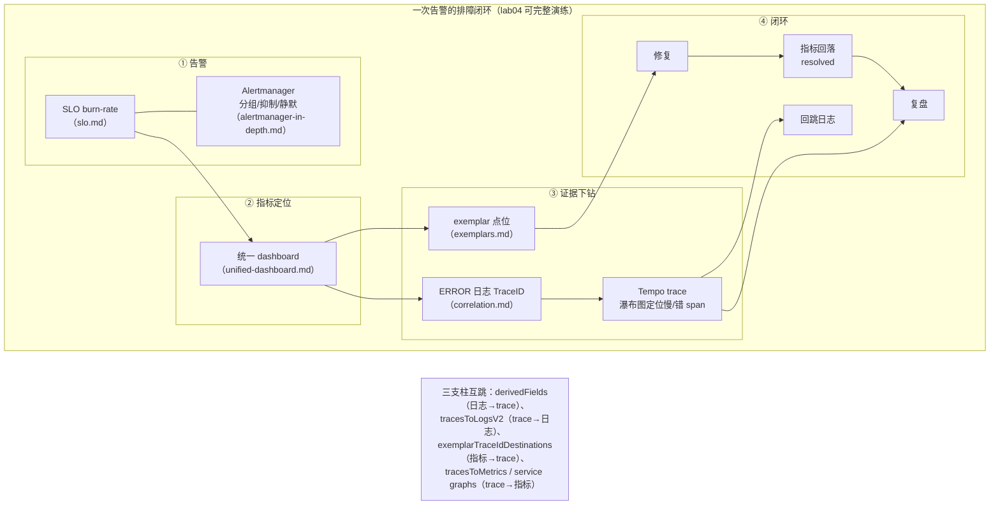

# 阶段 4 · 整合与告警（三支柱关联 + SLO + Alertmanager + 统一仪表盘）

> 本阶段是收获阶段：前三阶段分别点亮了 Metrics（Prometheus）、Logging（Loki）、
> Tracing（Tempo），现在把它们**缝成一个体系**——以 trace_id 为针线，
> 三种信号互相跳转；以 SLO 为度量衡，告警对"错误预算的消耗速度"响；
> 以统一仪表盘为战场，把排障过程固化成 SOP。
> 学完本阶段，你应当能够：独立搭建一套三支柱互跳的可观测性栈、定义 SLI/SLO
> 并落地多窗口多燃烧率告警、按 SOP 在 5 分钟内从告警走到根因证据。

## 学习目标

- [ ] 理解三支柱关联的数据模型：trace_id 在日志（正文注入 / OTLP 字段）、指标（exemplar）、trace（第一公民）中的位置
- [ ] 能实现"日志带 trace_id"（Python logging Filter / Go slog Handler）并解释 filter 挂 handler 的原因
- [ ] 会配 Grafana 四类关联：tracesToLogsV2（trace→日志）、derivedFields（日志→trace）、exemplarTraceIdDestinations（指标→trace）、tracesToMetrics（trace→指标）
- [ ] 说清 exemplar 的四段启用链路（SDK → Collector OpenMetrics → Prometheus 存储 → Grafana 展示）及其版本/语言兼容矩阵
- [ ] 理解 Tempo metrics_generator 的 spanmetrics / service graphs：从 trace 反向派生指标
- [ ] 会定义 SLI（可用性/延迟/正确性，含 PromQL）、制定 SLO（用户视角、28 天窗口、目标值方法论）
- [ ] 掌握错误预算与 burn rate 计算，能落地 Google SRE 的多窗口多燃烧率告警（14.4/6/3/1 四档）
- [ ] 吃透 Alertmanager：去重/分组/抑制/静默的路由流程、route 树与 receivers 配置、集群 HA 一句话
- [ ] 掌握告警治理：P0-P3 分级、告警周报与治理指标、静默与维护窗口纪律
- [ ] 能设计统一仪表盘（RED + 资源 + 依赖五层结构）并按五步 SOP 完成一次完整排障演练
- [ ] 理解 blameless postmortem 文化的要素与闭环方式

## 笔记索引（建议按序阅读）

| # | 笔记 | 主题 | 关键词 |
| --- | --- | --- | --- |
| 1 | [correlation.md](correlation.md) | 三支柱关联 | trace_id 数据模型、Python/Go 日志注入、tracesToLogsV2/derivedFields 逐项详解、spanmetrics/服务图、下钻闭环、关联失效 checklist |
| 2 | [exemplars.md](exemplars.md) | Exemplars | OpenMetrics/OTLP 格式、四段启用链路、query_exemplars API、版本兼容表、价值与限制（采样而非全集、PromQL 不可查） |
| 3 | [slo.md](slo.md) | SLO 与错误预算 | SLI/SLO/SLA 区别表、三类 SLI 的 PromQL、目标值方法论、burn rate 推导、多窗口多燃烧率告警、错误预算政策、反模式清单 |
| 4 | [alertmanager-in-depth.md](alertmanager-in-depth.md) | Alertmanager 深入 | 一条告警的旅程、route 树逐行注释、group_wait/interval/repeat 时间线、webhook 与模板、静默与维护窗口、P0-P3 告警治理 |
| 5 | [unified-dashboard.md](unified-dashboard.md) | 统一仪表盘与排障 SOP | 五层 dashboard 结构、五步排障剧本（含 lab04 点击路径）、SOP 固化到链接、dashboard 即代码、postmortem 文化 |
| 6 | [frontend-rum.md](frontend-rum.md) | 前端可观测性 / RUM | RUM vs 合成监控、Web Vitals（LCP/INP/CLS）、Grafana Faro 接入 LGTM 栈、Sentry 错误追踪与 Source Map、前后端 trace 串联（浏览器注入 traceparent）、Replay 隐私与采样 |

## 配套实验

- **lab04：三支柱整合——一次请求贯穿 Metrics / Logging / Tracing** ——
  [labs/lab04-three-pillars/](../../labs/lab04-three-pillars/README.md)

  一个 FastAPI 应用（web/inventory 双角色）同时产出三信号 → OTel Collector 分发
  → Prometheus / Loki / Tempo → Grafana 三向关联下钻 + SLO burn-rate 告警闭环。
  `podman compose` 一键启动，内置混沌开关（`/chaos`）与告警展示页（`/alerts`），
  可完整演练"告警 → 指标 → exemplar/日志 trace_id → Tempo trace → 回跳日志 →
  burn-rate 告警 → resolved"的全链路。

## 本阶段知识地图

## 与其他阶段的衔接

- **向左（阶段 1/2/3）**：本阶段不引入新的存储，只做"缝合"——阶段 1 的
  PromQL 与 recording rules 是 SLO 规则的语言，阶段 2 的 Loki 标签与正文结构
  决定 derivedFields 正则怎么写，阶段 3 的 trace 模型与 W3C 传播是 trace_id
  能贯穿一切的物理基础。
- **向后（阶段 5）**：本阶段默认**全量采样**；head/tail-based 采样（trace_flags=00
  的含义、exemplar 指向未采样 trace 的兜底）、高基数治理（lab04 教学用
  trace_id 当 Loki label 的反模式在生产中的正确姿势）、K8s 场景下的多租户
  Alertmanager，都留到阶段 5 展开。

## 参考资料（权威入口）

- Google SRE Workbook · Alerting on SLOs：<https://sre.google/workbook/alerting-on-slos/>（访问日期：2026-11-04）
- Google SRE Workbook · Error Budget Policy：<https://sre.google/workbook/error-budget-policy/>（访问日期：2026-11-04）
- Alertmanager 官方文档：<https://prometheus.io/docs/alerting/latest/alertmanager/>（访问日期：2026-11-04）
- Grafana Tempo 数据源关联配置：<https://grafana.com/docs/grafana/latest/datasources/tempo/configure-tempo-data-source/>（访问日期：2026-11-04）
- OpenTelemetry Exemplars 数据模型：<https://opentelemetry.io/docs/specs/otel/metrics/data-model/#exemplars>（访问日期：2026-11-04）

---

## 附：ASCII 图替换清单

| 原 ASCII 图位置（章节标题） | 原图内容简述 | 替换结果 |
| --- | --- | --- |
| 本阶段知识地图 | 一次告警排障闭环四阶段（告警 / 指标定位 / 证据下钻 / 闭环）+ 三支柱互跳说明的框图 | flowchart LR（含 subgraph 分组） |
