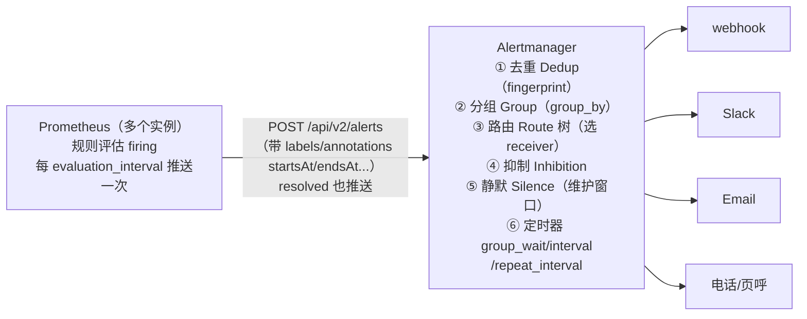
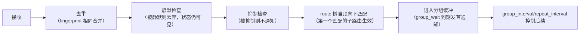
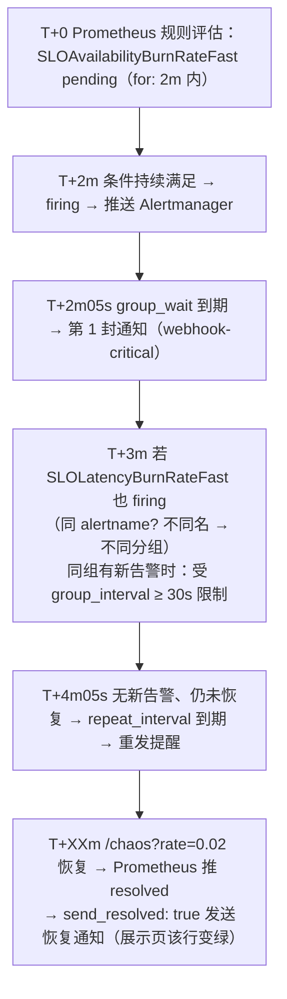

# Alertmanager 深入：路由、分组、抑制、静默与告警治理

> 阶段 4 · 笔记 4。Prometheus 只负责"判定告警是否成立"，**通知的分组、去重、
> 抑制、静默、路由全部由 Alertmanager 负责**——它是值班同学生活质量的第一决定因素。
> 本篇以 lab04 的 `alertmanager/alertmanager.yml`
> 为底本逐段讲解（见 [lab04-three-pillars](../../labs/lab04-three-pillars/README.md)），补齐 webhook 模板、静默与维护窗口、集群 HA 一句话、
> 以及告警治理（P0-P3 分级、周报与复盘指标）。
> 阶段 1 的 [alerting.md](../01-metrics/alerting.md) 讲过基础语法，本篇不再重复。

## 目录

1. [架构与数据流：一条告警的旅程](#1-架构与数据流一条告警的旅程)
2. [四大机制：去重 / 分组 / 抑制 / 静默](#2-四大机制去重--分组--抑制--静默)
3. [route 树完整配置逐行注释](#3-route-树完整配置逐行注释)
4. [receivers：webhook 与通知模板](#4-receiverswebhook-与通知模板)
5. [与 Prometheus 告警规则联动](#5-与-prometheus-告警规则联动)
6. [silence 静默与维护窗口](#6-silence-静默与维护窗口)
7. [集群高可用（一句话版）](#7-集群高可用一句话版)
8. [告警治理实践：分级、周报、复盘指标](#8-告警治理实践分级周报复盘指标)
9. [常见坑与排查](#9-常见坑与排查)
10. [面试题小结](#10-面试题小结)
11. [参考资料](#11-参考资料)

---

## 1. 架构与数据流：一条告警的旅程



关键认知：

1. **Alertmanager 无状态判定、有状态通知**：告警是否成立由 Prometheus 决定，
   Alertmanager 只维护"通知状态机"（哪个分组、上次什么时候发的、谁被抑制了）；
2. **推送而非拉取**：Prometheus 主动 POST 到 `--alertmanager.url`（生产配置
   多个 URL 做冗余）；Alertmanager 之间用 gossip 同步静默与通知状态（见 §7）；
3. **一条告警 = 一组标签**：同样的 labels（排序后做 fingerprint）就是同一条告警，
   改一个 label（如 `severity`）就是新的一条——这直接决定去重与分组行为。

一条告警在 Alertmanager 内部的完整处理顺序（务必记住，排障全靠它）：



---

## 2. 四大机制：去重 / 分组 / 抑制 / 静默

### 2.1 去重（Deduplication）

- 指纹 = 告警全部 labels 的哈希（`__name__` 之外含所有自定义 label）；
- 多个 Prometheus 实例推同一条告警（HA 双采样）→ 指纹相同 → 只保留一份；
- **推论：labels 里不要放高频变化的值**（如 `instance` 换名、`value` 放 label），
  否则每次变化都是"新告警"，去重失效、通知轰炸。

### 2.2 分组（Grouping）

- `group_by: [alertname, service]`：同一分组键的告警合并成**一封**通知——
  机房抖动时 200 条 `TargetDown` 变成 1 条" Targets down（200 instances）"；
- 分组键选择：**按"人会采取的动作"分组**。同一个人同一时刻会一起处理的告警，
  用相同的分组键；不同团队/不同 SLO 的告警，分开分组；
- 反例：`group_by: [instance]` 把同一次故障拆成 N 封邮件；漏配 `service` 则把
  无关服务的告警混进一封。

### 2.3 抑制（Inhibition）

- 机器故障时：`DatabaseDown`（critical）应抑制同机器的 `TargetDown`（warning）
  ——根因已页呼，症状告警闭嘴；
- 三要素：`source_matchers`（谁触发抑制）、`target_matchers`（谁被抑制）、
  `equal`（哪些 label 必须相等才算"同一事"）；
- lab04 的例子（§3 详注）：critical 触发时抑制同 `alertname` 同 `service` 的
  warning/info。注意 lab04 各档位 `alertname` 不同（`...BurnRateFast` vs
  `...BurnRateSlow`），所以该规则实际演示的是"同名不同级"场景；想要"档位间
  抑制"，应把 `equal` 里的 `alertname` 换成自定义 label（如 `slo: availability`），
  详见 §9 坑 3。

### 2.4 静默（Silence）

- 按标签匹配器圈定一批告警，在时间窗内不发通知（告警本身仍在 UI 可见）；
- 与抑制的区别：抑制是**告警间自动的因果关系**，静默是**人主动的运维决策**
  （发版窗口、容灾演练、已知故障处理中）；
- 用法见 §6（amctl / UI / API 三种方式与维护窗口实践）。

---

## 3. route 树完整配置逐行注释

以下逐段讲解 lab04 的
[alertmanager.yml](../../labs/lab04-three-pillars/alertmanager/alertmanager.yml)
（内容一致，注释更细）。先看全貌：

```yaml
global:
  resolve_timeout: 1m      # 告警不再推送后多久视为 resolved（Prometheus 停推即恢复的兜底）

templates:
  - /etc/alertmanager/templates.tmpl   # 自定义通知模板（§4）

route:
  receiver: webhook-default            # 根路由默认接收端（兜底：谁都不匹配走这里）
  group_by: ["alertname", "service"]   # 分组键
  group_wait: 10s
  group_interval: 30s
  repeat_interval: 3m
  routes:                              # 子路由：自顶向下，首个匹配生效
    - receiver: webhook-critical
      matchers: ['severity = "critical"']
      group_wait: 5s
      group_interval: 30s
      repeat_interval: 2m
    - receiver: webhook-warning
      matchers: ['severity = "warning"']
      group_wait: 10s
      repeat_interval: 10m
    - receiver: webhook-info
      matchers: ['severity = "info"']
      group_wait: 30s
      repeat_interval: 4h

inhibit_rules:
  - source_matchers: ['severity = "critical"']
    target_matchers: ['severity =~ "warning|info"']
    equal: ["alertname", "service"]

receivers:
  - name: webhook-default
    webhook_configs:
      - url: http://app:8000/webhook/alerts
        send_resolved: true
  # webhook-critical / webhook-warning / webhook-info 同构（指向同一展示页，
  # 生产中替换为 Slack / 电话 / 工单等不同渠道），完整文件见 lab04。
```

### 3.1 route 节点逐字段

| 字段 | lab04 取值 | 语义 | 生产建议 |
| --- | --- | --- | --- |
| `receiver` | `webhook-default` | 该节点匹配（且无子节点匹配）时使用的接收端 | 根节点必须是"一定能送达"的兜底渠道（如全员 IM 频道） |
| `group_by` | `[alertname, service]` | 分组键；`group_by: [...]`（省略号）表示继承父级 | 按团队/动作分组；不要含高基数 label |
| `group_wait` | 10s（critical 5s / info 30s） | 新分组**首条通知**前的等待：让同组后续告警凑齐 | 页呼级 30s 内；工单级可 5m+ |
| `group_interval` | 30s | 同组**有新告警加入**时，两次通知的最小间隔 | 比告警评估间隔稍长即可 |
| `repeat_interval` | 3m（info 4h） | 同组**无新告警**时重发提醒的间隔 | 实验调短便于观察；生产页呼 2~4h、工单 12~24h |
| `routes` | 3 个子路由 | 子路由列表；**顺序敏感**，自上而下首个匹配生效 | 越具体的匹配（如 `severity=critical AND service=payment`）放越上面 |
| `matchers` | `severity = "critical"` | 新版匹配语法（取代 `match`/`match_re`） | 支持`= / != / =~ / !~`，多个 matcher 是 AND |
| `continue` | 未用（默认 false） | 匹配后是否继续尝试后续兄弟路由 | 需要"一条告警抄送多渠道"时置 true（如同时进 Slack 和工单） |

三个最容易误解的语义：

1. **路由匹配的是 label，不是 severity 这一个字段**：`matchers` 是对整组 labels
   的断言，可以组合 `['severity = "critical"', 'service =~ "payment|trade"']`；
2. **首个匹配生效（first-match）**：子路由 1 命中后不再看子路由 2，除非子路由 1
   显式 `continue: true`。把宽匹配放最上面 = 下面全部失效（高频事故）；
3. **子路由未写的时间参数继承父路由**：lab04 的 `webhook-warning` 没写
   `group_interval`，继承根的 30s——排障时"为什么这个组 30s 一发"的答案常在父级。

### 3.2 时间参数协作的一个完整时间线

以 lab04 critical 路由（group_wait 5s / group_interval 30s / repeat_interval 2m）为例，
注入 `curl -X POST "http://localhost:8000/chaos?rate=0.6"` 后：



在 lab04 验证：浏览器开 <http://localhost:8000/alerts>（10 秒自动刷新），
对照 Alertmanager UI <http://localhost:9093> 的 Silences/Status 页看分组与抑制状态。

### 3.3 inhibit_rules 逐字段

```yaml
inhibit_rules:
  - source_matchers:                     # 当存在满足此条件的告警（抑制者）
      - 'severity = "critical"'
    target_matchers:                     # 满足此条件的告警被抑制（不通知）
      - 'severity =~ "warning|info"'
    equal: ["alertname", "service"]      # 但仅当两者的这些 label 完全相等
```

语义：`存在 critical 告警 A` ∧ `有 warning/info 告警 B` ∧ `A.alertname == B.alertname
∧ A.service == B.service` → B 不发通知（UI 中标记 inhibited）。
设计意图是"同 SLO 的慢档告警在快档页呼时闭嘴"。lab04 各档 alertname 不同，
该规则处于"演示配置正确姿势"状态——真实档位间抑制见 §9 坑 3 的改法。

---

## 4. receivers：webhook 与通知模板

### 4.1 webhook_configs（lab04 用的就是它）

```yaml
receivers:
  - name: webhook-critical
    webhook_configs:
      - url: http://app:8000/webhook/alerts   # 任意能收 POST 的 HTTP 端点
        send_resolved: true                   # 恢复时也通知（排障闭环必备）
      # 可选：max_alerts: 20（单封通知最多带几条，防超大分组撑爆 webhook）
```

Alertmanager POST 的 JSON 结构（demo-app 的 `/webhook/alerts` 就是解析它）：

```json
{
  "version": "4",
  "status": "firing",
  "receiver": "webhook-critical",
  "groupLabels": { "alertname": "SLOAvailabilityBurnRateFast", "service": "demo-app" },
  "commonLabels": { "alertname": "SLOAvailabilityBurnRateFast", "severity": "critical", "service": "demo-app", "slo": "availability" },
  "alerts": [
    {
      "status": "firing",
      "labels": { "alertname": "SLOAvailabilityBurnRateFast", "severity": "critical", "service": "demo-app" },
      "annotations": {
        "summary": "可用性 SLO 预算高速燃烧（burn rate > 14.4，约每小时烧掉 2% 的 28d 预算）",
        "description": "近 1h 错误比例 62.4%，SLO 目标 99.9%（预算 0.1%）..."
      },
      "startsAt": "2026-11-04T12:02:30Z",
      "endsAt": "0001-01-01T00:00:00Z",
      "generatorURL": "http://prometheus:9090/graph?...",
      "fingerprint": "e1f2c3d4b5a6..."
    }
  ]
}
```

字段速记：`groupLabels` 分组键取值 / `commonLabels` 组内公共标签 /
`alerts[]` 明细（含 `fingerprint`、`generatorURL` 跳回 Prometheus 规则页）。

### 4.2 自定义模板（templates.tmpl）

lab04 的 [templates.tmpl](../../labs/lab04-three-pillars/alertmanager/templates.tmpl)
定义了 Slack 风格标题与正文（供 slack_configs 引用，文件内以注释示例）：

```go
{{ define "slack.custom.title" }}
[{{ .Status | toUpper }}{{ if eq .Status "firing" }}:{{ .Alerts.Firing | len }}{{ end }}]
 {{ .CommonLabels.alertname }} · {{ .CommonLabels.service }}
{{ end }}
```

模板数据模型（`.ctx`）与常用函数：

| 模板变量/函数 | 含义 |
| --- | --- |
| `.Status` | firing / resolved（组级状态） |
| `.Alerts` / `.Alerts.Firing` / `.Alerts.Resolved` | 组内告警列表（可 `range` 遍历） |
| `.CommonLabels` / `.GroupLabels` | 公共标签 / 分组标签 |
| `.ExternalURL` | Alertmanager 自身地址（跳转 Silence 页好用） |
| `toUpper` / `humanize` / `humanizePercentage` | 大小写、数字与百分比格式化 |
| `.Annotations.summary` | 规则里写的 summary |

生产模板三原则：**标题一眼定性**（级别 + 症状 + 对象）、**正文带三个链接**
（dashboard 下钻 / runbook / 静默创建）、**恢复通知可区分**（绿色/resolved 前缀）。

### 4.3 其它常用 receiver 一览

| receiver | 用途 | 关键配置 |
| --- | --- | --- |
| `slack_configs` | IM 协作 | `api_url`（webhook）、`channel`、`title`/`text` 模板 |
| `email_configs` | 低紧急度/存档 | `to`、`smarthost`、`send_resolved` |
| `pagerduty_configs` / `opsgenie_configs` | 电话页呼（P0/P1） | `routing_key`、`severity` 映射 |
| `webhook_configs` | 自建网关（钉钉/飞书/企微经适配器） | `url`、`max_alerts` |
| `msteams_configs` / `telegram_configs` | 其它 IM | 官方 workhall 适配 |

钉钉/飞书没有官方 receiver，标准做法：自写一个小 webhook 适配器
（lab04 的 demo-app `/webhook/alerts` 就是它的极简版），或用现成网关
（如 PrometheusAlert / apprise）转发。

---

## 5. 与 Prometheus 告警规则联动

Alertmanager 的行为一半由**告警自带的 labels**决定，因此两边的"契约"要刻意维护：

1. **路由键必须在规则里就位**：Alertmanager 按 `severity`/`service`/`team` 路由，
   这些 label 必须写在告警规则的 `labels:` 里（lab04 每条 SLO 告警都带
   `severity` + `service` + `slo`）；漏写 = 落到兜底 receiver，绕过分级策略；
2. **通知信息写在 annotations**：`summary`（一句话症状）、`description`
   （数据 + 下钻 dashboard 链接）、`runbook_url`（处置手册）。lab04 的
   description 内嵌 `http://localhost:3000/d/lab04-three-pillars`，
   点开即到统一 dashboard（SOP 见 [unified-dashboard.md](unified-dashboard.md)）；
3. **Prometheus 侧的 alertmanager 服务发现**：

   ```yaml
   # prometheus.yml（lab04 实际配置）
   alerting:
     alertmanagers:
       - static_configs:
           - targets: ["alertmanager:9093"]
   # 生产用服务发现代替 static：
   #   kubernetes_sd_configs / dns_sd_configs，配合 --alertmanager.url 冗余
   ```

4. **评估节奏对齐**：`evaluation_interval: 15s` + 规则组 `interval: 30s` 决定告警
   最快多久翻转；Alertmanager 的 `group_wait`/`for` 叠加在上面。
   端到端延迟 ≈ 评估间隔 + for + group_wait，设计 SLO 告警时把这条链算进去；
5. **验证命令**（lab04 可跑）：

   ```bash
   # Prometheus：规则状态与 labels
   curl -s http://localhost:9090/api/v1/rules | python3 -m json.tool | grep -E '"alertname"|"state"'
   # Alertmanager：收到哪些、怎么分组的
   curl -s http://localhost:9093/api/v2/alerts | python3 -m json.tool | grep -E '"alertname"|"severity"'
   # 实际通知落地（demo-app 展示页数据源）
   curl -s http://localhost:8000/webhook/alerts -X POST -H 'content-type: application/json' \
     -d '{"alerts":[{"status":"firing","labels":{"alertname":"ManualTest","severity":"critical"},"annotations":{"summary":"手工触发验证"},"startsAt":"2026-11-04T12:00:00Z"}]}'
   ```

---

## 6. silence 静默与维护窗口

### 6.1 三种创建方式

```bash
# ① amtool（命令行，可进 CI/发布脚本）
amtool silence add \
  --comment "release v2.3 前端发版窗口" --duration 30m \
  --author "ydf" \
  alertname=~"TargetDown|DemoAppNoTraffic" service="demo-app"

# ② UI：http://localhost:9093 → Silences → New Silence（可视化选 matcher）
# ③ API（自动化平台调用）
curl -s -X POST http://localhost:9093/api/v2/silences -H 'content-type: application/json' \
  -d '{"matchers":[{"name":"service","value":"demo-app","isRegex":false}],
       "startsAt":"2026-11-04T13:00:00Z","endsAt":"2026-11-04T13:30:00Z",
       "createdBy":"ci-bot","comment":"维护窗口：DB 主备切换"}'
```

### 6.2 维护窗口实践

| 场景 | 做法 |
| --- | --- |
| 计划内发版 | 发布流水线自动创建 20~30m 静默（comment 带发布单号），失败自动 expire |
| DB / 网络演练 | 事先静默**症状类**告警（TargetDown、HighLatency），**保留**根因类（DatabaseDown）验证演练中真正的故障仍能触达 |
| 已知故障处理中 | incident 指挥创建静默 + `@mention` 值班群，避免 repeat_interval 轰炸（注意：静默会掩盖"二次故障"信号，恢复后立刻删除） |
| 长假值班减载 | 只静默 info/warning（matcher 限定 severity），critical 永不静默 |

三条纪律：**静默必须有 author + comment + 到期时间**（无限期静默是定时炸弹）；
**静默面向症状而非根因**；**每周清理过期/僵尸静默**（UI 按 created_by 排查）。

---

## 7. 集群高可用（一句话版）

一句话：**Alertmanager 以 2+ 副本 + Gossip 集群（`--cluster.peer` 指向彼此）实现
去重后的高可用——Prometheus 向所有副本推送同一批告警，副本间经 gossip 同步
静默与通知状态，保证"多副本只发一封通知"；本地实验用
`--cluster.listen-address=`（空值）关闭集群端口单实例运行（lab04 即如此）。**

---

## 8. 告警治理实践：分级、周报、复盘指标

### 8.1 分级 P0-P3 与路由映射

先定义"什么值得叫醒人"，再谈技术：

| 级别 | 定义（用户/SLO 视角） | 期望响应 | 通知渠道 | lab04 对应 |
| --- | --- | --- | --- | --- |
| **P0（critical）** | 核心旅程不可用 / SLO 预算高速燃烧（burn 14.4） | 5 分钟内响应，7×24 | 电话页呼 + IM | `severity: critical` → `webhook-critical`（group_wait 5s、repeat 2m） |
| **P1（warning）** | 预算中速消耗（burn 6）/ 单实例降级 | 30 分钟内，工作时间 | IM 强提醒 | `severity: warning` → `webhook-warning`（repeat 10m） |
| **P2（info/ticket）** | 慢速消耗（burn 3~1）/ 容量趋势 | 当天建工单 | 工单系统 | `severity: info` → `webhook-info`（repeat 4h） |
| **P3（dashboard）** | 不值得打扰人的趋势与噪声 | 周报复盘 | 只上面板，不进告警 | 不设规则，dashboard 呈现 |

原则：**P0 的数量必须少**（每服务每季度个位数），否则分级本身失效。
一条告警"该不该存在"的检验：它触发时是否总有人**做事**？没人做事的告警
降级到 P3 或删除。

### 8.2 告警周报与治理指标（Alertmanager 自身也要可观测）

用 PromQL 监控"告警系统健康度"（这些指标 Alertmanager 自带 `/metrics`）：

| 指标 | 含义 | 治理阈值（示例） |
| --- | --- | --- |
| `alertmanager_alerts{state="firing"}` | 当前 firing 数 | 长期 > 50 → 该清理规则了 |
| `alertmanager_notifications_total` / `..._sent_failed_total` 的 rate | 通知发送量与失败率 | 失败率 > 1% 查渠道配额/网络 |
| `alertmanager_notification_latency_seconds` | 通知延迟 p99 | > 30s 查 group_wait 设计 |
| `alertmanager_alerts_received_total` - `..._processed_total` 积压 | 处理积压 | > 0 持续增长查性能 |
| 自建指标：每周页呼次数 / 每页呼有效率 | 治理核心 | 页呼有效率 < 50% 必须整改 |

周报模板（5 分钟能填完的版本）：

```text
本周告警治理周报（YYYY-MM-DD）
- 页呼：P0 x2（有效 2 / 误报 0），P1 x7（有效 4）
- Top3 高频告警：TargetDown(89) / DiskUsage(41) / DemoAppNoTraffic(12)
- 动作：DiskUsage 改为趋势预测告警并降 P2；删除 XX 死规则
- SLO 预算：demo-app 可用性剩余 63%（burn 0.4）；延迟剩余 21%（burn 1.8，观察中）
- 静默审计：新增 6（发版 5、演练 1），全部按期过期
```
<!-- 保留原图：周报模板平铺清单，无层级语义，非示意图 -->

### 8.3 复盘（postmortem）与告警的双向迭代

每次 P0/P1 后问三个问题（详细文化篇见 [unified-dashboard.md](unified-dashboard.md)）：

1. 这条告警**够快吗**（从故障发生到通知多少秒）→ 不够：调窗口/档位；
2. **够准吗**（有效告警还是误报）→ 误报：收敛表达式/加 for/改 SLO 口径；
3. **够行动吗**（值班的知道下一步做什么吗）→ 不知道：补 runbook_url 与
   dashboard 链接进 annotations。

---

## 9. 常见坑与排查

| # | 症状 | 根因 | 解法 |
| --- | --- | --- | --- |
| 1 | 告警在 Prometheus firing，但没人收到 | ① prometheus.yml 未配 alerting.alertmanagers；② Alertmanager 收到了但被静默/抑制；③ receiver URL 写错（容器网络里用了 `localhost`） | 依次查 `/api/v1/alerts`（Prom 侧）→ `/api/v2/alerts`（AM 侧）→ Status 页 Silences/Inhibited；容器间用服务名（lab04 用 `http://app:8000`），访问宿主机服务用 `host.containers.internal` |
| 2 | 通知轰炸（同组几十封） | group_by 键含高基数 label；或 group_interval 太短 + 告警反复翻转（flapping） | 检查分组键；flapping 源头在规则侧（加 for / 平滑）；repeat_interval 只管"无新告警"的重发 |
| 3 | 想让"档位 1 告警抑制档位 2 告警"不生效 | inhibit `equal: [alertname, ...]`，但两档 alertname 不同（lab04 现状，教学刻意保留） | 给同一 SLO 的各档加公共 label（如 `slo: availability`），inhibit 的 `equal` 改为 `["slo", "service"]` |
| 4 | resolved 通知没发 / 乱发 | `send_resolved: false`；或 Prometheus 挂了没推 resolved，靠 `resolve_timeout` 兜底误恢复 | 渠道留 `send_resolved: true`；resolve_timeout ≥ 2×评估间隔 |
| 5 | 配置改完不生效 | Alertmanager 不热加载已加载的 yml；或 `amtool check-config` 没过 | `curl -X POST http://localhost:9093/-/reload`（需开 web.listen 配置）；提交前 `amtool check-config alertmanager.yml` |
| 6 | 子路由永远不匹配 | 兄弟路由顺序错误（宽匹配在上）或 matcher 拼错（`= ` vs `=~`） | 最具体的放最上；用 UI 的"Preview routing"（v0.25+ Status → 模拟）验证 |
| 7 | 同一告警重复收到多份 | 两个 Prometheus 实例 label 不一致（如一个带 `env` 一个不带）→ 指纹不同去重失效；或集群未组网（各自独立发通知） | 双采样侧 external_labels 对齐；AM 副本间配 `--cluster.peer` |
| 8 | webhook 收到 500 | 接收端超时/解析失败（alerts 数组过大） | `max_alerts` 限制；接收端幂等（重试会重发） |
| 9 | 静默没生效 | matcher 与告警 labels 不匹配（大小写、正则没加 `=~`）；静默时间窗未到/已过期 | UI Silences 页对照告警实际 labels；创建时用 UI 从现有告警"Silence this alert"继承 |
| 10 | 模板渲染报错 | 模板函数不存在/字段拼错（`.Alerts.Firing` 是方法不是字段，需 `len`） | 先在 UI 通知测试里渲染；参考官方默认模板源码抄结构 |

---

## 10. 面试题小结

**Q1：Prometheus 和 Alertmanager 的职责边界？为什么拆开？**
A：Prometheus 负责规则评估与告警判定（expr/for/labels/annotations），并推送
firing/resolved；Alertmanager 负责通知策略：去重、分组、路由树、抑制、静默、
重发节奏，并支持集群去重。拆开是因为判定与通知的演进节奏不同（规则跟服务走、
通知策略跟组织走），且通知层需要独立的高可用与状态（静默/分组）管理。

**Q2：group_wait / group_interval / repeat_interval 的区别？**
A：group_wait 是新分组**首条**通知前的等待（凑齐同组告警，牺牲少量延迟换降噪）；
group_interval 是同组**新增告警**时两次通知的最小间隔；repeat_interval 是
**无新告警**时对持续 firing 的重发提醒间隔。三者协作构成"首通知快、增量合并、
周期提醒"的节奏。

**Q3：inhibition（抑制）和 silence（静默）有什么区别？**
A：抑制是告警之间的自动因果机制——source 告警存在时，满足 target 匹配且
`equal` 标签相同的告警不通知（如 DatabaseDown 抑制同库的 TargetDown）；
静默是人主动创建的按 matcher 的临时通知屏蔽（如发版窗口）。前者自动化、
后者是运维决策；两者都不会删除告警，只是不通知。

**Q4：Alertmanager 怎么做高可用？为什么 Prometheus 不能只配一个？**
A：跑 2+ 个 Alertmanager 组成 gossip 集群（`--cluster.peer`），Prometheus
把告警推给**所有**副本；副本间同步静默与通知状态，保证多副本对同一分组只发
一封通知。若只配一个，Alertmanager 重启期间通知丢失；若多副本未组网，会
重复通知。

**Q5：一条告警从触发到通知的端到端延迟由哪些环节构成？**
A：scrape 间隔（数据可见性）+ evaluation_interval（规则评估）+ 表达式窗口
（rate 需要至少 2 个样本）+ `for` 持续时长 + Alertmanager 的 group_wait +
渠道投递延迟。做"5 分钟内页呼"的承诺时要整条链路相加验证。

**Q6：如何治理告警噪声？说说你的方法论。**
A：① 分级（P0 电话 / P1 IM / P2 工单 / P3 只上面板）并让 severity 进路由；
② 分组与抑制减少同类合并通知；③ SLO burn-rate 告警代替拍脑袋阈值
（见 [slo.md](slo.md)）；④ 周报治理指标：页呼有效率、Top 高频告警、通知失败率；
⑤ 每条告警必须回答"谁会在何时做什么"，无人行动的降级或删除；⑥ 静默与
维护窗口流程化（自动创建、按期过期、每周审计）。

---

## 11. 参考资料

- Alertmanager 官方文档（配置/route/通知）：<https://prometheus.io/docs/alerting/latest/alertmanager/>（访问日期：2026-11-04）
- Alertmanager 配置说明（group_wait/group_interval/repeat_interval 语义）：
  <https://prometheus.io/docs/alerting/latest/configuration/>（访问日期：2026-11-04）
- Notification template 官方文档与默认模板源码：
  <https://prometheus.io/docs/alerting/latest/notifications/>（访问日期：2026-11-04）
- amtool 命令行（静默管理/配置检查）：
  <https://prometheus.io/docs/alerting/latest/amtool/>（访问日期：2026-11-04）
- Alertmanager 高可用（gossip 集群）：
  <https://github.com/prometheus/alertmanager#high-availability>（访问日期：2026-11-04）
- Google SRE Workbook · Alerting on SLOs（severity 分层思想）：
  <https://sre.google/workbook/alerting-on-slos/>（访问日期：2026-11-04）
- 本工作区相关笔记：[SLO 与错误预算](slo.md)、[统一仪表盘与排障 SOP](unified-dashboard.md)、
  [告警体系（阶段 1 基础）](../01-metrics/alerting.md)、
  配套配置：[lab04 alertmanager.yml](../../labs/lab04-three-pillars/alertmanager/alertmanager.yml)、
  [templates.tmpl](../../labs/lab04-three-pillars/alertmanager/templates.tmpl)

---

## 附：ASCII 图替换清单

| 原 ASCII 图位置（章节标题） | 原图内容简述 | 替换结果 |
| --- | --- | --- |
| 1. 架构与数据流：一条告警的旅程 | Prometheus → Alertmanager（内部六步）→ 通知渠道的架构数据流图 | flowchart LR |
| 1. 架构与数据流：一条告警的旅程（处理顺序） | 告警在 Alertmanager 内部七阶段处理顺序管道 | flowchart LR |
| 3.2 时间参数协作的一个完整时间线 | 一条 critical 告警从 pending 到 resolved 的时间点事件链 | flowchart TD |

### 保留说明

- 8.2 告警周报与治理指标（周报模板）：平铺清单模板，无对象-关系结构，非示意图，保留原样。
