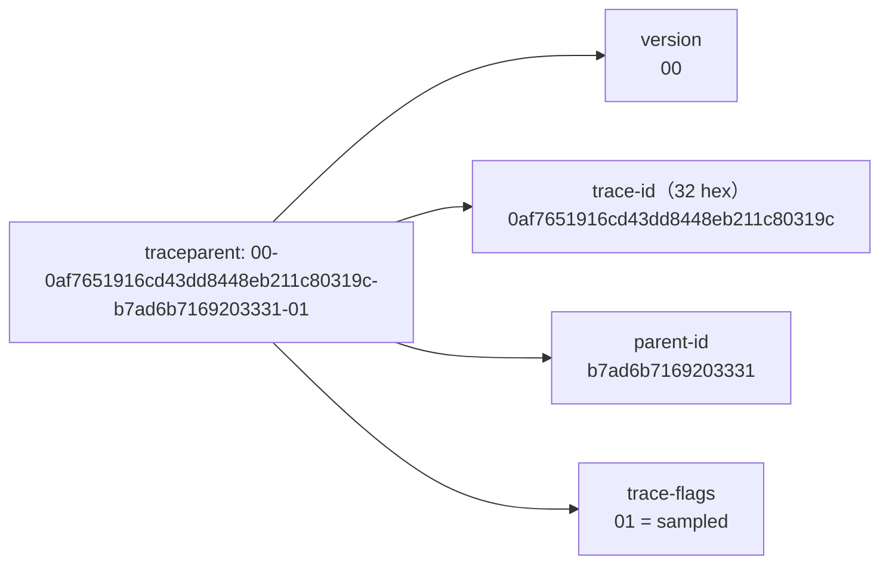
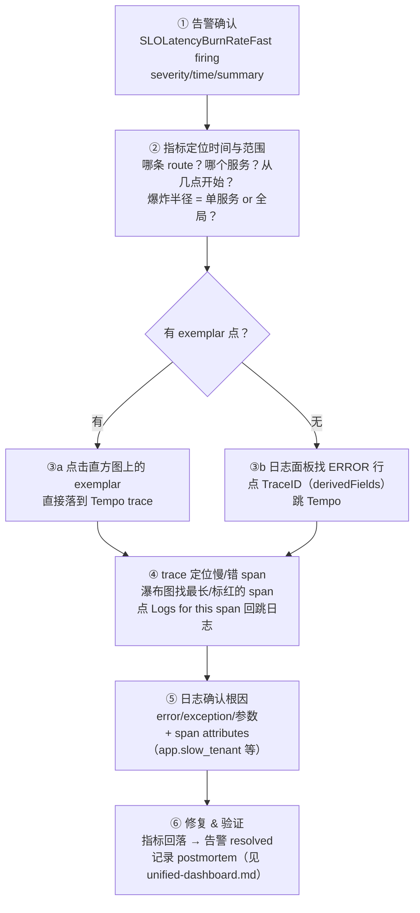

# 三大支柱关联：Metrics × Logging × Tracing 的互相跳转

> 阶段 4 · 笔记 1。三支柱各自独立时只是三座孤岛；关联起来才构成"一次排障的完整故事线"。
> 本篇讲清楚：为什么要关联、trace_id 如何注入日志（Python/Go 代码）、Grafana 三向关联
> 配置逐项详解、Tempo 服务图与派生指标，以及"指标告警 → trace → 日志"的下钻闭环。
>
> 配套实验：[lab04-three-pillars](../../labs/lab04-three-pillars/README.md)（本篇所有配置在其中都可动手验证）。

## 目录

1. [为什么要关联：一次排障的完整故事线](#1-为什么要关联一次排障的完整故事线)
2. [关联的数据模型：trace_id 是那把钥匙](#2-关联的数据模型trace_id-是那把钥匙)
3. [日志注入 trace_id：Python 完整代码](#3-日志注入-trace_idpython-完整代码)
4. [日志注入 trace_id：Go 完整代码](#4-日志注入-trace_idgo-完整代码)
5. [trace_flags 与采样：为什么日志上还要带 flags](#5-trace_flags-与采样为什么日志上还要带-flags)
6. [Grafana 关联配置详解](#6-grafana-关联配置详解)
7. [Tempo 服务图与派生指标（derived series）](#7-tempo-服务图与派生指标derived-series)
8. [下钻闭环：从指标告警到根因日志](#8-下钻闭环从指标告警到根因日志)
9. [常见坑与排查 checklist](#9-常见坑与排查-checklist)
10. [面试题小结](#10-面试题小结)
11. [参考资料](#11-参考资料)

---

## 1. 为什么要关联：一次排障的完整故事线

先看一个没有关联的世界。周五 23:47，你被电话叫醒：**"下单接口 p99 超过 2 秒了"**。

- 只有 Metrics：知道"出问题了"，但不知道是哪一次请求、哪一段代码。对着一张
  曲线图猜根因，像隔着毛玻璃看犯罪现场。
- 只有日志：知道某些请求报错了，但几万行日志里找相关的几十行，靠 `grep order_id`
  撞运气，而且无法回答"这次请求到底慢在哪一段"。
- 只有 Tracing：能看到慢在 `inventory.query` 这个 span，但看不到当时那条业务日志
  （库存服务打了什么 warn？参数是什么？），还是要切到日志系统里捞。

**三支柱关联后的完整故事线**（lab04 可以真实复现这条路径）：

| 时间 | 动作 | 依赖的关联机制 |
| --- | --- | --- |
| 23:47 | 告警触发：`SLOLatencyBurnRateFast`（延迟预算高速燃烧） | Prometheus 规则 + Alertmanager（见 [slo.md](slo.md)） |
| 23:48 | 打开统一 dashboard：p99 从 400ms 跳到 2s，只有 `/api/orders` 异常，`demo-inventory` 正常 → 范围收敛到单个服务单条路由 | 指标按 `service/route` 维度打标 |
| 23:49 | 延迟面板打开 "Show exemplars"，点中一个 2.1s 的 exemplar → 直接跳到 Tempo 里那条 trace（Python SDK 未支持 exemplar 时：从日志面板任意一条慢请求日志点 TraceID 跳转） | Prometheus exemplar / Loki derivedFields |
| 23:50 | trace 显示 `orders.process` 里夹着 `GET inventory` client span 1.9s——嫌疑锁定下游调用 | 跨服务 trace 传播（W3C traceparent） |
| 23:51 | 在 span 上点 "Logs for this span" → Grafana 自动切 Loki 并执行 `{service_name="demo-app"} \| json \| trace_id="<id>"`，看到 `inventory call failed ... Connection timed out` | Tempo tracesToLogsV2 |
| 23:52 | 切到 inventory 的日志/指标：连接池耗尽。扩容 + 重启，23:58 错误率回落，00:10 告警 resolved | 全链路闭环 |

**关联的本质**：三种信号描述的是**同一批请求**，把"同一次请求"的线索缝合起来的针线就是
`trace_id`（以及由它衍生的 span_id / exemplar）。可观测性平台的核心体验差异，往往不在
单个支柱多强，而在**跳转的顺滑程度**。

### 关联方向全景

| 从 | 到 | 机制 | 本篇章节 |
| --- | --- | --- | --- |
| 指标（直方图点） | trace | Exemplar（样本点挂 trace_id） | [exemplars.md](exemplars.md) |
| 日志（单行） | trace | Loki derivedFields（正则提取 trace_id） | §6.2 |
| trace（span） | 日志 | Tempo tracesToLogsV2（生成 LogQL） | §6.1 |
| trace（span） | 指标 | Tempo tracesToMetrics（spanmetrics） | §6.3 / §7 |
| trace（服务级） | 拓扑图 | Tempo Service Graph（服务图指标） | §7 |
| trace（TraceQL） | 指标 | TraceQL metrics（即时聚合查询） | §7.3 |

---

## 2. 关联的数据模型：trace_id 是那把钥匙

### 2.1 三种信号里 trace_id 的"官方位置"

| 信号 | trace_id 存在哪 | 说明 |
| --- | --- | --- |
| Tracing | span 的 `trace_id` 字段（第一公民） | 整条 trace 共享同一 16 字节 hex（32 字符） |
| Logging | OTLP `LogRecord` 的 `trace_id` / `span_id` / `trace_flags` 独立字段（非 attributes） | OTel 规范：日志桥接 API 自动从当前上下文取 |
| Metrics | Exemplar：`Exemplar{Value, Time, Attributes, TraceID, SpanID}` | 挂在直方图桶/计数器样本点上 |

关键认知：**OTel SDK 产出的 LogRecord 天生带 trace 上下文**（只要记录日志时 span 处于
active 状态），不需要你手动塞。问题出在**后端呈现**——很多日志系统（包括 Loki 的经典
push API）只保存"正文 + 标签"，不认识 OTLP 的 trace 字段。所以工程上有两条路：

1. **应用侧注入**（本工作区 lab04 采用）：把 trace_id/trace_flags 写进日志正文字段，
   正文到哪，关联到哪；
2. **管道侧提升**：OTel Collector 用 `transform` 处理器把 `trace_id` 拷贝成日志属性，
   再由 loki exporter / OTLP ingestion 提升为标签或 structured metadata。

两条路都常见，生产环境经常**同时保留正文注入 + derivedFields**（对旧格式日志更宽容）。

### 2.2 W3C Trace Context 快速回顾（详细见阶段 3 笔记）

跨服务传播靠 HTTP 头 `traceparent`（W3C 规范）：



- `trace_flags` 是 1 字节，目前只有最低位有意义：`01` 表示**采样**（这条 trace 会被
  后端记录），`00` 表示未采样；
- 这就是为什么日志里除了 `trace_id` 还值得带 `trace_flags`：看到 `00` 你就知道
  "这个 id 在 Tempo/Jaeger 里查不到，是正常现象，不是丢数据"。

参考：<https://www.w3.org/TR/trace-context/>（访问日期：2026-11-04）

---

## 3. 日志注入 trace_id：Python 完整代码

lab04 的 `labs/lab04-three-pillars/app/logging_utils.py` 就是这段代码的生产化版本，核心三件套：

```python
import json, logging
from datetime import datetime, timezone
from opentelemetry import trace

class TraceContextFilter(logging.Filter):
    """从当前上下文（contextvars）取活跃 span，写入 LogRecord。"""
    def filter(self, record: logging.LogRecord) -> bool:
        ctx = trace.get_current_span().get_span_context()
        if ctx.is_valid:
            record.trace_id   = f"{ctx.trace_id:032x}"   # 32 位 hex
            record.span_id    = f"{ctx.span_id:016x}"    # 16 位 hex
            record.trace_flags = f"{ctx.trace_flags:02x}" # "01"=sampled
        else:
            record.trace_id = record.span_id = record.trace_flags = ""
        return True

class JsonFormatter(logging.Formatter):
    def format(self, record):
        return json.dumps({
            "ts": datetime.fromtimestamp(record.created, tz=timezone.utc
                ).isoformat(timespec="milliseconds"),
            "level": record.levelname,
            "logger": record.name,
            "message": record.getMessage(),
            "trace_id":   getattr(record, "trace_id", ""),
            "span_id":    getattr(record, "span_id", ""),
            "trace_flags": getattr(record, "trace_flags", ""),
        }, ensure_ascii=False, separators=(",", ":"))

# ---- 接线：filter 必须挂在 handler 上 ----
fmt = JsonFormatter()
f = TraceContextFilter()

console = logging.StreamHandler()
console.setFormatter(fmt); console.addFilter(f)          # podman logs 可读

otlp = JsonOtlpHandler(logger_provider, formatter=fmt)    # OTLP 上报
otlp.addFilter(f)                                         # 同一 filter 挂两次
```

三个容易踩的细节：

1. **Filter 挂在 handler 而不是 logger 上**。Python logging 中，logger 上的 filter 只对
   "直接通过该 logger 记录"的记录生效，子 logger 传播到 root handler 时**不会**执行
   root logger 的 filter；而 handler 上的 filter 每次必执行。
2. **OTLP 上报时 body 的选择**。`opentelemetry.sdk._logs.LoggingHandler` 默认把
   `record.getMessage()`（纯文本）作为 body，trace 上下文放在 OTLP 的独立字段里——
   经过 loki exporter 后正文里没有 trace_id。lab04 的 `JsonOtlpHandler` 先把记录格式化
   成 JSON 再上报，保证正文自含 trace_id（同时 OTLP 字段里那份仍在，双保险）。
3. **异步任务会丢上下文**。`asyncio` 里 `asyncio.create_task(...)` 会拷贝当前
   contextvars（通常没问题）；但 `ThreadPoolExecutor` 裸线程、Celery 任务、新进程里
   **span 上下文是空的**，日志 trace_id 为 `""`。解法：把 `contextvars.copy_context()`
   传进线程，或在任务参数里显式传 `context` / `span_context`。

### 3.1 效果

```json
{"ts":"2026-11-04T12:00:00.123Z","level":"INFO","logger":"app","message":"order processed",
 "trace_id":"0af7651916cd43dd8448eb211c80319c","span_id":"b7ad6b7169203331","trace_flags":"01",
 "order_id":"a1b2c3d4","stock":42,"duration_ms":35.2}
```

同一次请求的 `order processed` 与下游 `inventory checked`（另一服务）trace_id 相同——
这就是后续一切跳转的基石。

---

## 4. 日志注入 trace_id：Go 完整代码

Go 没有语言级 contextvars，trace 上下文走 `context.Context`，所以注入点是
**Handler 的 Handle(ctx, record)**——这是 Go 1.21+ `log/slog` 的标准扩展点：

```go
package logutil

import (
	"context"
	"log/slog"

	"go.opentelemetry.io/otel/trace"
)

// TraceHandler 包装任意 slog.Handler，给每条记录注入 trace 上下文
type TraceHandler struct{ next slog.Handler }

func NewTraceHandler(next slog.Handler) slog.Handler { return TraceHandler{next} }

func (h TraceHandler) Handle(ctx context.Context, r slog.Record) error {
	if sc := trace.SpanContextFromContext(ctx); sc.IsValid() {
		r.AddAttrs(
			slog.String("trace_id", sc.TraceID().String()),
			slog.String("span_id", sc.SpanID().String()),
			slog.String("trace_flags", sc.TraceFlags().String()), // "01"/"00"
		)
	}
	return h.next.Handle(ctx, r)
}

func (h TraceHandler) Enabled(ctx context.Context, l slog.Level) bool {
	return h.next.Enabled(ctx, l)
}
func (h TraceHandler) WithAttrs(attrs []slog.Attr) slog.Handler {
	return TraceHandler{h.next.WithAttrs(attrs)}
}
func (h TraceHandler) WithGroup(name string) slog.Handler {
	return TraceHandler{h.next.WithGroup(name)}
}
```

使用（注意：**必须传 ctx**，`logger.Info(...)` 不带 ctx 拿不到 trace）：

```go
logger := slog.New(logutil.NewTraceHandler(slog.NewJSONHandler(os.Stdout, nil)))

func handleOrder(ctx context.Context, w http.ResponseWriter, req *http.Request) {
	ctx, span := tracer.Start(ctx, "orders.process")
	defer span.End()

	logger.InfoContext(ctx, "order processed", "order_id", oid, "duration_ms", 35.2)
	// 输出：{"time":"...","level":"INFO","msg":"order processed","order_id":"...",
	//        "trace_id":"0af7...","span_id":"b7ad...","trace_flags":"01"}
}
```

两条路选型：

| 方案 | 优点 | 缺点 |
| --- | --- | --- |
| 手写 Handler 注入（上面） | 教学清晰、字段名完全可控、与后端格式解耦 | 要记得处处 `XxxContext(ctx, ...)` |
| 官方桥接库 `go.opentelemetry.io/contrib/bridges/otelslog` | OTLP 直出（LogRecord 自带 trace 字段），语义规范 | 落 Loki 正文仍需 exporter 侧处理 trace 字段 |

Python/Java/.NET 的桥接库（`LoggingHandler`、`otelslog` 对应的 `opentelemetry-logback-appender`、
`OpenTelemetryLoggingHandler`）同理：**OTLP 导出时 trace 上下文自动携带**，正文注入是
为了兼容"只存正文"的日志后端。

---

## 5. trace_flags 与采样：为什么日志上还要带 flags

- `trace_flags=01`：这条 trace 被采样，**应该**能在 Tempo/Jaeger 查到；
- `trace_flags=00`：未采样（head sampling 放弃），后端查不到是**预期行为**。

把它写进日志的价值：

1. 排障时不至于把"查不到 trace"误判为"数据丢失/配置坏了"；
2. 可以统计日志中 `trace_flags="00"` 的比例，侧面验证采样率配置（阶段 5 采样主题的伏笔）；
3. 高级玩法：未采样的错误日志可以触发 tail-sampling 回捞（记录 trace_id 进队列，
   通知 collector 把这条 trace 补采），这是很多公司"错误 trace 全保留"的实现基础。

---

## 6. Grafana 关联配置详解

以下配置全部来自 lab04 的 `grafana/provisioning/datasources/datasources.yaml`，可直接对照实验。

### 6.1 Tempo 数据源：Trace → Logs（tracesToLogsV2）

```yaml
- name: Tempo
  uid: tempo
  type: tempo
  url: http://tempo:3200
  jsonData:
    tracesToLogsV2:
      datasourceUid: loki        # 目标 Loki 数据源（uid 必须完全一致）
      customQuery: true          # 用自定义 LogQL，不用默认拼接
      query: '{service_name="${__service.name}"} | json | trace_id="${__trace.traceId}"'
      spanStartTimeShift: 15m    # 时间窗口左扩（容忍时钟偏差）
      spanEndTimeShift: 15m      # 右扩
      filterByTraceID: false     # 走自定义查询时关闭默认过滤
      filterBySpanID: false
```

逐项解释：

| 字段 | 作用 | 实战建议 |
| --- | --- | --- |
| `datasourceUid` | 跳转目标。uid 是数据源的唯一标识，provisioning 里自己定死（loki/tempo），比名字可靠 | 千万别用 Grafana 自动分配的随机 uid |
| `customQuery` + `query` | 自定义 LogQL。可用模板变量：`${__trace.traceId}`、`${__span.spanId}`、`${__service.name}`、`${__span.name}`、`${__span.tags.<attr>}` | 用 `| json | trace_id=` 过滤**正文字段**，不依赖 Loki label，零基数成本 |
| `tags`（未用） | 默认模式：把 span 属性转成 Loki label 匹配，如 `service.name → service_name` | 只能定位"这个服务的日志"，无法精确到"这条 trace" |
| `filterByTraceID` | 默认模式下追加 trace id 过滤（要求日志带特定 label/字段） | 与 customQuery 互斥使用 |
| `spanStartTimeShift/EndTimeShift` | 把日志查询时间窗向前后扩展 | 容器时钟漂移、日志批量上报延迟时救场；给 5~15m |

### 6.2 Loki 数据源：Logs → Trace（derivedFields）

```yaml
- name: Loki
  uid: loki
  type: loki
  url: http://loki:3100
  jsonData:
    derivedFields:
      - name: TraceID                                  # 展示字段名（可点击）
        matcherRegex: "\"trace_id\":\"([0-9a-f]+)\""   # 从日志行正文提取
        datasourceUid: tempo                           # 跳转目标
        url: "${__value.raw}"                          # 捕获组的值 = trace_id
        urlDisplayLabel: "在 Tempo 中查看"
```

工作原理：Grafana 对**每一行日志正文**跑 `matcherRegex`，第一个捕获组作为
`${__value.raw}`，拼进目标数据源查询。要点：

- 正则要匹配你的**实际日志格式**。lab04 应用产出紧凑 JSON
  （`"trace_id":"..."`，冒号后无空格），所以正则是 `\"trace_id\":\"([0-9a-f]+)\"`；
  如果是 logfmt 或标准 `json.dumps`（冒号后带空格），正则要相应改——**字段名和格式
  差一个字符，跳转就静默失效**，这是关联失败的头号原因；
- 一行日志可以配多个 derivedFields（如同时提取 trace_id 和 user_id 跳其他系统）；
- 该提取发生在**查询时**（Grafana 侧），不改 Loki 存储，无基数风险——这也是它比
  "把 trace_id 当 Loki label" 更可取的原因。

### 6.3 Tempo → Metrics（tracesToMetrics）与 Prometheus → Tempo（exemplars）

```yaml
# Tempo 数据源里：
    tracesToMetrics:
      datasourceUid: prometheus
      queries:
        - name: "请求速率（span 维度）"
          query: sum(rate(traces_spanmetrics_calls_total{service_name="${__service.name}"}[$__rate_interval]))
        - name: "p99 延迟（span 维度）"
          query: histogram_quantile(0.99, sum by (le) (rate(traces_spanmetrics_duration_seconds_bucket{service_name="${__service.name}"}[$__rate_interval])))

# Prometheus 数据源里：
    exemplarTraceIdDestinations:
      - name: trace_id          # exemplar 中携带 trace id 的标签名
        datasourceUid: tempo
        url: "${__value.raw}"
        urlDisplayLabel: "在 Tempo 中查看"
```

- `tracesToMetrics` 的数据来自 Tempo metrics_generator 的 spanmetrics（§7），它让你在
  span 详情页一键看到"这个 span 对应的请求量/延迟趋势"；
- `exemplarTraceIdDestinations` 决定指标面板上 exemplar 点位点击后跳哪：`name` 必须
  与 exemplar 的 trace 标签名（OTel Collector prometheus exporter 输出的是 `trace_id`）
  一致。完整启用链见 [exemplars.md](exemplars.md)。

### 6.4 Grafana 11+ 的 correlations（了解即可）

Grafana 11 起还提供了平台级 **correlations**（在管理端配置，基于任意字段把任意两个数据源
连起来）， Tempo 数据源内部的 tracesToLogsV2 未来会逐步迁移到该机制。目前两种并存：
数据源内置关联（本篇主线，配置即代码、可版本化）与平台 correlations（更通用，适合
跨团队治理）。参考：<https://grafana.com/docs/grafana/latest/datasources/tempo/configure-tempo-data-source/>（访问日期：2026-11-04）

---

## 7. Tempo 服务图与派生指标（derived series）

### 7.1 metrics_generator：从 trace 反向生产指标

Tempo 的 `metrics_generator` 组件消费 trace 流，产出两类 Prometheus 指标并
remote_write 出去——这就是"从 trace 派生指标（derived series）"：

```yaml
metrics_generator:
  processor:
    service_graphs:
      histogram_buckets: [100ms, 250ms, 500ms, 1s, 2s, 5s]
    spanmetrics:
      histogram_buckets: [100ms, 250ms, 500ms, 1s, 2s, 5s]
  remote_write:
    - url: http://prometheus:9090/api/v1/write
overrides:
  defaults:
    metrics_generator:
      processors: [service-graphs, spanmetrics]
```

（Prometheus 侧需启动 `--web.enable-remote-write-receiver`。）

### 7.2 派生指标速查表

| 指标 | 来源 processor | 含义 |
| --- | --- | --- |
| `traces_spanmetrics_calls_total{service_name,span_name,...}` | spanmetrics | span 调用次数（counter） |
| `traces_spanmetrics_duration_seconds_{bucket,sum,count}` | spanmetrics | span 耗时直方图 |
| `traces_spanmetrics_size_bytes_*` | spanmetrics | span 事件大小（消息场景） |
| `traces_service_graph_calls_total{client,server}` | service-graphs | 服务间调用量 |
| `traces_service_graph_request_failed_total` | service-graphs | 服务间失败量 |
| `traces_service_graph_request_{client,server}_seconds_*` | service-graphs | 按端视角的耗时直方图 |

有了这些指标，**没有埋点的服务也能有 RED 指标**（只要它被 trace 覆盖），而且天然带
`span_name` 维度——lab04 dashboard 的"Span 调用速率"面板就是它。

### 7.3 Service Graph 与 TraceQL metrics

- **Service Graph**（Explore → Tempo → Service Graph 标签）：依赖拓扑图，节点是服务、
  边是调用量/错误率/延迟。数据来自 `traces_service_graph_*` 指标，因此要求数据源配置
  `serviceMap.datasourceUid: prometheus`。**注意**：边需要 client + server 两侧 span
  齐备（OTel 双侧埋点或 eBPF 补齐），且要等聚合窗口（默认约 30s~几分钟）。
- **TraceQL metrics**：直接在 Tempo 查询框里写聚合表达式（如
  `rate(`${query} | count()`, 1m)`? 实际语法形如 `{resource.service.name="demo-app"} | rate()`），
  Tempo 现场扫 block 计算指标，**不需要** metrics_generator 常开，适合临时探索；
  常驻告警/面板仍应使用 remote_write 出来的 recording 指标（便宜、快、可告警）。

参考：<https://grafana.com/docs/tempo/latest/metrics-generator/>（访问日期：2026-11-04）

---

## 8. 下钻闭环：从指标告警到根因日志

把前文所有机制串成一条 SOP（lab04 dashboard 顶部文本面板内嵌了这份）：



几个实战要点：

- **先定范围再看细节**：把时间窗锁死在异常开始前后（Grafana 快捷键缩放），避免被
  历史噪声带偏；用变量（service/route）对比"异常 vs 正常"；
- **优先点慢的、错的那一个样本**，别随机点：exemplar 选中的是真实代表样本，日志筛选
  `level="ERROR"` 后的 TraceID 也同理；
- **span → 日志跳回来**这一步经常被人忽略：它把"日志大海捞针"变成"精确制导"，是
  tracesToLogsV2 最大的价值；
- SOP 要**固化**：写进 dashboard 文本面板、告警 annotations 的 `runbook_url`、
  oncall 文档，让凌晨三点的人不需要动脑（详见 [unified-dashboard.md](unified-dashboard.md)）。

---

## 9. 常见坑与排查 checklist

| # | 症状 | 根因 | 解法 |
| --- | --- | --- | --- |
| 1 | 日志行 TraceID 点了没反应 | 字段名/格式不匹配：`traceId`、`trace_id: "..."`（冒号后有空格）、大写 hex、正则没锚双引号 | 统一字段名 `trace_id`；正则按真实格式写；用 Explore 复制一行真实日志验证正则 |
| 2 | 部分日志没有 trace_id | 异步线程/任务/新进程丢了上下文；或日志发生在 span 结束后 | contextvars 显式传递；把日志挪进 span 生命周期内 |
| 3 | trace 查得到但查不到对应 span | 该 span 未采样（trace_flags=00）或采样掉了部分 span | 看日志 trace_flags；确认采样策略（阶段 5） |
| 4 | "Logs for this span" 空结果 | ① Loki 里没有 `service_name` label（命名不一致）；② 时间窗太窄/时钟偏差；③ 日志还没到 Loki（采集延迟 10~30s） | Label browser 验证标签；加 spanStartTimeShift；稍等再查 |
| 5 | 跳转 404/空白页 | 数据源 uid 不一致（大小写敏感、provisioning 重装后 uid 变了） | provisioning 里显式固定 uid，且不要用名字引用 |
| 6 | 服务图空白 | 只有 client 或 server 单侧 span；metrics_generator 未启用/remote_write 失败；窗口未到 | 双侧埋点；`podman compose logs tempo | grep generator`；等 3~5 分钟 |
| 7 | 时间对不上 | 容器 UTC vs 浏览器时区；NTP 漂移 | Grafana 时区设置统一；日志打 epoch/UTC ISO + 明确标时区 |
| 8 | Loki 报 label 基数爆炸 | 把 trace_id 提升成了 Loki label（lab04 教学用法） | 生产删除该 hint，只走 derivedFields / `| json` |
| 9 | RBAC 权限错乱 | 跳转目标数据源对当前用户不可见 | 检查数据源权限（Grafana 数据源权限/文件夹授权） |
| 10 | 指标名对不上 | OTel 仪表名到 Prometheus 有转换（点号→下划线、unit 补 seconds、counter 补 total） | `prometheus-targets`/`/api/v1/label/__name__/values` 先看真实名字 |

**5 分钟自检脚本**（lab04 环境）：

```bash
# 1. 日志里有 trace_id 吗？
curl -s 'http://localhost:3100/loki/api/v1/query_range' \
  --data-urlencode 'query={service_name="demo-app"}' --data-urlencode 'limit=1' | head
# 2. Tempo 里有 trace 吗？（TraceQL 搜最近的）
curl -s 'http://localhost:3200/api/search?tags=service.name%3Ddemo-app' | head
# 3. 派生指标到了 Prometheus 吗？
curl -s 'http://localhost:9090/api/v1/query?query=traces_spanmetrics_calls_total' | head
```

---

## 10. 面试题小结

**Q1：三大支柱如何关联？关键技术点是什么？**
A：以 trace_id 为关联键。日志侧：OTel 日志桥接自动把当前 span 上下文写入 LogRecord
（或应用侧 filter 注入正文字段）；指标侧：exemplar 把单个样本关联到 trace；Grafana 侧：
tracesToLogsV2（trace→日志）、derivedFields（日志→trace）、
exemplarTraceIdDestinations（指标→trace）、tracesToMetrics（trace→派生指标）。

**Q2：为什么推荐 derivedFields 而不是把 trace_id 做成 Loki label？**
A：Loki label 会参与流分流（stream）切分，trace_id 基数≈日志条数，会导致流爆炸、
索引和内存成本失控。derivedFields 是查询时在 Grafana 侧对正文做正则提取，零存储成本，
还能同时配多个提取字段。label 只应放低基数字段（service_name、level、环境等）。

**Q3：日志里 trace_id 有了，但在 Jaeger/Tempo 查不到，可能是什么原因？**
A：① 该 trace 未被采样（看 trace_flags=00，属预期）；② span 还在 exporter 批处理
缓冲/Collector batching 里没落盘（等 30s~几分钟）；③ trace 与日志时间窗没对齐；
④ 后端 retention 已过期；⑤ 导出链路断了（某个 collector/exporter 报错），查 collector
自身指标 `otelcol_exporter_send_failed_*`。

**Q4：`tracesToLogsV2` 的 customQuery 里有哪些可用模板变量？**
A：`${__trace.traceId}`、`${__span.spanId}`、`${__service.name}`、`${__span.name}`、
`${__span.tags.<attribute>}`，以及通用时间变量。典型写法：
`{service_name="${__service.name}"} | json | trace_id="${__trace.traceId}"`。

**Q5：微服务里异步消息（MQ）场景怎么保证日志和 trace 关联不断？**
A：生产端把 trace 上下文注入消息头（如 W3C traceparent 写进 Kafka header），
消费端在处理循环一开始就 `Extract` 恢复 span（consumer span 作为 child），此后的业务
日志才会带同一 trace_id；若消费端不提取，会出现"新 trace 断链"，这是分布式追踪
最经典的断链点（阶段 3 context-propagation.md 有专述）。

**Q6：Tempo 没有像 Jaeger 那样的依赖图，服务拓扑怎么来？**
A：Tempo 的 Service Graph 基于 metrics_generator 的 service-graphs processor，它从
trace 流中识别 client/server span 对，聚合成 `traces_service_graph_*` 指标 remote_write
给 Prometheus，Grafana 再以节点图渲染；要求调用链双侧（client+server）都有 span。

---

## 11. 参考资料

- W3C Trace Context：<https://www.w3.org/TR/trace-context/>（访问日期：2026-11-04）
- OpenTelemetry Logging 规范（LogRecord 与 trace 字段）：<https://opentelemetry.io/docs/specs/otel/logs/data-model/>（访问日期：2026-11-04）
- OTel Python LoggingHandler：<https://opentelemetry.io/docs/languages/python/getting-started/>（访问日期：2026-11-04）
- Grafana Tempo 数据源配置（tracesToLogsV2 / tracesToMetrics / serviceMap）：<https://grafana.com/docs/grafana/latest/datasources/tempo/configure-tempo-data-source/>（访问日期：2026-11-04）
- Grafana Loki 数据源 derivedFields：<https://grafana.com/docs/grafana/latest/datasources/loki/configure-loki-data-source/#derived-fields>（访问日期：2026-11-04）
- Tempo metrics-generator（spanmetrics / service graphs）：<https://grafana.com/docs/tempo/latest/metrics-generator/>（访问日期：2026-11-04）
- OTel Collector loki exporter 与 OTLP ingestion：<https://github.com/open-telemetry/opentelemetry-collector-contrib/tree/main/exporter/lokiexporter>（访问日期：2026-11-04）
- 本工作区相关笔记：[context 传播](../03-tracing/context-propagation.md)、[Exemplars](exemplars.md)、[排障 SOP](unified-dashboard.md)

---

## 附：ASCII 图替换清单

| 原 ASCII 图位置（章节标题） | 原图内容简述 | 替换结果 |
| --- | --- | --- |
| 2.2 W3C Trace Context 快速回顾 | traceparent 头的字段拆解注解图（version / trace-id / parent-id / trace-flags） | flowchart LR |
