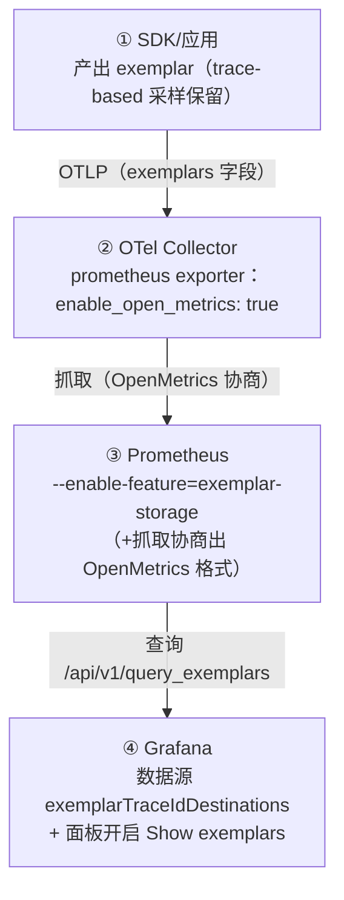

# Exemplars：把"那一次请求"钉在指标曲线上

> 阶段 4 · 笔记 2。指标是聚合的、匿名的——p99 直方图不会告诉你"是哪一次请求慢"。
> Exemplar（样本/示例）把**单个可定位的样本（通常带 trace_id）**挂在直方图桶上，
> 让"看曲线"到"看 trace"只需一次点击。本篇讲透概念、启用链路、版本兼容与价值边界。

## 目录

1. [概念：exemplar 到底是什么](#1-概念exemplar-到底是什么)
2. [格式与协议：OpenMetrics 与 OTLP](#2-格式与协议openmetrics-与-otlp)
3. [完整启用链路（四段缺一不可）](#3-完整启用链路四段缺一不可)
4. [PromQL / API / Grafana 中查看 exemplar](#4-promql--api--grafana-中查看-exemplar)
5. [OTel 链路如何透传 exemplar](#5-otel-链路如何透传-exemplar)
6. [版本兼容注意事项](#6-版本兼容注意事项)
7. [价值与限制](#7-价值与限制)
8. [常见坑](#8-常见坑)
9. [面试题小结](#9-面试题小结)
10. [参考资料](#10-参考资料)

---

## 1. 概念：exemplar 到底是什么

### 1.1 从一个痛点说起

`app_http_request_duration_seconds_bucket{le="1"}` 告诉你"过去 5 分钟有 12354 个请求
落在 1s 桶内"。但你盯着那个 2.4s 的尖峰想问的是：**"是哪几次请求贡献的？"**——
传统 Prometheus 回答不了：时序是聚合产物，个体信息在埋点瞬间就被扔掉了。

Exemplar 的定义（OpenMetrics/Prometheus 语境）：**时间序列上某个数据点附带的一个
"带标签的观测样本"**，包含三个要素：

| 要素 | 说明 | 例子 |
| --- | --- | --- |
| Value | 这次观测的值 | `0.087`（秒） |
| Timestamp | 观测发生的时间 | `1520879607.789` |
| LabelSet | 关联标签（几乎总是 trace 标识） | `trace_id="KOO5S4vxi0o"` |

最常见的载体是**直方图桶**：每个 `_bucket` 序列的数据点可以挂多个 exemplar，
Prometheus 只保留最近 N 个（环形缓冲）。这样"1s 桶"上的 exemplar 就是
"最近落进这个桶的真实请求样本"，点一下就进 trace。

### 1.2 与日志 trace_id 注入的区别

| 维度 | 日志带 trace_id | Exemplar |
| --- | --- | --- |
| 载体 | 单条日志行 | 指标数据点 |
| 覆盖率 | 每条日志都有（在 span 内） | 采样保留（有数量上限） |
| 语义 | "这件事发生了，证据在此" | "这个桶/曲线，由这类样本构成" |
| 典型入口 | 从错误日志点进 trace | 从延迟曲线上的点进 trace |
| 依赖 | 日志系统 | Prometheus 2.26+ / OTel 指标管线 |

两者互补：**排延迟看 exemplar（从指标到个体），排错误看日志（从证据到个体）**。

---

## 2. 格式与协议：OpenMetrics 与 OTLP

### 2.1 OpenMetrics 文本格式

Prometheus 抓取端要识别 exemplar，必须用 OpenMetrics 格式（抓取协商）。文本形态：

```text
# TYPE http_request_duration_seconds histogram
# UNIT http_request_duration_seconds
http_request_duration_seconds_bucket{le="0.1"} 12354 # {trace_id="KOO5S4vxi0o"} 0.087 1520879607.789
http_request_duration_seconds_bucket{le="+Inf"} 24054 # {trace_id="oHg5SJYRHA0"} 1.904 1520879610.112
http_request_duration_seconds_sum 7213.017
http_request_duration_seconds_count 24054
# EOF
```
<!-- 保留原图：OpenMetrics 抓取文本示例输出，非示意图 -->

语法要点：数据点之后 `#` 引出 exemplar，`{标签}` + 观测值 +（可选）时间戳；一条数据点
后可以跟多个 exemplar。规则原文见 OpenMetrics 规范 §Exemplars：
<https://github.com/OpenObservability/OpenMetrics/blob/main/specification/OpenMetrics.md#exemplars>（访问日期：2026-11-04）

### 2.2 OTLP 中的 exemplar

OTLP 指标协议里，每个 NumberDataPoint / HistogramDataPoint 都有 `exemplars` 数组：

```protobuf
message Exemplar {
  repeated KeyValue filtered_attributes = 1; // 附加维度（如 span.name）
  double value = 2;                          // 观测值
  fixed64 time_unix_nano = 3;                // 时间
  // 二选一：trace 关联
  bytes trace_id = 4;
  bytes span_id  = 5;
}
```

SDK 决定"往哪些点放 exemplar、放多少"（ExemplarReservoir 采样器），协议只管运输。
规范：<https://opentelemetry.io/docs/specs/otel/metrics/data-model/#exemplars>（访问日期：2026-11-04）

---

## 3. 完整启用链路（四段缺一不可）

Exemplar 是出了名的"配置链路长"，四段任何一段断了都静默失效：



### ① SDK 侧：让它产出

- **Java**：支持最成熟，`ExemplarFilter` 默认 `trace_based`（有活跃 span 就可能被选中），
  通常无需配置；
- **.NET**：同样内置支持；
- **Go**：写作本文时仍属实验性/未默认开启，关注 OTel Go 发行说明；
- **Python**：写作本文时 SDK 尚未实现 exemplar 输出（规范有、实现未跟上）——
  lab04 因此把链路全部配好但面板上暂无亮点，属预期；
- 规范环境变量（SDK 是否支持看语言）：`OTEL_METRICS_EXEMPLAR_FILTER=trace_based|always_on|always_off`。

### ② Collector 侧（lab04 已配）

```yaml
exporters:
  prometheus:
    endpoint: 0.0.0.0:8889
    enable_open_metrics: true   # exemplar 只能通过 OpenMetrics 格式表达
```

只要 pdata 里指标带 exemplar，exporter 就会带出去；`enable_open_metrics` 决定的是
"以 OpenMetrics 格式暴露抓取端点"。

### ③ Prometheus 侧（lab04 已配）

```yaml
# docker-compose.yml 的 command 段:
- --enable-feature=exemplar-storage    # 持久化 + 更大容量（默认只有极小的内存缓冲）
```

同时确认抓取协商出 OpenMetrics：Prometheus 2.5x 默认支持 `OpenMetricsText1.0`，若你
显式配置了 `scrape_protocols`，不要把 OpenMetrics 从列表里删掉。容量上限由启动参数
`--storage.exemplars.exemplars-limit`（每序列最大 exemplar 数，默认建议显式设，如 100000 全局
用 `--storage.exemplars.max-exemplars`，按版本参数名有差异，以官方文档为准）。

### ④ Grafana 侧（lab04 已配）

```yaml
# Prometheus 数据源
jsonData:
  exemplarTraceIdDestinations:
    - name: trace_id            # exemplar 标签名（collector 输出的就是 trace_id）
      datasourceUid: tempo      # 点击后跳转的目标
      url: "${__value.raw}"
```

面板：Timeseries → Panel options → **Show exemplars** 打钩；exemplar 点位会以
高亮小点叠加在曲线上，悬停/点击跳 Tempo。Explore 查询时勾选 "Show exemplars" 同理。

---

## 4. PromQL / API / Grafana 中查看 exemplar

### 4.1 PromQL 本身查不了 exemplar

设计如此：exemplar 不是时间序列，不能参与 `rate()`/`sum()`。它是**序列数据点的附属物**，
只能通过专用 API 与 UI 消费。别写 `exemplar(...)` 这种幻觉查询。

### 4.2 HTTP API（排障/自动化好用）

```bash
curl -G 'http://localhost:9090/api/v1/query_exemplars' \
  --data-urlencode 'query=app_http_request_duration_seconds_bucket' \
  --data-urlencode 'start=2026-11-04T00:00:00Z' \
  --data-urlencode 'end=2026-11-04T23:59:59Z'
```

返回结构（节选）：

```json
{
  "status": "success",
  "data": {
    "seriesLabels": [
      {
        "__name__": "app_http_request_duration_seconds_bucket",
        "le": "1", "service_name": "demo-app", "http_route": "/api/orders"
      }
    ],
    "exemplars": [
      {
        "labels": { "trace_id": "3f9a8c..." },
        "value": "0.87",
        "timestamp": 1793577600.123
      }
    ]
  }
}
```

拿到 `trace_id` 就能直接查 Tempo（`/api/v2/traces/{traceID}`）——一条 curl 完成
"指标→trace"的闭环。

### 4.3 Grafana 三处入口

1. **Timeseries 面板**：开启 Show exemplars，点位叠加在曲线/柱子上；
2. **Explore（Prometheus）**：查询选项勾选 Show exemplars；
3. **Histogram 面板**：直方图视图下 exemplar 更贴合"桶"的语义（Grafana 10+）。

---

## 5. OTel 链路如何透传 exemplar

完整数据流（以 Java 应用 + lab04 栈为例）：


两个细节：

- **ExemplarReservoir**（SDK 内部）：直方图默认 `AlignedHistogramBucketExemplarReservoir`
  ——**每个桶独立保留一个最新样本**，天然的桶对齐让"1s 桶上的 exemplar"永远代表
  慢请求；简单计数器则是固定大小随机/最新样本池；
- **过滤属性（filtered_attributes）**：exemplar 的标签不必与应用指标同基数——只放
  trace_id/span_id 这类"定位键"，别把 user_id 之类塞进去（它们应该走 trace/span 属性）。

### Collector 上还能"加工"吗？

可以但克制：`filter` processor 可裁剪指标（顺带丢弃其 exemplar）；`transform`/`metricstransform`
重命名/重标签通常保留 exemplar。**聚合类处理器（如 delta→cumulative 转换之外的降采样）
可能破坏 exemplar 语义**——exemplar 描述的是"个体观测"，聚合后的序列配旧 exemplar 就是
张冠李戴。原则：exemplar 链路上少做有损变换。

---

## 6. 版本兼容注意事项

| 组件 | 关键版本 | 说明 |
| --- | --- | --- |
| Prometheus | ≥ 2.26 | exemplar storage 引入（`--enable-feature=exemplar-storage`） |
| Prometheus | ≥ 2.50（scrape_protocols 可配） | 显式控制协商格式；确保 OpenMetrics 在列表内 |
| OpenMetrics | 1.0 | exemplar 语法标准化；旧 0.0.1 草案兼容但建议 1.0 |
| Grafana | ≥ 7.x 支持 UI；10/11 体验完善 | Explore/面板开关 + exemplarTraceIdDestinations |
| OTel Collector | prometheus exporter 的 `enable_open_metrics` 长期存在 | 版本间行为稳定；0.9x 后偶有输出格式微调，升级看 changelog |
| OTel Java SDK | 1.x 全系 | 默认 trace_based filter，开箱即用 |
| OTel .NET SDK | 1.x 全系 | 内置支持 |
| OTel Go SDK | 实验性 | 关注 release notes |
| OTel Python SDK | 写作时未实现 | `OTEL_METRICS_EXEMPLAR_FILTER` 变量遵循规范但无实现 |

三条实践建议：

1. **升级顺序**：先 Prometheus（存储端），再 Collector（格式端），最后动 SDK；
   反过来会出现"上游已产出、下游不识别"的静默丢弃；
2. **验收方法**：升级后 `curl /api/v1/query_exemplars?...` 确认 exemplar 真的在库里，
   不要只看 UI（UI 关闭开关也会显示"没有"）；
3. **多租户/联邦**：exemplar 不参与联邦（federation）转发，跨集群要靠远程查询或
   重复抓取，架构设计时别指望它像 metric 一样被复制。

---

## 7. 价值与限制

### 7.1 价值：排障动线的质变

| 场景 | 没有 exemplar | 有 exemplar |
| --- | --- | --- |
| p99 尖峰 | 猜原因：翻日志、翻 trace 列表碰运气 | 在尖峰时间点直接点 exemplar → 那次慢请求的 trace |
| 灰度对比 | 只能对比聚合曲线 | 新版本桶上的 exemplar 直接展示新版本慢请求样本 |
| 桶边界 bug（桶太粗） | 发现不了 | +Inf 桶上成串 exemplar 一眼看出分布越界 |
| 容量/性能回归 | 关联分析靠时间戳对齐 | 指标与个体证据同点共存，零对齐成本 |

### 7.2 限制（必须心里有数）

| 限制 | 说明 | 对策 |
| --- | --- | --- |
| **存储成本** | 每序列保留最近 N 个（默认上限很小，开启 feature 后由启动参数控制）；exemplar 本身 ~100B 级 | 容量参数显式规划；不要为所有序列开满 |
| **采样而非全集** | ExemplarReservoir 只留部分样本，"点到的"≠"唯一的" | 需要全量证据时下钻日志/trace，exemplar 是入口不是证据库 |
| **PromQL 不可查询** | 不能对 exemplar 做计算/告警 | 它只为"跳转"服务；分析仍用聚合指标 |
| **依赖 trace 采样** | exemplar 携带的 trace_id 可能未被后端采样（head sampling 拒绝） | 高价值路径保证采样率；或采用 tail-based 采样兜底（阶段 5） |
| **抓取间隔敏感** | exemplar 挂在数据点上，抓取间隔内的样本先经 SDK 池子 | 抓取间隔别拉太长（30s~60s 常见） |
| **直方图语义** | 桶边界不当会让 exemplar 失去分辨力（全挤进 +Inf） | 桶边界按业务分布设计（lab04 的 buckets 覆盖 5ms~10s） |

### 7.3 成本估算示例

假设 500 个直方图序列 × 每序列保留 10 个 exemplar × 每条 ~150B ≈ 0.75MB 常驻——
很便宜。真正的成本在于**高基数序列**（每个 label 组合一条序列），基数治理才是前提
（阶段 5 高基数主题）。

---

## 8. 常见坑

| # | 症状 | 根因 | 解法 |
| --- | --- | --- | --- |
| 1 | Grafana 面板没有 exemplar 点 | 四段链路任一断点：SDK 未产出 / collector 未开 open_metrics / Prometheus 未开 feature / 面板未开 Show exemplars | 从底往上验：`/api/v1/query_exemplars` 有没有 → 抓取端点 curl 看格式 → SDK 文档确认支持 |
| 2 | `query_exemplars` 返回空但指标正常 | 存储上限太满（环形缓冲覆盖）或查询窗口不含样本 | 扩大 start/end；检查启动参数容量 |
| 3 | exemplar 点了跳不到 Tempo | `exemplarTraceIdDestinations.name` 与 exemplar 标签名不一致（如 `traceID` vs `trace_id`），或 tempo uid 不对 | 对齐 name=trace_id、uid=tempo |
| 4 | exemplar 一直"最新一个" | SDK reservoir 策略（桶对齐=每桶最新） | 正常现象；想要多样性需 SDK 自定义 reservoir |
| 5 | 升级后 exemplar 消失 | 协商格式被改（scrape_protocols 里丢了 OpenMetrics）或 feature flag 改名 | 按官方 migration notes 核对 |
| 6 | Python 应用怎么配都没有 | Python SDK 未实现（写作时） | 换 Java/.NET 演示，或等实现；链路其余部分保持开启 |
| 7 | exemplar 时间戳和 trace 对不上 | 机器时钟漂移 / 抓取批次延迟 | NTP 校时；trace 查询窗口放宽 |

---

## 9. 面试题小结

**Q1：什么是 exemplar？解决什么问题？**
A：时间序列数据点上附带的"带标签的个体观测样本"（值+时间戳+trace 关联标签），
典型挂在直方图桶上。解决"聚合指标无法定位个体"的问题——从 p99 尖峰一次点击直达
那一次慢请求的 trace。PromQL 不能查询它，只能通过 API/UI 消费。

**Q2：要在 Prometheus + Grafana 栈里启用 exemplar，需要打开哪些开关？**
A：① SDK 产出（Java 默认开）；② Collector prometheus exporter
`enable_open_metrics: true`；③ Prometheus `--enable-feature=exemplar-storage`
（并保证抓取协商 OpenMetrics 格式）；④ Grafana 数据源
`exemplarTraceIdDestinations` 指向 Tempo 且面板开启 Show exemplars。四段缺一不可。

**Q3：exemplar 和把 trace_id 写进指标 label 有什么区别？**
A：label 参与序列切分，trace_id 做 label 等于基数爆炸（每请求一条序列）；
exemplar 不切序列，只是数据点的附属样本，容量受控。这是"个体关联"唯一正确的
指标侧姿势。

**Q4：exemplar 的数量如何控制？存满了怎么办？**
A：SDK 侧由 ExemplarReservoir 决定（直方图默认每桶保留最新一个）；Prometheus 侧
按序列维护环形缓冲，超出上限时最旧的被覆盖。它不是审计数据，丢了不补；需要全量
证据走日志/trace。

**Q5：head-based 采样对 exemplar 有何影响？**
A：exemplar 携带的 trace_id 可能属于未被采样的 trace（点过去查不到 trace）。
缓解：提高关键路径采样率、错误/慢请求走 tail-based 采样回捞（阶段 5 展开）。

---

## 10. 参考资料

- OpenMetrics 规范（Exemplars 章节）：<https://github.com/OpenObservability/OpenMetrics/blob/main/specification/OpenMetrics.md#exemplars>（访问日期：2026-11-04）
- Prometheus exemplars 存储特性开关：<https://prometheus.io/docs/prometheus/latest/feature_flags/#exemplars-storage>（访问日期：2026-11-04）
- Prometheus exemplars API：<https://prometheus.io/docs/prometheus/latest/querying/api/#querying-exemplars>（访问日期：2026-11-04）
- OTLP 指标数据模型 Exemplars：<https://opentelemetry.io/docs/specs/otel/metrics/data-model/#exemplars>（访问日期：2026-11-04）
- OTel SDK 指标配置（OTEL_METRICS_EXEMPLAR_FILTER）：<https://opentelemetry.io/docs/specs/otel/configuration/sdk-environment-variables/#metrics-exemplar>（访问日期：2026-11-04）
- Grafana 配置 Prometheus exemplar 跳转：<https://grafana.com/docs/grafana/latest/datasources/prometheus/configure-prometheus-data-source/#exemplars>（访问日期：2026-11-04）
- OTel Collector prometheus exporter：<https://github.com/open-telemetry/opentelemetry-collector-contrib/tree/main/exporter/prometheusexporter>（访问日期：2026-11-04）
- 本工作区相关笔记：[三大支柱关联](correlation.md)、[采样策略（阶段 5）](../05-production/README.md)

---

## 附：ASCII 图替换清单

| 原 ASCII 图位置（章节标题） | 原图内容简述 | 替换结果 |
| --- | --- | --- |
| 3. 完整启用链路（四段缺一不可） | SDK → Collector → Prometheus → Grafana 四段纵向链路图（带交互协议边标注） | flowchart TD |

### 保留说明

- 2.1 OpenMetrics 文本格式：OpenMetrics 抓取文本的示例输出，属数据样例而非示意图，保留原样。
