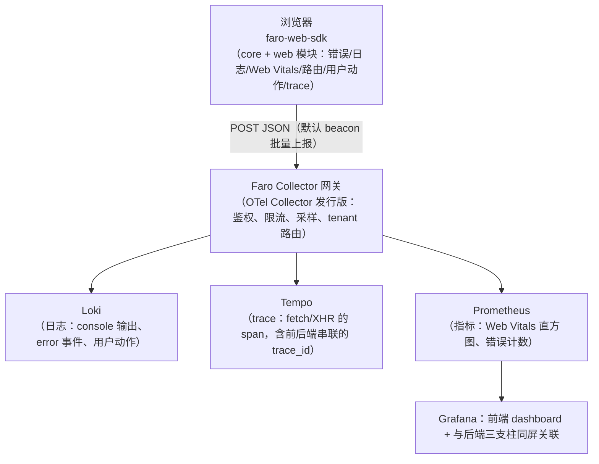
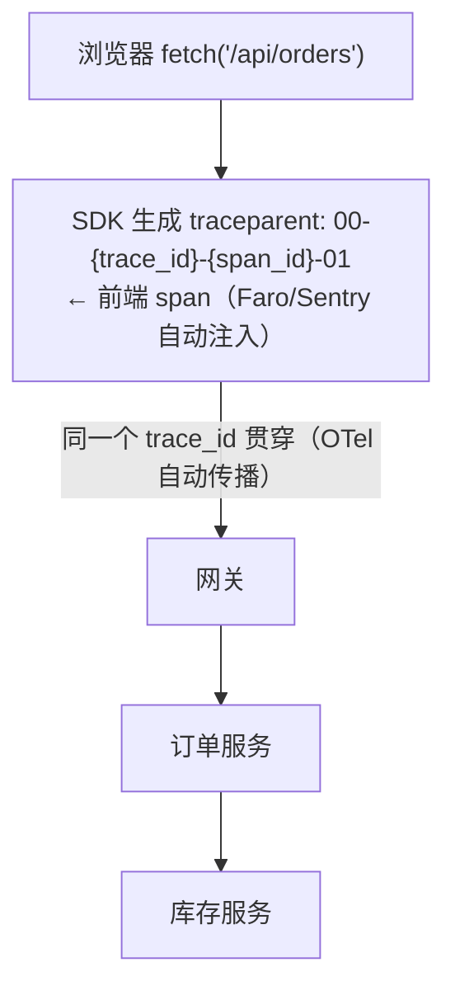
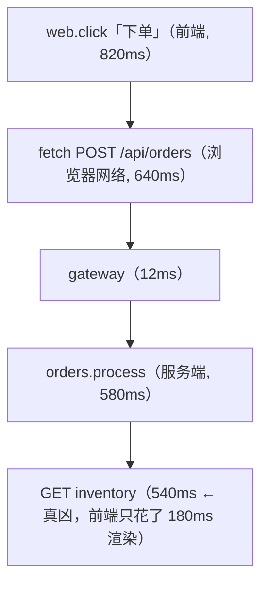

# 前端可观测性 / RUM：Web Vitals、Grafana Faro 与 Sentry

> 后端三支柱再完美，也回答不了"用户为什么看到白屏/点了没反应/按钮错位"——
> **用户浏览器里发生的故障，只有用户浏览器里的数据能证明**。
> 本篇讲前端可观测性的主干：RUM 与合成监控的分工、Web Vitals（LCP/INP/CLS）、
> Grafana Faro（把前端接入 LGTM 三支柱）、Sentry（错误追踪事实标准）、
> 前后端 trace 串联，以及隐私与采样。这是三支柱故事线的"最后一公里"，
> 与 [correlation.md](correlation.md) 的 trace 关联机制直接衔接。
> 设计视角续篇：[系统设计 03 · 前端 RUM SDK 设计](../06-system-design/sdk-design-rum.md)（如果自己写 RUM SDK，采集与上报怎么设计）。

## 目录

1. [为什么需要前端可观测性：RUM vs 合成监控](#1-为什么需要前端可观测性rum-vs-合成监控)
2. [Web Vitals：Google 定义的用户体验指标](#2-web-vitalsgoogle-定义的用户体验指标)
3. [Grafana Faro：前端数据接入 LGTM 栈](#3-grafana-faro前端数据接入-lgtm-栈)
4. [Sentry：错误追踪的事实标准](#4-sentry错误追踪的事实标准)
5. [前后端 trace 串联：把浏览器变成 trace 的起点](#5-前后端-trace-串联把浏览器变成-trace-的起点)
6. [Session Replay 与隐私边界](#6-session-replay-与隐私边界)
7. [采样与数据量控制](#7-采样与数据量控制)
8. [常见坑](#8-常见坑)
9. [面试题小结](#9-面试题小结)
10. [参考资料](#10-参考资料)

---

## 1. 为什么需要前端可观测性：RUM vs 合成监控

真实故障的分工视角：

| 故障 | 后端指标能看到吗 |
|---|---|
| CDN 边缘节点慢/证书问题 | ❌（源站正常） |
| JS 报错导致下单按钮无响应 | ❌（请求根本没发出） |
| 第三方脚本（统计/广告）阻塞渲染 | ❌ |
| 弱网/低端机型上资源加载 40s | ❌（后端只见正常延迟） |
| CLS 布局跳动让用户点错按钮 | ❌ |

两类前端监控，互补而非替代：

| | **RUM**（Real User Monitoring） | **合成监控**（Synthetic） |
|---|---|---|
| 数据来源 | 真实用户浏览器上报 | 机器人定时访问（Lighthouse/Playwright） |
| 覆盖 | 真实地域/机型/网络分布 | 固定探针（机房视角） |
| 能发现 | 真实体验问题、区域性故障 | 发布前回归、跨地区可用性、竞品对比 |
| 盲区 | 修 bug 依赖用户流量（低流量站数据稀） | 不是真实用户（无真实 Cookie/登录态/机型） |
| 工具 | Faro、Sentry、商业 RUM | Lighthouse CI、Checkly、Grafana Synthetic Monitoring |

成熟组合：**合成监控守发布门（CI 里跑 Lighthouse 阈值），RUM 看真实世界**。

## 2. Web Vitals：Google 定义的用户体验指标

Core Web Vitals（Google 排名信号，阈值是"75 分位用户"体验）：

| 指标 | 衡量 | good | poor | 常见根因 |
|---|---|---|---|---|
| **LCP**（Largest Contentful Paint） | 加载：主内容出现时间 | ≤2.5s | >4.0s | 服务端慢（TTFB）、大图无优化、阻塞资源、CDN |
| **INP**（Interaction to Next Paint） | 交互响应：点击/按键到下一帧渲染 | ≤200ms | >500ms | 长任务（JS 主线程阻塞）、大 bundle、第三方脚本 |
| **CLS**（Cumulative Layout Shift） | 视觉稳定：布局意外跳动累计 | ≤0.1 | >0.25 | 无尺寸的图片/广告位、字体注入跳动、动态插入 DOM |

辅助指标：TTFB（后端+网络，与后端指标直接可比）、FCP、Long Task、JS 错误率。

两个工程要点：

1. **INP 于 2024-03 取代 FID** 成为 Core Web Vital：FID 只测"第一次交互的输入延迟"
   （几乎测不出问题），INP 测全页面生命周期的**完整交互到渲染延迟**（P98 取最差感）——
   老资料还在讲 FID，评估体系要切到 INP；
2. 报告口径用**分位数**（p75），均值会被长尾完全误导——这与后端延迟用 p99 而非 avg
   是同一课（[promql.md](../01-metrics/promql.md) 的 histogram 哲学在前端同样成立）。

```js
// 前端采集：web-vitals 库（Google 官方，Faro/Sentry 内部同样用它）
import { onLCP, onINP, onCLS } from 'web-vitals';
onLCP(metric => report({ name: 'LCP', value: metric.value,
                         rating: metric.rating,        // 'good'|'needs-improvement'|'poor'
                         page: location.pathname, ua: navigator.userAgent }));
```

## 3. Grafana Faro：前端数据接入 LGTM 栈

Faro = Grafana 开源的 **Web SDK + 收集网关**，把浏览器事件转成 LGTM 栈的原生数据
（这也意味着它与 [unified-dashboard.md](unified-dashboard.md) 的统一排障面板直接合流）：



接入（核心三行）：

```js
import { initializeFaro } from '@grafana/faro-web-sdk';
import { Tracing, getWebInstrumentations } from '@grafana/faro-web-telemetry';

initializeFaro({
  url: 'https://faro-gw.example.com/collect/{app-name}',
  app: { name: 'shop-web', version: process.env.APP_VERSION },  // 版本号=发布对齐的关键
  instrumentations: [...getWebInstrumentations()],              // errors/console/webvitals/route
  traces: { ...new Tracing().options },                        // fetch/XHR span（见 §5）
});
```

**选它的理由**：前端数据落进与后端同一套存储/面板体系（`service_name="shop-web"` 的
Loki 流、Tempo 里的前端 span），排障动线不用换工具；
**不选的理由**：错误聚合/Replay 的产品成熟度不如 Sentry——两者组合使用
（Sentry 管错误工作流，Faro 管三支柱关联）是常见形态。

## 4. Sentry：错误追踪的事实标准

Sentry 的核心循环（SaaS 或自托管）：**错误发生 → 聚合成 Issue → 通知 → 定位 →
标记 Resolved → 同一错误回归时 Re-regression 告警**。

比"console.error 上报"多出的关键能力：

| 能力 | 说明 | 工程意义 |
|---|---|---|
| **错误指纹聚合** | 堆栈结构化后 hash 分组（同一 bug 的 10 万次报错 = 1 个 Issue） | 告警不打爆，按 Issue 排优先级 |
| **Source Map 还原** | 上传打包前后的 map，堆栈还原到 TS/JSX 源码行 | 没有它，堆栈是 `main.3f2a.js:1:82341` 的天书 |
| **Release 标记** | 每个错误标注版本；新版本引入的错误自动标记 | "v2.3.1 引入 12 个新错误"——发布质量门禁 |
| **Breadcrumbs** | 错误前的用户操作/网络请求/控制台轨迹 | 复现路径自带上下文 |
| **Environments/Tags** | env、user（脱敏后）、route、feature flag | 按环境分流、按维度过滤 |
| **Performance / Replay / Profiling** | 拓展模块：事务追踪、会话回放、前端 profiling | 一个 SDK 的全家桶（按需开） |

```js
import * as Sentry from '@sentry/browser';
Sentry.init({
  dsn: 'https://xxx@o0.ingest.sentry.io/1',
  release: 'shop-web@' + process.env.APP_VERSION,   // CI 注入，与 Release 对齐
  environment: 'prod',
  tracesSampleRate: 0.1,        // 性能事务采样（见 §7）
  replaysSessionSampleRate: 0.01, replaysOnErrorSampleRate: 1.0,  // 出错的会话必录
  beforeSend: (event) => sanitize(event),           // 出口脱敏（PII 擦除最后防线）
});
```

**自托管 vs SaaS**：自托管（Docker Compose 起全套）数据不出域，但要养
（Postgres/Redis/Kafka/ClickHouse 一串依赖）；错误数据含用户上下文的团队，
数据主权要求高时选自托管或商业 SaaS 的 EU/本地区域。

## 5. 前后端 trace 串联：把浏览器变成 trace 的起点

后端排障的最后盲区是"请求在到达后端**之前**的耗时"（DNS/TLS/TTFB/前端渲染）。
做法与后端跨服务传播完全同构——**W3C traceparent 从浏览器注入**
（[context-propagation.md](../03-tracing/context-propagation.md) 的同一套规范）：



于是 Grafana/Tempo 里看到的是**一条从 click 开始的完整 trace**：



要点：

1. 前端 span 的价值不只是"加上网络耗时"——**归因边界**变了：以前"前端说后端慢、
   后端说前端慢"的扯皮，现在 trace 里一目了然（fetch span 的 `http.response.status`
   与 server span 之间的 gap 就是网络/排队）；
2. 实现上是 SDK 拦截 fetch/XHR 注入 header（Faro 的 `Tracing`、Sentry 的
   `tracePropagationTargets` 配置允许清单），**注意 CSP `connect-src` 与允许的域名**；
3. 采样策略要前后端一致：前端 head sample 10% 但后端 tail-based 全采错误——
   出错 trace 的 header flags 是 `01`，后端配合 tail sampling 就能保留
   （[sampling.md](../05-production/sampling.md) 的组合拳）。

## 6. Session Replay 与隐私边界

Replay（录制 DOM 变化而非视频，回放可搜索）是近年 RUM 标配（Sentry Replay、
Faro 集成 rrweb）：

- 价值：错误 + 用户操作轨迹 = "所见即所得的复现"；配合 breadcrumbs 定位体验类问题；
- **隐私是硬边界**：
  - 默认遮蔽策略要开满（`maskAllText`/`maskAllInputs`、URL 脱敏规则）；
    密码框/支付信息**绝对**不能进录制，PII 擦除要在 `beforeSend` 出口再兜一层；
  - 法律面：录制属于用户数据处理，GDPR/个保法下要有告知与同意（合规团队签字）；
  - 采样率独立控制（正常会话 0.1%~1%，**出错会话 100%**：`replaysOnErrorSampleRate`）；
- 成本：Replay 体积远大于事件流，全量录制既贵又危险——按"错误触发"录制是主流默认。

## 7. 采样与数据量控制

RUM 的量纲：`PV × (事件数 + span 数 + replay 概率)`，三个旋钮分开拧：

| 旋钮 | 建议 | 理由 |
|---|---|---|
| 错误/异常事件 | **100%**（量天然小） | 错误就是低频高价值，采样丢不起 |
| Web Vitals | 100% 上报、分位数在后端算 | 每页一次，量可控；前端只报原始值 |
| 性能 trace（fetch span） | 1%~10% head sampling | 高流量站全采无意义，注意与后端 tail sampling 对齐（§5.3） |
| Replay | 正常会话 ≤1%，错误会话 100% | 见 §6 |

再配合**出口裁剪**：白名单 route 才上报、剔除内网/爬虫 UA、非生产环境低采样——
这些规则放在 Faro Collector/Sentry 网关侧统一执行，别散落在各前端代码里。

## 8. 常见坑

1. **Source Map 公开可下载**：构建产物把 `.map` 一起发到 CDN——等于把全部源码公开
   （还可能带 key）。map 只上传 Sentry/内部服务，CDN 上删除并在构建产物剥离
   `//# sourceMappingURL`；
2. **CSP 没放行上报域名**：SDK 的 collect 请求被 CSP 拦截，前端监控"静默失明"数周
   没人发现——SDK 要有 sendFailure 自监控（Faro 的 transport 错误指标/事件）；
3. **广告拦截器吞掉上报**：拦截器对已知监控域名（sentry.io 等）按 URL 杀，
   采样产生**系统性偏差**（装拦截器的用户消失）——自托管自定义域名可显著缓解；
4. **SPA 路由不更新**：单页应用的"页面切换"没有导航事件，Web Vitals 不重置、
   页面维度全记成首屏——用 SDK 的 route instrumentation（history pushState 钩子）；
5. **release 版本不注入**：错误堆栈对不上发布、回归检测失效。release 必须由 CI
   注入且与部署系统同源（同一个 git sha）；
6. **均值汇报 LCP**："平均 LCP 1.8s 达标"掩盖了 p75 4.2s 的南美用户——
   分地区/机型分位数汇报是底线；
7. **trace 断在浏览器**：fetch header 注入只对同源/白名单域生效，第三方 API 域
   不传 traceparent（也不该传）——trace 覆盖范围要在文档里写清楚，别假设全链路；
8. **前端 trace 采样率拉满**：高流量站 100% 采 fetch span，Tempo/Sentry 账单爆炸，
   而排障价值与 5% 采样几乎相同（配合错误必采）。

## 9. 面试题小结

**Q1：RUM 与合成监控的区别与组合方式？**
A：RUM 采真实用户浏览器数据（真实分布、能发现真实体验问题、依赖流量）；
合成监控用固定探针定时访问（可测低流量/预发布/多地域可用性，但非真实环境）。
组合：合成监控守发布门（CI 阈值）+ RUM 看真实世界。

**Q2：Core Web Vitals 三大指标？INP 与 FID 的区别？**
A：LCP（主内容加载 ≤2.5s）、INP（交互响应 ≤200ms）、CLS（布局稳定 ≤0.1），
阈值按 p75 口径。INP 在 2024 年取代 FID：FID 只测第一次交互的输入延迟
（几乎测不出问题），INP 覆盖全页面生命周期所有交互的"到下一帧渲染"完整延迟。

**Q3：Grafana Faro 的架构与定位？**
A：Web SDK（错误/日志/Web Vitals/路由/trace 采集）→ Faro Collector 网关
（OTel Collector 形态：鉴权/限流/采样）→ Loki/Tempo/Prometheus → Grafana。
定位：让前端成为 LGTM 三支柱的原生公民，与后端同屏排障；错误工作流弱于 Sentry，
常与 Sentry 组合。

**Q4：为什么 Sentry 需要 Source Map？部署时要注意什么？**
A：线上是压缩混淆的 bundle，堆栈地址无意义；上传 map 后堆栈可还原到源码行。
注意：map 不能公开可访问（等于泄漏源码），只上传到 Sentry，CDN 产物删除 map 引用。

**Q5：前端如何与后端 trace 串联？**
A：SDK 拦截 fetch/XHR，按 W3C Trace Context 生成/注入 `traceparent` header，
trace 从用户交互（click span）开始贯穿网关到所有后端服务；同一 trace_id 下，
前后端的耗时归因边界一目了然。采样要与后端策略对齐（错误 trace 必留）。

**Q6：Session Replay 的隐私红线有哪些？**
A：默认遮蔽（文本/输入/URL 规则）、支付与密码信息绝对不录制、出口 beforeSend
再脱敏一层、GDPR/个保法下需告知同意；正常会话低采样（≤1%）、错误会话 100%。

**Q7：前端监控的四类数据分别怎么定采样率？**
A：错误事件 100%（低频高价值）；Web Vitals 100%（每页一次，后端算分位数）；
性能 trace 1~10%（与后端 tail sampling 配合保证错误全留）；Replay 正常 ≤1%、
错误 100%。统一规则放采集网关侧，不散落前端。

## 10. 参考资料

- web.dev Core Web Vitals（含 INP 取代 FID）：<https://web.dev/articles/vitals>（访问日期：2026-11-04）
- web-vitals JS 库：<https://github.com/GoogleChrome/web-vitals>（访问日期：2026-11-04）
- Grafana Faro 文档：<https://grafana.com/docs/pyroscope/next/faro/>（访问日期：2026-11-04）
- Sentry JS SDK 文档：<https://docs.sentry.io/platforms/javascript/>（访问日期：2026-11-04）
- Sentry 自托管：<https://develop.sentry.dev/self-hosted/>（访问日期：2026-11-04）
- W3C Trace Context：<https://www.w3.org/TR/trace-context/>（访问日期：2026-11-04）
- Grafana Synthetic Monitoring：<https://grafana.com/docs/grafana-cloud/testing/synthetic-monitor/>（访问日期：2026-11-04）
- 本工作区相关笔记：[correlation.md](correlation.md)、[context-propagation.md](../03-tracing/context-propagation.md)、[sampling.md](../05-production/sampling.md)、[unified-dashboard.md](unified-dashboard.md)

---

## 附：ASCII 图替换清单

| 原 ASCII 图位置（章节标题） | 原图内容简述 | 替换结果 |
| --- | --- | --- |
| 3. Grafana Faro：前端数据接入 LGTM 栈 | 浏览器 SDK → Faro Collector 网关 → Loki/Tempo/Prometheus → Grafana 架构图 | flowchart TD |
| 5. 前后端 trace 串联：把浏览器变成 trace 的起点（注入） | 浏览器生成 traceparent 后贯穿网关 → 订单服务 → 库存服务的传播图 | flowchart TD |
| 5. 前后端 trace 串联：把浏览器变成 trace 的起点（trace 瀑布） | click → fetch → gateway → orders.process → GET inventory 的 span 嵌套树 | flowchart TD |
