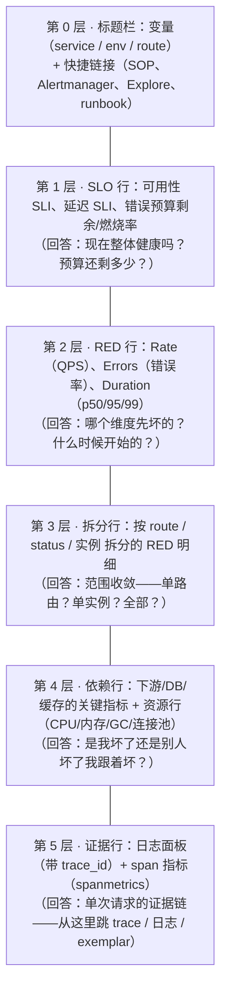
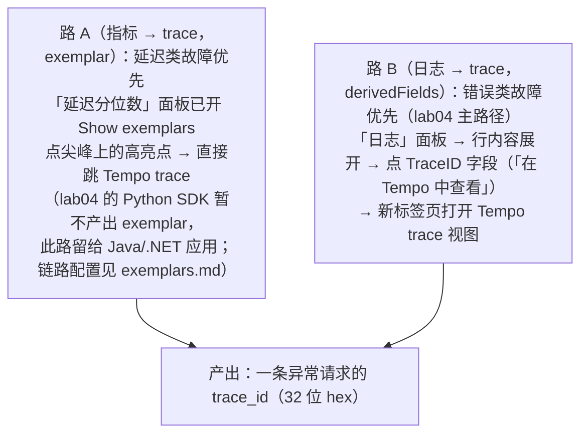
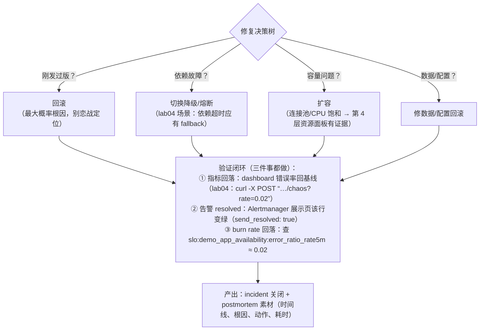
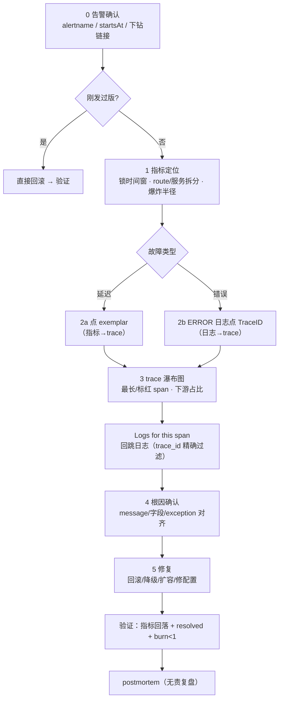

# 统一仪表盘与排障 SOP：让凌晨三点的你不需要动脑

> 阶段 4 · 笔记 5。三支柱关联（[correlation.md](correlation.md)）解决的是
> "能不能跳"，本篇解决"**往哪跳、按什么顺序跳**"：好的服务总览 dashboard
> 长什么样、一次 incident 的标准排障剧本（含 lab04 的真实点击路径）、
> 如何把 SOP 固化进 dashboard 与告警链接，以及 postmortem 文化。
> 配套 dashboard：[lab04 three-pillars.json](../../labs/lab04-three-pillars/grafana/dashboards/three-pillars.json)。

## 目录

1. [为什么"统一"仪表盘是排障效率的最大杠杆](#1-为什么统一仪表盘是排障效率的最大杠杆)
2. [好的服务总览 dashboard：RED + 资源 + 依赖](#2-好的服务总览-dashboardred--资源--依赖)
3. [lab04 统一 dashboard 逐面板解读](#3-lab04-统一-dashboard-逐面板解读)
4. [incident 排障 SOP：五步剧本（含 lab04 点击路径）](#4-incident-排障-sop五步剧本含-lab04-点击路径)
5. [把 SOP 固化到 dashboard 与告警链接](#5-把-sop-固化到-dashboard-与告警链接)
6. [dashboard 工程化：provisioning、变量、阈值即代码](#6-dashboard-工程化provisioning变量阈值即代码)
7. [postmortem 文化要点](#7-postmortem-文化要点)
8. [常见坑与排查](#8-常见坑与排查)
9. [面试题小结](#9-面试题小结)
10. [参考资料](#10-参考资料)

---

## 1. 为什么"统一"仪表盘是排障效率的最大杠杆

事故恢复时间（MTTR）的分解：

```text
MTTR = 检测时间（告警）+ 确认时间（是不是真的）+ 定位时间（哪里坏了）
     + 修复时间（改什么）+ 验证时间（好了吗）
```
<!-- 保留原图：MTTR 分解等式，公式而非示意图 -->

检测靠告警（[slo.md](slo.md)）、修复靠变更，而**确认、定位、验证三段全部发生在
dashboard 上**。三个支柱三套系统、十几个面板来回切换时，每次"切系统 + 对时间窗 +
对服务名"都要 1~2 分钟且极易出错；统一仪表盘 + 互相跳转把这三段的单位动作
从"分钟"压到"秒"。设计目标只有一句话：

> **告警响起后，值班的人从第一屏出发，不离开浏览器、不查 wiki、不猜菜单，
> 5 次点击内完成"定位到根因证据"。**

反面模式先列出来（很多公司 dashboard 之痛的来源）：

| 反模式 | 症状 |
| --- | --- |
| 面板坟场 | 300 张 dashboard，没人说得清入口是哪张；事故中现场搜索 5 分钟 |
| 指标堆砌 | 每个面板 10 条曲线、共用一个 Y 轴，看不出任何异常 |
| 孤岛视图 | 指标、日志、trace 三张 dashboard 无链接，靠肉眼对时间戳 |
| 只有资源没有服务 | CPU/内存一应俱全，唯独没有"用户看到的错误率" |
| 无变量无下钻 | 一个服务复制 20 份 dashboard，改一个阈值要改 20 处 |

---

## 2. 好的服务总览 dashboard：RED + 资源 + 依赖

### 2.1 黄金结构：自上而下五层

一个"服务总览"（Service Overview）dashboard 的经典布局——**从用户视角到
机器视角**，异常时视线自然向下流动：



### 2.2 每层的面板清单（速查表）

| 层 | 面板 | 数据源 | 典型 PromQL / LogQL（lab04 口径） |
| --- | --- | --- | --- |
| SLO | 可用性 SLI / 预算燃烧 | Prometheus | `slo:demo_app_availability:error_ratio_rate5m`（recording rule） |
| RED·R | 请求速率 | Prometheus | `sum(rate(app_http_requests_total{service_name=~"$service"}[1m]))` |
| RED·E | 错误率（阈值=SLO 预算） | Prometheus | `sum(rate(...{status=~"5.."}[5m])) / sum(rate(...[5m]))` |
| RED·D | 延迟分位数 | Prometheus | `histogram_quantile(0.99, sum by (le)(rate(..._bucket[$__rate_interval])))` |
| 拆分 | 按 route 速率/错误 | Prometheus | `sum by (http_route)(rate(...))` |
| 依赖 | 下游服务 RED / DB 连接池 | Prometheus（或 spanmetrics） | `traces_spanmetrics_calls_total{service_name="demo-inventory"}` |
| 资源 | CPU / 内存 / GC / FD | Prometheus | `process_cpu_seconds_total`、`go_goroutines` 等（node_exporter） |
| 证据 | 日志（可跳 trace） | Loki | `{service_name=~"$service"} \| json` |
| 证据 | span 调用速率（派生） | Prometheus | `topk(5, sum by (span_name)(rate(traces_spanmetrics_calls_total[$__rate_interval])))` |

### 2.3 三个设计细节

1. **Use Method 行（USE：Utilization/Saturation/Errors）只放在第 4 层**：
   资源指标是"原因维度"，永远不要放在第一屏——第一屏只放用户可感知的
   SLO/RED（这是 [slo.md](slo.md) 反模式 2 的 dashboard 版）；
2. **阈值即上下文**：错误率面板画出 `vector(0.001)` 的预算虚线、延迟面板画出
   1s SLO 红线——看一眼就知道"越没越线"，不需要背数字；
3. **spanmetrics 是兜底的 RED**：没有埋点的内部服务，只要有 trace 覆盖，
   `traces_spanmetrics_*` 就能给出按 `span_name` 拆分的 RED（lab04 的
   「Span 调用速率」面板，Tempo metrics_generator remote_write 而来）。

---

## 3. lab04 统一 dashboard 逐面板解读

对照 [three-pillars.json](../../labs/lab04-three-pillars/grafana/dashboards/three-pillars.json)
（uid：`lab04-three-pillars`，访问 `http://localhost:3000/d/lab04-three-pillars`）：

| 面板 | 类型 | 作用 | SOP 中的角色 |
| --- | --- | --- | --- |
| 排障 SOP（顶部文本面板） | text | 内嵌 markdown 剧本 + 混沌开关命令 | 第 0 步：值班第一眼 |
| 请求速率 / 错误率 / 延迟 p99（三连 stat） | stat | RED 一眼行；错误率阈值色即预算 0.1%/1% | 第 1 步：确认健康度 |
| 请求速率（按 route） | timeseries | 范围收敛：哪条路由异常 | 第 2 步：定范围 |
| 延迟分位数 p50/p95/p99 | timeseries | 红线 1s SLO；**已开启 Show exemplars** | 第 2 步：定时间 + 点 exemplar |
| 错误率（按 route + 预算虚线） | timeseries | 精确定位坏路由与起始时间 | 第 2 步：定时间 |
| Span 调用速率（Tempo 派生指标） | timeseries | 无埋点服务的 RED 兜底（span 维度） | 第 2 步：定位嫌疑 span |
| 日志（JSON 自带 trace_id） | logs | 每行 TraceID 可点击 → Tempo（derivedFields） | 第 3 步：拿 trace 入口 |

顶部链接栏（dashboard links）预置了四个入口：Explore · Trace 搜索（Tempo）、
Explore · 日志（Loki）、混沌开关（`/chaos`）、Alertmanager 通知展示页
（`/alerts`）——第 5 节会讲这些链接为什么是 SOP 的一部分。

dashboard 变量：`$service`（`label_values(app_http_requests_total, service_name)`），
所有面板共用——切到 `demo-inventory` 即完成"对比正常/异常服务"的动作。

---

## 4. incident 排障 SOP：五步剧本（含 lab04 点击路径）

> 前置：lab04 已启动（`podman compose up -d --build`），后台流量 ~2.5rps，
> Grafana <http://localhost:3000>（admin/admin）。本剧本的每一步都写明了
> "动作 → 看什么 → 产出什么结论"。

### 第 0 步 · 告警确认（30 秒）

```text
触发：Alertmanager 通知（lab04：http://localhost:8000/alerts 展示页 或 :9093 原生 UI）
动作：读三样东西——alertname（哪个 SLO 哪一档）、startsAt（从几点开始烧）、
      description 里的下钻链接
产出：一句话 incident 描述，例如
      "demo-app 可用性 SLO 档位 1（burn>14.4）自 23:47 firing，疑似全局性故障"
分流：若是刚发过版 → 直接跳第 5 步（回滚优先，定位其次）
```
<!-- 保留原图：第 0 步操作说明清单（触发/动作/产出/分流），非示意图 -->

lab04 演示命令（等 3~5 分钟生效）：

```bash
curl -X POST "http://localhost:8000/chaos?rate=0.6"   # 注入 60% 错误率
```

### 第 1 步 · 指标定位：时间与范围（1~2 分钟）

```text
动作：打开统一 dashboard（description 里的链接，或 :3000/d/lab04-three-pillars）
      ① 顶部三连 stat：错误率颜色（超 0.1% 预算变黄/红）
      ② 「错误率」时间序列：把时间窗缩放到 startsAt 前后（Grafana 快捷键
         shift+拖拽 / 点异常段放大）
      ③ 用 $service 变量对比 demo-app 与 demo-inventory
看什么：异常开始的确切时间；是单路由还是全路由；单服务还是多服务
产出：范围结论——"23:47 起 /api/orders 错误率 2%→60%，inventory 正常 →
      问题在 demo-app 自身或其调用路径，爆炸半径 = 单服务"
```
<!-- 保留原图：第 1 步操作说明清单（动作/看什么/产出），非示意图 -->

关键纪律：**先锁时间窗再下钻**。后面每一步的查询都会继承当前时间窗，
窗不对，exemplar/trace/日志全是噪声。

### 第 2 步 · 拿到一条"坏请求"的 trace_id（1 分钟，两条路）



### 第 3 步 · trace 定位慢/错 span（1~2 分钟）

```text
动作：在 Tempo trace 瀑布图里——
      ① 找最长的 span（延迟故障）或标红 status=ERROR 的 span（错误故障）
      ② 看 span 属性（lab04 的 orders.process 带 app.order.id、app.slow_tenant）
      ③ 跨服务段：GET（client）→ demo-inventory GET /api/inventory，
         看下游段耗时占比 → 判断"是我慢还是下游慢"
      ④ 点「Logs for this span」回跳日志（tracesToLogsV2 自动执行
         {service_name="demo-app"} | json | trace_id="<id>"）
产出：嫌疑 span 名 + 所在服务，例如"orders.process 内 payment 段标 ERROR，
      orders 服务自身"
```
<!-- 保留原图：第 3 步操作说明清单（动作①~④/产出），非示意图 -->

### 第 4 步 · 日志确认根因（1 分钟）

```text
动作：第 3 步跳回的 Loki 查询已按 trace_id 过滤——只看这一个请求的日志：
      ① ERROR 行的 message 与字段（lab04：order processing failed +
         reason="payment_gateway_timeout"、order_id）
      ② 对照 span 上的 exception 事件（record_exception 记录的 TimeoutError）
      ③ 需要更多同类样本：去掉 trace_id 过滤，改
         {service_name="demo-app"} | json | level="ERROR" | line_format
         "{{.reason}}" 看错误分布
产出：根因假设 + 证据，例如"支付网关超时（reason 字段 100% 是
      payment_gateway_timeout），非代码 bug，是依赖故障"
```
<!-- 保留原图：第 4 步操作说明清单（动作①~③/产出），非示意图 -->

### 第 5 步 · 修复与验证（修复本身 + 2~3 分钟观察）



### SOP 全景图（可贴进值班手册）



一次完整演练的参考耗时：熟悉环境 5~8 分钟；熟练后 **5 分钟内完成 0→4 步**。

---

## 5. 把 SOP 固化到 dashboard 与告警链接

SOP 写在 wiki 里 = 没人看。三个"长在事故现场"的固化点：

### 5.1 dashboard 顶部文本面板（lab04 已做）

three-pillars.json 的第一个面板就是 SOP markdown（含混沌开关命令）。
好处：打开 dashboard 的第一屏就是剧本；改 SOP = 改 JSON = 走代码评审。

### 5.2 dashboard links 快捷入口（lab04 已做）

```json
"links": [
  { "title": "Explore · Trace 搜索（Tempo）", "url": "/explore?...datasource%3A%22tempo%22..." },
  { "title": "Explore · 日志（Loki）", "url": "/explore?...datasource%3A%22loki%22..." },
  { "title": "混沌开关（查看当前错误率）", "url": "http://localhost:8000/chaos" },
  { "title": "Alertmanager 通知展示页", "url": "http://localhost:8000/alerts" }
]
```

原则：**SOP 里出现的每个系统，都必须是 dashboard 顶部一键可达**（保持时间窗
`keepTime: true` 尤其重要——跳转不丢上下文）。

### 5.3 告警 annotations 里的下钻链接（lab04 已做）

```yaml
# slo-burn-rate.yml
annotations:
  description: >-
    近 1h 错误比例 {{ $value | humanizePercentage }}，SLO 目标 99.9%。
    下钻：http://localhost:3000/d/lab04-three-pillars
```

进阶做法（生产模板）：通知里给三个链接——
`dashboard 链接`（点开即定位到该服务）、`runbook_url`（处置手册锚点）、
`Alertmanager silence 预填链接`（处理中一键静默防 repeat 轰炸）。
这样通知本身就是 SOP 的第 0 步。

### 5.4 Grafana 数据链接（data links）——面板级下钻

面板的 query result 上可配 data link：例如「错误率」曲线按 route 拆分的序列上
配链接，点击 `route="/api/orders"` 的序列 → 跳到按该 route 过滤的日志查询。
属于"第 2 步 → 第 3 步"的直达电梯，值得花 10 分钟配置。

---

## 6. dashboard 工程化：provisioning、变量、阈值即代码

lab04 的做法即生产做法：

| 实践 | lab04 落地 | 为什么 |
| --- | --- | --- |
| provisioning 预置数据源 | `grafana/provisioning/datasources/datasources.yaml`（uid 固定 prometheus/loki/tempo） | uid 固定 = dashboard JSON 与关联配置可版本化引用，不随环境漂移 |
| provisioning 预置 dashboard | `provisioning/dashboards/dashboards.yaml` + `dashboards/three-pillars.json` | dashboard 即代码，重建环境零手工 |
| 变量驱动多服务 | `$service` 变量 + 所有面板引用 | 一张总览覆盖所有服务，拒绝复制粘贴 |
| 阈值与 SLO 同源 | 错误率阈值 0.001/0.01、延迟红线 1s——与 slo-burn-rate.yml 同口径 | 面板上看到的"线"和告警判定用同一组数字，改 SLO 时两处同步 |
| 刷新与时间窗 | refresh 10s、默认 now-15m | 排障时窗口小刷新快；SLO 面板可另配 1h/6h |
| 文本面板放 SOP | 顶部 markdown 面板 | 见 §5.1 |

管理建议：dashboard JSON 进 git；CI 里用 `json.load` 校验 + uid 唯一性检查；
大团队用 Terraform/Grizzly 管理文件夹权限。**别在 UI 上手改生产 dashboard**
——下次 provisioning 会把你的修改覆盖掉（lab04 的 provider 允许 UI 改动是实验便利）。

---

## 7. postmortem 文化要点

排障结束不是终点，**postmortem（事后复盘）是把这次 MTTR 投资变成下次
MTTR 缩短**的复利机制。

### 7.1 好的 postmortem 长什么样

```markdown
# Postmortem：demo-app 可用性 SLO 违约（2026-11-04）

## 影响（先写用户，不写系统）
- 23:47~00:12（25 分钟），/api/orders 错误率 60%，约 4.5 万次下单失败
- 可用性 SLO 28d 预算烧掉 5.2%；触发档位 1 页呼一次

## 时间线（只记事实，不带情绪）
- 23:41 v2.8.0 发布完成（支付 SDK 升级）
- 23:47 SLOAvailabilityBurnRateFast firing，oncall 收到页呼
- 23:49 确认范围：单服务单路由；inventory 正常
- 23:52 trace 显示 payment span 全量超时；日志 reason=payment_gateway_timeout
- 23:55 决策回滚（发版时间吻合，先回滚后定位）
- 23:58 回滚完成，错误率回落
- 00:12 告警 resolved；预算燃烧率回到 <1

## 根因（技术根因 + 流程根因）
- 技术：新 SDK 默认连接池 10，旧网关需要预热握手，高峰全排队超时
- 流程：该发布未灰度（直接 100%）；压测未覆盖新 SDK 路径

## 行动项（有人、有期限、可验证）
- [ ] 支付 SDK 回归压测（trade 团队，11-11，验收：压测报告含连接池场景）
- [ ] 发布流程强制灰度 5%→50%→100%（平台组，11-18，验收：流水线默认值）
- [ ] dashboard 第 4 层补下游连接池饱和度面板（observability，11-08）

## 做得好的
- 告警 2 分钟内触达；SOP 前 4 步 5 分钟内完成；回滚决策果断
```

### 7.2 文化要点（每条都有反面案例）

| 要点 | 反面案例 |
| --- | --- |
| **无责（blameless）**：追问流程与系统，不追责任人 | "XX 手滑点了发布"→ 下次没人敢写真时间线 |
| **必写影响与预算消耗**：用 SLO 语言量化 | "服务抖了一下"→ 管理层无法判断该不该投人 |
| **行动项可验证**：有 owner、截止日、验收标准 | "以后加强发布审核"→ 永远不会发生 |
| **所有 incident 都写**（不只 P0） | 只复盘大事故 → 小事故的模式从未被看见 |
| **快速出稿**：24~48h 内初稿 | 一个月后记忆失真，时间线靠拼 |
| **定期回顾旧 action item** | 同一根因一年复盘三次 |

postmortem 与告警/SOP 的闭环：每次复盘至少回看三个工件——告警够不够快
（调 [slo.md](slo.md) 档位）、dashboard 够不够直达（补面板/链接）、SOP 步骤
是否成立（更新文本面板与 runbook）。**复盘的产出应该体现为仓库里的 diff**，
而不是又一份文档。

---

## 8. 常见坑与排查

| # | 症状 | 根因 | 解法 |
| --- | --- | --- | --- |
| 1 | 点开 dashboard 一片空白 | 时间窗默认 now-15m，但数据是 1h 前的；或变量默认值选了没有数据的服务 | 排障第一步永远先核时间窗与变量；面板配 description 写明预期 |
| 2 | exemplar 点了没反应 | Python SDK 未产出 exemplar（lab04 预期），或四段链路断（见 [exemplars.md](exemplars.md) §8） | 用路 B（日志 TraceID）；换 Java/.NET 应用验证 exemplar |
| 3 | 日志面板 TraceID 字段点不动 | derivedFields 正则与日志格式不匹配（`trace_id` 字段名/紧凑 JSON） | 对照 correlation.md §9 checklist；复制一行真实日志验证正则 |
| 4 | "Logs for this span" 查出空 | span 的 service.name 与 Loki 的 service_name label 值不一致；时间窗太窄 | Label browser 核对标签值；tracesToLogsV2 的 spanStart/EndTimeShift 已给 ±15m，浏览器窗口放宽 |
| 5 | 面板数据"来自未来/过去" | 浏览器时区 vs 容器 UTC；Grafana timezone=browser（lab04 默认） | dashboard 统一 timezone（`utc` 或浏览器）；日志 ts 明确 UTC ISO |
| 6 | 跳转 Explore 后查询不带时间窗 | 链接没配 `keepTime` 或 URL 未带时间参数 | dashboard links 加 `"keepTime": true`；SOP 固化时实测每个链接 |
| 7 | 修改 dashboard 后重启丢失 | provisioning 覆盖（provider 允许更新时以文件为准） | dashboard 改动直接改 JSON 提交 git（lab04 allowUiUpdates 仅为实验便利） |
| 8 | 「Span 调用速率」面板空 | Tempo metrics_generator 未预热（2~3 分钟）或 remote_write 失败 | `podman compose logs tempo \| grep -i generator`；Prometheus 确认 `--web.enable-remote-write-receiver` |
| 9 | 多人同时排障结论打架 | 各看各的 dashboard/时间窗 | SOP 第 1 步强制"锁时间窗"动作；incident 频道同步统一视图链接 |
| 10 | SOP 文本面板过期 | 服务演进后面板/命令变了，SOP 没人改 | SOP diff 纳入服务变更清单；复盘必查"SOP 是否按剧本走通" |

**lab04 五步验证自检脚本**（对照 §4 剧本的每步产出）：

```bash
# 第 1 步：指标定位——错误率现状
curl -s 'http://localhost:9090/api/v1/query' \
  --data-urlencode 'query=slo:demo_app_availability:error_ratio_rate5m' | python3 -m json.tool

# 第 2 步：日志里有带 trace_id 的 ERROR 行吗（derivedFields 的原料）
curl -s 'http://localhost:3100/loki/api/v1/query_range' \
  --data-urlencode 'query={service_name="demo-app"} | json | level="ERROR"' \
  --data-urlencode 'limit=1' | head

# 第 3 步：Tempo 有对应 trace 吗
curl -s 'http://localhost:3200/api/search?tags=service.name%3Ddemo-app' | head

# 第 5 步：修复后 burn 回落、告警 resolved
curl -s http://localhost:9093/api/v2/alerts | python3 -m json.tool | grep -E '"status"|"alertname"'
```

---

## 9. 面试题小结

**Q1：你会如何为一个线上服务设计总览 dashboard？**
A：五层结构自上而下：SLO 行（可用性/延迟 SLI 与错误预算）→ RED 行 →
按 route/status/实例的拆分行 → 依赖与资源行（下游 RED、连接池、CPU/内存）→
证据行（可跳转的日志与 spanmetrics）。第一屏只放用户可感知指标，资源指标
属于"原因"放下面；所有面板由 service 变量驱动，阈值与 SLO 数字同源；
顶部放 SOP 文本与各系统快捷链接。

**Q2：接到告警后你的排障流程是什么？**
A：五步剧本：① 告警确认（哪个 SLO、哪一档、何时开始，刚发版则优先回滚）；
② 指标定位（统一 dashboard 锁时间窗，按 route/服务收敛爆炸半径）；
③ 拿 trace_id（延迟走 exemplar，错误走日志 TraceID）；
④ trace 瀑布图定位最长/错误 span，用 "Logs for this span" 回跳日志确认根因；
⑤ 修复（回滚/降级/扩容）后三重验证：指标回落、告警 resolved、burn rate < 1。
全程在统一 dashboard + 关联跳转内完成。

**Q3：为什么排障时强调"先锁时间窗"？**
A：后续所有查询（exemplar、trace、日志）都继承当前时间窗；窗不对会引入历史
噪声、漏掉真正异常段，多人协同时也容易各看各的数据。锁定异常起始时间前后
是最小化噪声、对齐团队认知的第一个动作。

**Q4：统一 dashboard 的"统一"体现在哪？不只是把图画在一起吧？**
A：体现在三件事：① 一屏覆盖三支柱且带**互跳配置**（tracesToLogsV2 /
derivedFields / exemplarTraceIdDestinations），指标↔日志↔trace 是链接不是复制
粘贴 trace_id；② 变量与时间窗全局共享，一次选择全部面板生效；③ SOP 与
链接固化在 dashboard 内（文本面板 + links + 告警 annotations 下钻链接），
dashboard 即 runbook 入口。

**Q5：什么是 blameless postmortem？为什么重要？**
A：复盘聚焦流程与系统缺陷而非个人过失的复盘文化。重要性：只有保证"写真实
时间线不会被追责"，才能拿到真实数据（人的行为、决策时点），行动项才能落在
流程上；追责式复盘的结局是下次事故的信息被隐藏，MTTR 不降反升。好 postmortem
的要素：影响量化（含错误预算消耗）、事实时间线、技术+流程双根因、可验证的
行动项、48 小时内出稿。

**Q6：MTTR 怎么分解？可观测性主要优化哪一段？**
A：MTTR = 检测 + 确认 + 定位 + 修复 + 验证。SLO burn-rate 告警优化检测；
统一 dashboard 优化确认；三支柱关联跳转优化定位；SOP/回滚演练优化修复决策
速度；指标回落 + resolved 通知优化验证。修复本身（写代码/扩容）往往不是
大头——前三段才是可观测性的主战场。

---

## 10. 参考资料

- Google SRE Book · Postmortem Culture：
  <https://sre.google/sre-book/postmortem-culture/>（访问日期：2026-11-04）
- Google SRE Workbook · Postmortem 模板与案例：
  <https://sre.google/workbook/postmortem-examples/>（访问日期：2026-11-04）
- Grafana dashboard provisioning 官方文档：
  <https://grafana.com/docs/grafana/latest/administration/provisioning/>（访问日期：2026-11-04）
- Grafana 数据链接与 dashboard links：
  <https://grafana.com/docs/grafana/latest/dashboards/build-dashboards/manage-dashboard-links/>（访问日期：2026-11-04）
- Grafana 最佳实践（dashboard 设计）：
  <https://grafana.com/docs/grafana/latest/dashboards/best-practices/>（访问日期：2026-11-04）
- RED 方法（Weave Flux / Tom Wilkie）与 USE 方法（Brendan Gregg）：
  <https://www.brendangregg.com/usemethod.html>（访问日期：2026-11-04）
- 本工作区相关笔记：[三大支柱关联](correlation.md)、[Exemplars](exemplars.md)、
  [SLO 与错误预算](slo.md)、[Alertmanager 深入](alertmanager-in-depth.md)、
  配套 dashboard：[lab04 three-pillars.json](../../labs/lab04-three-pillars/grafana/dashboards/three-pillars.json)

---

## 附：ASCII 图替换清单

| 原 ASCII 图位置（章节标题） | 原图内容简述 | 替换结果 |
| --- | --- | --- |
| 2.1 黄金结构：自上而下五层 | 服务总览 dashboard 第 0~5 层的纵向层级结构图 | flowchart TD |
| 4. incident 排障 SOP · 第 2 步 | 路 A（exemplar）/ 路 B（日志 TraceID）两条取 trace_id 的分支路径 | flowchart TD |
| 4. incident 排障 SOP · 第 5 步 | 修复决策树（四种根因分支）+ 验证闭环 + 产出 | flowchart TD |

### 保留说明

- 第 0 步 / 第 1 步 / 第 3 步 / 第 4 步的操作说明块：触发/动作/看什么/产出式平铺清单，无对象-关系结构，非示意图，保留原样（紧随其代码块已加保留注释）。
- 1. 为什么"统一"仪表盘是排障效率的最大杠杆（MTTR 分解）：等式而非示意图，保留原样（已加保留注释）。
