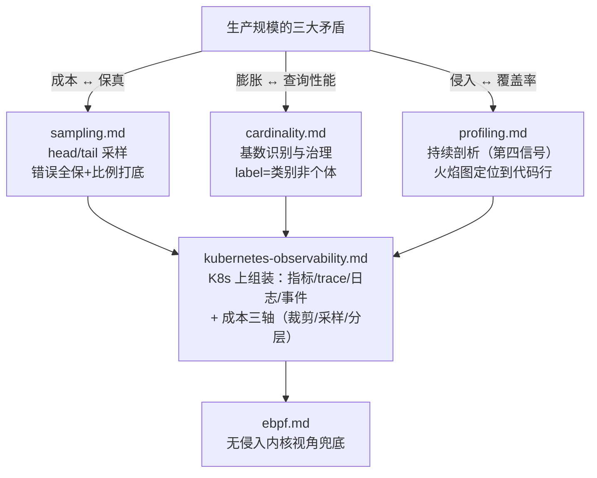

# 阶段 5 · 生产进阶（索引）

> 本阶段回答一个问题：**当系统从"能观测"走向"生产规模"，可观测性自身如何保持便宜、可靠、无侵入？**
>
> 四条主线：采样（省钱不丢真相）、高基数（治理指标膨胀）、持续剖析（下钻到代码行）、eBPF（无侵入内核视角），以及把它们组装到 Kubernetes 的工程实践。

## 笔记目录

| 笔记 | 主题 | 一句话摘要 | 配套实验 |
| --- | --- | --- | --- |
| [sampling.md](./sampling.md) | 采样策略 | head-based（SDK 端 ParentBased/TraceIDRatioBased）与 tail-based（Collector tail_sampling：错误/慢全保 + 正常按比例）的成本-保真权衡、决策树、policy 详解、与 exemplar/SLO 的相互影响及八大生产坑。 | `labs/lab05-sampling-and-profiling/sampling/` |
| [cardinality.md](./cardinality.md) | 高基数问题 | label 取值组合成 series 的"乘法爆炸"：TSDB 倒排索引为何怕它、真实来源（user_id/URL/IP 当 label）、识别方法（TSDB status API）、治理清单与各 TSDB 容忍度对比。 | — |
| [profiling.md](./profiling.md) | 持续性能剖析 | profile 作为第四信号：火焰图读法（on/off-CPU、宽高含义、形态速查）、Pyroscope 架构与 SDK/eBPF 双采集模式、span 级 profiling 思路、CPU/内存泄漏排查实例。 | `labs/lab05-sampling-and-profiling/profiling/` |
| [ebpf.md](./ebpf.md) | eBPF 可观测性 | 内核可编程沙箱带来无侵入、节点级、全语言的观测能力：syscall/网络/TCP 重传/安全审计示例，工具生态（bcc/bpftrace/Pixie/Hubble/kindling/Inspektor Gadget），与 OTel 的融合及 macOS 平台限制。 | — |
| [kubernetes-observability.md](./kubernetes-observability.md) | K8s 可观测性 | 分层观测清单与关键指标（working_set/OOM 判据）、kube-prometheus-stack 与 ServiceMonitor 发现机制、OTel Operator 自动注入、日志采集方案对比、事件/审计、成本三轴治理与 LGTM 一句话。 | — |

## 本阶段知识地图

## 阅读建议（按角色）

- **后端/平台工程师（首次学习）**：sampling → cardinality → kubernetes-observability，跑完两个 lab；
- **性能优化方向**：profiling → ebpf，重点吃透火焰图读法与 off-CPU 场景；
- **SRE / 值班排障**：sampling（采样与 SLO 交互）+ cardinality（止血手段）+ k8s 笔记的"常见坑"清单；
- **准备面试**：每篇末尾的"面试题小结"共 35+ 题，覆盖采样一致性、TSDB 基数、火焰图语义、eBPF 价值主张、ServiceMonitor 机制等高频考点。

## 阶段定位（承上启下）

- **承接阶段 1~4**：指标/日志/trace 三支柱与告警体系已建立，本阶段解决"规模化之后"的经济性与可维护性问题；
- **外延阅读**：OTel 规范（profiles 信号）、各 TSDB 官方文档、Brendan Gregg 的性能分析体系；
- 所有外部引用均标注 URL 与访问日期（统一为 2026-11-04）。

## 配套实验

见 `../../labs/lab05-sampling-and-profiling/`：

1. **sampling/**：双 Collector（无采样 vs tail_sampling）+ 双 Jaeger 对照，验证"错误 trace 100% 保留、正常流量 ~10%"；
2. **profiling/**：Pyroscope + 故意制造 CPU 热点的 Python 应用，从火焰图定位热点函数。

两个实验均可独立 `podman compose up -d` 一键启动，支持 Apple Silicon（linux/arm64）。

---

## 附：ASCII 图替换清单

| 原 ASCII 图位置（章节标题） | 原图内容简述 | 替换结果 |
| --- | --- | --- |
| 本阶段知识地图 | 四篇笔记与"生产规模三大矛盾"的关系图（三分支汇入 K8s 组装，再到 eBPF 兜底） | flowchart TD |

无保留未替换的图。
