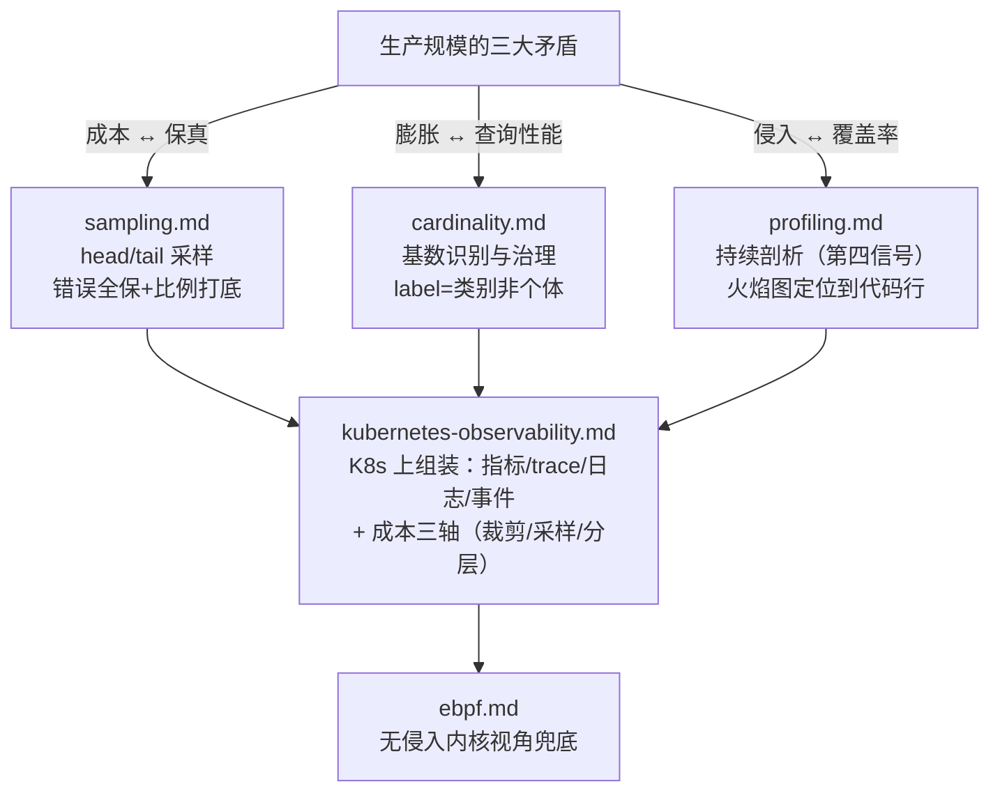

# 阶段 5 · 生产进阶（索引）

> 本阶段回答一个问题：**当系统从"能观测"走向"生产规模"，可观测性自身如何保持便宜、可靠、无侵入？**
>
> 四条主线：采样（省钱不丢真相）、高基数（治理指标膨胀）、持续剖析（下钻到代码行）、eBPF（无侵入内核视角），以及把它们组装到 Kubernetes 的工程实践。

## 笔记目录

| 笔记 | 主题 | 一句话摘要 | 配套实验 |
| --- | --- | --- | --- |
| [sampling.md](./sampling.md) | 采样策略 | head-based（SDK 端 ParentBased/TraceIDRatioBased）与 tail-based（Collector tail_sampling：错误/慢全保 + 正常按比例）的成本-保真权衡、决策树、policy 详解、与 exemplar/SLO 的相互影响及八大生产坑。 | `labs/lab05-sampling-and-profiling/sampling/` |
| [cardinality.md](./cardinality.md) | 高基数问题 | label 取值组合成 series 的"乘法爆炸"：TSDB 倒排索引为何怕它、真实来源（user_id/URL/IP 当 label）、识别方法（TSDB status API）、治理清单与各 TSDB 容忍度对比。 | — |
| [profiling.md](./profiling.md) | 持续性能剖析 | profile 作为第四信号：火焰图读法（on/off-CPU、宽高含义、形态速查）、Pyroscope 架构与 SDK/eBPF 双采集模式、span 级 profiling 思路、CPU/内存泄漏排查实例。 | `labs/lab05-sampling-and-profiling/profiling/` |
| [ebpf.md](./ebpf.md) | eBPF 可观测性 | 内核可编程沙箱带来无侵入、节点级、全语言的观测能力：syscall/网络/TCP 重传/安全审计示例，工具生态（bcc/bpftrace/Pixie/Hubble/kindling/Inspektor Gadget），与 OTel 的融合及 macOS 平台限制。 | — |
| [kubernetes-observability.md](./kubernetes-observability.md) | K8s 可观测性 | 分层观测清单与关键指标（working_set/OOM 判据）、kube-prometheus-stack 与 ServiceMonitor 发现机制、OTel Operator 自动注入、日志采集方案对比、事件/审计、成本三轴治理与 LGTM 一句话。 | — |

## 本阶段知识地图

## 阅读建议（按角色）

- **后端/平台工程师（首次学习）**：sampling → cardinality → kubernetes-observability，跑完两个 lab；
- **性能优化方向**：profiling → ebpf，重点吃透火焰图读法与 off-CPU 场景；
- **SRE / 值班排障**：sampling（采样与 SLO 交互）+ cardinality（止血手段）+ k8s 笔记的"常见坑"清单；
- **准备面试**：每篇末尾的"面试题小结"共 35+ 题，覆盖采样一致性、TSDB 基数、火焰图语义、eBPF 价值主张、ServiceMonitor 机制等高频考点。

## 阶段定位（承上启下）

- **承接阶段 1~4**：指标/日志/trace 三支柱与告警体系已建立，本阶段解决"规模化之后"的经济性与可维护性问题；
- **外延阅读**：OTel 规范（profiles 信号）、各 TSDB 官方文档、Brendan Gregg 的性能分析体系；
- 所有外部引用均标注 URL 与访问日期（统一为 2026-11-04）。

## 配套实验

见 `../../labs/lab05-sampling-and-profiling/`：

1. **sampling/**：双 Collector（无采样 vs tail_sampling）+ 双 Jaeger 对照，验证"错误 trace 100% 保留、正常流量 ~10%"；
2. **profiling/**：Pyroscope + 故意制造 CPU 热点的 Python 应用，从火焰图定位热点函数。

两个实验均可独立 `podman compose up -d` 一键启动，支持 Apple Silicon（linux/arm64）。

---

## 附：ASCII 图替换清单

| 原 ASCII 图位置（章节标题） | 原图内容简述 | 替换结果 |
| --- | --- | --- |
| 本阶段知识地图 | 四篇笔记与"生产规模三大矛盾"的关系图（三分支汇入 K8s 组装，再到 eBPF 兜底） | flowchart TD |

无保留未替换的图。

---

## 阶段导读：为什么要有这个阶段

阶段 0-4 建立的体系有一个隐含前提：**一切都很小**——单机 compose、全量采样、低基数的演示 label、一天几兆的日志量。生产规模会同时打破这三个假设，本阶段就围绕这三组矛盾展开：

1. **成本 ↔ 保真**：全量 trace 存不起，于是有 head/tail 采样——错误与慢 trace 全保、正常流量按比例（sampling）；
2. **膨胀 ↔ 查询性能**：label 乱用会让序列数乘法爆炸，拖垮 TSDB 甚至整个集群（cardinality）；
3. **侵入 ↔ 覆盖率**：埋点有边界（语言、第三方依赖、业务内部），profiling 与 eBPF 补上"代码行"与"内核视角"两个盲区（profiling、ebpf）。

最后把这一切组装到 Kubernetes（kubernetes-observability）：Operator 自动注入、ServiceMonitor 发现机制、日志采集方案对比、事件与审计、成本三轴治理。在整条路径中的位置：阶段 4 留下的两个"教学默认"（全量采样、trace_id 当 Loki label）在这里被替换成生产姿势；阶段 6 讲"成本是第一等设计约束"，其工程手段全部出自本阶段。

配套实验 [labs/lab05-sampling-and-profiling/](../../labs/lab05-sampling-and-profiling/README.md) 分两组：[sampling](../../labs/lab05-sampling-and-profiling/sampling/README.md) 用双 Collector 对照验证 tail 采样"错误全保、正常按比例"的效果；[profiling](../../labs/lab05-sampling-and-profiling/profiling/README.md) 用故意制造 CPU 热点的应用，从火焰图定位热点函数。两个实验互相独立，可按需选做。

## 常见误区与正解

- **误区一："采样 = 丢数据 = 不可观测。"**
  为什么错：tail 采样对错误与慢 trace 100% 保留，牺牲的只是"正常请求的冗余样本"；指标本来就是聚合数据，与 trace 采样率无关，SLO 统计不受影响。
  正解：按信号分别定策略——trace 用采样（head 打底 + tail 保关键）、日志分级采样、指标不采样只做基数与粒度控制。
- **误区二："高基数等出问题再治理。"**
  为什么错：基数爆炸没有报错，表现为内存缓涨、查询变慢、最后 OOM，且影响面是**整个 Prometheus 实例**（所有监控对象陪葬）；事后再删 label 要动全部采集端。
  正解：把序列数当健康指标持续监控（TSDB Status API），label 设计走评审；`user_id`、完整 URL、IP 这类个体值进日志与 trace，不进指标 label。
- **误区三："profiling 是性能专家的重型工具，平时不开。"**
  为什么错：持续剖析（SDK 或 eBPF 采集）以很低的固定开销常驻，把"问题发生后再复现"变成"问题发生时数据已在"，这正是它区别于临时压测的价值。
  正解：CPU/内存/分配 profile 常开低频采集，与 trace 关联（span 级 profiling），告警触发时直接看火焰图。
- **误区四："有了 eBPF 就不用埋点了。"**
  为什么错：eBPF 从内核视角看到的是系统调用与网络事件，拿不到业务语义——它说得出"这个 pod 在重传"，说不清"哪一次下单慢了、属于哪个业务操作"。
  正解：eBPF 与 OTel 互补——无侵入兜底 + 语义化埋点主线；接手黑盒系统先用 eBPF 摸底。
- **误区五："装完 kube-prometheus-stack 就算 K8s 可观测了。"**
  为什么错：那只覆盖指标一环；日志方案、trace 链路、事件/审计、成本治理都没有落脚点。
  正解：按 kubernetes-observability 的分层清单逐层检查，每层回答"用什么采、存哪里、谁来看"。

## 踩坑速查

| 现象 | 可能原因 | 处置 |
| --- | --- | --- |
| Prometheus 内存缓涨后 OOM 重启 | 高基数 label 序列爆炸 | TSDB Status API 找 top series，砍掉或降维该 label |
| tail_sampling 丢了错误 trace | 策略顺序/等待窗口/决策缓存容量问题 | 核对延迟阈值与 `num_traces` 上限，错误策略放前面 |
| exemplar 点位跳不到 trace | exemplar 指向被采样丢弃的 trace | 错误路径保证全保留，或日志里兜底记录 trace_id |
| Pod 反复 OOMKilled 重启 | limit 低于真实 working_set | 用 working_set（而非 RSS）判据重设 limit |
| ServiceMonitor 不被发现 | label 与 Prometheus CR 的 selector 不匹配 | 对齐 release 标签，再看 Operator 日志 |
| Pyroscope 收不到某语言数据 | SDK 未启用或传输端点配错 | 先用本地模式验证 push，再查 endpoint 与采样配置 |
| 节点上 eBPF 工具加载失败 | 内核版本过低或权限不足 | 核对内核版本与 capability，容器需特权或 bpf 权限 |
| 采样后服务图/延迟统计失真 | 用被采样的 trace 反推全局统计 | 在采样之前用 spanmetrics 派生指标，或直接用应用 RED 指标 |

权威入口：OpenTelemetry 官方文档 `https://opentelemetry.io/docs` （官方文档） 、Kubernetes 官方文档 `https://kubernetes.io/docs` （官方文档） 、Grafana Pyroscope 文档 `https://grafana.com/docs/pyroscope` （官方文档） 。

## 与下一阶段的接口：进入系统设计前

阶段 5 的四个工程手段，到阶段 6 会全部翻转成**设计决策**——这正是把"会用"与"会设计"连起来的枢纽。进入阶段 6 前，先想清楚这些对应关系：

- **采样 → 接入层设计**：lab05 里 tail_sampling 跑在 Collector 上，阶段 6 的 ingestion-pipeline 会回答"尾部采样为什么必须部署在管道这一层、为什么不能放进 SDK 或存储"；
- **基数治理 → 租户配额设计**：本阶段的"序列数是健康指标"，到多租户平台里变成"每个租户的基数预算与超限处置"——阶段 6 总体设计的多租户一节直接引用它；
- **profiling → 第四信号的存储与查询**：profile 数据是"随时间堆叠的树"，它的存储与查询形态和三种传统信号都不一样，阶段 6 会让你思考第四信号该用什么引擎；
- **K8s 实践 → 平台形态**：ServiceMonitor/OTel Operator 的"发现与注入"机制，是阶段 6 讨论"自研平台怎么接入新服务"的对照样本。

同时带三个问题进阶段 6（它们会在容量算例里被逐个用到）：我的系统一个月三种信号各产生多少量？采样把存储成本压到多少、代价是什么？当前 label 里哪几个是未来的事故源？

一个返工信号：做阶段 6 开篇的容量估算算例时，如果对"每秒多少 span、平均 span 大小、保留 7 天要多少磁盘"这类数字完全没感觉——回 sampling 与 cardinality 两篇重读成本模型小节，那是估算的地基。反过来，如果你能在阶段 6 的每张决策表旁边说出"我在阶段 X 的 lab 里见过对应现象"，说明这条学习路径你已经串起来了。

## 输出自测题：三道场景题

阶段 5 的能力都藏在权衡里，三道场景题检验你是否能"给出有代价意识的做法"：

1. **大促压测在即，trace 量预计翻十倍，可观测预算不变。** 你的方案？
   要点：tail 采样保住错误与慢 trace，正常流量按比例下调；在采样**之前**用 spanmetrics 派生服务级指标，保证 RED 统计不受 trace 采样影响；日志与指标说明"为什么不受影响"——它们本来就走了不同的成本模型。答出"砍什么、保什么、为什么"三层才算完整。
2. **有同事提议把 `city_id` 加进指标 label"按城市看流量"，接着又想把 `user_id` 也加上。** 你怎么回应？
   要点：两件事分开谈——`city_id` 如果类别数可控，属于合理的低基数维度，但要先估序列乘法并纳入基数预算；`user_id` 是典型个体值，拒绝进 label，需求引导到日志或 trace 里解决；顺带把"序列数监控与基数预算"的治理机制讲给对方。
3. **一个 Pod 反复 OOMKilled 重启，但容器里看到的 RSS 并不高。** 怎么回事、怎么查？
   要点：OOM 判据是 cgroup 的 working_set 而非进程 RSS，working_set 包含不可回收的页缓存等，会高于 RSS；按 working_set 口径重新评估 limit；再用持续剖析看内存分配热点，判断是真实泄漏还是 limit 设置失真。

三道题分别对应 sampling、cardinality、profiling 与 K8s 四篇的核心权衡。能说出"方案 + 代价 + 验证手段"才算过关。

## 一页速记：生产化六句话

1. 采样不是丢数据：错误与慢 trace 全保，正常流量按比例；全局统计要在采样之前派生。
2. 基数没有报错只有账单：序列数本身要当成健康指标持续监控。
3. label 表类别不表个体：`user_id`、完整 URL、IP 进日志与 trace，不进指标。
4. 火焰图补齐代码行：宽是占用占比，深是调用栈深度，优先看宽的板块。
5. eBPF 拿内核事实，OTel 拿业务语义，两者互补不互替。
6. K8s 上按分层清单逐层检查：指标、日志、trace、事件、审计、成本，缺哪层补哪层。

每句背后的完整权衡在对应笔记里；说不透的那句，先回 lab05 复现一次现象再回来读。
