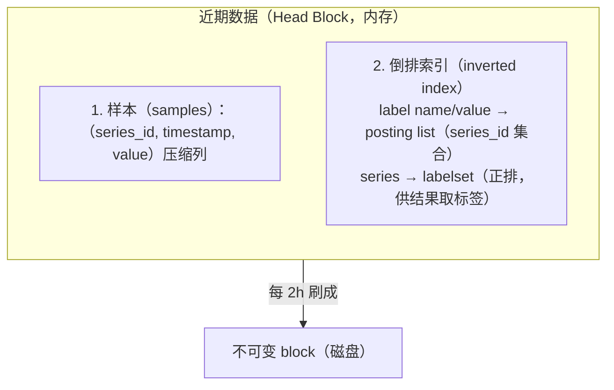

# 高基数问题（Cardinality）：TSDB 的头号杀手

> 阶段 5 · 生产进阶 · 笔记 5-2
>
> 高基数是指标系统在生产环境里最常见、也最隐蔽的故障来源：它不报错，只是让存储膨胀、查询变慢、最后 OOM。本篇覆盖：什么是基数、为什么 TSDB 怕高基数、真实的高基数来源、如何识别与度量、治理手段清单、以及各 TSDB 对高基数的容忍度对比。

---

## 1. 什么是基数（Cardinality）

### 1.1 定义

在指标语境下，**基数 = 一个 label（维度）的不同取值数量**；而大家真正关心的"时间序列基数"是：

```
series 数 = 各 label 取值的笛卡尔积（只统计实际出现过的组合）
```

例子：

```promql
http_requests_total{method="GET", route="/api/users", status="200", user_id="12345"}
```

如果 `user_id` 有 100 万个不同值，仅这一个指标就是 **100 万条 series**——即使用户数再翻十倍，指标定义一行都没变。

### 1.2 一个直观的计算例子

```python
method   = 5 种        # GET/POST/PUT/DELETE/PATCH
route    = 120 个接口
status   = 8 种        # 200/301/400/401/403/404/422/500
pod      = 15 个副本
tenant   = 2 000 个租户

series = 5 × 120 × 8 × 15 × 2000 = 144,000,000   # 1.44 亿条！
```

对比一下"同样的信息"如果 `tenant` 不做 label：

```python
series = 5 × 120 × 8 × 15 = 48,000               # 4.8 万条，差 3000 倍
```

**结论先行：label 应该用来描述"类别的身份"（class of behavior），而不是"个体的身份"（identity of an entity）。** 这是 Robusta（k8sGPT 团队）与 Grafana 都反复强调的原则——一个 label 值集合应该是"可枚举且增长缓慢"的。

### 1.3 指标、日志、trace 对基数的容忍度天差地别

| 信号 | 数据模型 | 对高基数的态度 | 原因 |
| --- | --- | --- | --- |
| Metrics（TSDB） | 预聚合的序列（label → 时间轴） | **极不友好** | 每个新组合都是一条新序列，写入前就要建索引 |
| Logging（Loki 等） | 追加写日志行，label 只选流 | 中等 | 高 label 基数 → 流（stream）数爆炸，成本/查询都会炸 |
| Tracing | 按需查询的事件树 | 天然高基数 | 每条 trace 都是唯一的，本来就是事件型数据 |
| Profiling | 采样聚合的符号树 | 天然高基数 | 按函数符号聚合，不按用户聚合 |

所以治理总原则是：**高维度信息放到日志、trace、exemplar 里去，不要塞进指标 label。**

---

## 2. 为什么 TSDB 怕高基数

以 Prometheus 为代表的主流 TSDB（VictoriaMetrics、Mimir、Thanos 的 LE 判断类似）存储模型分两层：



### 2.1 高基数的四重代价

**① 倒排索引膨胀**
每个 `user_id="12345"` 都要变成一个索引项，指向它的 posting list。基数 100 万 = 100 万个索引项 + 对应 posting list 条目。索引常驻内存——这是 Prometheus 内存上涨的第一元凶。

**② 内存中的 Head 追踪每个活跃 series**
每条活跃 series 在 Head 里都有 chunk（样本缓冲区）+ 元数据。series 数 × 每 series 约 1~2 KB 起步的固定开销，百万级 series 光元数据就是数 GB。

**③ 查询扇出（query fan-out）**
一次聚合查询如：

```promql
sum by (route) (rate(http_requests_total[5m]))
```

需要先从倒排索引求交得到 series 集合，再逐条读数据。如果匹配到 80 万条 series，即使最终 `sum` 结果只有 120 行，中间也要处理 80 万条序列——查询超时、Prometheus OOM、Grafana 面板转圈，都是这么来的。

**④ compaction / 查询超时 / 快照变慢**
块合并时要重写索引，索引越大 compaction 越久；`/api/v1/status/tsdb` 打开都卡。

参考：Prometheus TSDB 存储 https://prometheus.io/docs/prometheus/latest/storage/ （访问日期：2026-11-04）

### 2.2 Loki 的"流基数"是同款问题

Loki 的 label 只用来**分桶成 stream**（例如 `{app="api", env="prod"}`），日志内容进索引的只有少量 filter（旧版）或干脆不进（新版 pattern/chunk 方案）。如果把 `user_id` 放进 Loki label：

- 每个用户一条 stream，写入端 stream 数爆炸，ingester 内存暴涨；
- 单条 stream 数据量太小，压缩率崩塌（Loki 的性价比来自"同 stream 大量日志一起压缩"）；
- 官方明确把"高流基数"列为第一反模式。

参考：Loki labels 最佳实践 https://grafana.com/docs/loki/latest/get-started/labels/ （访问日期：2026-11-04）

---

## 3. 真实的高基数来源（对照自查清单）

以下每一条都是真实事故的浓缩。检查你的代码/配置里有没有：

### 3.1 user_id / email / session_id 当 label

```python
# ❌ 错误：每个用户一条序列
request_count.labels(user_id=user["id"]).inc()

# ✅ 正确：按类别分维度，个体信息去日志/trace
request_count.labels(route=route, status=status).inc()
log.info("request done", extra={"user_id": user["id"], "trace_id": ...})
```

### 3.2 URL 原始参数 / path 当 label

```python
# ❌ /orders/12345、/orders/12346 …… 每个 id 一条序列
http_total.labels(path=request.path).inc()

# ✅ 路由模板化（框架的 http.route 而不是 raw path）
http_total.labels(route="/orders/:id").inc()
```

框架 instrumentation 一定要用**路由模板**属性（OTel 的 `http.route`），而不是原始 URL。URL 带 query string 更糟（`?token=...`）。

### 3.3 IP / Pod 名 / container_id 当 label

K8s 里 `pod`、`container_id` 这类由 cAdvisor/kubelet 天然带上的 label 是**可控的滚动基数**（pod 重建产生新值），属于"半可控"；但把**对端 IP**（如 `remote_addr`）做成 label 就是纯高基数。网关类服务把客户端 IP 塞进指标的案例非常多——攻击扫描一分钟就能造出几万个序列。

### 3.4 异常堆栈 / 错误消息当 label

```python
# ❌ 每种异常消息一条序列（消息里常带变量：timeout after 3s / 5s / 7.2s...）
error_total.labels(message=str(e)).inc()

# ✅ label 只放异常类型，消息进日志
error_total.labels(type=type(e).__name__).inc()
```

### 3.5 无界枚举（status / version / bucket 名）

- `version` label：CI 每次构建都 +1，一年后几百个值（滚动基数，还好）；
- S3 桶名、域名、队列名做 label：环境扩张时无界增长；
- `status=200/201/.../599`：把 HTTP code 当 label 不算灾难，但要防 4xx/5xx 里的奇葩码被外部触发（被扫描器打出大量 404 之外的奇怪码）。

### 3.6 histogram 的隐式乘法

histogram 的 series 数 = **bucket 数 × 其它 label 组合数**。一个 14 bucket 的 duration histogram 叠加 `route × method × status`（120×5×8）= 6.7 万条 series。histogram 本身是好东西（对比 summary 可以聚合），但**每个带它的 label 都被放大 15 倍**，维度要更克制。

### 3.7 kube-state-metrics / kubelet 的默认基数

大集群里 kube-state-metrics 默认暴露的指标基数不小（pod 数 × 指标数 × 容器数），`kube_pod_container_info` 这类"信息型"指标 series 数 = 全部容器数，但它同时也贡献了 join 用的元数据。kube-prometheus-stack 新版本已经默认裁剪一部分（见 6.4）。

---

## 4. 识别与度量：先量化，再动手

治理前先回答三个问题：**现在有多少 series？谁贡献最多？增长是稳定的还是在发散？**

### 4.1 Prometheus：TSDB Status API 与 UI

```bash
# Prometheus 2.35+ 自带 top10 接口（UI: Status → TSDB）
curl -s http://prometheus:9090/api/v1/status/tsdb | jq '.data.seriesCountByMetricName[:10]'
```

返回示例（节选）：

```json
{
  "status": "success",
  "data": {
    "totalSeries": 1284932,
    "seriesCountByMetricName": [
      {"name": "http_requests_total", "value": 412033},
      {"name": "kube_pod_container_info", "value": 8821},
      ...
    ],
    "seriesCountByLabelName": [
      {"name": "user_id", "value": 380411},
      ...
    ],
    "seriesCountByFocusedLabelValueName": [ ... ],
    "labelValueCountByLabelName": [ ... ]
  }
}
```

关注四个榜单：按 metric name 的 series 数、按 label name 的 series 数、聚焦某个 label 后按值的分布、每个 label 的取值个数。**`seriesCountByLabelName` 里 user_id/path/ip 出现在前列 = 实锤**。

参考：https://prometheus.io/docs/prometheus/latest/querying/api/#tsdb-stats （访问日期：2026-11-04）

### 4.2 用 PromQL 做基数审计（任何版本可用）

```promql
# 整个实例的活跃 series 数
prometheus_tsdb_head_series

# 每个指标贡献的 series 数 top10
topk(10, count by (__name__)({__name__=~".+"}))

# 某个 label 的取值个数（基数审计）
count(count by (user_id) (http_requests_total))

# 哪些 label name 整体最"贵"
count by (job, __name__) ({__name__=~"http_.*"})
```

把 `topk(10, count by (__name__)({__name__=~".+"}))` 做成一个 Grafana 面板，就是最实用的"基数仪表盘"。

### 4.3 运行时兜底：限制 & 预算

- Prometheus 2.45+ 支持 `--scrape.sample-limit`（单 target 上限；等价于 scrape_configs 各 job 里的 `sample_limit` 字段）与 recording rule 侧的限制；超限时 target 标记 `sample_limit` 错误（数据丢弃而非截断，注意取舍）；
- Mimir 有 `max_global_series_per_user` 租户级硬顶；
- VictoriaMetrics 有 `-maxLabelsTimeseries` 等保护。

### 4.4 Loki 的流基数度量

```logql
topk(10, sum by (stream) (count_over_time({namespace="prod"}[1h])))
# 或直接看 ingester 指标
loki_ingester_stream_count            # 当前活跃流
loki_ingester_chunk_utilization       # chunk 利用率（低 = 流太碎）
```

参考：Loki cardinality 文档 https://grafana.com/docs/loki/latest/operations/cardinality/ （访问日期：2026-11-04）

---

## 5. 治理手段清单（按性价比排序）

### 5.1 原则：label 只放"类别"，不放"个体"

设计指标时的自查三问：

1. 这个 label 的可能取值能不能**在一页纸里写完**？不能 → 别用 label；
2. 取值集合的增长是否与业务规模线性相关（用户数、订单数）？是 → 去日志/trace；
3. 我是不是真的会**按这个维度聚合查询**？不会 → 删掉。

### 5.2 收敛 label 值（白名单 + 桶化）

取值可控但偏多时，先收敛再放行：

```python
# 桶化：把 0~9999ms 收敛成 5 个档位（如果确实无法用 histogram）
latency_bucket = "<50ms" if t < 50 else "<200ms" if t < 200 else ...
```

更常见的做法：路由归一化（`/orders/123` → `/orders/:id`）、状态码归类（`5xx`）、地区归类（国家→大区）。

### 5.3 metric_relabel_configs：抓取后、入库前丢弃

**最常用的止血手段**——不改变被采集端，在 Prometheus 侧按 label 匹配丢弃：

```yaml
scrape_configs:
  - job_name: kubernetes-pods
    metric_relabel_configs:
      # ① 丢弃带无界 label 的样本整条（最推荐）：drop 用 source_labels 的**值**做匹配
      - source_labels: [user_id]
        regex: '.+'
        action: drop
      # ② 只删 label 本体（慎用，与①二选一）：labeldrop 的 regex 匹配的是
      #    **label 名**而非值，且不接收 source_labels、无条件作用于所有样本；
      #    删掉 label 后剩余维度相同的 series 会合并甚至冲突
      #  - action: labeldrop
      #    regex: 'user_id'
      # ③ 或按指标名整条丢弃
      - source_labels: [__name__]
        regex: 'http_requests_per_user_total|crawl_hits_total'
        action: drop
      # 或保留白名单（与 drop 互斥使用）
      - source_labels: [__name__]
        regex: 'up|http_requests_total|process_.*'
        action: keep
```

两个细节：

- `relabel_configs`（抓取**前**，决定抓哪个 target）与 `metric_relabel_configs`（抓取**后**，决定存哪些样本）作用点不同，治理基数用后者；
- 被 drop 的 target/指标在 Prometheus 里不再可见，配合注释说明，避免"指标消失"排查成本。

参考：https://prometheus.io/docs/prometheus/latest/configuration/configuration/#metric_relabel_configs （访问日期：2026-11-04）

### 5.4 histogram 优先于带大量 label 的方案

对比三种延迟统计的基数成本与能力：

| 方案 | series 数（假设 3 个 bucket 档） | 可聚合 | 可算分位数 | 高基数风险 |
| --- | --- | --- | --- | --- |
| histogram（14 buckets） | 16 × 其他维度 | 可 sum 聚合 | 可 histogram_quantile（有误差） | 中（×15 放大） |
| summary（client 端分位） | 每 label 组合 × quantile | **不可跨实例聚合** | 精确但只在单实例 | 高（通常为了聚合加更多 label） |
| 桶化 counter | 3 × 其他维度 | 可 | 粗略 | 低但信息有损 |

**结论**：跨实例聚合的延迟/大小分布，首选 histogram；summary 只适合"单实例报表"场景。这也是为什么 OTel 默认用 explicit bucket histogram。

### 5.5 把高基数维度挪到日志 / trace / exemplar

| 信息 | 去处 | 检索方式 |
| --- | --- | --- |
| user_id / order_id | 结构化日志字段 | LogQL / 全文检索 |
| 具体慢在哪一步 | trace 的 span 属性 | trace 属性过滤（Tempo TraceQL） |
| 单个慢样本的量级 | Prometheus exemplar（histogram 样本点带 trace_id） | 点击直方图 exemplar 跳 trace |
| 函数级热点 | profiling | 火焰图 |

这套"维度下沉"是可观测性三大支柱配合的根本理由：**指标负责窄而深的聚合，日志/trace 负责宽而浅的明细。**

### 5.6 Native Histogram（前瞻）

Prometheus 2.40+ 引入 native histogram（可变 bucket 数、更高精度、series 数更省：一个 histogram 只占 1 条 series + 内部稀疏 bucket）。OTSDB 生态仍在跟进中，值得跟踪但别押注生产。参考：https://prometheus.io/docs/prometheus/latest/feature_flags/#native-histograms （访问日期：2026-11-04）

### 5.7 分层存储与聚合降采样

基数之外的另一条成本轴：**时间维度**。Thanos / Mimir / VictoriaMetrics 都支持对象存储 + 降采样（5m/1h）；本地 Prometheus 用 `--storage.tsdb.retention.time` 分层（热 15d，冷通过 remote_write 进长期存储）。

---

## 6. 治理手段速查表（按问题定位）

| 症状 | 定位 | 处置 |
| --- | --- | --- |
| Prometheus 内存缓慢上涨后 OOM | `prometheus_tsdb_head_series` 持续上升 | TSDB status top10 找元凶 metric/label → metric_relabel drop |
| 某面板查询超时 | 查询匹配 series 数过大 | 缩小时间窗/加 Recording Rule 预聚合/砍维度 |
| 峰值时 target 掉 | sample limit 触发 | 找到突发来源（扫描器/重试风暴），加 drop 规则 |
| Loki ingester 内存高、写入 429 | stream 数爆炸 | label 只留 env/app/namespace，其他下沉到日志行 |
| 卡片风暴（Grafana 变量展开上万项） | label_values 查询高基数 label | 变量改用静态列表或低基数 label |
| 新版本上线 series 翻倍 | 新增 label 或新 semconv 指标 | 发布流程加 series 数 diff 检查（CI 里对比） |

### 6.4 大集群特例：kube-prometheus-stack 的默认裁剪

kube-prometheus-stack 新 chart 已默认对 kubelet/cAdvisor 指标做 drop（例如丢弃 `container_*_seconds_total` 中无用的、`go_*` 等），减少 60%+ 的无用 series。升级后**先看 values 里 `kubelet.serviceMonitor.cAdvisorMetricRelabelings`** 的默认 drop 列表，再叠加自己的规则。

---

## 7. 各 TSDB 对高基数的容忍度（一句话对比）

| 系统 | 一句话评价 |
| --- | --- |
| **Prometheus（单机）** | 最怕高基数：索引与 Head 全在单机内存，百万级 series 就要小心，千万级基本不可用。 |
| **Grafana Mimir** | 水平扩展 + 对象存储 + 租户限流，把单机问题摊薄到集群，但"高基数是反模式"的结论不变，只是死得更慢、更贵。 |
| **VictoriaMetrics** | 同等硬件下对高基数的吞吐与压缩公认最好（cardinality explorer 还能直接按 label 分析），社区常说"能多扛一个数量级"，但基数治理原则完全一样。 |
| **Thanos** | 本质仍是 Prometheus 采集与 Head，长期层用对象存储降成本；采集端基数问题原样存在。 |
| **ClickHouse** | 列存 + 最终一致性 OLAP，"万物皆可存"，对 label 基数容忍度最高（Uber/Cloudflare 用它存高基数监控数据），代价是要自己解决预聚合、保留策略与查询语义，运维复杂度高于专用 TSDB。 |

参考：Mimir https://grafana.com/docs/mimir/latest/ （访问日期：2026-11-04）；VictoriaMetrics cardinality https://docs.victoriametrics.com/keyconcepts/ （访问日期：2026-11-04）。

---

## 8. 常见坑

1. **"我只有 90 个值，怎么会爆炸"**：基数是**乘法**不是加法——90 个值 × 另一个 50 值的 label × 20 个 pod = 9 万 series。审计要看组合，不是单 label。
2. **labeldrop 造成的假象**：`labeldrop` 删掉 label 后 series 身份变了（等价旧序列死亡、新序列诞生），会在 `prometheus_tsdb_head_series` 上看到先涨后跌的尖刺，且历史数据断档。治理请用整条 `drop`。
3. **STALE 标记与滚动基数**：K8s 滚动更新后旧 pod 的 series 会带 stale 标记保留在 Head 里一段时间（默认 5m eval + head 保留），频繁滚动会积累大量"僵尸 series"内存占用。
4. **summary 聚合陷阱**：把 20 个实例的 summary `p99` 做 `avg()` 是错误统计（分位数不可平均），结论会系统性低估长尾。要分位数就上 histogram。
5. **`count by` 审计本身把 Prometheus 打挂**：`count by (__name__)({__name__=~".+"})` 在千万 series 上是全量扫描，请在业务低峰跑，或限制 `job`。
6. **基数问题甩锅给存储**：换 VictoriaMetrics 只能"多扛一会儿"，根因是埋点设计。先修 label 设计，再谈选型。
7. **Recording Rule 没救高基数**：record 只能加速查询，原始 series 依然会被采集与存储。规则要配 metric_relabel drop 才省存储。

---

## 9. 面试题小结

1. **Q：什么是时间序列基数？为什么 Prometheus 对它敏感？**
   A：基数 = label 取值组合出的 series 数量。Prometheus 的倒排索引和 Head block 常驻内存，series 越多索引与元数据越大；查询需要先索引求交再扫数据，series 数直接决定查询扇出，最终表现为内存膨胀与查询超时。

2. **Q：举三个生产中高基数的典型来源及修法。**
   A：user_id/email 做 label（改走日志/trace/exemplar）；原始 URL/path 做 label（用路由模板 http.route）；客户端 IP 或 container_id 做 label（丢弃或收敛）。共同修法：label 描述类别而非个体 + metric_relabel_configs 兜底。

3. **Q：histogram 和 summary 在基数与聚合能力上的差异？**
   A：histogram 的 series 数 = bucket 数 × 维度组合，可跨实例 sum 聚合后用 histogram_quantile 估算分位数；summary 在客户端算分位数，不可跨实例聚合，若为聚合强行加 label 反而放大基数。跨实例分布统计首选 histogram。

4. **Q：如何快速定位"哪个指标导致 series 暴涨"？**
   A：`GET /api/v1/status/tsdb` 的 seriesCountByMetricName/seriesCountByLabelName top10；或 PromQL `topk(10, count by (__name__)({__name__=~".+"}))`；持续监控 `prometheus_tsdb_head_series` 并在 CI 里对 series 数做 diff。

5. **Q：VictoriaMetrics/Mimir 比 Prometheus"更能扛"高基数，是不是就不用治理了？**
   A：不是。水平扩展只是把内存和查询摊到更多机器，成本随基数线性增长，且查询扇出依然存在；好的 label 设计在任何 TSDB 上都是第一原则。

---

## 10. 参考资料

| 资料 | 链接 | 访问日期 |
| --- | --- | --- |
| Prometheus TSDB 存储 | https://prometheus.io/docs/prometheus/latest/storage/ | 2026-11-04 |
| Prometheus TSDB Status API | https://prometheus.io/docs/prometheus/latest/querying/api/#tsdb-stats | 2026-11-04 |
| Prometheus relabel 配置 | https://prometheus.io/docs/prometheus/latest/configuration/configuration/ | 2026-11-04 |
| Native Histograms | https://prometheus.io/docs/prometheus/latest/feature_flags/#native-histograms | 2026-11-04 |
| Loki labels 最佳实践 | https://grafana.com/docs/loki/latest/get-started/labels/ | 2026-11-04 |
| Loki cardinality 运维 | https://grafana.com/docs/loki/latest/operations/cardinality/ | 2026-11-04 |
| Grafana Mimir 文档 | https://grafana.com/docs/mimir/latest/ | 2026-11-04 |
| VictoriaMetrics key concepts | https://docs.victoriametrics.com/keyconcepts/ | 2026-11-04 |
| RobustPerspective 关于 cardinality 的经典讨论 | https://www.robustperception.io/cardinality-is-key/ | 2026-11-04 |
| ClickHouse 官方文档 | https://clickhouse.com/docs | 2026-11-04 |

---

## 附：ASCII 图替换清单

| 原 ASCII 图位置（章节标题） | 原图内容简述 | 替换结果 |
| --- | --- | --- |
| 2. 为什么 TSDB 怕高基数 | Prometheus TSDB 存储模型两层盒图（Head Block 内存中含样本与倒排索引，每 2h 刷成磁盘 block） | flowchart TD（含 subgraph） |

无保留未替换的图。
