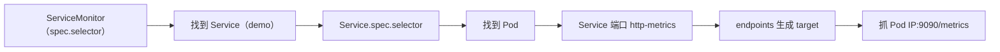

# Kubernetes 可观测性

> 阶段 5 · 生产进阶 · 笔记 5-5
>
> K8s 把"观测对象"从"一批进程"升级为"一套会自我调度的分布式系统"：除了应用，还要观测控制平面、节点、kubelet、事件与审计。本篇覆盖：要观测什么与关键指标、kube-prometheus-stack（ServiceMonitor/PodMonitor 发现机制）、OTel Kubernetes Operator（自动注入）、日志采集方案对比、事件与审计日志、成本控制、LGTM 一句话。

---

## 1. K8s 自身要观测什么：分层清单

| 层 | 观测对象 | 核心问题 | 数据来源 |
| --- | --- | --- | --- |
| 控制平面 | kube-apiserver | 请求延迟/错误率、etcd 健康、对象数量（基数！）、缓存同步 | apiserver /metrics（ServiceMonitor 一般自动配好） |
| | etcd | leader 唯一性、磁盘 fsync 延迟、DB size、对象数 | etcd /metrics |
| | kube-scheduler / controller-manager | 调度延迟、pending pods、工作队列重试 | 各组件 /metrics |
| 节点 | kubelet | 运行中 pod 数、PLEG 延迟（节点卡顿经典指标）、启动耗时 | kubelet /metrics |
| | kubelet/cAdvisor | 容器 CPU/内存/网络/文件系统用量 | kubelet /metrics/cadvisor |
| | node-exporter | 主机 CPU/内存/磁盘 IO/文件系统/网络 | DaemonSet node-exporter |
| 工作负载 | Pod/容器 | 重启次数、状态相位、OOMKill、资源超限 | kube-state-metrics + cAdvisor |
| | Deploy/StatefulSet/Job | 副本可用性、Job 失败 | kube-state-metrics |
| 事件与审计 | Events | "为什么我的 pod 被驱逐/重建" | kube-state-metrics / event exporter |
| | Audit Log | 谁在何时改了什么资源 | apiserver audit 策略 |

### 1.1 关键指标速查（生产告警常用）

| 指标 | 来源 | 含义/注意 |
| --- | --- | --- |
| `container_cpu_usage_seconds_total` | cAdvisor | 计数器，rate 后是核数；注意与 limit 对比 |
| `container_memory_working_set_bytes` | cAdvisor | **OOMKill 的判定依据**（不是 RSS 也不是 usage_bytes），工作集 = RSS - inactive_file |
| `kube_pod_status_phase{phase="Pending"}` | kube-state-metrics | Pending 堆积 = 调度/镜像/存储问题 |
| `kube_pod_container_status_restarts_total` | kube-state-metrics | 重启计数，配合 `last_terminated_reason="OOMKilled"` |
| `kube_pod_container_resource_requests/limits` | kube-state-metrics | 容量规划、利用率计算分母 |
| `kube_deployment_status_replicas_available` | kube-state-metrics | 与 `spec.replicas` 差值即不可用副本 |
| `kube_node_status_condition{condition="MemoryPressure"}` | kube-state-metrics | 节点压力/驱逐前兆 |
| `kubelet_pleg_relist_duration_seconds`（histogram） | kubelet | PLEG 卡顿是节点"假死"经典根因 |
| `apiserver_request_duration_seconds` | apiserver | 控制面延迟；注意按 verb/resource 分位 |
| `apiserver_storage_objects` | apiserver | **每类对象数量 ≈ K8s 侧基数压力**（Secret/ConfigMap 最容易爆） |
| `etcd_disk_wal_fsync_duration_seconds` | etcd | 控制面写入健康，超时即集群抖动 |
| `scheduler_e2e_scheduling_duration_seconds` | scheduler | 调度耗时（alpha，但很有用） |

参考：kubelet 指标 https://kubernetes.io/docs/reference/instrumentation/kubelet-metrics/ （访问日期：2026-11-04）；kube-state-metrics https://github.com/kubernetes/kube-state-metrics （访问日期：2026-11-04）。

### 1.2 两个"K8s 特有"的易混概念

- **cAdvisor vs kube-state-metrics**：cAdvisor 报告"运行时用量"（CPU/内存实际值），kube-state-metrics 报告"期望状态 vs 实际状态"（副本数、相位、重启次数）。前者是 gauge 看资源，后者是 K8s 对象的状态镜像。
- **memory 差异**：`container_memory_usage_bytes`（含 cache）> `container_memory_working_set_bytes`（OOM 判据）> `container_memory_rss`。容器被 OOMKill 时 working_set 一定贴近 limit——告警用它。

---

## 2. kube-prometheus-stack：指标方案的事实标准

### 2.1 组件一览

`kube-prometheus-stack`（prometheus-community Helm chart）一次安装给你整套：

| 组件 | 作用 |
| --- | --- |
| Prometheus Operator | 管 Prometheus/Alertmanager 的 CRD 控制器（声明式采集配置） |
| Prometheus（Agent 模式可选） | 抓取与存储 |
| Alertmanager | 告警路由/静默/分组 |
| Grafana + 默认 dashboard | 大盘（k8s 集群/节点/pod 一应俱全） |
| node-exporter | 节点指标 DaemonSet |
| kube-state-metrics | 集群对象状态指标 |
| 各组件 ServiceMonitor | 自带上百条采集规则开箱即用 |

### 2.2 Helm 安装要点

```bash
helm repo add prometheus-community https://prometheus-community.github.io/helm-charts
helm repo update

helm install monitoring prometheus-community/kube-prometheus-stack \
  --version 65.x.x \        # 以官方 chart 发布为准：https://github.com/prometheus-community/helm-charts
  --namespace monitoring --create-namespace \
  --set grafana.adminPassword='admin' \
  --set prometheus.prometheusSpec.retention=7d \
  --set prometheus.prometheusSpec.storageSpec.volumeClaimTemplate.spec.storageClassName=<你的SC>
# 大集群建议追加 values 文件做指标裁剪（见第 6 节）
```

注意：默认安装不带持久卷（Prometheus 数据重启即丢），生产必须配置 `storageSpec`；chart 版本以官方发布页为准。

### 2.3 核心机制：ServiceMonitor / PodMonitor CRD 与服务发现

Prometheus Operator 的声明式采集：你不再手写 `scrape_configs`，而是创建 ServiceMonitor 对象，Operator 据此生成抓取配置。

**ServiceMonitor 示例（最常用的完整版）：**

```yaml
apiVersion: monitoring.coreos.com/v1
kind: ServiceMonitor
metadata:
  name: demo-app
  namespace: demo                      # ServiceMonitor 所在 namespace
  labels:
    release: monitoring                # ★ 必须匹配 Prometheus CR 的 serviceMonitorNamespaceSelector/selector，
                                       #   helm 安装名是什么 release 值就是什么，这是新手第一坑
spec:
  selector:
    matchLabels:
      app.kubernetes.io/name: demo-app # ★ 去哪个 namespace 找带这个 label 的 Service
  namespaceSelector:
    matchNames: [demo]                 # 目标 Service 的 namespace；不写=仅当前 namespace
  endpoints:
    - port: http-metrics               # ★ 引用 Service 的 port name（不是数字！）
      path: /metrics
      interval: 30s
      scrapeTimeout: 10s
      # 需要时：给所有抓到的样本注入/改写 label
      # relabelings: [...]
      # 入库前裁剪（基数治理主战场）
      metricRelabelings:
        - sourceLabels: [__name__]
          regex: 'go_goroutines|process_.*'
          action: drop
```

**发现链条（面试常问）：**



**PodMonitor 示例**（没有 Service、直接抓 Pod 端口时用，如 headless workload）：

```yaml
apiVersion: monitoring.coreos.com/v1
kind: PodMonitor
metadata:
  name: demo-app-pods
  namespace: demo
  labels: {release: monitoring}
spec:
  selector:
    matchLabels: {app.kubernetes.io/name: demo-app}
  podMetricsEndpoints:
    - port: http-metrics     # 引用 Pod container 的 port name
      interval: 30s
```

**三条最容易翻车的规则：**

1. ServiceMonitor 上的 `release: <helm安装名>` label 不匹配 → Prometheus 根本不选它（Operator 的 selector 默认按 release 过滤）；
2. endpoints.port 写端口号（"9090"）→ 不生效，必须是 Service 里定义的 **port name**；
3. ServiceMonitor 与目标 Service 不在同一 namespace 时，必须写 `namespaceSelector`，且 Prometheus 的 `serviceMonitorNamespaceSelector` 要允许跨 ns。

参考：https://prometheus-operator.dev/docs/ （访问日期：2026-11-04）；chart 仓库：https://github.com/prometheus-community/helm-charts/tree/main/charts/kube-prometheus-stack （访问日期：2026-11-04）。

---

## 3. OTel Kubernetes Operator：trace/日志的声明式接入

### 3.1 是什么

OpenTelemetry Operator 是一个 K8s 控制器，提供三个核心 CRD：

| CRD | 作用 |
| --- | --- |
| `OpenTelemetryCollector` | 部署 collector（deployment/daemonset/statefulset/sidecar 四种形态） |
| `Instrumentation` | 声明语言自动注入配置（java/python/nodejs/dotnet/go） |
| `OpAMPBridge` | 远程管理 collector 配置（进阶） |

### 3.2 DaemonSet agent 示例

```yaml
apiVersion: opentelemetry.io/v1beta1
kind: OpenTelemetryCollector
metadata:
  name: otel-agent
  namespace: observability
spec:
  mode: daemonset                 # 每节点一个 agent，收集本节点应用数据
  hostNetwork: true               # 常配 hostNetwork 降低跨网络开销
  config: |
    receivers:
      otlp:
        protocols:
          grpc: {endpoint: 0.0.0.0:4317}
          http: {endpoint: 0.0.0.0:4318}
    processors:
      memory_limiter: {check_interval: 1s, limit_mib: 512}
      k8sattributes:              # 给 span/pod 日志打上 ns/pod/node 等元数据标签
        extract: {metadata: [k8s.pod.name, k8s.namespace.name, k8s.node.name]}
      batch: {}
    exporters:
      otlp/gateway:
        endpoint: otel-gateway.observability.svc:4317
        tls: {insecure: true}
    service:
      pipelines:
        traces:  {receivers: [otlp], processors: [memory_limiter, k8sattributes, batch], exporters: [otlp/gateway]}
        metrics: {receivers: [otlp], processors: [memory_limiter, batch], exporters: [otlp/gateway]}
        logs:    {receivers: [otlp], processors: [memory_limiter, batch], exporters: [otlp/gateway]}
```

### 3.3 自动注入（auto-instrumentation）

创建 `Instrumentation` CR 后，**给 Pod 加一个 annotation**，Operator/SDK init 容器就会注入对应语言的 OTel SDK，零代码改造获得 trace：

```yaml
apiVersion: opentelemetry.io/v1alpha1
kind: Instrumentation
metadata:
  name: auto-inject
  namespace: observability
spec:
  exporter:
    endpoint: http://otel-agent.observability.svc.cluster.local:4318
  propagators: [tracecontext, baggage, b3]
  sampler:
    type: parentbased_traceidratio
    argument: "0.1"            # head 采样在这里统一管理（见 sampling.md）
  java:    {image: ghcr.io/open-telemetry/opentelemetry-operator/autoinstrumentation-java:latest}
  python:  {image: ghcr.io/open-telemetry/opentelemetry-operator/autoinstrumentation-python:latest}
  nodejs:  {image: ghcr.io/open-telemetry/opentelemetry-operator/autoinstrumentation-nodejs:latest}
```

应用 Deployment 只需加注解（java/python/nodejs/dotnet 用 inject-*，sidecar collector 用 sidecar.opentelemetry.io/inject）：

```yaml
spec:
  template:
    metadata:
      annotations:
        instrumentation.opentelemetry.io/inject-java: "observability/auto-inject"  # 也可只写 "true"
        # sidecar.opentelemetry.io/inject: "observability/otel-agent"              # 注入 sidecar collector
```

注意事项：

- 镜像 tag 请固定版本（`latest` 仅示意），以 OTel Operator 发布为准；
- Go 自动注入依赖 eBPF（alpha），其余语言通过 init 容器修改启动参数实现；
- 注入的是"通用"埋点（HTTP/DB 客户端），业务内部 span 仍需手动埋点或手动 SDK。

参考：https://opentelemetry.io/docs/kubernetes/operator/ （访问日期：2026-11-04）。

---

## 4. 日志方案：DaemonSet vs Sidecar vs 原生节点代理

| 方案 | 原理 | 优点 | 缺点 | 适用 |
| --- | --- | --- | --- | --- |
| **DaemonSet 采集 stdout 文件**（Promtail/Vector/Fluent Bit） | 每节点一个 agent 读 `/var/log/pods/...` | 资源开销恒定、与应用解耦、零改造 | 多租户隔离弱；解析/路由只能按 label/格式 | **默认首选**，绝大多数场景 |
| **Sidecar 注入** | 每 Pod 一个采集容器（或 OTel SDK 直发） | 隔离与配额清晰；可读容器内文件；能拿到应用结构化上下文 | 资源随 Pod 数线性放大、运维面变大 | 多租户 SaaS、强隔离/定制解析需求 |
| **节点原生**（kubelet 原生日志或 systemd） | 少数托管/特殊发行版能力 | 无额外组件 | 生态与功能受限 | 特定平台 |

实践要点：

- **应用日志打到 stdout/stderr** 是 K8s 的"社交礼仪"，别写容器内文件再挂载；
- DaemonSet 采集器需要挂载 hostPath `/var/log/pods` 并容忍 `node` 变更；
- OTel 路线：filelog receiver（DaemonSet collector）→ 统一 OTLP；应用也可直接 OTLP logs（省一层文件 IO，但要求改造）。

---

## 5. 事件与审计日志：K8s 的"变更日志"

### 5.1 Events（发生了什么）

K8s Event 是集群的"系统日志"：调度失败、镜像拉取失败、OOMKill、驱逐……排查"为什么 pod 重启"的第一站：

```bash
kubectl get events -A --sort-by=.lastTimestamp | tail -30
kubectl describe pod <pod>   # 末尾自动带相关 events
```

进阶：把 events 持久化进日志系统（默认只保留 1h 且 etcd 容量有限）：

- kube-state-metrics 可暴露 `kube_event_*` 指标（配置开启）；
- `kubernetes-event-exporter` 把 event 转发到 Loki/ES/Kafka：https://github.com/opensearch-project/kubernetes-event-exporter （访问日期：2026-11-04）。

### 5.2 审计日志（谁改的）

apiserver audit 记录"谁在何时对什么资源做了什么"，合规与溯源必备。最小策略示例（apiserver 启动参数 `--audit-policy-file`）：

```yaml
apiVersion: audit.k8s.io/v1
kind: Policy
rules:
  - level: RequestResponse            # 记录请求与响应体
    resources: [{group: "", resources: ["secrets", "configmaps"]}]
  - level: Metadata                   # 只记录元数据（谁/何时/什么对象）
    verbs: ["create", "delete", "update", "patch"]
  - level: None                       # 高频只读流量不记，防审计日志自身爆炸
    verbs: ["get", "watch", "list"]
    resources: [{group: "", resources: ["events"]}]
```

后端可选 logfile/webhook（发往 Loki/SIEM）。参考：https://kubernetes.io/docs/tasks/debug/debug-cluster/audit/ （访问日期：2026-11-04）。

---

## 6. 成本控制：指标裁剪、采样、分层 retention

### 6.1 指标裁剪（最立竿见影）

大集群 kube-prometheus-stack 默认配置可能 60% 的 series 是没人看的：

```yaml
# values.yaml：在 ServiceMonitor/抓取层丢弃
prometheus:
  additionalServiceMonitors: []
  prometheusSpec:
    # 全局：所有 target 的入库裁剪
    # （用 additionalScrapeConfigs / 各 ServiceMonitor 的 metricRelabelings）
```

常用裁剪目标：

- `go_*`、`process_*`（除非排障，业务侧价值低）；
- kubelet/cAdvisor 的 `container_*_seconds_total` 部分、`kube_pod_container_info` 等信息型指标；
- 高基数来源统一在 metricRelabelings 处理（见 cardinality.md 第 5.3 节）。

### 6.2 采样

- **trace 采样**：见 sampling.md（K8s 场景在 Instrumentation CR 统一配置）；
- **日志采样**：debug 级别在生产按比例采样或直接丢弃；
- **profile**：降低采样频率（如 100Hz → 50Hz）。

### 6.3 Retention 分层

| 层 | 保留 | 存储 |
| --- | --- | --- |
| 本地 Prometheus（热） | 3~15d | PVC（SSD） |
| 远端长期（温/冷） | 3~13 个月 | Thanos / Mimir / VictoriaMetrics + 对象存储，自动降采样（5m/1h） |
| 审计/合规 | 按法规 | SIEM/对象存储归档 |

### 6.4 基线仪表盘（监控"监控"）

- `prometheus_tsdb_head_series`（series 总数，配合告警）；
- collector 自身：`otelcol_exporter_*/otelcol_receiver_*` 队列与丢弃；
- 每节点 DaemonSet 资源占用 vs limit（采集器自己别成为故障源）。

---

## 7. Grafana LGTM 栈一句话

**LGTM = Loki（日志）+ Grafana（可视化）+ Tempo（trace）+ Mimir（指标）**：Grafana 开源的一体化可观测后端组合，通过统一标签与 exemplar 互相跳转，配合 Pyroscope 可扩展为 profile 信号——自托管各组件或用 Grafana Cloud 的托管版。参考：https://grafana.com/oss/ （访问日期：2026-11-04）。

---

## 8. 常见坑

1. **ServiceMonitor 不生效三连**：`release` label 不匹配 Operator selector；port 写数字而非 name；跨 namespace 没配 `namespaceSelector`。
2. **内存告警用了错误指标**：看 `usage_bytes`（含 page cache）永远偏高，误报；OOM 判据是 `working_set_bytes`。
3. **kube-state-metrics 指标延迟**：kube-state-metrics 是"轮询 API 的有延迟快照"，相位/重启类指标有数十秒滞后，别拿它做秒级告警（秒级用 cAdvisor/runtime 指标）。
4. **时间戳混乱**：应用自己打日志时间戳但容器时区是 UTC；Grafana 查询按浏览器时区渲染——统一 UTC 存储 + 展示层转。
5. **helm 升级覆盖自定义 values**：升级 chart 时忘记 `--reuse-values` 或 values 文件，自定义裁剪丢失 → series 暴涨。
6. **采集器自己 OOM**：node-exporter/promtail 无 limit，遇到异常大的 target/日志洪水被杀，形成观测盲区；给采集器配 limit + 自监控。
7. **审计日志全量 RequestResponse**：审计自身打爆 apiserver/etcd；按 verbs/resources 分级（Metadata 为主）。
8. **自动注入改了请求头处理**：注入的 SDK 改变（增加）请求头，个别老网关对 header 大小敏感——灰度注入。

---

## 9. 面试题小结

1. **Q：K8s 可观测性要覆盖哪几层？各举一个关键指标。**
   A：控制平面（apiserver_request_duration_seconds、etcd fsync）、节点（kubelet PLEG 延迟、node-exporter 磁盘）、容器运行时（container_memory_working_set_bytes、CPU throttle）、工作负载状态（kube_pod_status_phase、kube_deployment_status_replicas_available）、事件与审计（Events、audit policy）。

2. **Q：cAdvisor 与 kube-state-metrics 的分工？OOMKill 看哪个指标？**
   A：cAdvisor=运行时用量（CPU/内存/网络），kube-state-metrics=K8s 对象期望 vs 实际状态。OOMKill 判定看 cAdvisor 的 container_memory_working_set_bytes 对比 limit，重启原因看 kube_pod_container_status_last_terminated_reason。

3. **Q：ServiceMonitor 的发现机制是什么？为什么不生效时先查 release label？**
   A：Operator watch ServiceMonitor → 按 spec.selector 找 Service → Service 找 Pod → 按 port name 生成 target。Prometheus CR 用 label selector（默认 release=<安装名>）筛选 ServiceMonitor，label 不匹配时 Operator 根本不纳管，这是最高频配置错误。

4. **Q：OTel Operator 的自动注入原理和限制？**
   A：Instrumentation CR 定义语言 SDK 镜像与端点，Pod 加 instrumentation.opentelemetry.io/inject-<lang> 注解后由 mutating 准入注入 init 容器修改启动参数（Java agent/Python sitecustomize 等）。限制：注入的是通用库埋点，业务 span 仍需手动；Go 注入依赖 eBPF 尚在 alpha。

5. **Q：DaemonSet 与 Sidecar 日志采集怎么选？**
   A：默认 DaemonSet（开销恒定、零改造），多租户强隔离/需读容器内文件/深度定制解析用 sidecar（资源随 Pod 线性放大）。应用侧最佳实践仍是日志打到 stdout。

6. **Q：大集群如何控制可观测性成本？**
   A：三轴：指标裁剪（metricRelabelings 丢弃 go_*/信息型指标、治理基数）、采样（trace head/tail、日志级别、profile 频率）、retention 分层（本地短保留 + 对象存储长期 + 降采样）。

---

## 10. 参考资料

| 资料 | 链接 | 访问日期 |
| --- | --- | --- |
| kubelet 指标参考 | https://kubernetes.io/docs/reference/instrumentation/kubelet-metrics/ | 2026-11-04 |
| K8s 系统指标总览 | https://kubernetes.io/docs/reference/instrumentation/ | 2026-11-04 |
| kube-state-metrics | https://github.com/kubernetes/kube-state-metrics | 2026-11-04 |
| Prometheus Operator 文档 | https://prometheus-operator.dev/docs/ | 2026-11-04 |
| kube-prometheus-stack chart | https://github.com/prometheus-community/helm-charts/tree/main/charts/kube-prometheus-stack | 2026-11-04 |
| OTel Kubernetes Operator | https://opentelemetry.io/docs/kubernetes/operator/ | 2026-11-04 |
| OTel K8s 部署指引 | https://opentelemetry.io/docs/kubernetes/ | 2026-11-04 |
| K8s 审计日志 | https://kubernetes.io/docs/tasks/debug/debug-cluster/audit/ | 2026-11-04 |
| kubernetes-event-exporter | https://github.com/opensearch-project/kubernetes-event-exporter | 2026-11-04 |
| Grafana OSS（LGTM） | https://grafana.com/oss/ | 2026-11-04 |

---

## 附：ASCII 图替换清单

| 原 ASCII 图位置（章节标题） | 原图内容简述 | 替换结果 |
| --- | --- | --- |
| 2.3 核心机制：ServiceMonitor / PodMonitor CRD 与服务发现 | ServiceMonitor 发现链条（7 步箭头链：ServiceMonitor → Service → Pod → target） | flowchart LR |

无保留未替换的图。
