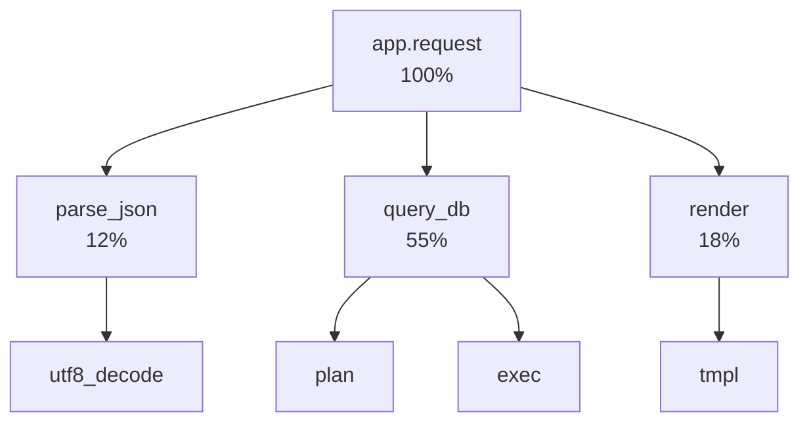
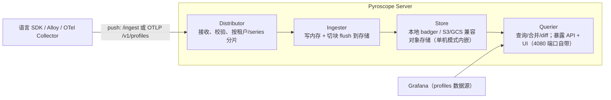

# 持续性能剖析（Continuous Profiling）

> 阶段 5 · 生产进阶 · 笔记 5-3
>
> Metrics 告诉你"哪里慢"，trace 告诉你"哪条链路慢"，profiling 告诉你**"哪一行代码在烧 CPU/吃内存"**。本篇覆盖：profile 作为第四信号、火焰图读法（on-CPU / off-CPU、形态解读）、Pyroscope 架构与多语言支持、与 trace 的关联（span profiling）、其他工具一览、CPU/内存泄漏排查实例流程。

---

## 1. Profile：第四种信号

### 1.1 定位：补齐"代码级"的最后一环

回顾三大支柱的能力边界：

| 信号 | 回答的问题 | 粒度 | 盲区 |
| --- | --- | --- | --- |
| Metrics | 系统现在健康吗？（QPS/错误率/延迟） | 服务级聚合 | 不知道代码内部发生了什么 |
| Logging | 这次请求发生了什么？ | 单事件 | 无法归因性能 |
| Tracing | 这条链路慢在哪一跳？ | 跨服务调用链 | span 之间/内部的 CPU 热点看不到 |
| **Profiling** | **CPU 周期/内存字节花在哪些函数上？** | **函数级（栈帧聚合）** | 单点采样，无因果语义 |

一个经典场景：延迟直方图显示 p99 变差，trace 显示瓶颈在 `order-service` 的某个 span 里耗时 800ms，但 span 内部就是一次业务函数调用，没有更细的 span 了——这时只有 profile 能回答"这 800ms 里 CPU 在干嘛"。

### 1.2 什么是 Continuous Profiling

传统 profiling 是"出事了再 attach 工具"（如 `perf record`、JProfiler），有三个致命问题：**不可复现**（负载已变）、**有侵入**（生产不敢开）、**无历史**（无法对比上周）。

Continuous Profiling（持续剖析）的范式：

1. **常态开启**：低开销（目标 <1%~2.5% CPU）采样，一直跑在生产上；
2. **低频高分辨率**：比如每 10s 采 10~60s 的样本，函数热点统计上足够；
3. **集中存储 + 按时间检索**：可以问"上周三的 CPU 热点"和"上周二对比"；
4. **与标签系统结合**：profile 也带 label（service/version/env），支持按版本 diff——发布回归一目了然。

### 1.3 数据模型：一切都是 pprof

现代 profiling 生态的事实标准是 Google 的 **pprof 格式**（golang/pprof protobuf）：

- 一个 profile = 多个 **sample**（采样点），每个 sample = **调用栈（location 链）× 累积值（value）**；
- value 可以是 CPU 纳秒、分配字节数、分配对象数、锁等待时间……同一格式承载不同 profile type；
- OTel 在 2024 年将 profiling 纳入规范成为**第四种信号**（Profiles signal，处于开发阶段但语义已定），数据模型对齐 pprof，通过 OTLP `/v1/profiles` 传输。

参考：OTel Profiles 信号 https://opentelemetry.io/docs/specs/otel/profile/ （访问日期：2026-11-04）

---

## 2. 火焰图怎么读

火焰图（Flame Graph）由 Brendan Gregg 发明，把"成千上万个采样调用栈"按帧聚合成可视化矩形树。

参考：https://www.brendangregg.com/flamegraphs.html （访问日期：2026-11-04）

### 2.1 基本语法

```
宽 = 该函数（含其下游）在样本中出现的比例 → 越宽越"贵"
高 = 调用栈的深度（上层是被下层调用的 callee；方向可能因工具而异）
颜色 = 随机暖色，无语义（有的工具用颜色区分模块/优化状态）
```
<!-- 保留原图：宽/高/颜色三元定义平铺清单，无对象关系，非示意图 -->

一个示例（CPU 火焰图，横向堆叠）：



读图三步：

1. **找最宽的塔基**：`query_db.exec` 占 55%，第一优先级；
2. **自顶向下扫一遍**，找"意外出现在热路径上"的帧（如 `parse_json` 居然 12%）；
3. **用搜索/对比**：Pyroscope 支持 diff 视图（两个时间窗相减），回归问题优先用 diff。

### 2.2 on-CPU vs off-CPU

这是读图前必须先分清的两种 profile：

| | on-CPU | off-CPU |
| --- | --- | --- |
| 度量什么 | 函数**占用 CPU 周期**的时间 | 线程**不在 CPU 上**等待的时长（阻塞在锁/IO/sleep/gc pause） |
| 采样方式 | 固定频率（如 100Hz）抓正在运行的线程栈；eBPF 用 perf 事件 | 线程**离开 CPU 的时刻**记录栈 + 阻塞时长（kprobe/USTD 钩子） |
| 典型问题 | 算法热、正则回溯、序列化、GC | 锁竞争、IO 慢、连接池耗尽、缺页 |
| 误用后果 | CPU 100% 但请求慢 → on-CPU 图看不出问题（都在等锁） | 吞吐下降但 CPU 低 → off-CPU 才是答案 |

**经验法则：CPU 饱和先看 on-CPU，延迟异常但 CPU 空闲看 off-CPU。** 同一时刻的 on-CPU + off-CPU 合称 wall-clock（墙上时间）分析。

### 2.3 常见形态解读速查表

| 形态 | 长什么样 | 通常意味着 |
| --- | --- | --- |
| 大平顶（plateau） | 某一层横贯整图的宽矩形 | 单一函数吃掉大头：纯计算热点（加解密、序列化、算法） |
| 宽基座多分叉 | 底部系统调用/GC/解释器帧很宽 | runtime/框架开销：GC 频繁、解释型语言 VM 帧、syscall 密集 |
| 瘦高塔 | 很深但每层很窄 | 深度递归/长调用链，单路径慢但占比不高；结合 off-CPU 看 |
| 锯齿/梳状 | 大量细窄并排列 | 海量小函数或动态分发（Python/JS 的典型形态，先用"合并相同帧"功能） |
| 出现 `__libc_start_main` 下异常宽的未知帧 | 符号缺失 | strip 过的二进制/容器镜像没带调试符号，先解决符号化 |
| off-CPU 图中锁帧极宽 | `pthread_mutex_lock` 一览众山小 | 锁竞争，看持锁者（换 mutex contentions profile） |

### 2.4 反直觉点（新人最常错）

- **宽 ≠ 慢函数本身**：宽度包含**所有下游**。判断"这个函数自身多贵"要看它**自己那格**（减去子帧），工具里叫 self time / exclusive；
- **火焰图不显示调用次数**，显示的是**时间占比**；高频低耗函数可能完全看不见；
- **栈的顺序**：不同工具 root 在上或在下（Pyroscope 可切换 icicle/火焰），先确认方向再读。

---

## 3. Pyroscope：Grafana 的持续剖析平台

原 Pyroscope 公司 2023 年加入 Grafana，产品与 Grafana 云及自托管 LGTM 栈整合。当前形态：**Grafana Pyroscope**（多租户、对象存储后端的单体/微服务 profile 数据库）。

参考：https://grafana.com/docs/pyroscope/latest/ （访问日期：2026-11-04）

### 3.1 架构

单二进制（`grafana/pyroscope` 镜像，默认端口 4080）内含一套流水线组件（类比 Loki/Tempo）：



| 组件 | 职责 | 一句话 |
| --- | --- | --- |
| Distributor | 校验与切分写入 | 类比 Loki distributor |
| Ingester | 内存聚合 + 落盘 | profile 按 series（app+labels）聚合 |
| Store | badger（单机）/ S3（生产） | 单机实验零依赖，生产接对象存储 |
| Querier + UI | 查询、火焰图、diff | 自带 UI，也可接 Grafana |

### 3.2 采集模式：语言 SDK vs eBPF（无侵入）

| | 语言 SDK（pyroscope-io 各语言客户端 / pyroscope-go） | eBPF（Grafana Alloy / OTel eBPF profiler） |
| --- | --- | --- |
| 原理 | 进程内采样器：Go 用 pprof runtime，Python 内嵌 py-spy，Java 用 async-profiler，Ruby/rPHP 用 rbspy 等 | 内核态 perf 事件 + 栈回溯，跨进程统一采集 |
| 改代码 | 多数语言要加初始化几行（或用 OTel 自动注入） | 零改动，DaemonSet 一装全集群覆盖 |
| 语言支持 | Go/Java/Python/Node(.NET 由 eBPF 覆盖)/Ruby/PHP/Rust/eBPF(自身) 等 | 理论上所有原生/JIT 语言（含 .NET、本机二进制） |
| 标签/维度 | 应用内打 tags（version、tenant 等业务维度强） | 依赖 K8s 元数据（pod/namespace），业务维度弱 |
| 典型部署 | 应用容器内 | 节点级 DaemonSet |

生产常见组合：**eBPF 兜底全集群 + 重点服务用 SDK 打业务标签**。

### 3.3 多语言接入速览

| 语言 | 库 | 关键代码/机制 |
| --- | --- | --- |
| Go | `github.com/grafana/pyroscope-go` | `pyroscope.Start(pyroscope.Config{...})`，底层 runtime/pprof |
| Python | `pyroscope-io`（pip） | `pyroscope.configure(application_name=..., server_address=...)`，内嵌 py-spy |
| Java | `pyroscope-java-agent`（JVM agent jar） | `-javaagent:pyroscope.jar`，底层 async-profiler，支持 cpu/alloc/lock/wall |
| Node.js | `@pyroscope/nodejs` | `pyroscope.start()`（V8 CPU/Heap sampling） |
| .NET | eBPF 采集或 `Pyroscope.DotNet`（较新） | 通常走 eBPF/OTel 路线 |
| 任意 | OTel SDK + OTLP profiles / Grafana Alloy push | OTel Profiles 信号路线（演进中） |

### 3.4 Grafana 集成

- 添加 **Pyroscope 数据源**（类型 "Pyroscope"，URL 指向 server 4080）；
- Explore 里选 service → 时间窗 → 火焰图 / Table / Both；支持 **diff**（对比两时间窗/两 label 值）；
- dashboard profile 面板可与 metrics 面板同屏；
- **与 trace 关联**：Grafana 数据链路支持从 profile label 中提取 `trace_id`（当 profile 带 exemplar trace_id 时），从火焰图跳转 trace——目前主要在 Grafana Cloud 与 OTel profiles 路线可用，自托管逐渐跟进。

### 3.5 部署形态：单机 / 微服务 / Alloy 网关

| 形态 | 组件 | 适用 |
| --- | --- | --- |
| **单二进制（monolithic）** | 一个 `grafana/pyroscope` 进程，内嵌全组件 + 本地 badger | 实验、小规模（本实验 lab05 用这种） |
| **微服务（microservices）** | distributor/ingester/querier/store 独立扩缩 + S3/GCS 对象存储 + memcache | 大规模多租户生产 |
| **Alloy / OTel Collector 网关前置** | 应用 push 给 Alloy，由 Alloy 统一转发/复制/限流到 Pyroscope 或 Grafana Cloud | 需要在采集侧做路由、多后端、脱敏的中间层 |

单机到微服务的演进逻辑与 Loki/Tempo 完全同构：先单体跑起来，写入量上来后拆 ingester 水平扩写、对象存储扩容量——这也是"LGTM 栈运维心智模型可复用"的体现。

---

## 4. 与 trace 的关联：span 级 profiling

profile 与 trace 的联系是当前最活跃的方向。思路：

1. **线程/协程标注**：SDK 在处理某个请求时，把当前 trace_id/span_id 作为动态标签贴到该线程产生的 profile 样本上（pyroscope-go 的做法：在 context 里携带 span，采样时读取）；
2. **聚合查询**：查询 profile 时按 `span_id` 过滤，得到"这一个 span 执行期间的 CPU 热点"；
3. **反向跳转**：从慢 span 一键下钻到该 span 期间的火焰图。

价值：trace 告诉你"哪个 span 慢"，span-scoped profile 告诉你"这个 span 里 CPU 花在哪"。限制：采样命中单个 span 的窗口内样本量少，通常需要聚合多次命中。

相关进展可关注：
- pyroscope-go 与 OTel 的 correlation 设计（profile 带 trace_id/span_id 标签）：https://grafana.com/docs/pyroscope/latest/configure-client/trace-correlation/ （访问日期：2026-11-04）
- OTel Profiles 信号与 eBPF profiler 的原生集成：https://opentelemetry.io/blog/2024/otel-profiles-and-ebpf/ （访问日期：2026-11-04）

---

## 5. 其他工具一览

| 工具 | 定位 | 亮点 | 适合 |
| --- | --- | --- | --- |
| **Pyroscope (Grafana)** | 持续剖析平台 | 多租户、对象存储、Grafana 集成、多语言/eBPF | 想要"一直开着"的平台化方案 |
| **Parca** | 持续剖析（CNCF 沙箱） | 原生 eBPF 采集、pprof 格式、k8s 原生 | 想要纯开源 eBPF 路线 |
| **pprof（Go 官方）** | Go 内建 profiler + Web UI | `import _ "net/http/pprof"`，`go tool pprof`，零成本起步 | Go 服务、排障现场 |
| **async-profiler** | JVM 采样 profiler | 低开销、cpu/alloc/lock/wall 全覆盖，intellij 集成 | Java 应用事实标准 |
| **perf / FlameGraph 工具集** | Linux 系统级采样 | Brendan Gregg 原版火焰图生成脚本 | 主机/系统级问题 |
| **DataDog Profiler / Continuous Profiler** | 商用 APM 内置 | 与 APM trace 联动开箱即用 | 已用 Datadog 的团队 |
| **Google Cloud Profiler** | 云托管 | 免运维、按量计费 | GCP 用户 |
| **speedscope** | 交互式火焰图查看器 | 浏览器本地打开、多格式导入 | 单次 profile 文件分析 |

---

## 6. 实战：CPU 热点与内存泄漏排查流程

### 6.1 CPU 热点排查（以 Pyroscope 为例）

**现象**：`checkout-service` CPU 从 40% 涨到 85%，延迟 p99 翻倍，日志无异常。

1. **确认是计算型问题**：CPU 利用率高 + QPS 未涨 → 大概率代码路径变化（先排除流量与 GC）；
2. **打开 Pyroscope UI**：选 `checkout-service`，时间窗选"涨高后 30 分钟"，profile type 选 `cpu`；
3. **看塔基**：发现 `OrderPricing.apply_discount` 占 46%，下游集中在 `regex_match`；
4. **diff 对比**：与"上涨前同时段"做 diff，`apply_discount` 增量 +38pt → 上周发布的折扣规则正则引入灾难性回溯；
5. **修复验证**：改用受限回溯模式/预编译，发布后再 diff，占比回落。

### 6.2 内存泄漏排查（Go，pprof 手法通用）

**现象**：容器 RSS 缓慢上涨，每 3 天 OOMKilled 一次（注意：K8s 判 OOM 看的是 `container_memory_working_set_bytes`）。

1. 常开 `net/http/pprof`（生产建议加鉴权或仅在 debug 模式启用）；
2. 隔 6h 采两个 heap 快照对比：
   ```bash
   curl -o heap1.gz http://checkout:8080/debug/pprof/heap
   # 6 小时后
   curl -o heap2.gz http://checkout:8080/debug/pprof/heap
   go tool pprof -base heap1.gz heap2.gz   # 增量视图
   ```
3. 看 `inuse_space` 增量 top：某个 `sessionCache` map 增长 800MB；
4. 检查代码：cache 无 TTL 无淘汰 → 引入 TTL/LRU；持续观察曲线走平即收敛；
5. 若用 Pyroscope：Java/.NET/Node 直接在 UI 选 `memory`/`heap` profile type，按 `alloc_space`（累计分配，找分配大户）与 `inuse_space`（常驻，找泄漏）分别看。

### 6.3 off-CPU 场景速查

- 吞吐上不去但 CPU 闲 → off-CPU：通常锁/连接池/下游 IO；
- 容器 CPU limit 触发 throttle → 看 `container_cpu_cfs_throttled_periods_total`（指标）+ off-CPU 中等待点。

### 6.4 深挖单点：用 pprof CLI 交互分析（Go 场景补充）

平台 UI 适合"发现"，命令行适合"验尸"。Go 服务常开 pprof 端点后：

```bash
# 交互式 top（默认按累计值排）
go tool pprof http://checkout:8080/debug/pprof/profile?seconds=30
(pprof) top10          # 累计 top10
(pprof) list applyDiscount   # 定位到该函数逐行开销（需源码）
(pprof) web            # 生成调用图（需要 graphviz）

# 火焰图（命令行版）
go tool pprof -http=:8081 http://checkout:8080/debug/pprof/profile?seconds=30

# 对比两份快照（回归分析，等价于 Pyroscope 的 diff）
go tool pprof -base cpu_old.pb.gz cpu_new.pb.gz
```

`list` 命令能精确到**源码行**的采样计数，这是 UI 很难替代的"最后一公里"。

---

## 7. 常见坑

1. **容器里符号缺失**：Distroless/多阶段构建 strip 了符号，火焰图全是地址。解法：镜像带 `-gcflags="-N -l"` 不可取，正确做法是发布时保留 `.debug` 段或 sidecar 挂符号表（Sentry/Pyroscope 有符号服务器概念；Go 默认保留符号，问题主要在 C++/Rust/Node native）。
2. **Python/JS 火焰图全是解释器帧**：CPython 3.11+ 才默认暴露 Python 栈；旧版本要用 py-spy --native 之外的模式或升级运行时；Node 要 `--cpu-prof` 语义正确配置采样间隔。
3. **采样开销评估不充分**：默认 100Hz CPU 采样开销极低，但 alloc/lock profile（尤其 Java 全量 alloc）在高压服务上可能 >5%，灰度开启并观察。
4. **拿火焰图做精确耗时对比**：profile 是统计采样，单个函数"精确耗时"不可靠；要看占比与相对变化，别当 stopwatch 用。
5. **忘了 profile type 语义**：`cpu`（on-CPU）、`wall`（含等待）、`alloc_objects/alloc_space`（分配速率）、`inuse_*`（常驻）混着看会得出荒谬结论（例如拿 alloc_space 说内存泄漏——它是历史累计不是常驻）。
6. **只看单时间窗**：没有 diff/deno 对比，很难区分"一直如此"与"最近引入"。持续剖析的核心价值就是历史对比。
7. **单机 Pyroscope 用默认 badger 存储上生产**：单机模式适合实验/小规模；生产请配置对象存储（S3/GCS/MinIO），否则节点挂了历史全丢。

---

## 8. 面试题小结

1. **Q：持续性能剖析与传统按需 profiling 的区别？**
   A：常态开启（低开销采样常驻生产）、按时间维度存储可回溯、与 label/版本系统结合可 diff。把 profiling 从"救火工具"变成"历史数据库"。

2. **Q：on-CPU 和 off-CPU profiling 分别解决什么问题？如何选？**
   A：on-CPU 度量占用 CPU 周间的栈（算法/序列化/GC 热点），off-CPU 度量线程离开 CPU 的等待时长（锁/IO/池等待）。CPU 饱和看 on-CPU；CPU 空闲但延迟高看 off-CPU；两者合看是 wall-clock 分析。

3. **Q：火焰图中"宽度"和"高度"分别代表什么？某帧很宽但 self time 很小说明什么？**
   A：宽 = 该帧及其下游占总样本比例；高 = 栈深度。很宽但 self 小 = 它只是"热路径的必经之路"，热点在它的某个下游子帧，继续向下钻。

4. **Q：Pyroscope 的两种采集模式（语言 SDK vs eBPF）如何取舍？**
   A：SDK 需要改代码但能打业务标签（version/tenant），适合重点服务精细化；eBPF 零侵入节点级全覆盖（含本机二进制），适合大盘兜底与存量服务。生产常组合使用。

5. **Q：如何用 profile 数据排查内存泄漏（Go/Java）？**
   A：对比两个时间点的 heap profile（增量 -base），看 inuse_space 持续增长且不被释放的对象/代码路径；区分 alloc_space（累计分配，找分配大户）与 inuse_space（常驻，找泄漏）。容器场景结合 container_memory_working_set_bytes 确认 OOM 趋势。

6. **Q：profile 如何与 trace 打通（span profiling）？**
   A：SDK 在请求处理期间把 trace_id/span_id 作为标签写入该线程的 profile 样本；查询时按 span_id 过滤得到该 span 内的 CPU 热点，实现从慢 span 到代码行的下钻；限制是单 span 窗口样本稀疏，需聚合。

---

## 9. 参考资料

| 资料 | 链接 | 访问日期 |
| --- | --- | --- |
| Grafana Pyroscope 官方文档 | https://grafana.com/docs/pyroscope/latest/ | 2026-11-04 |
| Pyroscope 语言客户端配置 | https://grafana.com/docs/pyroscope/latest/configure-client/ | 2026-11-04 |
| Pyroscope trace correlation | https://grafana.com/docs/pyroscope/latest/configure-client/trace-correlation/ | 2026-11-04 |
| OTel Profiles 信号规范 | https://opentelemetry.io/docs/specs/otel/profile/ | 2026-11-04 |
| OTel eBPF profiler 公告 | https://opentelemetry.io/blog/2024/otel-profiles-and-ebpf/ | 2026-11-04 |
| Brendan Gregg 火焰图 | https://www.brendangregg.com/flamegraphs.html | 2026-11-04 |
| Go pprof 文档 | https://pkg.go.dev/net/http/pprof | 2026-11-04 |
| async-profiler | https://github.com/async-profiler/async-profiler | 2026-11-04 |
| Parca | https://parca.dev/ | 2026-11-04 |
| speedscope | https://www.speedscope.app/ | 2026-11-04 |

> 动手实验：`labs/lab05-sampling-and-profiling/profiling/` 用 Pyroscope + 一个故意制造 CPU 热点的 Python 应用，带你从 0 走完"启动 → 看火焰图 → 定位热点函数"全流程。

---

## 附：ASCII 图替换清单

| 原 ASCII 图位置（章节标题） | 原图内容简述 | 替换结果 |
| --- | --- | --- |
| 2.1 基本语法 | CPU 火焰图层级示例（app.request 及 parse_json/query_db/render 子帧与占比） | flowchart TD |
| 3.1 架构 | Pyroscope Server 组件流水线（Distributor→Ingester→Store→Querier）及 SDK 推送、Grafana 查询两端 | flowchart LR |

### 保留说明（未替换的原图）

- **2.1 基本语法**（火焰图"宽/高/颜色"三元定义）：平铺字段清单，无对象与关系，非示意图，已在原处加 HTML 注释。
