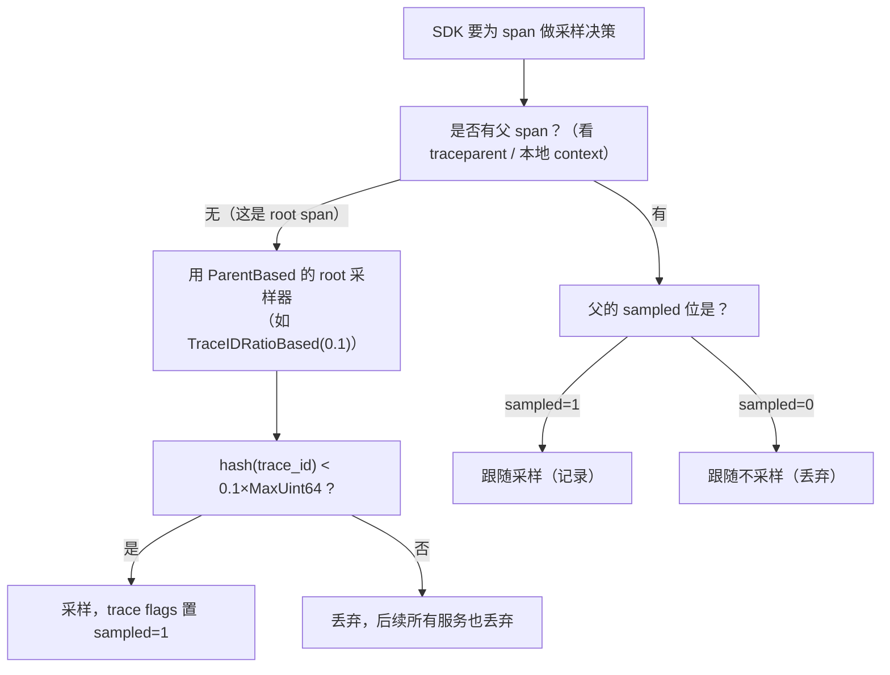
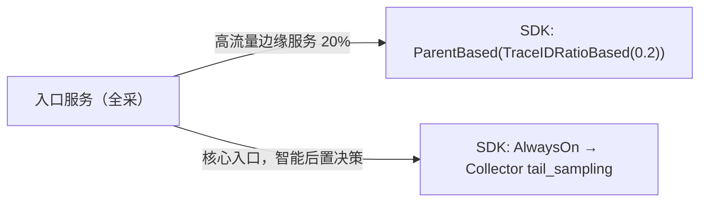

# 采样策略（Sampling）：head-based 与 tail-based

> 阶段 5 · 生产进阶 · 笔记 5-1
>
> 采样是"可观测性"走向"可负担的可观测性"的第一道闸门。本篇覆盖：为什么采样、head-based（SDK 端采样器）、tail-based（Collector tail_sampling processor 完整配置）、两者对比、采样与 exemplar / SLO 统计的相互影响，以及生产中最常见的坑。

---

## 1. 为什么需要采样：成本 vs 保真

### 1.1 一笔简单的成本账

假设一个中等规模的微服务系统：

| 项目 | 数值（示例） |
| --- | --- |
| 服务数 | 40 个 |
| 每个 trace 平均 span 数 | 25 个 |
| 每个 span 压缩后大小（OTLP protobuf + 后端存储） | 0.5 KB ~ 2 KB |
| QPS | 2 000 |
| 每天产生的 trace 数 | 2 000 × 86 400 ≈ 1.73 亿 |

按每 span 1 KB 估算，全量采集一天就是 **约 4 TB** 的原始数据，一个月 120 TB。这还没算：

- **网络**：应用 → Collector → 后端的传输带宽；
- **CPU**：应用端序列化、Collector 端处理、后端索引与压缩；
- **查询**：倒排索引膨胀导致检索变慢；
- **人力**：没有任何人能看完 1.73 亿条 trace——数据多到超出人类注意力，本身就是一种浪费。

### 1.2 采样的本质：有损压缩

采样的本质是**对 trace 数据做有损压缩**：用少量的样本代表总体。问题变成：

> 我愿意花多少钱（采样率），换取什么样的保真度（错误 trace 是否一条不丢、慢请求是否完整、是否能按比例还原总体分布）？

Google Dapper 论文（2010）早就给出了工程结论：**不必采集所有请求的完整 trace，也能回答"这一次用户请求经历了什么"以及"系统整体健康度如何"**。绝大多数商用 APM（Datadog、New Relic、Dynatrace）与开源方案（Jaeger、Tempo、Zipkin）都围绕采样策略展开。

- Dapper 论文：https://research.google/pubs/pub36356/ （访问日期：2026-11-04）

### 1.3 黄金法则：单位化思考——"sample everything you can afford"

OpenTelemetry 社区流传一句经验法则（源自早期 APM 行业的实践总结）：

> **Sample everything you can afford, and sample intelligently what you can't.**
> （能负担得起的就全采；负担不起的部分，用聪明的策略采。）

落到工程上就是三条：

1. **低流量服务**（内部工具、后台任务）：AlwaysOn 全采，成本可忽略，换来完整上下文；
2. **高流量核心链路**：head-based 固定比例打底（如 1%~10%），保证"随时都有可用样本"；
3. **必须完整保留的部分**：错误、异常慢、特定租户/大客户，用 tail-based 兜底 100% 保留。

**单位化**的含义：把预算换算成"每秒允许导出多少 span"，再反推各条链路的采样率。例如 Collector 侧预算 5 000 span/s，其中 500 留给错误通道、1 000 留给核心链路 10% 采样、其余按服务流量分配。

---

## 2. 核心概念：sampled 位、父子一致性、有状态与无状态

在讲具体策略前，先固定几个术语，后面所有坑都源于对它们的误解。

### 2.1 sampled 标志位

W3C Trace Context 的 `traceparent` 头里有 1 个字节（两位十六进制）的 flags，最低位就是 **sampled 位**：

```
00-0af7651916cd43dd8448eb211c80319c-00f067aa0ba902b7-01
                                                          ^^ sampled = 1
```
<!-- 保留原图：traceparent 头格式示例（示例数据），非示意图 -->

- 采样决策一旦做出，就随着 context 一路传播；
- 下游服务的 SDK 读到 `sampled=1` 才会记录并导出 span；
- **它只是"建议"（hint）而不是强制**：下游服务可以覆盖（用自己的采样器重新决策），但这会破坏一致性（见 7.1）。

W3C Trace Context 规范：https://www.w3.org/TR/trace-context/ （访问日期：2026-11-04）

### 2.2 父子一致性（consistent sampling）

一条 trace 跨越 N 个服务。理想情况：**要么所有服务都记录这条 trace 的 span，要么都不记录**。做不到一致性的后果：

- trace 断链：在 Jaeger/Tempo 里只看到上半段，找不到下游；
- 统计失真：你以为统计了 10% 的样本，实际某些服务只存了 0.3%。

实现一致性的两种途径：

1. **遵守父决策**（ParentBased）：最简单也最常用，前提是入口处做出好决策；
2. **确定性哈希**（TraceIDRatioBased）：对所有 trace_id 做同样的哈希判断，即使各服务独立配置相同比例，对同一条 trace 的结论也一致。

### 2.3 无状态（head）vs 有状态（tail）

- **head-based**：在 trace 的起点（入口服务的 SDK）做决策，之后不需要记住任何东西——**无状态**；
- **tail-based**：等 trace 结束后，依据**整条 trace 的全部 span** 做决策——需要**有状态地缓冲**（内存 + 磁盘），实现复杂度和资源占用都高一个量级。

---

## 3. Head-based sampling（SDK 端决策）

### 3.1 工作原理

请求进入进程时，SDK 的 Sampler 被调用 `ShouldSample()`，返回 `RECORD_AND_SAMPLE` / `DROP`，并把结果写进 trace flags 随请求传播。决策只依赖**当时已知的信息**：trace_id、父 span 的采样位、少量 span 属性。它**不知道**这次请求最终会不会失败、会不会慢——这是 head-based 的根本局限。

### 3.2 四种内置采样器

OTel SDK 规范定义了四种内置采样器（各语言实现一致）：

| 采样器 | 行为 | 典型用途 | 注意点 |
| --- | --- | --- | --- |
| `AlwaysOn` | 全采 | 开发/测试环境；低流量服务；接 tail sampling 时的入口（"决策后置"） | 生产高流量下成本失控 |
| `AlwaysOff` | 全不采 | 临时关掉某服务的 trace（metrics/logging 不受影响） | 仍会产生空 context 传播，span 不导出 |
| `TraceIDRatioBased` | 按 trace_id 确定性哈希，按比例采样 | 高流量服务的固定比例打底 | 只看比例不看内容；**root span 上用**，配合 ParentBased |
| `ParentBased` | 包装器：有父则跟随父决策，无父（root span）才用被包装的采样器 | **生产默认**；保证跨服务一致性 | 各语言 SDK 的默认值就是 ParentBased(AlwaysOn)，等价于全采 |

关于 `ParentBased` 的四个可定制子采样器（可以按"父在远端/本地、父是否采样"分别指定）：

```
ParentBased(
  root                      = AlwaysOn(),        # root span 用什么
  remote_parent_sampled     = AlwaysOn(),        # 远端父(跨服务传入)且已采样
  remote_parent_not_sampled = AlwaysOff(),       # 远端父且未采样
  local_parent_sampled      = AlwaysOn(),        # 本地父(同进程)且已采样
  local_parent_not_sampled  = AlwaysOff(),       # 本地父且未采样
)
```
<!-- 保留原图：ParentBased 参数清单，无层级语义，非示意图 -->

默认四个子采样器就是"完全跟随父决策"，一般不需要改。

### 3.3 决策树



### 3.4 配置方式一：环境变量（零代码改动，最推荐先掌握）

OTel SDK 规范定义了标准环境变量，所有主流语言 SDK 都支持：

| 环境变量 | 可选值 | 说明 |
| --- | --- | --- |
| `OTEL_TRACES_SAMPLER` | `always_on` / `always_off` / `traceidratio` / `parentbased_always_on` / `parentbased_traceidratio` | 采样器类型 |
| `OTEL_TRACES_SAMPLER_ARG` | `0.1`（比例，0~1 的十进制） | 仅对 ratio 类采样器有效 |

例如给 Kubernetes 里某个入口服务配置 10% head 采样：

```yaml
env:
  - name: OTEL_TRACES_SAMPLER
    value: parentbased_traceidratio
  - name: OTEL_TRACES_SAMPLER_ARG
    value: "0.1"
```

参考：OTel SDK 环境变量规范 https://opentelemetry.io/docs/specs/otel/configuration/sdk-environment-variables/ （访问日期：2026-11-04）

### 3.5 配置方式二：代码显式配置

Python 示例（入口服务 10% 采样，其余跟随）：

```python
from opentelemetry import trace
from opentelemetry.sdk.trace import TracerProvider
from opentelemetry.sdk.trace.sampling import ParentBased, TraceIdRatioBased

provider = TracerProvider(
    sampler=ParentBased(root=TraceIdRatioBased(0.1)),
)
trace.set_tracer_provider(provider)
```

Go 示例：

```go
import (
    "go.opentelemetry.io/otel/sdk/trace"
    sdktrace "go.opentelemetry.io/otel/sdk/trace"
)

tp := sdktrace.NewTracerProvider(
    sdktrace.WithSampler(sdktrace.ParentBased(sdktrace.TraceIDRatioBased(0.1))),
)
```

Java（Spring）可以用 system properties：

```bash
java -Dotel.traces.sampler=parentbased_traceidratio \
     -Dotel.traces.sampler.arg=0.1 \
     -jar app.jar
```

### 3.6 head-based 的组合拳：按属性采样

单纯比例采样无法表达"某个重要客户全采、健康流量采 1%"。多数 SDK 允许**自定义 Sampler**：在 `ShouldSample` 里读 span 属性（如 `http.route`、租户 header）再决定。伪代码：

```python
class SmartSampler(Sampler):
    def should_sample(self, parent_context, trace_id, name, kind, attributes, links):
        attrs = attributes or {}
        if attrs.get("tenant") == "mega-corp":        # 大客户全采
            return Decision(RECORD_AND_SAMPLE)
        if attrs.get("http.route") == "/healthz":     # 健康检查不采
            return Decision(DROP)
        return TraceIdRatioBased(0.01).should_sample(...)  # 其余 1%
```

注意：入口能拿到的属性有限（很多属性在 span 结束时才完整），这是 head 决策的天然限制。

---

## 4. Tail-based sampling（Collector 端决策）

### 4.1 工作原理

把"要不要这条 trace"的决策从应用挪到 **OpenTelemetry Collector 的 tail_sampling processor**：

1. 应用/SDK 全量（或高比例）发送 span 到 Collector；
2. Collector 按 trace_id 把 span **缓冲**在内存（`num_traces` 上限）；
3. 一条 trace 的最后一个 span 到达后，再等 `decision_wait`（默认 30s，可调短），防止还有迟到的 span；
4. 对**完整 trace** 逐条评估 policy，任一命中即采样（OR 语义）；
5. 未命中的 trace 整体丢弃；已采样的 span 流向后续 processor/exporter。

因为它看到的是完整 trace，所以能做出 head-based 做不到的决策：**"只要有任何一个 span 是 ERROR，整条 trace 100% 保留"**。

官方文档：https://github.com/open-telemetry/opentelemetry-collector-contrib/blob/main/processor/tailsamplingprocessor/README.md （访问日期：2026-11-04）

### 4.2 完整配置：错误全保、慢全保、正常 10%

这是生产中最常用的一套组合，直接可用：

```yaml
processors:
  tail_sampling:
    # 决策等待时间：最后一个 span 到达后再等多久才做决策。
    # 要大于你最长的"零散 span 迟到"时间；如果按延迟保 trace，
    # 也要容忍比阈值更慢的 trace 能等到决策完成。
    decision_wait: 10s
    # 内存中最多缓冲多少条 trace（超出后最老的先被逐出并直接丢弃）
    num_traces: 100000
    # 预期每秒新 trace 数，用于预分配内部结构，影响内存
    expected_new_traces_per_sec: 1000
    # 决策缓存：同一 trace_id 后续再来的 span 直接按缓存决策处理，
    # 避免"迟到 span 泄漏未采样的数据"
    decision_cache:
      sampled_cache_size: 200000
      non_sampled_cache_size: 200000
    policies:
      # 1) 任何 span 状态为 ERROR → 整条 trace 保留
      - name: errors
        type: status_code
        status_code:
          status_codes: [ERROR]
      # 2) trace 总时长 > 800ms（慢请求）→ 保留
      - name: slow-traces
        type: latency
        latency:
          threshold_ms: 800
      # 3) 其余正常 trace 按 trace_id 确定性采 10%
      - name: baseline-10pct
        type: probabilistic
        probabilistic:
          sampling_percentage: 10
```

三个关键语义：

- **policy 之间是 OR**：任一命中就采样，所以"错误 100% + 正常 10%"天然叠加，最终保留率 ≈ 错误率 + 慢率 + 10% × 正常占比；
- **同一 Collector 实例内，一条 trace 只会被判一次**；
- probabilistic 基于 trace_id 哈希——同一 trace 无论经过哪个 Collector 副本，结论一致（前提是配置一致）。

### 4.3 policy 类型详解

| type | 判定依据 | 常用参数 | 典型场景 |
| --- | --- | --- | --- |
| `always_sample` | 全采 | — | 放在组合最后做"兜底全采"，或临时排障打开 |
| `status_code` | 任一 span 的 status code | `status_codes: [ERROR]` | 错误 trace 100% 保留（最常用） |
| `latency` | trace 首末 span 时间差 | `threshold_ms` | 慢请求保留，配合 SLO 阈值（如 p99 目标） |
| `probabilistic` | trace_id 哈希比例 | `sampling_percentage` | 正常流量打底采样 |
| `string_attribute` | span 属性字符串匹配 | `key` / `values` / `enabled_regex` / `invert_match` | 按 `http.route`、`tenant.id`、`deployment.environment` 保留特定流量 |
| `numeric_attribute` | span 属性数值比较 | `key` / `min_value` / `max_value` | 如 `http.response.status_code >= 500`（若未正确映射 status） |
| `rate_limiting` | 每秒最多 N 条 trace | `spans_per_second`（实为 traces/s，历史命名） | 硬性成本上限，防突发流量打爆存储 |
| `span_count` | trace 内 span 数量 | `min_spans` / `max_spans` | 找"扇出异常"的请求（调用了 200 个下游） |
| `trace_state` | W3C tracestate 条目 | `key` / `values` | 上游人工标记 `tracestate` 强制采样 |
| `boolean_attribute` | 布尔 span 属性 | `key` / `value` | 自定义开关属性 |
| `ottl_condition` | OTTL 表达式 | `error_mode` / `span` / `trace` | 任意复杂条件（如"DB span 慢且非只读"） |
| `and` | 多个 policy 取 AND | `and: {and_sub_policy: [...]}` | "错误 AND 特定租户"这类交集 |
| `composite` | 按顺序 + 总体限额 | `max_total_spans_per_second` / `policy_order` | 精细配额：多种策略叠加且不超总预算 |
| `drop` | 直接丢弃（优先级最高） | — | 显式丢弃健康检查/爬虫流量，优先于采样 policy |

`composite` 示例（带总量上限，防止成本失控）：

```yaml
    policies:
      - name: composite-budget
        type: composite
        composite:
          max_total_spans_per_second: 5000        # 硬预算：每秒最多放行 5000 个 span
          policy_order: [errors, slow, baseline]
          composite_sub_policy:
            - name: errors
              type: status_code
              status_code: {status_codes: [ERROR]}
            - name: slow
              type: latency
              latency: {threshold_ms: 1500}
            - name: baseline
              type: probabilistic
              probabilistic: {sampling_percentage: 5}
```

### 4.4 部署拓扑要点（容易被忽略）

- **tail_sampling 必须能看到一条 trace 的全部 span**。如果同一服务的多个副本把同一 trace 的 span 发到不同 Collector 实例，每个实例都只看到半条 trace，决策质量崩塌。
  - 单实例 Collector：没问题，但是单点；
  - **负载均衡多实例**：必须用 **trace_id 一致性哈希负载均衡**。方案：SDK 直连前加一层 gateway（Collector 用 `loadbalancing` exporter），或用 OTLP 的 gRPC client-side LB（较少用）。社区标准做法是两跳：agent → load-balancing collector（按 trace_id 哈希分发）→ 带 tail_sampling 的 collector。
- **内存规划**：`num_traces × 平均 span 数 × span 大小` 是内存主要开销；`decision_wait` 越大内存占用越高。
- **重启丢数据**：tail_sampling 的缓冲在内存里，Collector 重启会丢掉尚未决策的 trace。它不是持久队列（processor 无法使用 file_storage），这是与 exporter queue 的关键区别。
- **放在 batch 之前**：tail_sampling 是"trace 级"处理器，顺序上通常 `memory_limiter → tail_sampling → batch → exporter`。

---

## 5. Head-based vs Tail-based 全面对比

| 维度 | Head-based（SDK 端） | Tail-based（Collector 端） |
| --- | --- | --- |
| 决策位置 | 应用进程内，trace 起点 | Collector，trace 终点 |
| 决策依据 | 只有 trace_id / 少量入口属性 | 完整 trace 的所有 span：错误、总延迟、span 数、任意属性 |
| 能否保证错误 trace 全采 | **不能**。错误是事后发生的，入口决策时未知 | **能**。status_code policy 100% 保留错误 |
| 能否保证慢请求全采 | 不能 | 能（latency policy） |
| 应用侧成本 | 最低：丢弃的 span 不序列化不发送 | 较高：应用仍需全量发送（CPU/带宽） |
| Collector 侧成本 | 无额外开销 | 有状态缓冲，内存/CPU 开销大，需容量规划 |
| 一致性保证 | 天然一致（决策随 context 传播） | 需要保证同 trace 的 span 到同一实例（哈希 LB） |
| 故障半径 | 无状态，重启无损 | 重启丢缓冲中的 trace |
| 实现复杂度 | 低（一个配置项） | 中高（容量、拓扑、缓存） |
| 典型组合 | ParentBased(TraceIDRatioBased) | SDK 全采/高比例 + tail 组合策略 |
| 适合场景 | 超高流量、预算敏感、只需要代表性样本 | 核心链路、需要"错误一条不丢"、SLO 排障 |

**生产常见落地形态**（两者结合）：



即在**最外层入口**全采（把决策权交给 tail），在**深处的高流量服务**用 head 比例采样控制应用侧成本——只要入口决定了采样，深处服务跟随父决策即可。

---

## 6. 采样与 exemplar、SLO 统计的相互影响

### 6.1 为什么"用 trace 数量算错误率"会失真

采样的第一个铁律：**被采样的 trace 不能直接做除法**。

- 错误率 = 错误 trace 数 / 总 trace 数 —— 只有当**所有类别的采样率完全相同**时才成立；
- tail sampling 恰恰对错误 100%、对正常 10%，此时"trace 后端里的错误占比"是**人为放大的**（比如真实错误率 1%，后端里可能显示 ~50%）。

正确做法：

1. **SLO / 错误率 / 延迟分布一律用 metrics 通道**（Prometheus histogram/counter 不受 trace 采样影响）；
2. trace 只用于**下钻定位**："这条 trace 为什么失败"，而不是"失败了多少"；
3. 如果一定要用 span 出指标，可用 OTel Collector 的 **spanmetrics connector** 从 span 生成 RED 指标——但注意：**在 tail_sampling 之前**接 spanmetrics 才能得到无偏指标（否则指标也被采样策略扭曲了）。这引出一个经典 pipeline 顺序问题：

```yaml
# 正确拓扑：同一个 otlp receiver 扇出到两条 traces 管道（fork），
# spanmetrics 在采样**之前**分叉——它的输出是 metrics，必须汇入 metrics 管道
connectors:
  spanmetrics: {}               # 声明为 connector（吃 traces，吐 metrics）

service:
  pipelines:
    # 分叉 ①：全量 trace → spanmetrics connector（在 tail_sampling 之前，指标无偏）
    traces/spanmetrics:
      receivers: [otlp]
      exporters: [spanmetrics]
    # 分叉 ②：全量 trace → tail sampling → 后端（connector 不能当 traces 的 receiver，
    # 它吐出的是 metrics，接进 traces 管道会直接启动报错）
    traces/sampled:
      receivers: [otlp]         # 同名 receiver 可同时供多条管道使用（fan-out）
      processors: [tail_sampling, batch]
      exporters: [otlp/tempo]
    # connector 的输出最终汇入 metrics 管道
    metrics:
      receivers: [spanmetrics]  # connector 在这里作为 receiver 出现
      processors: [batch]
      exporters: [prometheus]
```

（connector 的具体写法见官方文档：https://opentelemetry.io/docs/collector/transforming-data/ ，访问日期：2026-11-04）

### 6.2 exemplar：连接指标与 trace 的桥，也会被采样打断

Prometheus histogram 可以在 bucket 里存 **exemplar**（带 trace_id 的样本点）。Grafana 里点击直方图上的 exemplar 菱形点，直接跳转到那条 trace——这是三大支柱联动的关键体验。

但采样的介入会带来两个问题：

- **死链**：exemplar 记录的 trace_id 如果被采样策略丢掉了，点击跳转就是 404。错误率越低的路径越容易遇到（正常流量被 10% 采样）。
- **对齐策略**：让 exemplar 优先从**会被保留**的样本生成。实践做法：
  - tail sampling 保留所有错误/慢 → exemplar 对这些样本几乎总能跳转成功；
  - 或者接受一定的死链率（跳转失败时回退到查询同时段 trace 列表）。

参考：Grafana exemplars https://grafana.com/docs/grafana/latest/fundamentals/exemplars/ （访问日期：2026-11-04）；Prometheus exemplar 规范 https://prometheus.io/docs/prometheus/latest/feature_flags/#exemplars-storage （访问日期：2026-11-04）

### 6.3 SLO 视角下的采样设计

SRE 的 SLO（如"99.9% 请求 < 400ms"）依赖**无偏指标**。采样设计要满足：

| 需求 | 满足方式 |
| --- | --- |
| SLI 计算无偏 | 用 Prometheus 指标（与采样无关）；spanmetrics 放在采样前 |
| 错误预算烧穿时能定位 | tail sampling 100% 保留 ERROR + 慢于阈值 |
| 长尾（p99.9）可解释 | latency policy 阈值设在 SLO 目标附近（如 SLO 400ms → 阈值 400~600ms） |
| 特定租户豁免 | string_attribute policy 保留大客户/特定实验流量 |

Google SRE Workbook 关于 SLO 实现：https://sre.google/workbook/implementing-slos/ （访问日期：2026-11-04）

---

## 7. 常见坑（前人踩过的，你可以绕开）

### 7.1 父子采样不一致导致断链

**现象**：Jaeger/Tempo 里的 trace 经常只有入口两三个 span，下游没了；或者下游有、上游没有。

**根因**：
- 下游服务 SDK 配置了 `TraceIDRatioBased(0.1)` 却**没有**包 `ParentBased`——root 决策没问题，但作为下游服务时它**不跟随父决策**，10% 概率丢弃已被采样的 trace 的后半段；
- 两个服务用了不同的 `OTEL_TRACES_SAMPLER_ARG`；
- 异步任务/消息队列没传播 context，下游成了"新 root"又重新决策。

**修法**：除入口服务外，一律 `parentbased_*`（或显式 `ParentBased(root=...)`）；跨进程传播用 W3C tracecontext；消息场景把 traceparent 放进消息 header。

### 7.2 采样后 rate 统计失真

**现象**：有人直接在后端对 trace 做 `count over time` 当 QPS 用，tail sampling 后数字暴跌 80%，触发告警。

**修法**：见 6.1——QPS/错误率/延迟分位数一律走 metrics；或用 spanmetrics（采样前分叉）。若坚持用采样样本估计，需要按已知采样率加权（错误类别权重 1，正常类别权重 10），但后端原生不支持权重，极其不推荐。

### 7.3 多实例 Collector 负载均衡打散 trace

**现象**：开了 tail_sampling 的 Collector 有多个副本，错误 trace "有时候丢"。

**根因**：round-robin/最少连接 LB 把同一 trace 的 span 分给不同实例，每个实例只看到片段，`status_code` policy 看不到那个 ERROR span。

**修法**：agent → `loadbalancing` exporter（按 trace_id 一致性哈希）→ tail_sampling Collector。参考：https://github.com/open-telemetry/opentelemetry-collector-contrib/blob/main/exporter/loadbalancingexporter/README.md （访问日期：2026-11-04）

### 7.4 decision_wait 与"迟到 span"

`decision_wait` 设 1s，结果某个下游 P99 是 3s：先到的 span 触发等待 1s 后决策"不采样"，3s 后 ERROR span 才到——已经被丢弃，且决策缓存还会把这条 trace 记为"不采样"。**修法**：decision_wait ≥ 最长链路的 P99 尾部（一般 10~30s），并配合 `decision_cache`，让迟到 span 按已采样决策补发。

### 7.5 内存不足触发 OOM，或 num_traces 逐出丢错误

突发流量把 `num_traces` 挤爆，最老的 trace（可能正是慢请求，还没等到决策）被逐出直接丢弃——错误 trace 神秘消失。**修法**：`num_traces` 按 `expected_new_traces_per_sec × decision_wait × 安全系数(3~5)` 估算；加 `memory_limiter` 并监控 `otelcol_processor_tail_sampling_` 系列指标。

### 7.6 status_code policy 不生效

常见原因：应用框架 instrumentation **没有把 HTTP 5xx 映射为 span Status ERROR**（各语言/版本 semconv 行为有差异）。排查：先在后端看错误 span 的 `otel.status_code` 属性是不是 `ERROR`；不是的话，要么升级 instrumentation 并启用新 semconv，要么在应用里显式 `span.set_status(ERROR)`，要么改用 `numeric_attribute` 匹配 `http.response.status_code >= 500`。

### 7.7 把 AlwaysOn 当默认值带进生产

很多 SDK 的默认采样器是 `ParentBased(AlwaysOn)`，本地开发毫无感觉，上线后账单爆炸。**上线的 checklist 里应该有一项：`OTEL_TRACES_SAMPLER` 是什么？**

### 7.8 健康检查/探针流量污染数据

K8s 存活探针每 5s 一次的 `/healthz` 可能占掉总 trace 的大部分。用 `drop` policy 显式丢弃（按 `http.route` 匹配），或在入口不埋点。

---

## 8. 面试题小结

1. **Q：head-based 和 tail-based 采样的本质区别是什么？各自最大的优缺点？**
   A：决策发生在 trace 的起点还是终点。head 无状态、成本最低、天然一致，但决策时不知道结果，无法保证错误 trace 全采；tail 有状态缓冲、能看到完整 trace，能保证错误/慢全采，但 Collector 内存开销大、需要 trace_id 哈希负载均衡、重启会丢缓冲。

2. **Q：为什么 `TraceIDRatioBased` 要配合 `ParentBased` 使用？**
   A：ParentBased 保证非 root span 跟随父决策，跨服务一致（不断链）；TraceIDRatioBased 只负责 root span 的比例决策。单独用 TraceIdRatioBased 于下游服务，会对已被入口采样的 trace 再做一次概率丢弃，造成断链。

3. **Q：tail_sampling 里 policies 是 AND 还是 OR？想做"错误且属于某租户"怎么写？**
   A：默认 OR；用 `and` 组合 policy，如 `and: { and_sub_policy: [ {type: status_code, ...}, {type: string_attribute, ...} ] }`。

4. **Q：开了 tail sampling 之后，还能直接用 trace 后端的数据算错误率吗？**
   A：不能。tail 策略（错误 100%、正常 10%）会人为放大错误占比。SLO/错误率用 metrics 或采样前分叉的 spanmetrics；trace 用于下钻。

5. **Q：exemplar 指向的 trace 跳转 404，可能是什么原因？**
   A：该 trace 被采样策略丢弃（exemplar 生成与采样决策不对齐）；或 trace 已过 retention；或采集管道分叉（exemplar 走的 Prometheus 与 trace 后端不是同一套采样拓扑）。

6. **Q：多副本部署带 tail_sampling 的 Collector 有什么前提？**
   A：必须保证同一 trace 的所有 span 到达同一实例——用 loadbalancing exporter 按 trace_id 一致性哈希，或单实例。否则每个副本只见片段，policy 决策失真。

7. **Q：如何给采样定预算（"afford"怎么量化）？**
   A：从后端预算反推：每秒允许写入 span 数 = 预算存储速率 ÷ span 均大小；扣除错误/慢通道（按历史错误率估算），剩余配额 ÷ 正常流量速率 = baseline 比例；用 composite policy 的 `max_total_spans_per_second` 做硬顶。

---

## 9. 参考资料

| 资料 | 链接 | 访问日期 |
| --- | --- | --- |
| OpenTelemetry 采样概念（官方） | https://opentelemetry.io/docs/concepts/sampling/ | 2026-11-04 |
| OTel SDK 采样规范 | https://opentelemetry.io/docs/specs/otel/trace/sdk/ | 2026-11-04 |
| SDK 环境变量（OTEL_TRACES_SAMPLER） | https://opentelemetry.io/docs/specs/otel/configuration/sdk-environment-variables/ | 2026-11-04 |
| tail_sampling processor（contrib） | https://github.com/open-telemetry/opentelemetry-collector-contrib/blob/main/processor/tailsamplingprocessor/README.md | 2026-11-04 |
| loadbalancing exporter | https://github.com/open-telemetry/opentelemetry-collector-contrib/blob/main/exporter/loadbalancingexporter/README.md | 2026-11-04 |
| W3C Trace Context | https://www.w3.org/TR/trace-context/ | 2026-11-04 |
| Google Dapper 论文 | https://research.google/pubs/pub36356/ | 2026-11-04 |
| Jaeger 采样文档 | https://www.jaegertracing.io/docs/1.62/sampling/ | 2026-11-04 |
| Grafana exemplars | https://grafana.com/docs/grafana/latest/fundamentals/exemplars/ | 2026-11-04 |
| Google SRE Workbook · 实现 SLO | https://sre.google/workbook/implementing-slos/ | 2026-11-04 |

> 动手实验：本阶段配套 lab（`labs/lab05-sampling-and-profiling/sampling/`）用一个双 Collector（无采样 vs tail_sampling）对照实验验证本篇所有结论，强烈建议跑一遍。

---

## 附：ASCII 图替换清单

| 原 ASCII 图位置（章节标题） | 原图内容简述 | 替换结果 |
| --- | --- | --- |
| 3.3 决策树 | head-based 采样决策树（有无父 span、父 sampled 位两条分支及哈希判定） | flowchart TD |
| 5. Head-based vs Tail-based 全面对比 | 入口服务两种落地形态分支（head 固定比例 vs AlwaysOn + tail 后置决策） | flowchart LR |

### 保留说明（未替换的原图）

- **2.1 sampled 标志位**（traceparent 头格式示例）：示例数据展示，非对象关系图，已在原处加 HTML 注释；
- **3.2 四种内置采样器**（ParentBased 参数清单）：平铺参数列表，无层级语义，已在原处加 HTML 注释。
