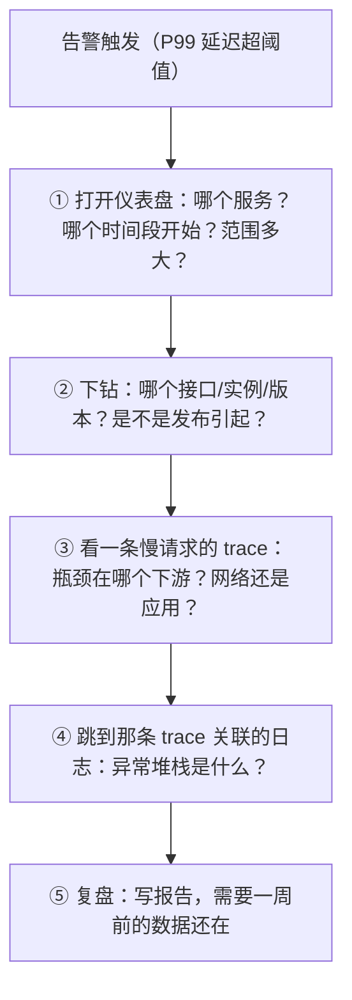
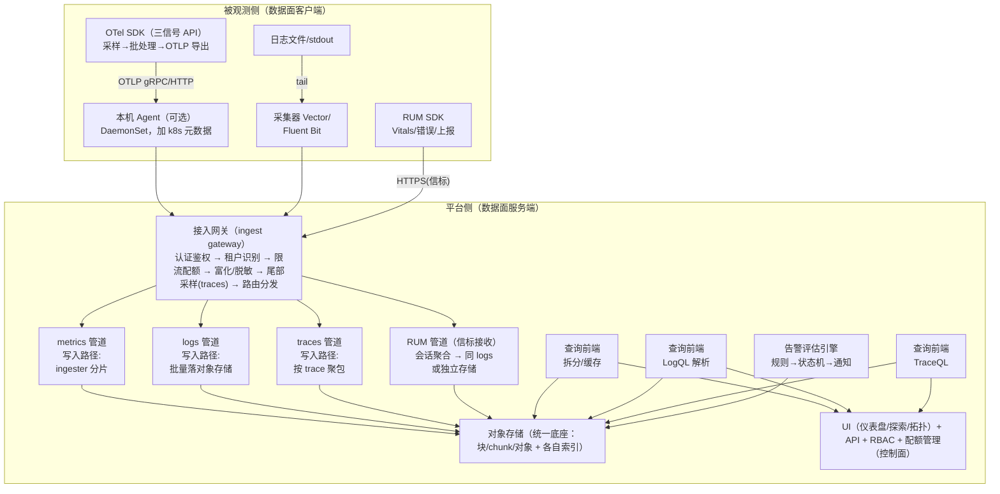

# 系统设计 01 · 从零设计一个可观测系统：需求、容量与总体架构

> 前五阶段我们学了"怎么用"（Prometheus / Loki / OTel / Jaeger / Grafana），本阶段换个视角：**如果自己造一个可观测系统（mini-Datadog），该怎么设计？**
> 本篇回答四个问题：系统的需求从哪里推导？规模怎么估算（一条算例走完三种信号）？端到端架构怎么分层？自研、开源组装、SaaS 购买怎么选？
> 后续五篇分别展开：[服务端 SDK 设计](sdk-design-server.md)、[前端 RUM SDK 设计](sdk-design-rum.md)、[接入管道](ingestion-pipeline.md)、[存储后端](storage-backends.md)、[查询与告警](query-and-alerting.md)。
> 前置：阶段 0 的 [三大支柱](../00-concepts/three-pillars.md) 与 [OTel 总览](../00-concepts/opentelemetry-overview.md)。

## 目录

- [1. 需求推导：从排障工作流反推系统能力](#1-需求推导从排障工作流反推系统能力)
- [2. 规模估算：一条算例走完三种信号](#2-规模估算一条算例走完三种信号)
- [3. 信号的统一与分离：为什么不是一个库装三种数据](#3-信号的统一与分离为什么不是一个库装三种数据)
- [4. 端到端参考架构](#4-端到端参考架构)
- [5. 多租户与隔离](#5-多租户与隔离)
- [6. 自研、开源组装、还是购买](#6-自研开源组装还是购买)
- [7. 落地路线图与设计评审清单](#7-落地路线图与设计评审清单)
- [8. 常见坑](#8-常见坑)
- [9. 面试题小结](#9-面试题小结)
- [10. 参考资料](#10-参考资料)

## 1. 需求推导：从排障工作流反推系统能力

不要从"我要存 metrics/logs/traces"出发，而要从**用户的排障工作流**出发。一个值班工程师处理告警的典型路径：



每一步都对系统提出一个**硬需求**：

| 工作流步骤 | 对系统能力的要求 | 对应设计约束 |
| --- | --- | --- |
| 告警触发 | 指标低延迟可查（< 1min 端到端） | metrics 写入路径短、告警评估周期短 |
| ① 仪表盘 | 聚合查询秒级返回 | 查询引擎并行 + 预聚合（记录规则） |
| ② 下钻 | 任意标签组合过滤 | 标签索引（倒排索引/列存排序键） |
| ③ trace | 按 trace_id 秒级点查 | trace 存储按 ID 组织（见 [存储设计](storage-backends.md)） |
| ④ 关联日志 | 日志可按 trace_id 过滤 | 采集时注入 trace_id + 日志索引支持该字段 |
| ⑤ 复盘 | 数据保留足够长 + 成本可控 | 保留策略、降采样、分层存储 |

此外还有四类"不显眼但决定成败"的非功能需求：

1. **可观测系统自身不能比业务先挂**：观测管道过载时必须能降级（限流/丢弃），不能反噬业务——这是[接入层设计](ingestion-pipeline.md)的第一原则；
2. **数据可信**：时钟偏移、重复样本、丢批都要被显式处理并计数（自监控）；
3. **低成本**：可观测数据的成本随业务线性增长，**采样、降采样、保留策略是三个成本阀门**；
4. **低接入成本**：业务方接入一个新系统的心智成本决定推广成败——这就是 OTel 把 SDK 做成事实标准的原因（[SDK 设计](sdk-design-server.md)）。

## 2. 规模估算：一条算例走完三种信号

设计的第一张表不是架构图，是**容量表**。以一个中型平台为例（口径为演算示例，重点是方法）：

**基础假设**：100 个微服务 × 平均 10 实例 = 1,000 个实例；入口流量 5,000 RPS；平均每个请求扇出 4 跳，产生 20 个 span。

### 2.1 Metrics：活跃序列数是唯一的自变量

```
全局活跃序列数 = 实例数 × 每实例序列数
每实例序列数   = runtime 指标(~500) + HTTP 指标(路由×方法×状态码, ~200) + 业务指标(~800) ≈ 1,500

→ 1.5M 活跃序列，采集间隔 15s
→ 写入 = 1.5M / 15 = 100k 样本/s
→ 存储 = 100k × 86,400 × ~3 B/样本(压缩后 chunk + 索引摊销) ≈ 26 GB/天（raw）
```
<!-- 保留原图：容量算例（公式与数值推导），非对象关系图 -->

关键直觉：**metrics 成本由"序列数 × 保留期"决定，与流量无关**。流量涨 10 倍，如果标签设计不变（没有把 user_id 塞进标签），metrics 成本几乎不变——这正是 [高基数笔记](../05-production/cardinality.md) 的主题。

### 2.2 Logs：吞吐量决定一切

```
写入 = 1,000 实例 × 20 行/s × 300 B/行 = 6 MB/s ≈ 520 GB/天（原始）
zstd 压缩 ~4x → ~130 GB/天（存储）
```
<!-- 保留原图：吞吐与存储量公式算例，非示意图 -->

关键直觉：**logs 成本由吞吐 × 保留期决定**。降低成本的手段依次是：调高级别过滤（DEBUG 不出进程）、缩短保留期、只索引标签不索引全文（Loki 路线，见 [存储设计](storage-backends.md)）。

### 2.3 Traces：采样率是最大的成本杠杆

```
span 产生 = 5,000 RPS × 20 span = 100k span/s
原始体积  = 100k × 800 B ≈ 80 MB/s ≈ 6.9 TB/天（全量保留 —— 不可行）

头部采样 10% + 错误/慢请求全保（实际 ~15%）：
→ ~1 TB/天（压缩前）→ zstd ~5x → ~200 GB/天（存储）
```
<!-- 保留原图：采样后存储量算例，非示意图 -->

关键直觉：**traces 是唯一"允许你只存一部分"的信号**。同样 $100 预算，metrics 买的是"序列数"，logs 买的是"保留期"，traces 买的是"采样率"。

### 2.4 汇总：一张月成本表（对象存储按 $0.023/GB/月）

| 信号 | 保留策略 | 存储量估算 | 月存储成本 | 成本杠杆 |
| --- | --- | --- | --- | --- |
| metrics | raw 14d + 5m 降采样 90d + 1h 降采样 1y | ~500 GB | ~$12 | 序列基数、降采样 |
| logs | 7d（热） | ~910 GB | ~$21 | 级别过滤、保留期 |
| traces | 7d，~15% 采样 | ~1.4 TB | ~$32 | 采样率（见[采样笔记](../05-production/sampling.md)） |
| **合计** | — | ~2.8 TB | **~$65** | — |

> 演算口径注意：存储只是成本的一部分，查询计算（CPU）与网关/查询副本在大规模下会反超存储；这里的结论性排序（traces 最贵 → 采样优先）在 10 倍规模下依然成立。

**查询负载**也要估：200 个活跃仪表盘 × 平均 12 个 panel × 30s 刷新 ≈ 80 QPS 聚合查询；真正致命的不是 QPS 而是**单查询扫描序列数**（一个 `sum by (user_id)` 就能扫百万序列）——这决定了查询层必须有拆分、缓存与并发限制（见 [查询设计](query-and-alerting.md)）。

## 3. 信号的统一与分离：为什么不是一个库装三种数据

三种信号的写入模式、查询模式、保留需求差异巨大，强行统一存储是经典错误：

| 维度 | metrics | logs | traces |
| --- | --- | --- | --- |
| 写入模式 | 固定速率覆盖（每序列每间隔一个点） | 突发追加 | 每请求一棵树，延迟到达（等最慢 span） |
| 数据形态 | 数值时间序列 | 半结构化文本 | 带因果关系的 span 树 |
| 典型查询 | 时间窗口聚合（rate/p95） | 标签过滤 + 关键词/模式 | 99% 按 trace_id 点查，1% 按标签搜 |
| 压缩率 | 极高（相邻样本相似，Gorilla ~2B/点） | 中（zstd ~4x） | 中高（zstd ~5x，同 trace span 相关性强） |
| 丢一点数据的代价 | 低（插值可近似） | 中（可能丢关键证据） | 高（断链则整条 trace 不完整） |
| 成本敏感点 | 基数 | 保留期 | 采样率 |

所以正确的姿势是：**存储分引擎，关联做统一**——三种数据共用一套身份体系（`service.name`、`trace_id`），UI 层提供跳转（指标 → exemplar → trace → 日志，见 [关联笔记](../04-integration/correlation.md)）。`trace_id` 就是三种信号之间的外键。

> **路线之争：三大支柱 vs 宽事件（wide events）**。Honeycomb 等主张"一张宽表存事件"（每个请求一行、上百列），查询更灵活、不需要预定义 schema；代价是基数控制压力巨大、聚合语义要自己实现、生态（告警/仪表盘）要重造。工程上两者在融合：OTel 已支持宽事件式的 attribute 模型，ClickHouse 系产品（SigNoz 等）实际上就是"列存宽表"落地三大信号。

## 4. 端到端参考架构



分层职责与失败域：

| 层 | 职责 | 允许的失败模式 |
| --- | --- | --- |
| SDK | 产生数据、本地限损（队列+丢弃） | 宿主进程存活优先于数据完整 |
| 本机 Agent | 协议转换、加环境元数据、本地缓冲 | 宕机丢本机数据，不影响业务 |
| 接入网关 | 认证、限流、富化、采样、路由 | 过载时 429 拒绝（让 SDK 退避）而非排队 |
| 存储管道 | 分片写入、压缩、索引 | 副本/纠删码兜底，单机盘损不丢数据 |
| 查询层 | 拆分、缓存、并发限制 | 慢查询被杀，不拖垮存储 |
| UI/控制面 | 可视化、权限、租户管理 | 只读故障影响体验不影响采集 |

两个设计决策值得强调：

1. **对象存储是统一底座**。三种信号的持久层都长在 S3/OSS 类存储上（Mimir/Thanos/Loki/Tempo 全如此）：11 个 9 的持久性交给云厂商，自己只管"怎么组织对象 + 怎么索引"。这是过去十年可观测系统最重要的架构变化（详见 [存储设计](storage-backends.md)）。
2. **控制面与数据面分离**。采样率、仪表盘、保留策略是控制面配置，要能动态下发给网关/Agent（OTel Operator + OpAMP 协议就是这个方向），而数据面节点保持无状态、可随意扩缩。

## 5. 多租户与隔离

只要平台服务超过一个团队，就必须回答四个问题：

| 问题 | 常见做法 | 关键细节 |
| --- | --- | --- |
| 租户身份 | 每请求带租户头（Mimir/Loki/Tempo 用 `X-Scope-OrgID`） | 网关强制注入，不让客户端自报（防止伪装） |
| 写入配额 | 按租户限流：samples/s、logs/s、span/s + 突发桶 | 超限返回 429 + 计数暴露，SDK 自动退避 |
| 查询配额 | 每租户最大并发、单查询最大扫描量、超时 | 防止一个租户的大查询拖垮共享查询节点 |
| 数据隔离 | 逻辑隔离（同集群按租户前缀分片）或物理隔离（cell） | 大客户/合规场景用独立 cell，爆炸半径可控 |

隔离的深层目标是**公平性与可预测性**：一个租户基数爆炸时，受害者应该是它自己（配额拒绝），而不是全体用户（共享队列阻塞）。

## 6. 自研、开源组装、还是购买

| 维度 | 自研存储/引擎 | 开源组装（Grafana 栈 / ClickHouse 系） | SaaS（Datadog 等） |
| --- | --- | --- | --- |
| 初期成本 | 极高（每引擎都是数人年级） | 低（compose 就能起） | 最低（按量付费） |
| 规模化成本 | 可控（人力为主） | 中（对象存储+计算节点，量级见 2.4 节成本表） | 随流量线性且贵（logs/traces 计费尤甚） |
| 控制力 | 完全 | 高（可改可调） | 低（黑盒） |
| 运维负担 | 全背 | 升级/容量/告警自己来 | 厂商背 |
| 数据主权 | 完全 | 完全（数据在自己账号） | 出域（合规审查点） |
| 适用 | 超大规模/特殊需求 | 绝大多数有平台团队的公司 | 无专职运维、快速起步 |

主流开源栈速览（各自的"全家桶"边界）：

| 栈 | metrics | logs | traces | 特点 |
| --- | --- | --- | --- | --- |
| Grafana LGTM | Mimir/Thanos | Loki | Tempo | 组件同构（对象存储底座、租户头一致），Grafana 统一 UI |
| ClickHouse 系 | ClickHouse | ClickHouse | ClickHouse | 单引擎三信号（SigNoz、HyperDX），SQL 生态，宽表路线 |
| ELK/Elastic | — | Elasticsearch | APM（可选） | 全文检索最强，索引成本最高 |
| SkyWalking | 自有存储 | — | 自有 | 国产、APM 一体化、探针体系成熟 |

本系列后续笔记以"**自研设计为主线，对照开源真实实现**"：每个子系统先给最小可用骨架，再对照 Prometheus/Loki/Tempo/Mimir 是怎么做的。

## 7. 落地路线图与设计评审清单

架构图不等于平台。从零到一的现实顺序（每步都先出价值再扩规模）：

| 阶段 | 动作 | 价值锚点 | 反模式 |
| --- | --- | --- | --- |
| 第 1 步 | metrics 先行：接 OTel SDK + 网关 + TSDB + 基础 RED 仪表盘 + 黄金信号告警 | 值班第一时间有仪表盘看 | 一上来搭全三支柱，三个月无产出 |
| 第 2 步 | logs：结构化改造 + trace_id 注入 + 日志管道 | 告警后能翻日志 | 先建索引后治结构（垃圾进垃圾出） |
| 第 3 步 | traces：SDK 自动埋点 + 尾部采样网关 + 点查后端 | 单请求排障链路打通 | 全量采样存储炸了再补采样 |
| 第 4 步 | 关联与收敛：exemplars、跳转、SLO 告警、告警治理 | 排障工作流五步闭环 | 三支柱各自门户，复制粘贴 trace_id |
| 第 5 步 | 规模化治理：多租户配额、成本看板、覆盖率指标 | 平台可复制到全部业务线 | 无配额裸奔到基数爆炸 |

**埋点覆盖率是平台期的北极星指标**（`instrumented_services / total_services`），配 SDK 自动埋点与接入模板（Helm chart 默认注入），让"新服务默认被观测"。

设计评审清单（自研/组装前过一遍，每条都要有答案）：

- [ ] 容量表：三种信号各自的写入量、序列数/stream 数、存储量、单查询扫描上限？
- [ ] 三个成本阀门（采样/降采样/保留）是否租户级可配、可动态调整？
- [ ] 网关过载语义：拒绝（429）优先于排队？SDK 侧退避是否联动？
- [ ] 丢数据的三种场景（队列满/网关拒绝/停机 flush 超时）各有计数和告警？
- [ ] 关联键（trace_id）是否在采集时刻写入全部三信号？
- [ ] 多租户配额（写入/查询/保留）与公平性隔离？
- [ ] 平台自监控：谁观测观测者（golden signals of the pipeline）？
- [ ] 逃生通道：换后端时 SDK 是否零改动（OTLP/标准协议）？

## 8. 常见坑

1. **只估算写入不估算查询**。容量表里没有"单查询最大扫描序列数"这一行，上线第一个月就会被一个 `group by` 高基数标签的仪表盘打挂。查询配额要在第一天就设计进去。
2. **没有成本阀门的全量采集**。traces 100% 采样 + logs 全量入索引，成本曲线会在半年内逼停项目。三个阀门（采样率/降采样/保留策略）必须是**租户级可配置**而不是全局常量。
3. **接入层无背压设计**。网关只加不拒，过载时排队→延迟→SDK 超时重试→雪崩。正确语义是**尽早拒绝 + 让 SDK 退避**（详见[接入设计](ingestion-pipeline.md)）。
4. **把"关联"做成事后 ETL**。三大信号的关联（trace_id 外键）必须在**采集时刻**就写入数据，事后用日志正则反提 trace_id 的方案既慢又脆。
5. **忽略自身可观测性**。平台自己的丢数率、拒绝率、队列水位没有指标，等于开盲盒运维。第一天就要自举（self-hosted telemetry）。
6. **时钟偏移不设防**。跨实例按时间对齐查询时，NTP 漂移几百毫秒就会出现"因果倒置"（span 结束早于开始）。至少要在 SDK 里打 `time.unix_nano` 并在网关做窗口容忍。

## 9. 面试题小结

1. **Q：为什么三大支柱要用三种不同的存储引擎？**
   A：写入模式（定速覆盖 vs 突发追加 vs 延迟成树到达）、查询模式（窗口聚合 vs 关键词检索 vs ID 点查）、压缩特性、丢失容忍度全不同；强行统一要么成本爆炸（ES 存 metrics）要么能力残缺（TSDB 做全文检索）。正确抽象是"存储分引擎、关联做统一"（trace_id 做外键）。
2. **Q：你们的可观测系统容量怎么估？**
   A：metrics 用活跃序列数 × 保留期（与流量无关）；logs 用吞吐 × 保留期；traces 用 span 量 × 采样率。给出 2.x 节的算例即可，强调三者成本杠杆不同。
3. **Q：为什么 Mimir/Loki/Tempo 都把对象存储做底座？**
   A：持久性外包（11 个 9）、成本比本地盘低一个量级、与计算解耦（无状态查询节点随意扩缩）；代价是高延迟与不可原地修改，所以都演化出"小对象批量打包 + 索引单独组织"的形态。
4. **Q：多租户可观测平台最容易被忽略的设计点？**
   A：公平性——配额（写入限流、查询并发、扫描量上限）要按租户隔离，防止单租户基数爆炸或大查询拖垮共享组件；数据按租户前缀分片，必要时物理 cell 隔离。
5. **Q：三大支柱和宽事件（wide event）路线怎么选？**
   A：宽表灵活但基数与生态是硬伤；三大支柱胜在标准化（OTel/semconv）与成熟工具链。落地趋势是融合：列存（ClickHouse）本质上就是可聚合的宽表，OTel 的 attribute 模型也已事件化。

## 10. 参考资料

- OpenTelemetry 官方文档（架构与规范入口）：<https://opentelemetry.io/docs/>（访问日期：2026-11-06）
- Grafana Mimir 架构文档（对象存储底座 + 多租户的完整参照）：<https://grafana.com/docs/mimir/latest/references/architecture/>（访问日期：2026-11-06）
- Thanos 设计文档（长期存储三件套：sidecar/compactor/store gateway）：<https://thanos.io/tip/thanos/design.md/>（访问日期：2026-11-06）
- Google SRE 书《监控分布式系统》章节（四个黄金信号与告警需求）：<https://sre.google/sre-book/monitoring-distributed-systems/>（访问日期：2026-11-06）
- Honeycomb 关于 wide events 与三大支柱的讨论：<https://www.honeycomb.io/blog/you-want-to-build-an-observability-pipeline>（访问日期：2026-11-06）
- 本仓库关联笔记：[三大支柱](../00-concepts/three-pillars.md)、[高基数问题](../05-production/cardinality.md)、[采样策略](../05-production/sampling.md)、[关联与跳转](../04-integration/correlation.md)

## 附：ASCII 图替换清单

| 原 ASCII 图位置（章节标题） | 原图内容简述 | 替换结果 |
| --- | --- | --- |
| 1. 需求推导：从排障工作流反推系统能力 | 告警触发后的五步排障工作流 | flowchart TD |
| 4. 端到端参考架构 | 被观测侧/平台侧分层的端到端总体架构图 | flowchart TD（subgraph 分层） |

### 保留说明

| 原 ASCII 图位置（章节标题） | 保留原因 |
| --- | --- |
| 2.1 Metrics：活跃序列数是唯一的自变量 | 容量算例（公式与数值推导），非对象关系图 |
| 2.2 Logs：吞吐量决定一切 | 吞吐与存储量公式算例，非示意图 |
| 2.3 Traces：采样率是最大的成本杠杆 | span 量与采样后存储量算例，非示意图 |

架构总览的收尾对照：三支柱的采集（SDK）→传输（管线）→存储（后端）→呈现（查询告警）四段，各自有独立分册展开——本册的价值是把四段串成一条数据流，读分册时带着"这一段在总览的哪个位置、上下游契约是什么"，孤立章节就串成了系统。

顺手补一句自检口径：能不看图说出"一条 trace 从 SDK 产生到可查询要经过几跳、每跳的契约字段是什么"——架构总览才算读完；本册的所有小节都是为这一句话服务的。

再补一句选型位：总览图的每一段都有"自建 vs 托管"的分岔——判据统一写成本册的容量三问（数据量、峰值、保留期），三问的答案定分岔方向，具体清单见 [storage-backends](storage-backends.md) 与 [apm-landscape](../03-tracing/apm-landscape.md)。
