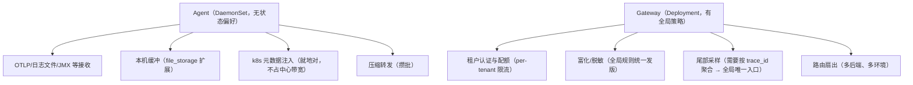
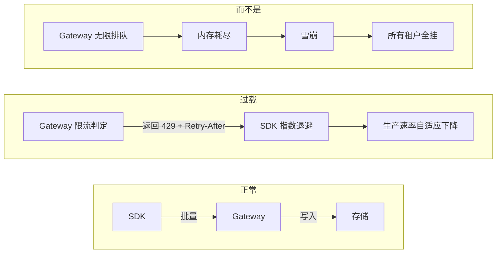
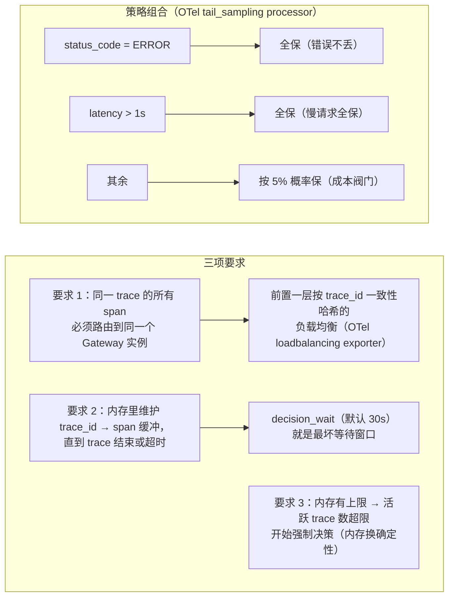

# 系统设计 04 · 接入层与数据管道：从 SDK 到存储之间的那条河

> 数据从 SDK 出来到落进存储之间，需要一条**可水平扩展、可主动丢弃、可就近加工**的管道。"SDK 直写存储"是反模式：存储的写入语义、租户配额、脱敏与尾部采样都没有落脚点。
> 本篇回答五个问题：接入层的完整职责清单是什么？agent / gateway / 两级拓扑怎么选？过载时"拒绝"和"排队"哪个对？尾部采样为什么必须部署在这层？什么时候才需要 Kafka？
> 前置：[OTel Collector 深挖](../00-concepts/otel-collector-deep-dive.md)（本篇是它的设计视角续篇）、实验 [lab00](../../labs/lab00-otel-collector-basics/README.md)、[lab04](../../labs/lab04-three-pillars/README.md)。

## 目录

- [1. 接入层的职责清单](#1-接入层的职责清单)
- [2. 拓扑选择：直发、Agent、Gateway、两级](#2-拓扑选择直发agentgateway两级)
- [3. 背压与过载保护：拒绝优先于排队](#3-背压与过载保护拒绝优先于排队)
- [4. 交付语义：at-least-once 与去重](#4-交付语义at-least-once-与去重)
- [5. 管道上的加工：富化、脱敏、尾部采样](#5-管道上的加工富化脱敏尾部采样)
- [6. 要不要 Kafka](#6-要不要-kafka)
- [7. 管道自身的可观测性与容量](#7-管道自身的可观测性与容量)
- [8. 常见坑](#8-常见坑)
- [9. 面试题小结](#9-面试题小结)
- [10. 参考资料](#10-参考资料)

## 1. 接入层的职责清单

把"SDK 直写存储"展开成它欠下的每一笔债，就是接入层的职责：

| 职责 | 具体内容 | 不做会怎样 |
| --- | --- | --- |
| 协议终结 | 终结 OTLP gRPC/HTTP、解 protobuf、租户认证 | 存储要懂 N 种客户端协议，耦合 |
| 租户与配额 | 识别租户、按租户限流（写入速率/突发桶） | 单租户刷爆共享存储 |
| 富化 | 注入 K8s 元数据（pod/namespace/node）、地域、成本标签 | SDK 要自己扫环境，口径不一 |
| 脱敏 | 属性正则掩码、删字段、截断超长值 | PII 直落存储，合规事故 |
| 尾部采样 | 按 trace 结局（错误/延迟）决策（traces 独有） | 只能头基采样，错误 trace 随机丢 |
| 路由/扇出 | 按信号/租户/环境分发到不同后端，可多路复制 | 换后端要改全部 SDK |
| 批处理重组 | 攒大对象、压缩，匹配存储的最优写入粒度 | 存储写入碎片化（对象存储尤其怕小对象） |
| 缓冲解耦 | 短时存储抖动时削峰 | 存储抖动直接打回业务（SDK 队列溢出） |

OTel Collector 的 `receivers → processors → exporters` 管道模型就是这份清单的产品化：每个 processor 对应一项职责，可编排、可插拔（见 [Collector 深挖](../00-concepts/otel-collector-deep-dive.md)）。

## 2. 拓扑选择：直发、Agent、Gateway、两级

四种拓扑，决策变量是**功能放哪、故障域多大、运维几层**：

| 拓扑 | 形态 | 优点 | 缺点 | 适用 |
| --- | --- | --- | --- | --- |
| SDK 直发 | SDK → 存储后端 | 链路最短、无中间组件 | 富化/脱敏无处安放；换后端动所有 SDK | 原型/云厂商托管端点 |
| 本机 Agent | SDK → 本机/本节点 Agent → 后端 | 就近缓冲削峰；能 tail 日志文件；K8s 里以 DaemonSet 收全节点 | 无全局视图（做不了按 trace 聚合的尾部采样）；每节点一个组件 | 单集群、日志采集刚需 |
| 集群 Gateway | SDK → 中心 Gateway → 后端 | 全局配额/路由/尾部采样集中管理；SDK 只认一个地址 | 网关成单点/单瓶颈；跨 AZ 流量成本 | 多租户平台 |
| 两级（Agent + Gateway） | SDK → Agent → Gateway → 后端 | 兼得两者：Agent 管就近采集，Gateway 管全局策略 | 组件最多、排障链路最长 | 生产平台标准形态 |

两级拓扑里职责要**严格分层**，否则演化成大泥球：



经验法则：**凡是需要"看到同一 trace 的所有 span"或"全租户统一规则"的，放 Gateway；凡是"每节点重复做且数据量大"的（解压元数据、缓冲），放 Agent。**

### 2.1 两级拓扑的落地配置（骨架级 YAML）

Agent（DaemonSet，每节点一个）——职责：接收、本机元数据、缓冲：

```yaml
# agent-config.yaml（节选，完整可跑版本见 lab04）
receivers:
  otlp:
    protocols: { grpc: { endpoint: 0.0.0.0:4317 }, http: { endpoint: 0.0.0.0:4318 } }

processors:
  memory_limiter:                      # 永远是第一个 processor
    check_interval: 1s
    limit_mib: 512                     # 软水位=limit，硬水位=spike 后开始丢数据+GC
  k8sattributes:                       # 就地富化：IP → pod/namespace/node
    extract: { metadata: [k8s.pod.name, k8s.namespace.name, k8s.node.name] }
  batch: { timeout: 5s, send_batch_size: 8192 }

exporters:
  otlp/gateway:
    endpoint: gateway.observability.svc:4317
    tls: { insecure: false }
    sending_queue:                     # 发送队列（挂 file_storage 才能持久化）
      enabled: true
      num_consumers: 4
      queue_size: 4096
    retry_on_failure:
      enabled: true
      initial_interval: 1s
      max_interval: 5s
      max_elapsed_time: 30s

extensions:
  file_storage:                        # 队列落盘：网关重启/抖动不丢缓冲数据
    directory: /var/lib/otelcol/queue
```

Gateway（Deployment，≥3 副本 + LB）——职责：全局策略 + 尾部采样 + 路由：

```yaml
# gateway-config.yaml（traces 管道节选）
receivers:
  otlp: { protocols: { grpc: { endpoint: 0.0.0.0:4317 } } }

processors:
  memory_limiter: { check_interval: 1s, limit_mib: 2048 }
  tail_sampling:                       # 前提：前面有按 trace_id 的 LB 把同 trace 打到同实例
    decision_wait: 30s                 # 等 span 到齐的最坏窗口
    num_traces: 150000                 # 活跃 trace 内存上限，超限强制决策
    policies:
      - name: errors, type: status_code, status_code: { status_codes: [ERROR] }
      - name: slow, type: latency, latency: { threshold_ms: 1000 }
      - name: baseline, type: probabilistic, probabilistic: { sampling_percentage: 5 }

exporters:
  otlp/tempo: { endpoint: tempo.observability.svc:4317 }
```

注意 traces 走 Gateway 之前还有一层**按 trace_id 一致性哈希的 LB collector**（`loadbalancing` exporter 指向网关副本列表），见第 5.3 节。

## 3. 背压与过载保护：拒绝优先于排队

接入层最重要的一条价值观：**过载时尽早拒绝，把退避责任推回 SDK**（SDK 的重试状态机见[服务端 SDK](sdk-design-server.md) 第 6 节）。两边合力构成端到端背压：



逐层的过载手段（从内到外）：

| 层 | 机制 | 关键参数/语义 |
| --- | --- | --- |
| Gateway 接收端 | 按租户令牌桶限流 | 超额立即 429（`Retry-After` 头），**不排队** |
| Gateway 处理端 | 内存水位保护 | OTel Collector 的 `memory_limiter` 必须是第一个 processor：软水位开始拒绝、硬水位进入丢数据模式并 GC |
| Gateway 发送端 | 有界发送队列 + 重试 | `sending_queue`（可挂 `file_storage` 扩展持久化）+ `retry_on_failure`；队列满则丢弃并计数 |
| SDK | 有界队列 + 退避 | 见 [SDK 设计](sdk-design-server.md)；最终丢数据也带计数 |
| 兜底 | 分级丢弃 | 级别：debug → info → …；过载先丢低价值信号（甚至按租户 SLA 定序） |

为什么"拒绝优于排队"，直觉算一笔账：写入速率是消费速率的 2 倍时，排队每秒净增 1 秒的积压——排队只是**把 OOM 换成延迟和双倍流量**（超时重试叠加）。只有当过载是**秒级抖动**时排队才有意义，这正好就是"有界小队列"的职责。

## 4. 交付语义：at-least-once 与去重

可观测管道**不追求 exactly-once**，理由是成本收益完全不对称：

| 语义 | 代价 | 收益 |
| --- | --- | --- |
| at-most-once（尽力而为） | 无 | 过载即丢数据，错误 trace 缺失 |
| **at-least-once（默认）** | 重试导致的重复 | 崩溃/超时后数据不丢 |
| exactly-once | 端到端事务/幂等去重（写入路径吞吐大降） | 对观测数据的边际收益 ≈ 0 |

于是问题变成：**重复数据怎么办？** 各信号的答案不同，这是设计时要显式写下的决策：

1. **traces**：重复 span（trace_id+span_id 相同）在按 trace 打包的后端（Tempo）**天然幂等**——同 ID 的包覆盖即可，多数实现干脆容忍；
2. **logs**：容忍重复（排障场景重复无害），要精确去重就在查询侧按指纹聚合（error 指纹本来就要做）；
3. **metrics**：唯一真正危险的信号。counter 是累积量，重复导出同时间戳样本时，**以 (series, timestamp) 为 key 后写覆盖**即可保持正确；真正的坑是**乱序与回拨**（OTLP 累积模式下 SDK 重发旧时间戳），存储端要么拒绝老样本要么带窗口接受（Prometheus 2.39+ 支持 out-of-order 窗口）。

## 5. 管道上的加工：富化、脱敏、尾部采样

### 5.1 富化：就地对

K8s 场景的标准动作（`k8sattributes` processor）：Agent 从 pod 的 IP/UID 反查 namespace、deployment、node，注入 resource 属性。要点是**在 Agent 层做**——元数据在节点上（kubelet/Downward API），去中心做既浪费带宽又放大 API Server 压力。

### 5.2 脱敏：规则即代码

属性级动作（删除/哈希/正则掩码）在管道统一执行，规则进 git、评审后发布：

```yaml
processors:
  attributes/sensitive:
    actions:
      - key: http.request.header.authorization   # 删整字段
        action: delete
      - key: user.email                          # 哈希化
        action: hash
      - key: db.statement                        # 截断超长（防大对象打爆管道）
        action: truncate
        value: 500
```

### 5.3 尾部采样：必须部署在"看得到整条 trace"的地方

头基采样看不到结局（见[采样笔记](../05-production/sampling.md)），尾部采样要等 trace 的所有 span 到齐再决策——**这只有管道做得到**：



**代价表**（评估是否上尾部采样时用）：

| 成本项 | 量级 | 说明 |
| --- | --- | --- |
| 内存 | 活跃 trace 数 × 平均 span 数 × span 大小 | 10 万并发长 trace 就是 GB 级 |
| 延迟 | decision_wait | trace 可见性延迟至少 30s（对"实时大盘"场景是硬伤） |
| 架构 | 必须加一层 trace 感知的 LB | 多一跳、多一层运维 |

替代/补充方案：**spanmetrics 先行**——先把所有 span 聚合成 RED 指标（不存原始 span），指标上看到错误率异常，再通过 exemplar 跳到保留下来的 trace。这样即使 1% 采样，异常也知道"该看哪"。

## 6. 要不要 Kafka

"管道"不等于"消息队列"。要不要在 Gateway 和存储之间加 Kafka：

| 维度 | 直接转发（OTel Collector → 后端） | Kafka 解耦 |
| --- | --- | --- |
| 组件复杂度 | 低 | 高（集群 + 分区运维 + 消费者组再均衡） |
| 削峰能力 | 短时（内存/文件队列，分钟级） | 长时（按盘容量，小时级） |
| 多消费者扇出 | Collector 自带 multi-exporter | 天然（每个后端一个消费者组） |
| 故障隔离 | 存储抖动传导到 Gateway 队列 | 存储挂半天也不丢（Kafka 先攒着） |
| 端到端延迟 | 秒级 | 秒级（追得上时）~分钟级（积压时） |

真实系统的选择：**Grafana 栈（Mimir/Loki/Tempo）写入路径没有 Kafka**——distributor→ingester 的内存环 + 对象存储已经够稳，多一层 Kafka 纯增加运维；**ClickHouse 系（SigNoz、Uber 日志平台）普遍用 Kafka**——因为 ClickHouse 的写入 hates 抖动，大批量稳定写入性能最好，Kafka 恰好把削峰和批处理都做了。

决策口诀：**存储怕抖动、消费方多、或要小时级缓冲 → Kafka；否则直接转发，用有界队列 + 对象存储扛短抖动。** 引入 Kafka 时的关键设计：分区键 = (tenant_id, trace_id)，保证 trace 完整性落在单分区内，消费者才能做按 trace 的聚合（尾部采样前移到消费侧）。

## 7. 管道自身的可观测性与容量

管道是所有数据的必经之路，它的自监控就是平台的生命体征（golden signals 应用）：

| 信号 | 指标 | 异常含义 |
| --- | --- | --- |
| 流量 | `otelcol_receiver_accepted_spans`（按 receiver 分） | 采集侧总量变化（发布？故障？） |
| 错误 | `refused` / `otelcol_exporter_send_failed_*` | 触发限流（去查配额）或后端故障 |
| 延迟 | 接收→发送的 pipeline 延迟 p99 | 处理器过重（尾部采样堆积？） |
| 饱和度 | 内存水位、发送队列长度、活跃 trace 数（尾采样） | 过载前兆，水平扩容信号 |

容量规划的两个经验值：Gateway 无状态转发单实例约可处理**每秒数十万 span**（取决于处理器重量，尾部采样会拉低一个量级）；扩容判据用**发送队列水位持续 >70%** 而不是 CPU（队列先满）。

## 8. 常见坑

1. **memory_limiter 不是第一个 processor**：放在脱敏/批量之后，水位检查晚了一拍，高峰照样 OOM。规范要求：第一个 processor 必须是 memory_limiter。
2. **尾部采样没配 trace 感知 LB**：普通轮询把同一 trace 的 span 打到不同实例，每个实例都只看到半条 trace，决策窗口超时后全按"未完结"处理，采样行为不可预测。先上 `loadbalancing` exporter（按 trace_id 哈希），再上 tail_sampling。
3. **Gateway 单副本"高可用"**：无 LB 的单点网关重启一次，全平台数据断流几十秒。网关自己要 ≥3 副本 + 前置 LB；Agent 侧配多网关地址。
4. **把重度加工全塞网关**：正则脱敏 + 大 JSON 解析 + 尾部采样叠加，单实例吞吐掉一个数量级。重加工下沉到按信号分出的独立 pipeline（traces/logs 分开部署网关），互不拖累。
5. **Agent 用 emptyDir 做持久队列却不管盘满**：file_storage 队列写满节点盘，业务 pod 被驱逐。必须配容量上限 + 满时回退丢数据模式。
6. **限流只按 QPS 不按体积**：一个 2MB 的日志批和 2KB 的指标批算"一次请求"，大租户照样打爆带宽。配额维度要含字节速率。

## 9. 面试题小结

1. **Q：为什么可观测管道普遍 at-least-once 而不做 exactly-once？**
   A：exactly-once 需要端到端事务/幂等，吞吐代价大；观测数据的消费（排障/聚合）对少量重复不敏感——traces 同 ID 覆盖天然幂等、logs 查询侧聚合、metrics 按 (series, timestamp) 后写覆盖。成本收益严重不对称。
2. **Q：过载时接入层应该排队还是拒绝？**
   A：拒绝（429 + Retry-After）优先：持续过载下排队只把 OOM 换成积压+重试放大；有界小队列只用于秒级抖动削峰。端到端背压 = 网关拒绝 + SDK 退避，两半缺一不可。
3. **Q：尾部采样为什么只能在网关做？要满足什么条件？**
   A：需要等同一 trace 的全部 span 到齐才能按结局决策，只有集中层看得到；条件：按 trace_id 一致性哈希的 LB（保证同 trace 同实例）+ 内存缓冲（decision_wait 窗口）+ 活跃 trace 上限。
4. **Q：什么时候值得引入 Kafka？**
   A：存储引擎怕写入抖动（ClickHouse）、消费方多需要扇出、或需要小时级故障缓冲；否则直接转发 + 有界队列更简单（Grafana 栈就是无 Kafka 设计）。
5. **Q：Agent 和 Gateway 的职责怎么划分？**
   A：节点本地、数据量大的事放 Agent（协议接收、K8s 元数据富化、本机缓冲）；需要全局视野或全租户统一的事放 Gateway（配额、脱敏规则、尾部采样、路由扇出）。
6. **Q：metrics 信号对重复/乱序样本最敏感，管道要注意什么？**
   A：重复靠存储端 (series, timestamp) 后写覆盖天然去重；乱序（SDK 重发旧累积值）要么拒绝要么开 out-of-order 窗口；网关不要改写时间戳（保留 SDK 时钟）。

## 10. 参考资料

- OpenTelemetry Collector 文档（processors / memory_limiter / sending_queue）：<https://opentelemetry.io/docs/collector/configuration/>（访问日期：2026-11-06）
- tail_sampling processor（决策窗口与策略）：<https://github.com/open-telemetry/opentelemetry-collector-contrib/blob/main/processor/tailsamplingprocessor/README.md>（访问日期：2026-11-06）
- loadbalancing exporter（按 trace_id 的一致性哈希）：<https://github.com/open-telemetry/opentelemetry-collector-contrib/blob/main/exporter/loadbalancingexporter/README.md>（访问日期：2026-11-06）
- Grafana Mimir 架构（无 Kafka 写入路径的参照）：<https://grafana.com/docs/mimir/latest/references/architecture/>（访问日期：2026-11-06）
- 《Observability Engineering》（O'Reilly）管道与采样章节：<https://www.oreilly.com/library/view/observability-engineering/9781492076438/>（访问日期：2026-11-06）
- 本仓库关联笔记：[OTel Collector 深挖](../00-concepts/otel-collector-deep-dive.md)、[采样策略](../05-production/sampling.md)、[结构化日志](../02-logging/structured-logging.md)；实验：[lab00](../../labs/lab00-otel-collector-basics/README.md)、[lab04](../../labs/lab04-three-pillars/README.md)

## 附：ASCII 图替换清单

| 原 ASCII 图位置（章节标题） | 原图内容简述 | 替换结果 |
| --- | --- | --- |
| 2. 拓扑选择：直发、Agent、Gateway、两级 | Agent 与 Gateway 的职责分层树 | flowchart TD |
| 3. 背压与过载保护：拒绝优先于排队 | 正常/过载/反例三条背压路径 | flowchart LR |
| 5.3 尾部采样：必须部署在"看得到整条 trace"的地方 | 尾部采样三项要求与策略组合决策 | flowchart LR |
