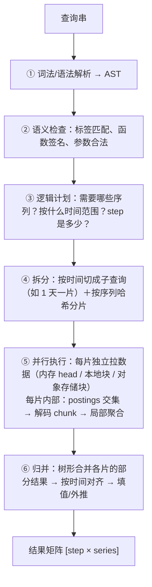
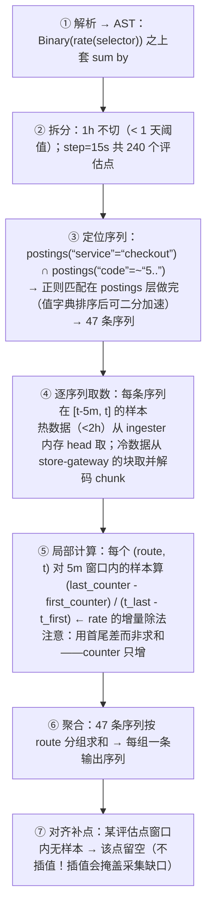
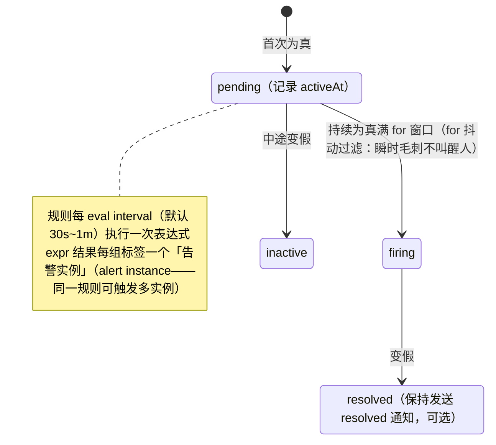
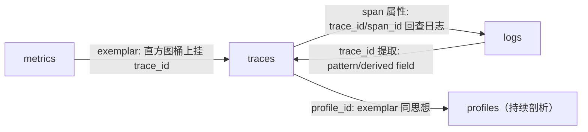

# 系统设计 06 · 查询与告警引擎：查得动、看得懂、叫得醒

> 存储解决"放得下"，查询层决定"用得好"：同一个 TSDB，查询引擎差一个设计，p99 可以从 1 秒到 60 秒。本篇是系列收官篇，回答五个问题：PromQL/LogQL/TraceQL 为什么长得像（查询语言设计的共性）？查询引擎怎么拆分并行？记录规则为什么属于成本工程？告警状态机与通知收敛怎么做？三大信号在查询面上怎么互跳？
> 前置：[PromQL](../01-metrics/promql.md)、[Grafana 深挖](../01-metrics/grafana-deep-dive.md)、[关联与跳转](../04-integration/correlation.md)、[Exemplars](../04-integration/exemplars.md)、[告警](../01-metrics/alerting.md) 与 [Alertmanager 深挖](../04-integration/alertmanager-in-depth.md)。

## 目录

- [1. 查询语言的共性：三大方言同一语法](#1-查询语言的共性三大方言同一语法)
- [2. 查询引擎骨架：解析、分片、并行、归并](#2-查询引擎骨架解析分片并行归并)
- [3. Query Frontend 模式：拆分、缓存、去重、限流](#3-query-frontend-模式拆分缓存去重限流)
- [4. 记录规则与预聚合：成本工程](#4-记录规则与预聚合成本工程)
- [5. 告警引擎：从规则到通知](#5-告警引擎从规则到通知)
- [6. 查询面上的三大信号互跳](#6-查询面上的三大信号互跳)
- [7. 常见坑](#7-常见坑)
- [8. 面试题小结](#8-面试题小结)
- [9. 参考资料](#9-参考资料)

## 1. 查询语言的共性：三大方言同一语法

把三种查询语言并排放，同一思想的三种方言（**标签选择器 + 流水线 + 聚合**）一目了然：

| 层 | PromQL | LogQL | TraceQL |
| --- | --- | --- | --- |
| 选数据 | `http_requests_total{service="checkout",code="500"}` | `{app="checkout"} |= "error"` | `{ .service.name = "checkout" && status = error }` |
| 变换/流水线 | 函数管道 `rate(...[5m])` | `\| json \| status>=500 \| line_format` | `\| by(.http.route)` 等组合子 |
| 聚合 | `sum by (route) (...)` | `sum by (route) (rate(...))`（metric 模式） | `{} \| count()` |

自研查询语言时按这个骨架搭：**AST 节点就三层（Selector / Pipeline / Aggregation）**，语法糖再多也别破坏三层性。三种语言还共享三个语义细节，踩过才知道是共性设计而非巧合：

1. **范围参数是 selector 的一部分不是聚合的**：`rate(x[5m])` 的窗口在每一步独立取数——理解错这一点 `rate` 就会算歪；
2. **默认对"缺失样本"有容忍**（PromQL lookback 5m 内取最近值）——因为分布式采集天然有抖动；
3. **标签集决定输出序列**：`by (...)` 就是 SQL 的 group by，聚合后每组一条序列。

## 2. 查询引擎骨架：解析、分片、并行、归并

一条 `query_range`（画图查询）的执行管道：



三个容易做错的细节：

- **step 对齐**：所有输出时间戳对齐到"自 Unix 纪元起的 step 整数倍"，否则缓存无法复用、相邻查询的图拼不上；
- **instant query 是 range 的特例**（step=0，取 lookback 内最近样本），共用同一条执行路径，不要写两套引擎；
- **取消传播**：用户关掉仪表盘面板，查询必须能中途取消（context 贯穿到存储扫描），否则僵尸查询堆积拖垮集群——这是查询服务的第一实现项。

### 2.1 一条查询的执行轨迹（走一遍全流程）

以仪表盘里最典型的面板查询为例：

```promql
sum by (route) (rate(http_requests_total{service="checkout", code=~"5.."}[5m]))
# 参数：range = 最近 1h，step = 15s → 输出 240 个点 × N 条序列
```



自研时的性能直觉：**总代价 ≈ 序列数 × 每序列解码的 chunk 数 × 单样本解码成本**。`sum by (user_id)` 把第一项放大四个数量级，这就是查询层必须限制"单查询最大序列数"的原因（422 拒绝优于 60 秒超时）。

### 2.2 查询代价速查表

| 模式 | 相对代价 | 原因 |
| --- | --- | --- |
| `x{固定标签}` instant | 1× | 索引直达 + lookback 一个点 |
| `rate(x[5m])` 单服务 | ~10× | 解码窗口内全部样本 |
| `sum by(高基数标签)` | **1000×+** | 输出序列爆炸，引擎与前端全垮 |
| 90 天 range 查询（无降采样档） | ~50× | 扫全历史 raw 块 |
| 正则负向匹配 `code!~"..."` | 视字典大小 | 不能用排序剪枝，退化为全值扫描 |
| 子查询嵌套 `max_over_time(rate(...)[1h:1m])` | 乘法叠加 | 内层先全量算一遍 |

## 3. Query Frontend 模式：拆分、缓存、去重、限流

Mimir/Cortex/Thanos 共同演化出的查询前置层，四个职责全是工程问题（组件见[存储设计](storage-backends.md) 3）：

| 职责 | 做法 | 收益 |
| --- | --- | --- |
| 拆分 | 长时间窗按天切子查询，并行执行后拼接 | 30 天查询从 60s 级降到并行片的最慢一片 |
| 缓存 | 结果缓存（query+range+step 为 key，按 step 对齐切桶）+ chunk 缓存 | 仪表盘反复刷新命中率高，存储读放大骤降 |
| 去重 | HA 双副本（两个 Prometheus 抓同一目标）在结果上按 replica 标签去重 | 写侧不用协议协调，读侧 CPU 换正确性 |
| 限流 | 每租户最大并发/在途查询数、单查询最大序列数与超时 | 防单租户大查询拖垮共享节点（公平性，见[总体设计](architecture-overview.md) 5） |

缓存的正确性细节（面试高频）：时间窗切成 `[t0, t1)` 的 step 对齐桶，**当前进行中的桶不缓存**（数据未齐）——否则最新 5 分钟永远显示旧值，且告警若依赖查询缓存会产生锯齿。

## 4. 记录规则与预聚合：成本工程

高频仪表盘查询（`sum by (route)(rate(...[5m]))` 每 15s 被几十个面板拉）是对存储的持续 DDoS。记录规则把计算前移：

```yaml
groups:
  - name: checkout RED 预聚合                # 每 30s 评估一次
    interval: 30s
    rules:
      - record: checkout:http_requests:rate5m    # 新序列名，"level:metric:operations" 命名法
        expr: sum by (route, code) (rate(http_requests_total[5m]))
```

预聚合后的单序列替代了原始几十上百条序列的重复扫描——**这是降采样之外第二个性价比最高的成本手段**，而且它同时是查询加速与告警加速（告警表达式直接引用预聚合序列，见[告警笔记](../01-metrics/alerting.md)）。取舍两条：预聚合序列本身占序列数（也要付基数成本）；规则变更后历史不回填（新序列从启用时刻才有值）。

### 4.1 记录规则的工程化：命名法与分层

规则一多就会演化成屎山，两套纪律要在第一天立好：

```yaml
# 命名法：level:metric:operations —— 层级 : 指标 : 施加的运算
groups:
  - name: service-level.rules            # 第一层：每服务基础预聚合（per-service，量大但通用）
    interval: 30s
    rules:
      - record: service:http_requests:rate5m
        expr: sum by (cluster, service, route, code) (rate(http_requests_total[5m]))
      - record: service:http_request_duration_seconds:p99
        expr: histogram_quantile(0.99, sum by (le, cluster, service, route)
              (rate(http_request_duration_seconds_bucket[5m])))

  - name: platform-level.rules           # 第二层：平台聚合（引用第一层结果，不再碰原始序列）
    interval: 30s
    rules:
      - record: platform:http_errors:ratio_rate5m
        expr: |
          sum(service:http_requests:rate5m{code=~"5.."})
            / sum(service:http_requests:rate5m)
```

分层规则：**上层只允许引用下层产物**（platform 层不碰 `http_requests_total` 原始序列）——规则间依赖形成 DAG，改一层不用全量重算；`promtool check rules` + 单元测试进 CI（`promtool test rules`，用例写"给定样本序列 → 期望记录值"），规则即代码（详见[告警笔记](../01-metrics/alerting.md)的 as code 一节）。

## 5. 告警引擎：从规则到通知

告警是"查询 + 状态机 + 通知编排"三件事的串联：

### 5.1 评估侧状态机（Prometheus 模型）



`for` 的语义要吃透：**pending 不发通知**，只有持续异常才升级——所以 `for: 5m` 的告警最坏要在故障后 5m+eval_interval 才通知，排障 SLO 里要把这段算进去。

### 5.2 通知侧收敛（Alertmanager 模型）

评估侧发出的告警实例可能成百上千（一个服务挂了 × 几十个实例 × 几条规则），直接投递等于电话轰炸。Alertmanager 用四层机制收敛：

| 机制 | 语义 | 典型用法 |
| --- | --- | --- |
| 分组 group_by | 同组标签的告警合并成一条通知，`group_wait`（如 30s）内到达的合并 | 按 `alertname, cluster` 分组，一次故障一封邮件 |
| 抑制 inhibit | 一条告警触发时静默另一条 | `NodeDown` 抑制该节点上所有 `ServiceDown` |
| 静默 silence | 时间窗+匹配器手动屏蔽 | 维护窗口、已知故障 |
| 路由 route 树 | 按标签递归匹配子路由，决定接收器与分组参数 | 按 team → severity 分流到 webhook/短信/工单 |

路由树 + 抑制规则 + 静默都要**as code 管理**（amtool 校验、CI 发布，见 [Alertmanager 深挖](../04-integration/alertmanager-in-depth.md)）——告警管道自身的变更也应走评审。

### 5.3 规则设计模式：为症状告警，配多窗口燃尽率

两条经过血泪验证的规则设计模式：

1. **为症状（用户视角的失败）告警，不为原因（资源指标）告警**：`checkout 错误率 > 1%` 是症状（用户下单失败）；`checkout pod 内存 85%` 是原因（可能根本不影响用户）。原因类指标放进仪表盘，症状类才配叫醒人——这是 Google SRE 《Alerting on SLOs》的核心主张；
2. **多窗口多燃尽率（multi-window multi-burn-rate）**：同一 SLO 用快慢两个窗口组合判断燃尽速度，快窗确认"正在烧"，慢窗确认"烧得起劲"，两个都超才告警：

```yaml
# SLO：checkout 可用性 99.9%（错误预算 0.1%/30d）
# 燃尽率 = 实际错误率 / 预算错误率；1h 窗口允许快速烧（14.4×），6h 窗口确认持续性
- alert: CheckoutErrorBudgetBurnFast
  expr: |
    (platform:http_errors:ratio_rate5m{service="checkout"} > 14.4 * 0.001)
    and (rate5m_over_1h_version > 14.4 * 0.001)      # 简化示意：1h 与 5m 双窗都超
  for: 2m
  labels: { severity: page, team: checkout }
  annotations:
    summary: "checkout 1h 内将烧穿 2% 错误预算"
    runbook_url: "https://wiki/runbooks/checkout-errors"
```

每个 page 级告警必须有 `runbook_url`（值班的第一反应不是看图而是照手册走）——这也是评估告警质量的硬指标：**无 runbook 的告警不允许 severity=page**。

### 5.4 告警质量（与 SLO 的衔接）

规则写出来的第一版几乎一定是"噪声发射器"。收敛到 SLO 视角：**为用户旅程的 SLO 告警（错误预算燃尽率），而不是为每个资源指标告警**（方法见 [SLO 笔记](../04-integration/slo.md)）。验收标准只有一条：每条告警都值得人从睡梦中醒来。

## 6. 查询面上的三大信号互跳

存储分引擎（见[存储设计](storage-backends.md)），但**查询面必须织成一张网**——这是可观测系统与"三个监控工具"的本质区别。三个跳转通道：



1. **metrics → traces（exemplars）**：histogram 样本可附带少量 (trace_id, value) 车载样本（Prometheus 有独立 exemplar 存储，容量上限保护索引）。图上 p99 毛刺 → 点开该桶的 exemplar → 直达慢请求 trace。成本控制点：exemplars 是"每序列最多几个"的预算制，不能无限挂；
2. **logs → traces（derived fields）**：Loki 数据源配置 `derivedFields`（`| pattern` 提取 trace_id 列），日志行渲染出可点的 trace 链接。依赖约束：**日志里必须真的打了 trace_id**（MDC/结构化注入，见[关联笔记](../04-integration/correlation.md)）——这是采集侧欠查询侧的债，设计第一天就要还；
3. **traces → profiles**：span 上挂 `profile_id`，跳到该时间窗的 CPU/内存剖析（Pyroscope 与 exemplar 同一思想，见[剖析笔记](../05-production/profiling.md)）。

UI 层把这些通道产品化为**一键跳转**（Grafana 的 data source correlations / 内置 Trace to logs），排障工作流（[总体设计](architecture-overview.md)第 1 节的五步）才真正闭环。

## 7. 常见坑

1. **rate() 窗口 < 2×抓取间隔**：`rate(x[15s])` 每 15s 窗口内只有 1~2 个样本，图全是锯齿甚至无值。经验律：窗口 ≥ 4×抓取间隔；
2. **group by 高基数标签**：`sum by (user_id)(...)` 输出百万序列，查询引擎与前端全挂。查询层要设"单查询最大序列数"硬限制（返回 422 而不是硬扛）；
3. **缓存当前步长桶**：最新数据被缓存固化，仪表盘"永远差一个 step"，依赖缓存的告警在 firing/resolved 之间锯齿。进行中的桶一律不缓存；
4. **告警身份设计错误**：把会变的值（实例 IP、当前时间、错误计数）放进告警标签——标签是告警实例的身份（identity），每次值变都被当成新告警，去重与抑制全部失效。动态信息放 annotations；
5. **recording rule 与面板查询双轨漂移**：面板还在算原始表达式、规则也在算，口径渐渐不一致。约定：预聚合序列是唯一事实来源，面板只允许引用；
6. **没有查询超时与取消传播**：一个 90 天大查询占住执行节点，后续查询排队雪崩。超时 + 取消 + 并发上限三件套是查询服务上线前提。

## 8. 面试题小结

1. **Q：查询引擎怎么做长区间查询的加速？**
   A：拆分（按时间切并行片）+ 分片（按序列哈希分布执行）+ 缓存（step 对齐的结果桶，进行中桶不缓存）+ 归并；配套每租户并发/序列数限制防大查询拖垮集群。
2. **Q：记录规则解决什么问题？和降采样的区别？**
   A：把高频重复的聚合计算前移成预写序列，同时降低查询延迟与读放大（成本工程）。降采样是"降低精度延长保留"，记录规则是"预计算降低查询成本"，二者正交叠加。
3. **Q：for 告警的语义？为什么需要它？**
   A：表达式为真后先进入 pending，持续满足 for 窗口才 firing——过滤瞬时毛刺（重启、GC 停顿）。代价是最坏通知延迟 = for + 评估间隔，要计入故障响应 SLO。
4. **Q：Alertmanager 的告警风暴怎么防？**
   A：group_by 分组 + group_wait 合并同一事件的多个实例；inhibit 用高优先级抑制衍生告警；silence 处理已知事件；三者都基于"标签是告警身份"的前提，所以标签设计不能含动态值。
5. **Q：三大信号在查询层怎么关联？前提是什么？**
   A：metrics→traces 走 exemplars（直方图挂 trace_id，容量预算制）；logs→traces 走 trace_id 提取列/derived fields；traces→profiles 走 profile_id。前提是采集侧从第一天就把 trace_id 写进日志与 exemplar——关联是采集时决策，查询侧只是把它点亮。
6. **Q：自研查询语言要守住什么结构？**
   A：三层 AST：标签 Selector → 流水线 Pipeline → 聚合 Aggregation；范围属于 selector、容忍样本缺失、标签集即分组。PromQL/LogQL/TraceQL 是同一骨架的三种方言。

## 9. 参考资料

- PromQL 官方文档（语义、lookback、子查询）：<https://prometheus.io/docs/prometheus/latest/querying/basics/>（访问日期：2026-11-06）
- LogQL（流水线与 metric 查询）：<https://grafana.com/docs/loki/latest/query/>（访问日期：2026-11-06）
- TraceQL 语言参考：<https://grafana.com/docs/tempo/latest/tracectl/traceql/>（访问日期：2026-11-06）
- Mimir query-frontend（拆分/缓存/去重）：<https://grafana.com/docs/mimir/latest/references/architecture/components/query-frontend/>（访问日期：2026-11-06）
- Prometheus 记录规则与告警规则：<https://prometheus.io/docs/prometheus/latest/configuration/recording_rules/>（访问日期：2026-11-06）
- Alertmanager 概念（分组/抑制/静默/路由）：<https://prometheus.io/docs/alerting/latest/overview/>（访问日期：2026-11-06）
- Exemplars 与 Grafana 集成：<https://prometheus.io/docs/prometheus/latest/feature_flags/#exemplars-storage>（访问日期：2026-11-06）
- 本仓库关联笔记：[PromQL](../01-metrics/promql.md)、[告警](../01-metrics/alerting.md)、[Grafana 深挖](../01-metrics/grafana-deep-dive.md)、[Exemplars](../04-integration/exemplars.md)、[关联与跳转](../04-integration/correlation.md)、[SLO](../04-integration/slo.md)、[Alertmanager 深挖](../04-integration/alertmanager-in-depth.md)、[持续剖析](../05-production/profiling.md)

## 附：ASCII 图替换清单

| 原 ASCII 图位置（章节标题） | 原图内容简述 | 替换结果 |
| --- | --- | --- |
| 2. 查询引擎骨架：解析、分片、并行、归并 | query_range 六步执行管道 | flowchart TD |
| 2.1 一条查询的执行轨迹（走一遍全流程） | 一条 PromQL 查询的七步执行轨迹 | flowchart TD |
| 5.1 评估侧状态机（Prometheus 模型） | 告警实例 pending/firing/inactive/resolved 状态机 | stateDiagram-v2 |
| 6. 查询面上的三大信号互跳 | metrics/logs/traces/profiles 四条互跳通道 | flowchart LR |
