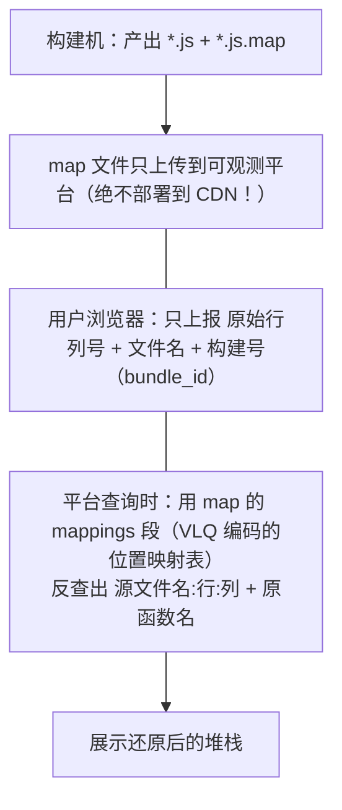
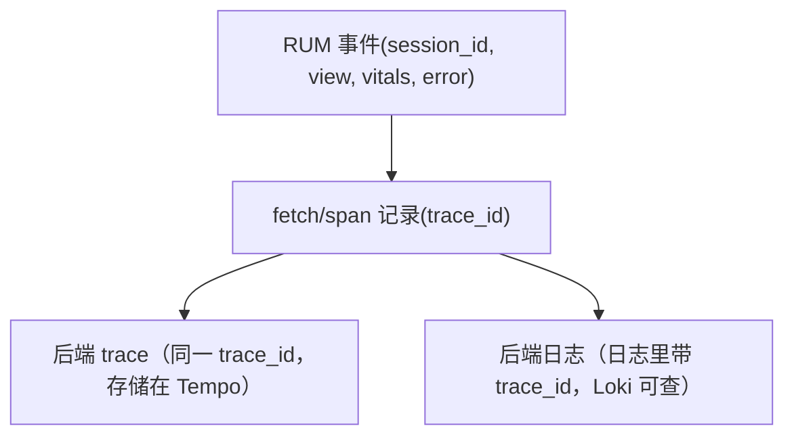

# 系统设计 03 · 前端 RUM SDK 设计：浏览器里的采集与上报

> 服务端 SDK 生存在"友好的服务器环境"，RUM（Real User Monitoring）SDK 生存在**敌对环境**：页面随时卸载、网络不可靠、没有文件系统、用户装着广告拦截器、法务盯着隐私合规。
> 本篇回答五个问题：RUM SDK 与服务端 SDK 的本质差异是什么？Web Vitals（LCP/INP/CLS）在浏览器里到底怎么测？错误怎么采集、怎么用 Source Map 还原？上报通道（sendBeacon / keepalive）怎么设计才能"卸载前发得出去"？前端怎么和后端 trace 串成一条链？
> 前置：[前端 RUM 概念篇](../04-integration/frontend-rum.md)（本篇是它的设计视角续篇）、[Context 传播](../03-tracing/context-propagation.md)。

## 目录

- [1. 与服务端 SDK 的本质差异](#1-与服务端-sdk-的本质差异)
- [2. 采集什么：四类数据源](#2-采集什么四类数据源)
- [3. Web Vitals 的测量原理](#3-web-vitals-的测量原理)
- [4. 错误采集与 Source Map 还原](#4-错误采集与-source-map-还原)
- [5. 会话模型与会话级采样](#5-会话模型与会话级采样)
- [6. 上报通道设计](#6-上报通道设计)
- [7. 前后端 trace 串联](#7-前后端-trace-串联)
- [8. 隐私与合规](#8-隐私与合规)
- [9. 常见坑](#9-常见坑)
- [10. 面试题小结](#10-面试题小结)
- [11. 参考资料](#11-参考资料)

## 1. 与服务端 SDK 的本质差异

| 维度 | 服务端 SDK | RUM SDK | 设计后果 |
| --- | --- | --- | --- |
| 生命周期 | 进程常驻，可优雅停机 | 页面随时刷新/关闭/切后台 | 上报必须"现在就发"且在卸载前完成 |
| 运行时 | 可控（JVM/Go/Node 版本固定） | 碎片化（浏览器版本×设备×WebView） | 代码要编译到 ES5、特性检测降级 |
| 后台能力 | 可开线程、可落盘缓冲 | 无后台线程、存储只有几 MB 的 localStorage/IndexedDB | 缓冲有限，失败重试空间小 |
| 网络 | 内网/专线，gRPC 可用 | 公网 HTTPS，可能被拦截器掐断 | 走 HTTPS 信标 + 多域名兜底 |
| 版本升级 | 重新部署即全员升级 | 用户不刷新页面就一直是旧版 SDK | 配置/事件结构要向后兼容若干年 |
| 数据主权 | 自家数据 | **用户设备上的用户行为数据** | PII 脱敏、合规同意、退出机制是第一天需求 |
| 性能预算 | <1~2% CPU | 不能阻塞渲染主线程 | 采集挂 PerformanceObserver，序列化切片/交 idle |

一句话：服务端 SDK 的第一原则是"不伤害业务进程"，RUM SDK 的第一原则是**"不伤害用户页面、不越权拿数据、卸载前把数据送出去"**。

## 2. 采集什么：四类数据源

| 数据源 | 浏览器 API | 产出 |
| --- | --- | --- |
| 导航与资源耗时 | Navigation Timing L2 / Resource Timing | 页面加载瀑布（TTFB、DNS、白屏）、资源（JS/CSS/API）耗时 |
| 体验指标 | PerformanceObserver（LCP/INP/CLS 事件） | Core Web Vitals（见 [3](#3-web-vitals-的测量原理)） |
| 错误 | `window.onerror` / `unhandledrejection` / `error` 事件 | JS 异常、Promise 未捕获拒绝、资源加载失败 |
| 行为轨迹（面包屑） | 点击/路由/请求的监听 | 错误发生前的用户动作序列，排障上下文 |

```js
// 面包屑（breadcrumb）的核心是"错误前的最后 20 步"
rum.addBreadcrumb('click',  { selector: '#checkout-btn' });
rum.addBreadcrumb('route',  { from: '/cart', to: '/pay' });
rum.addBreadcrumb('fetch',  { url: '/api/order', status: 500 });  // 与错误关联的最强线索
```

API 设计上要暴露 `reportError`（手动报错）、`addBreadcrumb`、`setUser`（匿名 ID）、`reportEvent`（业务事件如"支付成功"）——其余全部自动采集，接入成本控制在"一段 script 标签"。

统一的事件模型（所有采集源归一为一种信封，后端只需处理一种 schema）：

```jsonc
// 单个 RUM 事件（批量上报数组中的一项）
{
  "type": "error",                          // vital | navigation | error | action | view | fetch
  "timestamp": 1762430400000,
  "session": { "id": "a3f8...", "index": 2, "sampled": true },
  "view":    { "url": "/checkout", "route": "/checkout/:id" },   // URL 清洗后的路由模板
  "device":  { "mem": 8, "net": "4g", "ua_hash": "9c1d..." },    // UA 哈希化，防指纹
  "error":   { "msg": "Cannot read property...", "stack_hash": "77e2...",
               "file": "app.a1b2.js", "line": 1, "col": 48213,
               "bundle_id": "2026-11-06.a1b2c3" },               // 服务端用 bundle_id 找 sourcemap
  "trace":   { "trace_id": "4bf92f35...", "span_id": "00f067aa..." },  // 与后端 trace 串联的键
  "bcs":     [ /* 最近 20 条面包屑 */ ]
}
```

字段设计的两个原则：**采集端只放"定位所需"的最小字段**（体积与隐私双约束）；**动态部分（trace_id、bundle_id）必须是平台可反查的键**而不是自包含数据。

## 3. Web Vitals 的测量原理

不是背指标定义，而是知道**浏览器给了什么原料**：

| 指标 | 原料（API） | 计算要点 | 上报时机 |
| --- | --- | --- | --- |
| LCP 最大内容绘制 | `PerformanceObserver` 订阅 `largest-contentful-paint` 条目 | 浏览器持续报告更大的候选，**用户首次交互后停止更新**——所以最终值要等交互或页面隐藏才定 | `visibilitychange→hidden` 时上报（不能等 unload，移动端不可靠） |
| INP 交互到下次绘制 | `event` 条目（Event Timing API），`duration` = 交互开始到下一帧绘制 | 取页面生命周期内所有交互延迟的**约 p98**（交互少时取最差） | 页面隐藏时一次性上报 |
| CLS 累积布局偏移 | `layout-shift` 条目（`value` = 影响面积×距离分数） | 会话窗口累加：偏移间隔 <5s 归同一窗口，单窗口上限 1s，取**最大窗口**的和 | 页面隐藏时上报 |

三条工程要点：

1. **不要自己手写这些算法**，直接用官方 `web-vitals` 库（Google 维护，~1KB），它处理了上述所有边界（含 Safari 降级）；
2. **统一在 `visibilitychange` 触发上报**：手机上 `unload` 有时不触发、有时被 bfcache 吞掉，`document.visibilityState === 'hidden'` 是唯一可靠的"最后时机"；
3. 指标上报要带**维度**：页面路由、SDK 版本、设备档位（`navigator.deviceMemory`/`connection.effectiveType`），否则聚合出的 p75 无法下钻。

> 指标沿革提醒：INP 于 2024-03 正式取代 FID 成为 Core Web Vitals 第三项（FID 只测首次交互的输入延迟、且几乎从不过线，INP 测全程交互响应）。面试还答 FID 会暴露知识更新断层。

### 3.1 标准接入（web-vitals 库）

```js
import { onLCP, onINP, onCLS } from 'web-vitals';        // ~1KB，含全部窗口/降级逻辑

const send = (metric) => rum.queue({
  type: 'vital', name: metric.name, value: metric.value, rating: metric.rating,
  id: metric.id,                                        // 本次页面加载内的唯一 ID，用于去重合并
  delta: metric.delta, navigationType: metric.navigationType,  // navigate/restore/back_forward
});
onLCP(send); onINP(send); onCLS(send);
// 注意：库内部已按"最终值确定"时机回调（LCP 在首次交互/页面隐藏、INP/CLS 在页面隐藏）
// 所以 send 里不要再等 unload —— 回调到了就入队，页面隐藏时统一 flush
```

`rating`（good/needs-improvement/poor）直接采用官方阈值分档上报，**阈值判断放端上**（0.25s/2.5s 这类分界随 web.dev 政策会变，SDK 升级即可），平台只存原始 `value`，保证历史数据可比。

## 4. 错误采集与 Source Map 还原

### 4.1 三种错误入口

```js
window.addEventListener('error', e => {
  if (e.target && e.target !== window) return reportResourceError(e.target);  // 资源加载失败（img/script）
  reportJsError(e.message, e.filename, e.lineno, e.colno, e.error);           // 同步 JS 错误
}, true);                                                                     // capture=true 才能拿到资源错误

window.addEventListener('unhandledrejection', e => {                          // Promise 未 catch
  reportJsError(String(e.reason), '', 0, 0, e.reason instanceof Error ? e.reason : undefined);
});
```

**跨域脚本的经典问题**：加载第三方/CDN 脚本报错时只能拿到 `"Script error."`，行列号全无——浏览器对非同源脚本报错的拦截。解法：script 标签加 `crossorigin="anonymous"` + CDN 返回 `Access-Control-Allow-Origin` 头。采集不到堆栈的错误是半残数据，这条要在接入文档里写死。

### 4.2 Source Map：还原在生产端，不在客户端

生产构建把 `app.a1b2c3.js` 压缩混淆后，错误堆栈是 `app.a1b2c3.js:1:48213`，毫无可读性。正确流水线：



两个设计决策：**map 不下发到浏览器**（等于公开源码）而是平台私存；**还原放在查询时**而不是采集时（客户端拿不到 map，且采集端还原会拖慢上报）。

## 5. 会话模型与会话级采样

RUM 的采样与服务端语义不同——**必须按会话整体采样**：

```
session_id：首次访问生成随机 ID，localStorage 持久化
           30 分钟无活动 或 跨过午夜 → 切新会话（业界惯例口径）
采样决策：hash(session_id) % 100 < rate
           同一会话内所有事件（vitals/错误/trace）同生共死
```
<!-- 保留原图：会话定义与采样判定公式清单，无对象关系层级，非示意图 -->

为什么不能按事件采样：事件级随机采样会把"同一会话的 LCP 采到了、错误没采到、trace 断了"拆散，用户旅程无法重建；按会话哈希则保证**分析单元完整**，且会话内确定性（刷新页面不会翻转决策）。

配套的还有**用户 ID**：默认只用匿名 ID（`session_id` 级别），`setUser` 显式传入业务 ID 时要过脱敏白名单（见 [8](#8-隐私与合规)）。

## 6. 上报通道设计

浏览器给的四条通道，各有死穴：

| 通道 | 特点 | 死穴 | 适用 |
| --- | --- | --- | --- |
| `navigator.sendBeacon(url, data)` | 异步、**页面卸载后仍会发出**、不阻塞 | 单次 ~64KB 队列配额；POST 无法读响应、无法自定义重试 | 卸载时的兜底上报 |
| `fetch(url, {keepalive:true})` | 卸载后仍发；可读响应、可设头 | body 同样 ~64KB 限制 | 常规上报（首选） |
| `new Image().src = url + '?' + qs` | 最兼容、穿透部分拦截器 | GET URL 长度受限、无法带 body | 轻量计数兜底 |
| WebSocket/SSE 长连接 | 实时双向 | 卸载即断；连接维护成本 | 会话回放（rrweb）类重客户端 |

**批量与合并**是默认策略：事件先进内存队列，按"满 20 条 或 5s 或 页面隐藏"三条件触发合并上报（一个信标带 N 个事件）。与服务端 SDK 的批处理同理，只是"页面隐藏"替代了"定时器到点"的地位：

```js
const queue = [];
function schedule() {
  if (queue.length >= 20) return flush('batch-full');
  clearTimeout(t); t = setTimeout(() => flush('interval'), 5000);
}
document.addEventListener('visibilitychange', () => {
  if (document.visibilityState === 'hidden') flush('page-hidden');   // 最后时机，用 sendBeacon
});
function flush(reason) {
  const events = queue.splice(0);
  const body = JSON.stringify({ events });
  let ok;
  if (reason === 'page-hidden') {
    ok = navigator.sendBeacon(ENDPOINT, body);                        // 卸载路径：最可靠
  } else {
    ok = fetch(ENDPOINT, { method: 'POST', keepalive: true, body });  // 常规路径：可读响应可设头
  }
  if (!ok) retryLater(events);   // 非 unload 路径才重试
}
```

**失败处理的天花板很低**，要诚实设计：非卸载失败 → 指数退避重试 3 次 → 写入 IndexedDB（配额 ~几 MB，只存最近的）下次启动补发；卸载路径失败 → 认丢 + 计数。不要幻想"本地无限缓冲"，浏览器没有这个能力。

## 7. 前后端 trace 串联

RUM 的杀手级能力：**用户说"页面卡"，你能跳到那条请求的后端 trace**。实现方式是把浏览器变成 trace 的根：

```js
// 拦截 fetch/XHR：前端生成 traceparent 注入请求头，后端 SDK 提取并续链
const origFetch = window.fetch;
window.fetch = async (input, init = {}) => {
  const { traceId, spanId, sampled } = rumCtx.currentTrace();       // 当前页面/交互的 trace 上下文
  const headers = new Headers(init.headers);
  headers.set('traceparent', `00-${traceId}-${spanId}-${sampled ? '01' : '00'}`);  // W3C Trace Context
  const t0 = performance.now();
  try {
    const res = await origFetch(input, { ...init, headers });
    rum.recordFetch(input, res.status, performance.now() - t0, traceId);
    return res;
  } catch (e) { rum.recordFetch(input, 0, performance.now() - t0, traceId); throw e; }
};
```

数据模型上形成三段式关联：



后端 SDK 只要按标准做 extract（见[服务端 SDK](sdk-design-server.md) 第 3 节），链路就自动续上——**不需要后端知道请求来自浏览器**，这正是 W3C Trace Context 标准化的红利。Grafana Faro、Datadog RUM 的前后端串联都是这个原理。

注意两个边界：跨域第三方 API（支付、CDN）不配合回传，trace 到边界为止；页面内多个并行请求各自生成子 span，聚合口径（"这个 view 的总耗时"）由 RUM 侧自己算，不要指望 trace 侧。

## 8. 隐私与合规

RUM 采集的是**真实用户行为**，合规不是附加题：

| 风险 | 来源 | 设计对策 |
| --- | --- | --- |
| URL 里的 PII | `/reset?email=a@b.com`、`/user/12345` | 上报前按规则清洗：query 白名单 / path 参数 ID 化 |
| 请求体 | 绝不采集 POST body（密码、表单全在里面） | 只记 URL + 状态码 + 耗时 |
| 用户标识 | 邮箱/手机号当 user_id | 匿名 ID 默认，业务 ID 哈希化 + 白名单字段 |
| IP | 信标接收端拿到真实 IP | 接收端截断（/24）后即弃，不当维度使用 |
| 同意（GDPR/个保法） | 未同意就采集 | `init({ consent: 'granted' })` 门控；提供 `optOut()` 全停 |

**红线级规则**：默认采集"性能与错误"，"内容"（DOM 快照、输入、console）必须是显式开启的可选模块（会话回放类功能），且自动遮罩（mask）输入框。

## 9. 常见坑

1. **SPA 的"页面浏览"定义**：没有整页跳转，靠监听 history API（pushState/replaceState + popstate）把路由变化当 PV；路由切换后还要**重置 LCP/CLS 口径**（web-vitals 的 `reportChangedViews` 逻辑），否则指标混进上一视图。
2. **unload 里做重活**：移动端 `unload` 可能不触发、还会禁用 bfcache。所有"最后动作"改挂 `visibilitychange`。
3. **广告拦截器吃掉上报**：拦截规则常按域名/路径（`/rum`、`/collect`）匹配。对策：自定义上报路径、与主站同域（反代 `/api/telemetry`）、上报失败有计数（能估出"看不见的用户比例"）。
4. **重复上报**：刷新/重试导致同一错误一分钟报 500 次。客户端按 `msg+file+line` 做分钟级去重 + 服务端按指纹聚合（错误指纹 = 堆栈哈希）。
5. **SDK 自身把页面搞挂**：初始化异常、内存泄漏的面包屑数组、过度序列化大对象。所有采集回调 `try/catch`，面包屑环形数组（定长），序列化深度与体积双重上限。
6. **指标不带维度**：只报一个全局 p75，无法回答"是不是低端机/某路由/某版本的问题"。维度从第一天就要带上（路由、版本、设备档）。

## 10. 面试题小结

1. **Q：RUM SDK 和服务端 SDK 最大的设计差异？**
   A：环境敌对性：页面随时卸载（上报必须 visibilitychange+sendBeacon 兜底）、无后台线程与无限落盘（缓冲与重试空间小）、版本碎片（向后兼容多年）、数据在用户设备上（隐私合规是第一天需求）。
2. **Q：LCP 为什么不能实时上报？**
   A：浏览器在用户首次交互后停止更新 LCP 候选，最终值只有到页面隐藏时才确定；且移动端 unload 不可靠，统一在 `visibilitychange→hidden` 上报（INP/CLS 同理）。
3. **Q：sendBeacon 和 fetch keepalive 怎么选？**
   A：常规路径用 fetch keepalive（可读响应、可设头、同样卸载后发送）；页面隐藏的最后时机用 sendBeacon（最兼容、专门为卸载设计）。两者都有 ~64KB 单请求限制，靠批量合并控制体积。
4. **Q：RUM 采样为什么按会话不按事件？**
   A：分析单元是"用户旅程"（会话），事件级采样会把同一会话的 vitals/错误/trace 拆散、无法重建；按 session_id 确定性哈希保证会话内同生共死、刷新不翻转。
5. **Q：前端报错怎么和后端 trace 串起来？**
   A：前端拦截 fetch/XHR，以自己为 trace 根，按 W3C Trace Context 注入 `traceparent` 头；后端 SDK 标准提取续链。同一 trace_id 串起 RUM 事件、后端 trace、后端日志三处存储。
6. **Q：Source Map 为什么不能部署到 CDN？**
   A：等于把生产源码公开。map 只上传到可观测平台私存，客户端只报原始行列号，平台在查询时用 VLQ 映射表还原。

## 11. 参考资料

- web.dev：Core Web Vitals 与 web-vitals 库：<https://web.dev/articles/vitals>（访问日期：2026-11-06）
- web.dev：INP 指南（取代 FID 的原理与阈值）：<https://web.dev/articles/inp>（访问日期：2026-11-06）
- MDN：PerformanceObserver / Event Timing API：<https://developer.mozilla.org/en-US/docs/Web/API/PerformanceObserver>（访问日期：2026-11-06）
- MDN：navigator.sendBeacon（含 64KB 队列配额说明）：<https://developer.mozilla.org/en-US/docs/Web/API/Navigator/sendBeacon>（访问日期：2026-11-06）
- W3C Trace Context 规范（traceparent 格式）：<https://www.w3.org/TR/trace-context/>（访问日期：2026-11-06）
- Source Map 修订版规范（mappings/VLQ）：<https://sourcemaps.info/spec.html>（访问日期：2026-11-06）
- Grafana Faro 文档（生产级 RUM SDK 的实例参照）：<https://grafana.com/docs/cloud/front-end-application-observability/>（访问日期：2026-11-06）
- 本仓库关联笔记：[前端 RUM 概念篇](../04-integration/frontend-rum.md)、[Context 传播](../03-tracing/context-propagation.md)、[关联与跳转](../04-integration/correlation.md)

## 附：ASCII 图替换清单

| 原 ASCII 图位置（章节标题） | 原图内容简述 | 替换结果 |
| --- | --- | --- |
| 4.2 Source Map：还原在生产端，不在客户端 | 构建机/浏览器/平台三段还原流水线 | flowchart TD |
| 7. 前后端 trace 串联 | RUM 事件到后端 trace/日志的关联树 | flowchart TD |

### 保留说明

| 原 ASCII 图位置（章节标题） | 保留原因 |
| --- | --- |
| 5. 会话模型与会话级采样 | 会话定义与采样判定公式清单，无对象关系层级，非示意图 |

## 附：RUM SDK 的采样与隐私速查（收尾增补）

本册讲了 RUM SDK 的设计分层，收尾把最容易出事的两个横切面压成速查：

- **采样策略**：会话级采样（同一会话全采样或全丢弃，保证 trace 完整）优于事件级独立采样；错误事件默认全量（错误本来就少，丢了最可惜）；
- **隐私红线**：URL query 里的 token/邮箱脱敏在**采集端**做（进了 buffer 再脱敏就晚了）；录屏类功能默认关闭、开启前过法务；用户可关闭遥测的开关要真实生效（不是埋着不管）。

两行合起来是 RUM SDK 的"社会责任"清单——技术分册容易只讲架构不讲约束，但 SDK 是直接跑在用户浏览器里的代码，约束即设计。

### 收尾自测（增补）

3. 会话级采样为什么优于事件级采样？（同一用户的完整轨迹不可分割）
4. 你项目的前端遥测数据里有 URL query 吗？脱敏发生在采集端还是后端？
