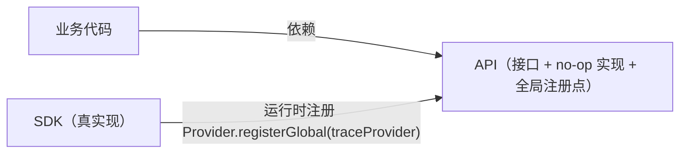
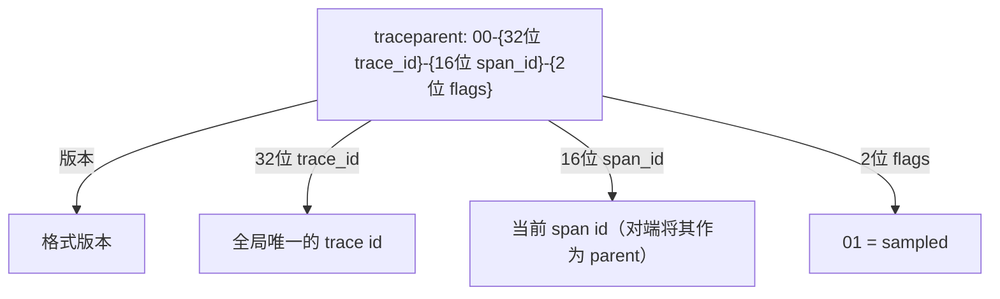
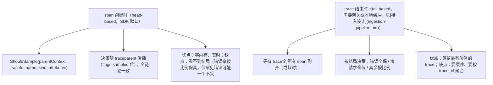
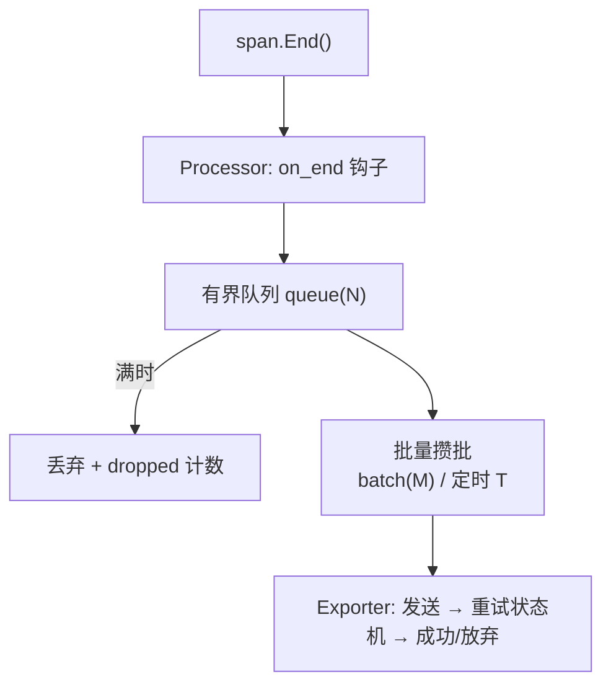
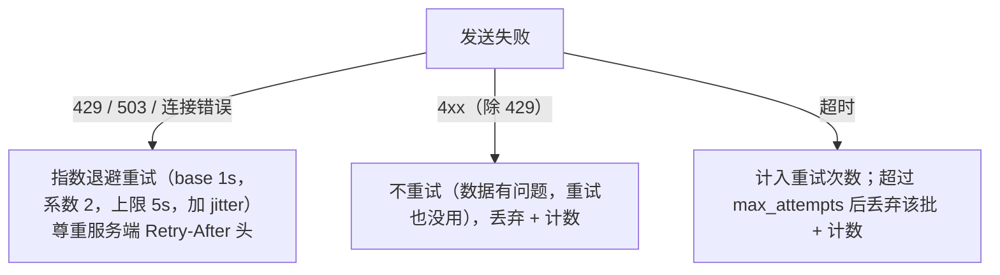

# 系统设计 02 · 服务端 SDK 设计：埋点库的内部机制

> SDK 是可观测系统里**唯一运行在用户业务进程里**的组件：它必须永不伤害宿主、几乎零配置可用、且不能把业务绑死在任何后端上。
> 本篇回答五个问题：API/SDK 分离怎么落到对象模型？context 是怎么"隐式"穿过调用栈的？采样决策在哪做、怎么做才能不打断 trace？导出管线的队列/批量/重试状态机长什么样？自动埋点（字节码注入）的原理与边界在哪？
> 前置：[OTel SDK 实战](../03-tracing/otel-sdk.md)（对象层级与代码用法）、[Metrics/Logs SDK](../00-concepts/otel-metrics-and-logs-sdks.md)；本篇是它的"设计视角"续篇。
> 篇末给出一个 ~200 行的最小 Tracing SDK 设计骨架（伪代码）。

## 目录

- [1. 设计原则：永不伤害宿主](#1-设计原则永不伤害宿主)
- [2. API 与 SDK 分离：对象模型怎么设计](#2-api-与-sdk-分离对象模型怎么设计)
- [3. Context：隐式传播的实现机制](#3-context隐式传播的实现机制)
- [4. 采样：决策点、算法与一致性](#4-采样决策点算法与一致性)
- [5. Metrics SDK 的三个独有难题](#5-metrics-sdk-的三个独有难题)
- [6. 导出管线：队列、批量、重试状态机](#6-导出管线队列批量重试状态机)
- [7. 自动埋点：字节码注入的原理与边界](#7-自动埋点字节码注入的原理与边界)
- [8. SDK 的自监控](#8-sdk-的自监控)
- [9. 最小骨架：200 行的 Tracing SDK 设计](#9-最小骨架200-行的-tracing-sdk-设计)
- [10. 常见坑](#10-常见坑)
- [11. 面试题小结](#11-面试题小结)
- [12. 参考资料](#12-参考资料)

## 1. 设计原则：永不伤害宿主

SDK 的第一设计原则不是"功能全"，而是**故障隔离**——埋点代码的任何问题都不能影响业务。把它展开成可执行的规则：

| 规则 | 具体含义 | 实现手段 |
| --- | --- | --- |
| 异常自吞 | exporter 抛异常不能冒泡到业务线程 | 所有导出路径 `try/catch` + 计数 |
| 内存有上限 | 队列满必须丢数据，不能无限涨 | 有界队列 + 丢弃策略（见 [6](#6-导出管线队列批量重试状态机)） |
| 热路径预算 | 埋点开销 < 1~2% CPU | span 创建无锁/无分配优先；属性惰性求值 |
| 网络故障不阻塞 | 后端挂了业务照常 | 异步导出线程 + 非阻塞发送 + 总超时 |
| 无 SDK 时零成本 | 只引 API 不装 SDK，调用全是 no-op | API/SDK 分离（见 [2](#2-api-与-sdk-分离对象模型怎么设计)） |
| 退出时尽力 flush | 优雅停机不丢最后一批 | shutdown hook + 有限超时（停机不能等太久） |

OTel 规范把这些写成了硬性要求（"the SDK must not throw"、"bounded queues"），自研 SDK 时这是**验收清单**而不是建议。

## 2. API 与 SDK 分离：对象模型怎么设计

核心手法是**控制反转**：业务代码只依赖接口包（API），实现包（SDK）由部署方注入。



| 设计点 | 为什么 | OTel 的落法 |
| --- | --- | --- |
| API 包零传递依赖 | 业务引了 API 就不该背上 gRPC/protobuf | API/SDK 分 artifact（Java 的 `opentelemetry-api` vs `-sdk`） |
| 全局 Provider + 可延迟初始化 | 库作者在 main 之前就想拿 Tracer | `otel.Tracer(name)` 惰性取全局；`global.SetTracerProvider()` 可后设置 |
| 未注册时 = no-op | 没配置就完全不产生数据、零开销 | API 自带 no-op 实现，所有方法空转 |
| Instrumentation Scope | 每个"埋点库"一个命名空间，便于按库过滤/排版本 | `Tracer("github.com/myorg/checkout", "1.2.0")` |
| 不可变对象 | span 属性修改要线程安全且可跨线程传递 | 属性集合 copy-on-write / 建造者模式 |

**no-op 不是"空实现"那么简单**：它还要保证"语义正确地什么都不做"——比如 no-op span 的 `context.WithSpan()` 依然要把（空的）span 塞进 context，这样业务代码里 `Span.FromContext()` 永远拿到合法对象，不用判空。

## 3. Context：隐式传播的实现机制

"当前 span"怎么不写参数传递就能在调用栈里取到？各语言的答案：

| 语言 | 机制 | 代价与坑 |
| --- | --- | --- |
| Go | 显式 `context.Context` 值传递 | 忘了传 ctx 就断链——所以规范强制所有 API 第一个参数是 ctx |
| Java | `ThreadLocal`（OTel 用 `Context` 包装） | 线程池复用必须严格 remove，否则串号；虚拟线程（Loom）同样适用 |
| Python | `contextvars.ContextVar` | async 任务自动复制上下文；但手写线程池要把 context 搬过去 |
| Node.js | `AsyncLocalStorage`（AsyncHooks 实现） | 性能开销曾争议多年；Promise 链自动跟随 |
| Rust | 显式传 `Context`（trait 对象） | 无隐式机制，类型系统强制 |

**跨进程传播**则靠 Propagator 把 context 序列化进协议头（W3C Trace Context，详见[传播笔记](../03-tracing/context-propagation.md)）：



SDK 内部要做的三件事：注入（inject：出站请求带头）、提取（extract：入站请求还原 parent）、续链（child 的 parent 指向提取到的 span）。**设计上的关键选择：传播格式必须可配置且默认标准**——自研时留 W3C 兼容，否则永远接不进别人的生态（B3、 baggage 等通过 Propagator 插件支持）。

## 4. 采样：决策点、算法与一致性

采样是成本的第一阀门（见[采样笔记](../05-production/sampling.md)），SDK 侧要吃透**决策点**：



头基采样器的一致性算法（自研必考）：**不能用 `rand()`**——同一 trace 在每个服务都要做出相同决策，否则断链。用 trace_id 做确定性哈希：

```go
// deterministic ratio sampler：对 trace_id 一致性哈希，同一 trace 永远同一决策
func (s *RatioSampler) ShouldSample(p SamplingParameters) SamplingResult {
    h := md5.Sum(p.TraceID[:])                    // 或 xxhash/fnv，性能更好
    v := binary.BigEndian.Uint64(h[:8]) % 10000
    if v < uint64(s.ratePerMyriad) {              // rate 用万分比避免浮点
        return RecordAndSample                    // 采样：记录 span 且 flags.sampled=1
    }
    return Drop                                   // 不采样：span 不产生，但 flags 传 0
}
```

再套一层 **ParentBased**：有 parent 时服从 parent 的采样位——保证"root 采了全链路都有，root 丢了全链路都没有"。这是 OTel 的默认采样器组合（ParentBased(Root=AlwaysSample)）。

## 5. Metrics SDK 的三个独有难题

Traces 是"事件流"，Metrics 是"时间序列"——SDK 里 metrics 的设计难题完全不同：

1. **聚合时机**：业务代码只该写 `counter.Add(1)`，但时间序列要求"每个时间点一个值"。谁负责把增量聚成 `(timestamp, value)`？
   - OTLP 可配**累积**（cumulative：从进程启动起的总量，Prometheus 模型）或**增量**（delta：每个收集周期内的增量，statsd/Delta 模型）。累积模式 SDK 只需在导出时读一次原子计数器；增量模式要做周期差分。
2. **临时属性集**：`histogram.Record(value, attrs...)` 的属性组合是运行时才确定的，SDK 要**按属性集维护聚合状态**（每个组合一个独立的 sum/count/bucket 数组）。这就是 metrics 基数问题的 SDK 侧来源：属性组合数 = 序列数。
3. **基数保护**：SDK 必须能拦截恶意基数。OTel 的答案是 **View**（视图）：按 instrument 匹配，做属性白名单（drop 高基数键）或聚合转换（histogram → exponential histogram）。

```python
# OTel Python：用 View 掐掉 user_id 维度，防止基数爆炸
from opentelemetry.sdk.metrics import MeterProvider
from opentelemetry.sdk.metrics.view import View

views = [View(instrument_name="checkout.requests", attribute_keys={"status", "route"})]
# 未列出的属性键（如 user_id）在聚合前被丢弃 —— 基数上限 = |status| × |route|
provider = MeterProvider(metric_readers=[reader], views=views)
```

Exponential Histogram（OTel 新特性）顺带一提：桶边界按 2 的幂自适应伸缩，无需预选桶边界，跨语言语义统一——自研 histogram 时直接抄这个模型而不是 Prometheus 的显式桶（兼容另说）。

## 6. 导出管线：队列、批量、重试状态机

span/log/metric 从"End()"到"离开进程"经过一条固定管线：



参数与语义（OTel BatchSpanProcessor 的默认值，自研时可直接对标）：

| 参数 | 默认值 | 权衡 |
| --- | --- | --- |
| `max_queue_size` | 2048 | 内存上限 ≈ N × span大小；小了丢数据，大了 OOM 风险 |
| `max_export_batch_size` | 512 | 单次网络请求体；过大触发网关 413/超时 |
| `schedule_delay` | 5s | 延迟 vs 网络效率 |
| `export_timeout` | 30s | 必须有——后端挂时不能无限等 |
| 队列满策略 | 丢弃**最旧** | 也可拒绝新（丢最新）；关键是计数上报 |

传输协议本身的选型（OTLP 为何长这样）：

| 选项 | 取舍 | 结论 |
| --- | --- | --- |
| OTLP over gRPC（:4317） | HTTP/2 多路复用、双向流；但浏览器/负载均衡对 gRPC 支持参差 | 服务端标准 |
| OTLP over HTTP（:4318，protobuf/json 体） | 无处不在的 HTTP 语义（LB、重试、探活、CDN）；可 gzip | 通用兜底，云厂商默认 |
| 自定义协议（UDP/私有 TCP） | 性能最优但要自己解决加密/重试/演进 | 老牌 APM 遗产，不建议新造 |

批量 payload 通常是 protobuf + gzip（压缩比 ~5x），一次导出几百 KB——**这个体积也是网关限流要按字节计费的原因**（见[接入设计](ingestion-pipeline.md) 3）。

**重试状态机**（OTel 规范定义，自研照抄即可）：



**优雅停机**是新手最常漏的：SIGTERM → `provider.shutdown()` → 同步 flush 队列（限时，如 5s）→ 退出。容器环境必须把 SIGTERM 处理成正常退出路径（Python 的 atexit 不会触发，lab03 的 `otel_setup.py` 有完整范例）。

## 7. 自动埋点：字节码注入的原理与边界

手动埋点覆盖不完，主流 SDK 都提供"零代码"自动埋点。三条技术路线：

| 路线 | 原理 | 代表 | 优劣 |
| --- | --- | --- | --- |
| 字节码注入 | JVM 启动时 `-javaagent` 用 ByteBuddy/ASM 重写目标类，在 HTTP client/DB driver 的方法前后插桩 | OTel Java agent, SkyWalking | 覆盖广、无侵入；但"魔法"多：类加载顺序、与应用 APM 冲突、升级 JDK 兼容风险 |
| Monkey-patch | import 时替换标准库方法（Python `wrapt` 代理 `requests`/`dbapi`） | OTel Python auto-instrumentation | 简单；但 patch 时序敏感（要在目标库加载前后正确顺序）、greenlet/异步运行时支持复杂 |
| 运行时观测 | eBPF uprobe/kprobe 拦截 syscall 与函数入口，零修改进程 | Beyla、Pixie（见[eBPF 笔记](../05-production/ebpf.md)） | 真零侵入；但语义抽象（拿不到业务属性，只有协议层信息） |

自动埋点的能力**边界**必须想清楚：

1. 它只能看到**库的边界**（HTTP、RPC、DB、cache、日志框架），业务内部逻辑仍需手动 span；
2. span 命名与属性要遵循 semconv（如 `http.request.method`、`db.system.name`），否则每家 agent 各说各话——这也是自动埋点库**版本升级经常 breaking** 的根源（semconv 本身在从 stable 迁移）；
3. 插桩点在热路径上，agent 自身开销要压测（Java agent 通常 +1~3% CPU，eBPF 类更低）。

## 8. SDK 的自监控

"观测别人的人谁来看"——SDK 必须暴露自己的运行指标（OTel 的 self-telemetry，通常打在进程自身的 metrics endpoint）：

| 指标 | 含义 | 报警阈值参考 |
| --- | --- | --- |
| `otel_dropped_spans_total` | 队列满/重试耗尽的丢弃数 | 持续 > 0 即需关注 |
| `otel_export_duration_ms`（p99） | 单次导出耗时 | 接近 export_timeout 说明后端慢 |
| `otel_queue_utilization` | 队列水位 | > 0.8 持续说明生产速率 > 消费速率 |
| `otel_exporter_refused` | 网关 429 计数 | > 0 说明触发平台限流（去查配额） |

这几个指标是"数据可信度"的直接证据：排障时如果 dropped=0 且 refused=0，才能断言"不是采集侧丢的"。

## 9. 最小骨架：200 行的 Tracing SDK 设计

把本篇机制压缩成一个可写出来的骨架（Go 风格伪代码，完整可跑版可作为后续 lab）：

```go
// ---------- API 包：业务只依赖这里 ----------
type Tracer interface { Start(ctx, name, opts...) (context.Context, Span) }
type Span interface {
    SetAttributes(kv ...KeyValue)
    RecordError(err error)
    End()
}

// ---------- SDK 包：部署时才引入 ----------
type spanProcessor interface { OnEnd(*span) ; Shutdown(ctx) error }

type batchProcessor struct {
    queue  chan *span   // 有界：cap = 2048
    client otlpClient   // 发送器
    dropped atomic.Uint64
}

func (p *batchProcessor) OnEnd(s *span) {
    select {
    case p.queue <- s:              // 正常入队
    default: p.dropped.Add(1)       // 满则丢弃，永不阻塞业务
    }
}

func (p *batchProcessor) Run(ctx context.Context) {
    buf := make([]*span, 0, 512)
    ticker := time.NewTicker(5 * time.Second)
    for {
        select {
        case s := <-p.queue: buf = append(buf, s)
            if len(buf) >= 512 { p.exportWithRetry(ctx, buf); buf = buf[:0] }
        case <-ticker.C: p.exportWithRetry(ctx, buf); buf = buf[:0]
        case <-ctx.Done(): p.exportWithRetry(ctx, buf); return   // shutdown flush
        }
    }
}

func (p *batchProcessor) exportWithRetry(ctx context.Context, batch []*span) {
    for attempt := 0; attempt < 5; attempt++ {
        err := p.client.ExportSpans(ctx, batch)
        if err == nil { return }
        if !retryable(err) { p.dropped.Add(uint64(len(batch))); return } // 4xx 放弃
        sleep(backoff(attempt))   // 1s,2s,4s,8s… + jitter，尊重 Retry-After
    }
}

// 采样器：ParentBased(TraceIDRatio) 组合
func shouldSample(parent *spanCtx, traceID [16]byte) bool {
    if parent != nil { return parent.sampled }         // 服从上游
    return hash(traceID)%10000 < ratePerMyriad         // 根 span 确定性哈希
}
```

这 60 行已经包含了本篇的四个核心机制：有界队列 + 丢弃计数、批量 + 定时导出、重试状态机、一致性采样。剩下的（WAL 级可靠性、OTLP 序列化、View 机制）是增量工程。

## 10. 常见坑

1. **Span 创建了但忘记 End()**：异步任务里 span 引用泄漏 + 队列永远不满也不空。Java/Python 的 linter 规则或 `span.End()` defer 检查要在 CI 里卡住。
2. **队列设置为无界**："怕丢数据"把 channel 设成无限，大促/异常风暴时 OOM 杀死业务进程——违反第一原则。正确姿势：有界 + dropped 计数 + 告警。
3. **导出在业务线程上同步执行**：SimpleProcessor 用在生产环境，每个 span 一次 HTTP 请求，RT 直接抖到天上去。Simple 只配 ConsoleExporter 调试用。
4. **随机数采样**：每个服务独立 `rand()` 决策，trace 十有八九断链。必须 trace_id 确定性哈希 + ParentBased。
5. **把高基数属性塞进 metrics**：`counter.Add(1, "user_id", userID)` 一个顶百万序列，存储侧直接打爆（见[高基数笔记](../05-production/cardinality.md)）。SDK 侧用 View 拦 + 平台侧用配额拦，双保险。
6. **agent 与 SDK 双重埋点**：Java 上了 `-javaagent` 又在代码里手动给同一个 HTTP 调用加 span，产生重复子 span。约定：库边界交给 agent，业务语义才手动。

## 11. 面试题小结

1. **Q：为什么 OTel 要把 API 和 SDK 拆成两个包？**
   A：控制反转——业务/库代码只依赖 API（无传递依赖、未注册时 no-op 零成本），实现由部署方注入。业务不绑定后端，测试可以注入 mock，SDK 升级不动业务代码。
2. **Q：SDK 如何保证不影响业务？**
   A：五条硬规则：异常自吞、内存有界（队列满丢弃+计数）、热路径预算（<1~2% CPU）、网络故障不阻塞（异步+总超时）、优雅停机有限 flush。
3. **Q：头基采样为什么不能用随机数？怎么做才能一致？**
   A：同一 trace 的每个服务必须做出相同决策，否则下游不采样导致断链。用 trace_id 做确定性哈希（md5/xxhash 后取模），并叠加 ParentBased 服从上游采样位。
4. **Q：BatchSpanProcessor 的队列满了怎么办？**
   A：丢弃（通常丢最旧）+ dropped 计数暴露；绝不阻塞调用方、绝不无限扩队。配套：网关 429 时 SDK 指数退避，二者合力实现端到端背压。
5. **Q：自动埋点（javaagent）和手动埋点怎么分工？**
   A：agent 负责库边界（HTTP/DB/缓存/日志框架，semconv 标准命名），业务负责领域语义（checkout、风控决策）。避免对同一边界重复埋点。
6. **Q：metrics SDK 为什么需要 View 机制？**
   A：属性组合数=序列数，运行时不可控的属性集会把基数打爆。View 在聚合前做属性白名单/聚合变换，是 SDK 侧的基数防线（平台侧还有配额兜底）。

## 12. 参考资料

- OpenTelemetry 规范：SDK 行为要求（bounded queue、异常处理）：<https://opentelemetry.io/docs/specs/otel/trace/sdk/>（访问日期：2026-11-06）
- OTel 采样规范（ShouldSample 语义）：<https://opentelemetry.io/docs/specs/otel/trace/sdk/#sampler>（访问日期：2026-11-06）
- OTel 指标 View 与基数控制：<https://opentelemetry.io/docs/specs/otel/metrics/sdk/#view>（访问日期：2026-11-06）
- Java agent（ByteBuddy 字节码注入）官方说明：<https://opentelemetry.io/docs/zero-code/java/>（访问日期：2026-11-06）
- 本仓库关联笔记：[OTel SDK 实战](../03-tracing/otel-sdk.md)、[Context 传播](../03-tracing/context-propagation.md)、[采样策略](../05-production/sampling.md)、[高基数](../05-production/cardinality.md)、[eBPF](../05-production/ebpf.md)；实验：[lab03](../../labs/lab03-otel-tracing-jaeger/README.md)、[lab05](../../labs/lab05-sampling-and-profiling/README.md)

## 附：ASCII 图替换清单

| 原 ASCII 图位置（章节标题） | 原图内容简述 | 替换结果 |
| --- | --- | --- |
| 2. API 与 SDK 分离：对象模型怎么设计 | 业务代码/API/SDK 的控制反转关系 | flowchart LR |
| 3. Context：隐式传播的实现机制 | traceparent 头格式分段注释树 | flowchart TD |
| 4. 采样：决策点、算法与一致性 | head-based/tail-based 两棵采样决策点树 | flowchart TD |
| 6. 导出管线：队列、批量、重试状态机 | span 从 End() 到 Exporter 的导出管线（含队列满丢弃分支） | flowchart TD |
| 6. 导出管线：队列、批量、重试状态机 | 发送失败后的三类重试决策 | flowchart TD |
