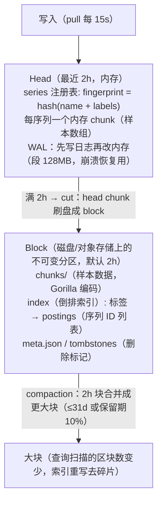
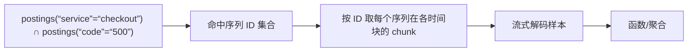
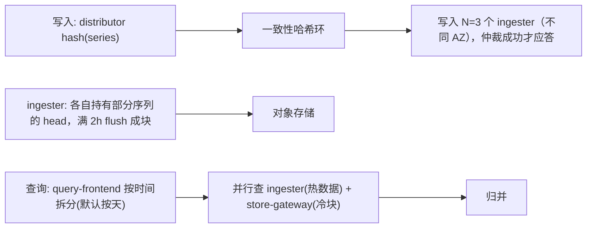
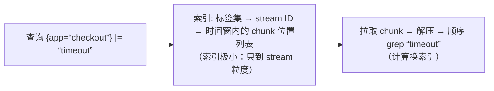
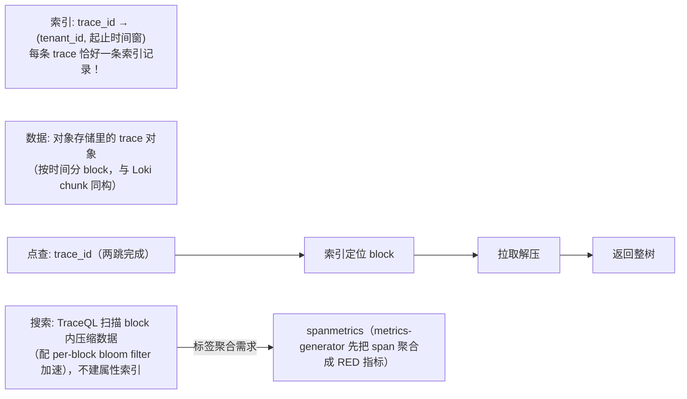

# 系统设计 05 · 存储后端设计：三种信号的三副引擎骨架

> 存储回答"放得下、取得出、付得起"。三种信号的访问模式差异（见[总体设计](architecture-overview.md)第 3 节）决定了三副完全不同的引擎骨架：TSDB（索引+压缩时序）、日志（标签索引+列存/全文）、trace（ID 点查+对象打包）。
> 本篇逐个拆骨架：Prometheus TSDB 的倒排索引与 Gorilla 压缩、Loki/ClickHouse 的两条日志路线、Tempo 的扁平索引；最后是保留/降采样/分层的成本工程。
> 前置：[Prometheus 架构](../01-metrics/prometheus-architecture.md)、[Loki](../02-logging/loki.md) 与 [Loki 运维篇](../02-logging/loki-operations.md)、[Jaeger vs Tempo](../03-tracing/jaeger-vs-tempo.md)、[长期存储](../01-metrics/long-term-storage.md)。

## 目录

- [1. 通用问题：所有可观测存储的共同形状](#1-通用问题所有可观测存储的共同形状)
- [2. Metrics TSDB 骨架：以 Prometheus 为蓝本](#2-metrics-tsdb-骨架以-prometheus-为蓝本)
- [3. 横向扩展与长期存储：三条路线](#3-横向扩展与长期存储三条路线)
- [4. Logs 存储骨架：全文索引 vs 标签索引 vs 列存](#4-logs-存储骨架全文索引-vs-标签索引-vs-列存)
- [5. Traces 存储骨架：Tempo 的扁平索引革命](#5-traces-存储骨架tempo-的扁平索引革命)
- [6. 保留、降采样与成本工程](#6-保留降采样与成本工程)
- [7. 常见坑](#7-常见坑)
- [8. 面试题小结](#8-面试题小结)
- [9. 参考资料](#9-参考资料)

## 1. 通用问题：所有可观测存储的共同形状

不管信号是什么，可观测存储都有四个共同约束，先立起来再谈差异：

| 约束 | 含义 | 设计后果 |
| --- | --- | --- |
| 时间是主轴 | 查询几乎总带时间范围，数据按时间到达 | 按时间分区（block/partition），旧分区不可变 |
| 写多读少但读要求低延迟 | 持续高吞吐写入，交互式查询 | 写路径极简（追加），读路径靠索引+缓存+并行 |
| 数据不可变（append-only） | 历史不修改（错误数据靠删除策略） | 压缩友好、LSM/分段设计、纠删码友好 |
| 本地盘靠不住 | 节点即牲口（cattle） | **对象存储做持久层**，本地盘只做热缓存 |

**对象存储的代际差**是当代设计的分水岭：S3 类存储持久性 11 个 9、单价约为本地 SSD 的 1/10、容量无限；代价是**延迟高（首字节几十 ms）+ 不可原地修改 + list 慢**。于是所有现代引擎都演化出同一套应对：**小数据打包成大对象（减少请求数）、索引与数据分离、读路径加缓存层**。

## 2. Metrics TSDB 骨架：以 Prometheus 为蓝本

单机 Prometheus TSDB 是所有 metrics 引擎的原型，四层结构：



### 2.1 倒排索引：查询的第一入口

查询 `http_requests_total{service="checkout",code="500"}` 的执行：



索引结构的关键取舍：

- **标签值字典编码（symbol table）**：`checkout` 这类值只存一份，postings 里存 ID——索引体积与重复值个数解耦；
- **series 数是全局资源**：每条活跃序列都要占 head 内存（约 1~3KB/序列含 chunk 引用）+ 索引条目。这就是**基数是 metrics 第一敌人**的物理根源（见[高基数笔记](../05-production/cardinality.md)）；
- 反面设计是 OpenTSDB/HBase 系的"每序列一行"——没有 postings 交集，标签过滤要扫全表，已被淘汰。

### 2.2 Gorilla 压缩：为什么 2 字节能装一个 double

Facebook 2015 年 Gorilla 论文（VLDB）的编码，是 TSDB 的基石：

| 编码对象 | 手法 | 效果 |
| --- | --- | --- |
| 时间戳 | delta-of-delta：相邻间隔的差值的差值（定速序列的 d-o-d ≈ 0） | ~1 bit/点（理想定速时） |
| 数值 | XOR：与前一值异或，只存前导零/尾零长度 + 有效位 | 实测平均 ~1.37 bit/值 |

合计**约 1.3~2 字节/样本**（原 double+int64 是 16 字节），压缩比约 10 倍。所有主流 TSDB（Prometheus/Mimir/VictoriaMetrics/InfluxDB）都用同族算法。设计启示：**别在 SDK 侧做时间对齐的"补点"**——定速是压缩的最优输入，乱序/补点会破坏 delta 链。

### 2.3 一个 Block 长什么样（磁盘布局）

把上面的概念落到磁盘上（目录树即接口，自研时照此组织对象存储里的块）：

```
01J2M...ULB7/                    # block：ULID 命名，meta.json 声明 minT/maxT
├── chunks/
│   ├── 000001                   # 样本数据：series-ref → Gorilla 编码 chunk 顺序排布
│   └── 000002
├── index/                       # （2.x 是单文件 index；3.x 起目录化，可增量拷贝）
│   ├── symbols                  # 字典：字符串池（label 名/值去重后按序编号）
│   ├── postings                 # 倒排：label 对 → series ID 列表（按 ID 排序，交集快）
│   └── series                   # series ID → labels + 各时间段的 chunk 引用
├── meta.json                    # minT/maxT/系列数/来源（compaction 父块）
└── tombstones                   # 删除标记：删数据=打标记，compaction 时真正物理删
```
<!-- 保留原图：文件系统目录树（磁盘布局清单），保留清单可读性 -->

三个可借鉴的细节：**字典编码**（symbols 让索引体积与重复标签值解耦）、**postings 按 series ID 有序**（多条件交集变线性归并）、**tombstone 延迟删除**（不可变数据上的删除 = 标记 + 重写时丢弃）。

### 2.4 WAL 与崩溃恢复

Head 在内存，断电即失——所以每次样本写入先 append WAL 再改内存（顺序写，微秒级）。恢复时重放 WAL。checkpoint 解决"WAL 无限增长"：head cut 成 block 后，之前段的 WAL 可截断。这套机制与数据库同源，自研 TSDB 时**先写 WAL 是不可省略的第一行代码**。

## 3. 横向扩展与长期存储：三条路线

单机 Prometheus 有两个天花板：容量（单机约百万级序列）与存活（无 HA）。三条路线：

| 路线 | 思路 | 组件 | 特点 |
| --- | --- | --- | --- |
| Thanos（旁路） | 保留单机 Prometheus，把 block 上传对象存储 | sidecar（上传+代理查询）、compactor（降采样+保留）、store-gateway（对象上的块服务查询）、query（全局查询） | 改造成本最低；查询要跨多 Prometheus 聚合 |
| Mimir/Cortex（重写） | 存算分离的分布式 TSDB | distributor（分片写入，RF=3 多副本）→ ingester（内存 head 分片）→ store-gateway（块查询）→ query-frontend（拆分/缓存） | 无缝水平扩展、多租户原生（X-Scope-OrgID）；组件多、运维重 |
| VictoriaMetrics（自研引擎） | 更激进的压缩 + 单一存储集群 | vminsert/vmselect/vmstorage | 压缩率与资源效率著称；生态（PromQL 兼容度）略后 |

Mimir 的写入分片值得单独记（它是"如何把 TSDB 拆成集群"的标准答案）：



HA 去重（两个 Prometheus 抓同一目标产生双份样本，按 replica label 去重）也做在查询路径上——**用少量查询 CPU 换写入简化**，这个取舍贯穿 Mimir 设计。

## 4. Logs 存储骨架：全文索引 vs 标签索引 vs 列存

日志查询的典型形态：`{app="checkout"} |= "timeout" | json | status >= 500`。先按标签缩小范围，再在内容上过滤。三条路线对这一查询的策略完全不同：

### 4.1 Elasticsearch：全文倒排

对日志内容分词建倒排索引（每个 token → 文档列表），`timeout` 的查找走索引直达。代价：**索引体积常达日志本体的 1~2 倍**（分词器+多字段+_source），写入放大明显；收益：任意关键词秒级搜索，无需预定义结构。生命周期靠 ILM 分层 hot→warm→cold→delete。适合：安全审计、全文检索刚需。

### 4.2 Loki：只索引标签，内容查询时过滤

Loki 的哲学：**把 99% 的索引费省下来**——只对标签集（stream）建索引，日志内容原样打包成 chunk（目标 ~1.5MB/块，zstd 压缩）进对象存储：



设计后果链条（每条都是运维篇的实战教训，见 [Loki 运维篇](../02-logging/loki-operations.md)）：

1. **标签必须是低基数**：stream 数 = 标签组合数，标签基数爆炸 = 索引爆炸 + chunk 碎片化（每 stream 至少一个 chunk）。`pod` 这种中基数标签都曾被禁，靠 `structured metadata`（3.x 起内容级过滤不占索引）与 `pattern` 聚合器补查询能力；
2. **查询成本与"选中 stream 的日志量"成正比**：选错标签（范围太大）就是全量扫描；
3. chunk 打包与 flush 节奏决定成本：太小的 chunk 让对象存储请求数爆炸。

### 4.3 ClickHouse：列存路线

把日志当**宽表**存：`(timestamp, tenant, level, message, trace_id, service, ...)`，`ORDER BY (tenant, service, timestamp)` 排序存储 + 列式压缩（字符串列 zstd 后比率很高，低基数的 level 列用字典编码几乎免费）：

```
查询过滤靠"排序键前缀裁剪"（主键索引）+ 跳数索引（bloom_filter(trace_id)）
标签不需要预先定义（列加就行，或用 Map/JSON 类型）
聚合（count by status_code）是列存强项 —— 比 grep 快一个量级
```
<!-- 保留原图：三行说明性文字清单，无图示结构，非示意图 -->

SigNoz、HyperDX 及 Uber 日志平台均走此路。适合：结构化日志为主、要灵活聚合分析、团队有 CH 运维能力。

一张生产级日志表的骨架（浓缩了本路线的全部设计点）：

```sql
CREATE TABLE logs
(
    timestamp    DateTime64(9) CODEC(Delta, ZSTD),       -- 时间列：delta 编码几乎免费
    tenant_id    LowCardinality(String),                 -- 低基数列：字典编码
    service      LowCardinality(String),
    level        Enum8('DEBUG'=1,'INFO'=2,'WARN'=3,'ERROR'=4),
    trace_id     String CODEC(ZSTD),
    body         String CODEC(ZSTD(3)),                  -- 正文：最高压缩档
    attrs        Map(String, String),                    -- 动态标签：不用为每个标签建列
    span_id      String MATERIALIZED attrs['span_id'],   -- 物化列：从 Map 提升，查询免解析
    _body_hash   UInt64 MATERIALIZED cityHash64(body),   -- 物化列：去重指纹
    INDEX idx_trace trace_id TYPE bloom_filter GRANULARITY 4,   -- 跳数索引：点查加速
    INDEX idx_body body TYPE tokenbf_v1(32768, 3, 0) GRANULARITY 4  -- 近似全文
)
ENGINE = MergeTree
PARTITION BY toDate(timestamp)                           -- 按天分区：过期整分区 DROP
ORDER BY (tenant_id, service, timestamp)                 -- 排序键 = 常用过滤前缀
TTL timestamp + INTERVAL 7 DAY DELETE,                   -- 行级 TTL：到点物理删
    timestamp + INTERVAL 90 DAY DELETE WHERE level = 'DEBUG';  -- 分级保留：DEBUG 早删
```

设计点对照：排序键即"主索引"（标签过滤靠前缀裁剪）、`LowCardinality` 列对应 Loki 的 stream 思想、`Map` 列吸收 schema 演进、TTL 的 `WHERE` 谓词实现分级保留（对应 [总体设计](architecture-overview.md) 6 的"日志靠分级保留"）。

### 4.4 三线对比与选型

| 维度 | Elasticsearch | Loki | ClickHouse |
| --- | --- | --- | --- |
| 索引成本 | 高（全文倒排，1~2x 本体） | 极低（只到 stream 粒度） | 低（排序键+跳数索引） |
| 任意关键词搜索 | 最强 | 弱（扫描，配 pattern 部分补齐） | 中（bloom/全文实验特性） |
| 聚合分析 | 中（聚合慢于列存） | 弱（LogQL 有但计算重） | 最强（SQL 全家桶） |
| 对标签纪律的要求 | 中 | **极高**（基数即成本） | 低（列/Map 灵活） |
| 运维复杂度 | 高（分片/副本/ILM） | 中 | 中高（合并/分区调优） |
| 典型搭配 | 安全/审计 | Grafana 栈日志 | 三信号统一库（SigNoz 系） |

## 5. Traces 存储骨架：Tempo 的扁平索引革命

traces 的访问模式极度偏科：**99% 是按 trace_id 点查**（从告警/exemplars/日志跳过来），1% 是按属性搜索。Jaeger 与 Tempo 代表两代设计：

### 5.1 Jaeger（span 行存储 + 二级索引）

每个 span 一行写入 ES/Cassandra，`service`/`operation`/`duration`/tag 建二级索引。搜索能力强（find traces where tag=x），代价：**每 span 一行的写入与索引成本 = 三信号里最贵的存储**，且查询一条 trace 要按 trace_id 聚合 N 行。

### 5.2 Tempo（整 trace 打包 + 扁平索引）

把**整条 trace（全部 span）序列化成一个大对象**（zstd 压缩，trace 内相关性高压缩率好），索引只剩一条：



这个设计把 traces 存储成本降了一个数量级（索引量 = trace 数而非 span 数），代价是搜索退化为扫描——但配合 spanmetrics（指标看异常）+ exemplar（跳转点查）的工作流，1% 的搜索需求其实不需要全文索引。**这是"以工作流为中心设计存储"的教科书案例**。

### 5.3 设计推论：trace 完整性属于管道

按 trace 打包意味着**必须等 span 到齐**（在网关完成，见[接入设计](ingestion-pipeline.md) 5.3），存储端不处理乱序到达——又一条"职责放在哪一层"的链式决策。

## 6. 保留、降采样与成本工程

三个成本阀门在存储侧的落法（呼应[总体设计](architecture-overview.md) 2.4）：

1. **保留期（retention）**：按信号分租户配置。metrics 块由 compactor 按保留期删除；Loki/Tempo 按对象生命周期规则删；CH 用 TTL 表达式（甚至列级 TTL：正文留 7 天，标签列留 90 天——**冷热分离到列粒度**）。
2. **降采样（downsampling，metrics 独有）**：原始 5s/15s 留 14 天 → 5m 聚合（min/max/sum/count）留 90 天 → 1h 留 1 年。Thanos compactor 的三档是标准实现。注意 histogram 降采样后分位数只能由 **sum/count 逼近**（桶信息不可再聚合时只能估），精度换成本要向用户声明。
3. **分层（tiering）**：热（本地 NVMe 缓存/内存）→ 温（对象存储标准层）→ 冷（归档层，单价再降 40%+，取回慢）。实现上就是 store-gateway/查询层带本地缓存 + 对象存储生命周期规则，存储引擎不感知。

一个反直觉的账：**存储单价降 10 倍后，查询计算（CPU）反而成为成本大头**（扫描解压都要算力）——所以记录规则/预聚合（见[查询设计](query-and-alerting.md)）属于成本工程而非功能工程。

## 7. 常见坑

1. **把无界标签塞进 metrics/Loki**：`user_id`/`request_id` 进 metrics 标签 → head 内存与索引爆炸；进 Loki 标签 → stream 爆炸。规则：metrics 标签基数 ≤ 数百，Loki 标签只用静态集（service/env/level），动态值放内容或 structured metadata。
2. **对象存储当数据库用（频繁 list/小对象）**：每秒 list bucket 或写 10KB 小对象，延迟与请求费都爆炸。所有引擎都会"攒大对象"（chunk/trace 打包），自研时也不许裸写小对象。
3. **compaction 跟不上写入**：块越积越多，查询扫描的块数线性上涨最终超时。容量规划必须给 compactor/合并节点留余量（ClickHouse 对应的是 "too many parts" 报错）。
4. **ES 分片拍脑袋**：按天索引 + 默认分片数，小索引碎片化、大索引恢复慢。经验：单分片 30~50GB，按量滚动而不是按天硬切。
5. **降采样档位配了却没有查询侧配合**：仪表盘查询 3 个月范围仍打 raw 档，降采样白做。查询层要按步长自动选档（Thanos query-frontend 的 `--query-auto-downsampling`）。
6. **乱序样本静默丢弃**：Prometheus 2.39 前乱序直接丢（无告警），NTP 抖动或 SDK 重发会造成数据"看起来缺了"。开 out-of-order 窗口或对 `out_of_order_samples_total` 告警。

## 8. 面试题小结

1. **Q：为什么 metrics 存储普遍用倒排索引？**
   A：查询入口是标签等值/正则匹配的组合（selector），倒排索引的 postings 交集能把"百万序列中选几十条"的代价降到索引层完成；序列数（基数）是索引与 head 内存的直接自变量，所以基数治理是物理需求而非最佳实践。
2. **Q：Gorilla 压缩为什么能把 16 字节样本压到 ~1.4 字节？**
   A：时间戳 delta-of-delta（定速序列的二阶差分≈0，1 bit 可表）+ 数值 XOR 编码（相邻样本值相似，只存有效位段）。前提是"定速+相邻相似"，所以乱序与补点伤害压缩率。
3. **Q：Mimir 怎么把单机 TSDB 拆成集群？**
   A：存算分离：distributor 按序列哈希写 3 副本 ingester（内存 head 分片），ingester 定期 flush 块到对象存储；查询走 query-frontend 拆分并行，store-gateway 服务对象存储上的块，HA 双副本在查询侧去重。
4. **Q：Loki 为什么便宜？代价是什么？**
   A：只索引标签集（stream 粒度），内容打包 zstd 进对象存储，索引量比 ES 小约两个数量级；代价：内容查询退化为对选中 stream 的顺序扫描，标签纪律要求极高（基数=成本），聚合计算重。
5. **Q：Tempo 为什么敢不建属性索引？**
   A：访问模式 99% 是 trace_id 点查（扁平索引一条记录搞定）；搜索需求由 spanmetrics（先聚合为指标）+ TraceQL 扫描（bloom 加速）承接。以真实工作流分配索引预算，是"按查询模式设计存储"的示范。
6. **Q：三种信号的保留策略为什么不能一刀切？**
   A：成本结构不同：metrics 靠降采样延长生命（聚合后体积骤减）；logs 靠分级保留/列级 TTL（正文贵标签廉）；traces 靠采样率控制入口量。统一"30 天删"要么浪费要么不够。

## 9. 参考资料

- Gorilla 论文（Facebook，VLDB 2015，delta-of-delta 与 XOR 编码）：<https://www.vldb.org/pvldb/vol8/p1816-teller.pdf>（访问日期：2026-11-06）
- Prometheus TSDB 深度文章（官方博客，head/block/compaction 细节）：<https://prometheus.io/blog/2019/01/01/subsecond-querys/> 与存储文档 <https://prometheus.io/docs/prometheus/latest/storage/>（访问日期：2026-11-06）
- Thanos 设计文档（sidecar/compactor/store-gateway 与降采样档位）：<https://thanos.io/tip/thanos/design.md/>（访问日期：2026-11-06）
- Grafana Mimir 架构（分布式 TSDB 与分片写入）：<https://grafana.com/docs/mimir/latest/references/architecture/>（访问日期：2026-11-06）
- Loki 存储设计与 chunk 生命周期：<https://grafana.com/docs/loki/latest/get-started/concepts/>（访问日期：2026-11-06）
- ClickHouse MergeTree 与跳数索引：<https://clickhouse.com/docs/en/engines/table-engines/mergetree-family/mergetree>（访问日期：2026-11-06）
- Tempo 架构（扁平索引与 TraceQL）：<https://grafana.com/docs/tempo/latest/operations/architecture/>（访问日期：2026-11-06）
- 本仓库关联笔记：[Prometheus 架构](../01-metrics/prometheus-architecture.md)、[长期存储](../01-metrics/long-term-storage.md)、[Loki](../02-logging/loki.md)、[Loki 运维篇](../02-logging/loki-operations.md)、[ELK 与 ClickHouse](../02-logging/elk-and-clickhouse.md)、[Jaeger vs Tempo](../03-tracing/jaeger-vs-tempo.md)、[高基数](../05-production/cardinality.md)

## 附：ASCII 图替换清单

| 原 ASCII 图位置（章节标题） | 原图内容简述 | 替换结果 |
| --- | --- | --- |
| 2. Metrics TSDB 骨架：以 Prometheus 为蓝本 | 写入→Head→Block→大块的 TSDB 分层结构 | flowchart TD |
| 2.1 倒排索引：查询的第一入口 | postings 交集查询执行流 | flowchart LR |
| 3. 横向扩展与长期存储：三条路线 | Mimir 写入/flush/查询三条链路 | flowchart LR |
| 4.2 Loki：只索引标签，内容查询时过滤 | Loki 查询两步执行流（索引定位→拉取扫描） | flowchart LR |
| 5.2 Tempo（整 trace 打包 + 扁平索引） | 扁平索引/数据布局与点查、搜索两条链路 | flowchart LR |

### 保留说明

| 原 ASCII 图位置（章节标题） | 保留原因 |
| --- | --- |
| 2.3 一个 Block 长什么样（磁盘布局） | 文件系统目录树（磁盘布局清单），保留清单可读性 |
| 4.3 ClickHouse：列存路线 | 三行说明性文字清单，无图示结构，非示意图 |

## 附：存储后端选型对照速查（收尾增补）

本册讲了三支柱各自的存储设计，收尾把选型判据压成一张对照：

| 柱 | 数据形状 | 首选引擎形态 | 关键取舍 |
|---|---|---|---|
| metrics | 时间序列（标签集+值） | TSDB（列存+倒排标签索引） | 高基数标签是成本炸弹 |
| logs | 不可变文本流 | 对象存储+列存索引（Loki/ClickHouse 系） | 全文检索 vs 标签检索的查询代价 |
| traces | span 树（有父子时序） | 时序 KV + trace id 聚簇 | 跨服务串联依赖采样一致性 |

三行对照的用法：新数据源进来先问"它更接近哪一柱的形状"——把数据塞进形状不匹配的引擎（如用日志引擎存指标）是可观测性架构的常见起点事故。

### 收尾自测（增补）

3. 你的错误日志若要支持"按错误指纹聚合"查询，三行对照里它该往哪个引擎形态靠？（列存索引——指纹是标签不是全文）
4. trace 存储的"trace id 聚簇"为什么重要？（一次排障要一次取全，散落查询是延迟杀手）
