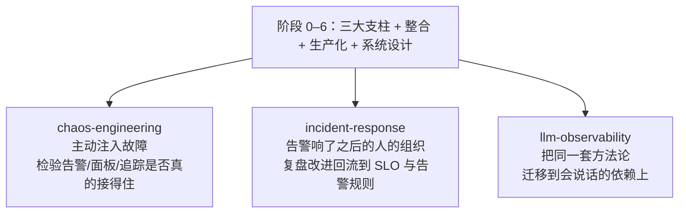

# 阶段 7 · 横向专题（索引）

> 前六个阶段回答的是"可观测体系怎么建、怎么设计"，本阶段回答三个横切问题：**它到底牢不牢**（混沌工程）、**知道之后人怎么办**（事件响应与值班）、**方法论如何迁移到新负载**（大模型应用）。
>
> 属于持续扩充的专题篇：每一篇都跨阶段引用前面的笔记与实验，读完阶段 0–6 之后按需选读。

## 笔记目录

| 笔记 | 主题 | 一句话摘要 | 配套实验 |
| --- | --- | --- | --- |
| [chaos-engineering.md](./chaos-engineering.md) | 混沌工程与故障演练 | 稳态假设与实验设计方法、爆炸半径控制、常见故障注入类型在各层的实现原理、主流工具定位与取舍、演练日组织，以及混沌实验如何反向检验可观测性本身（告警是否触发、面板能否定位、追踪是否断链）。 | — |
| [incident-response.md](./incident-response.md) | 事件响应与值班 | 事件的生命周期与角色分工、严重度分级、值班轮转与升级策略设计、告警疲劳的成因与治理、无责复盘的方法与文档结构、从复盘到改进项的闭环，与 SLO/错误预算的衔接。 | — |
| [llm-observability.md](./llm-observability.md) | 大模型应用可观测性 | LLM 应用与传统服务在可观测性上的差别、OpenTelemetry 生成式 AI 语义约定的现状、一次调用链该记录什么、token 用量与成本的度量、质量评估信号纳入观测体系、提示词与回复的隐私脱敏。 | [lab06](../../labs/lab06-mini-platform/README.md)（demo 用 §3.3 手写埋点） |

## 与前面阶段的关系

三篇均无专属 lab：混沌篇的实验步骤可复用 lab04 的错误注入开关，事件响应篇可结合 lab04 的告警联动做桌面推演（各篇内已给出步骤）。
