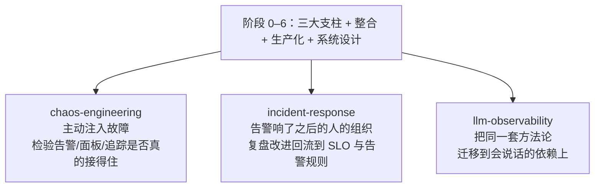

# 阶段 7 · 横向专题（索引）

> 前六个阶段回答的是"可观测体系怎么建、怎么设计"，本阶段回答三个横切问题：**它到底牢不牢**（混沌工程）、**知道之后人怎么办**（事件响应与值班）、**方法论如何迁移到新负载**（大模型应用）。
>
> 属于持续扩充的专题篇：每一篇都跨阶段引用前面的笔记与实验，读完阶段 0–6 之后按需选读。

## 笔记目录

| 笔记 | 主题 | 一句话摘要 | 配套实验 |
| --- | --- | --- | --- |
| [chaos-engineering.md](./chaos-engineering.md) | 混沌工程与故障演练 | 稳态假设与实验设计方法、爆炸半径控制、常见故障注入类型在各层的实现原理、主流工具定位与取舍、演练日组织，以及混沌实验如何反向检验可观测性本身（告警是否触发、面板能否定位、追踪是否断链）。 | — |
| [incident-response.md](./incident-response.md) | 事件响应与值班 | 事件的生命周期与角色分工、严重度分级、值班轮转与升级策略设计、告警疲劳的成因与治理、无责复盘的方法与文档结构、从复盘到改进项的闭环，与 SLO/错误预算的衔接。 | — |
| [llm-observability.md](./llm-observability.md) | 大模型应用可观测性 | LLM 应用与传统服务在可观测性上的差别、OpenTelemetry 生成式 AI 语义约定的现状、一次调用链该记录什么、token 用量与成本的度量、质量评估信号纳入观测体系、提示词与回复的隐私脱敏。 | [lab06](../../labs/lab06-mini-platform/README.md)（demo 用 §3.3 手写埋点） |

## 与前面阶段的关系

三篇均无专属 lab：混沌篇的实验步骤可复用 lab04 的错误注入开关，事件响应篇可结合 lab04 的告警联动做桌面推演（各篇内已给出步骤）。

---

## 阶段导读：为什么要有这个阶段

阶段 0-6 的主线是"建设"：建信号、建关联、建告警、建平台。但建设完成不等于体系可靠——**没有人故意演练过它**；告警响了之后**人的组织**也从未被设计过；而当一类新负载（大模型应用）出现时，整套方法论**能不能迁移**也需要验证。本阶段三个专题分别回答这三个横切问题：

1. **混沌工程**（chaos-engineering）：主动注入故障，检验的不只是业务韧性，还有可观测性本身——告警会不会响、面板能不能定位、trace 有没有断链。这一篇可以看作前六个阶段的"期末考试"；
2. **事件响应与值班**（incident-response）：可观测性回答"知道"，本篇回答"知道之后怎么办"——角色分工、严重度分级、升级路径、无责复盘，以及复盘改进项如何回流到 SLO 与告警规则，形成运营闭环；
3. **大模型应用可观测性**（llm-observability）：把同一套方法论迁移到"会说话的依赖"上：token 用量与成本度量、质量评估信号、提示词脱敏，以及仍在快速演进中的 OTel GenAI 语义约定。

读法建议：三篇相互独立，按需选读；每篇都大量回引前面阶段的笔记与实验，**读完阶段 0-6 再读，才拿得到全部的回指**。这三篇也是整套大纲里最贴近真实工作场景的——组织一次演练日、排一张值班表、给 LLM 应用补观测，都可以照着笔记直接落地。

读前准备：三篇的前置各不相同——混沌篇与事件响应篇建议先重温阶段 4 的 SLO 与告警两篇（稳态的度量衡与通知链路都定义在那里）；大模型篇需要阶段 3 的 OTel SDK 实操作底，否则手写 gen_ai span 的部分会吃力。另外，大模型篇开头的时效声明务必先读：GenAI 语义约定仍在快速演进，动手写代码前以当时版本的官方文档为准，不要照搬笔记里的属性名。

## 术语速查表

| 术语 | 英文 | 一句话解释 |
| --- | --- | --- |
| 稳态假设 | Steady State Hypothesis | 混沌实验的度量基线：系统在正常状态下应满足的可测量指标。 |
| 爆炸半径 | Blast Radius | 一次故障注入可能影响的范围，实验设计要主动收窄它。 |
| 故障注入 | Fault Injection | 人为向系统注入延迟、错误、资源故障等异常以验证韧性的手段。 |
| 演练日 | Game Day | 团队按剧本进行的故障演练活动，含观察员与演练后复盘。 |
| 事件指挥官 | Incident Commander | 事件响应中的指挥角色，统一调度沟通、决策与升级。 |
| 严重度分级 | Severity Levels | 给事件定级的共同语言（如 SEV1-SEV4），决定响应节奏与升级路径。 |
| 告警疲劳 | Alert Fatigue | 误报与噪音训练人忽略告警，导致真事故被漏看的现象。 |
| 无责复盘 | Blameless Postmortem | 聚焦系统与流程缺陷、不追究个人过错的复盘文化。 |
| 检索增强生成 | RAG | 先检索资料再让大模型生成的应用形态，链路含检索与生成两段。 |
| Token 用量 | Token Usage | LLM 调用消耗的输入/输出 token 数，是成本度量的基本单位。 |
| 质量评估信号 | Quality Signals | 事实性、相关性、幻觉率等衡量 LLM 输出质量的观测维度。 |
| GenAI 语义约定 | GenAI Semantic Conventions | OTel 为生成式 AI 场景制定的属性命名规范（仍在快速演进）。 |

OTel 规范与语义约定入口见 `https://opentelemetry.io/docs/specs` （官方文档） ；SRE 运营方法（告警、复盘、错误预算政策）见 Google SRE Workbook `https://sre.google/workbook` （官方文档） 。

## 与本阶段 lab 的对照

本阶段三篇均无专属实验环境，动手部分复用前面阶段的 lab，各篇的"读"与"做"分工如下——

- **混沌工程**：读笔记的稳态假设、实验设计方法与爆炸半径控制；动手直接用 [lab04-three-pillars](../../labs/lab04-three-pillars/README.md) 的混沌开关完成三个实验——错误注入、击杀依赖、击杀观测系统本身，观察告警是否触发、面板能否定位、trace 是否断链（笔记的动手节给出完整步骤）。三个实验必须按顺序做，第三个"打观测系统"最能暴露盲区；
- **事件响应**：读笔记的生命周期与角色模型；动手在 lab04 上做一次约 30 分钟的桌面推演——触发 burn-rate 告警后按严重度分级走一遍"认领角色 → 排障 → 沟通同步 → 复盘"，并产出你的第一份无责复盘文档，改进项直接回填到自己的告警规则；
- **大模型可观测性**：读笔记的 GenAI 语义约定现状与字段清单（注意笔记内的时效声明）；动手把 [lab06-mini-platform](../../labs/lab06-mini-platform/README.md) demo 应用里手写的 gen_ai span 扩展到你自己的 LLM 调用上，在 lab06 的接收端与瀑布图里直接观察这些 span 的形态。

一个共同纪律：三篇的动手都**必须在隔离环境**（本地 compose、演练环境）进行，严禁对生产系统做未评审的注入实验——爆炸半径控制，从你的实验环境开始。

## 常见误区与正解

- **误区一："混沌工程就是随机把系统搞挂，看会不会出事。"**
  为什么错：没有稳态假设的注入无法判断"系统是否依然正常"，没有爆炸半径控制的注入就是一场真实事故；随机搞挂只会消耗团队信任。
  正解：每个实验都要先写下稳态指标、注入点、中止条件与观察者分工，从小范围开始、随时可停，演练后必须复盘。
- **误区二："值班就是背锅，复盘就是为了找到责任人。"**
  为什么错：追责导向会让人隐瞒信息、美化时间线，复盘产出失真，同样的故障换个责任人再来一次。
  正解：无责复盘只问"系统与流程哪里允许了这个故障发生"，改进项带负责人与期限回流到告警规则、仪表盘或架构，责任人只出现在"谁负责修复"栏里。
- **误区三："LLM 应用只要把 prompt 和回复记下来就够观测了。"**
  为什么错：直接存 prompt/回复既缺结构（无法按会话、检索段、生成段分析），又有隐私风险，还漏掉了成本与质量两个关键维度。
  正解：按 GenAI 语义约定的调用结构记录 span（含模型、参数、token 用量），质量信号抽样评估，敏感内容在入库前脱敏——三个维度缺一不可。
- **误区四："这三个专题可看可不看，等真出了事再说。"**
  为什么错：混沌演练和值班体系的价值恰恰在事故**之前**——事故发生时只能执行已有流程，现场没有时间设计流程。
  正解：至少完成一次完整演练日与一次桌面推演，把角色分工和升级路径变成肌肉记忆；LLM 篇则在新项目立项时就要介入，而不是上线后补。
- **误区五："可观测性是项目，做完就交付结束了。"**
  为什么错：负载在变、规模在变、依赖在变，静态的体系会缓慢失效——告警逐渐失真、面板没人看、trace 覆盖出现新盲区。
  正解：用运营节奏维持体系活性：告警周报、错误预算会议、定期演练、新服务接入评审，让可观测性成为持续运行的能力而非一次性交付物。

## 自检清单（整套大纲收官自测）

- [ ] 能为一个新服务设计一次混沌实验，写出稳态假设、注入点、爆炸半径与中止条件；
- [ ] 能说清事件指挥官与值班工程师的职责边界，以及什么时候必须升级；
- [ ] 能写出一份一页纸的无责复盘：时间线、影响面、三个带负责人与期限的改进项；
- [ ] 能说出告警疲劳的至少三个成因与对应治理手段；
- [ ] 能为一次 LLM 调用列出该记录的 span 结构（调用、检索、生成）与 token 用量字段；
- [ ] 能说出 GenAI 语义约定当前的稳定性现状，并知道去哪里核对最新版本；
- [ ] 在 lab04 或 lab06 上完整走过一次"注入故障 → 告警触发 → 定位证据 → 复盘归档"的演练。

这七条全部通过，意味着你不只"学过"这套大纲，而是能在真实团队里把它运转起来——这正是阶段 7 三个专题存在的意义。
