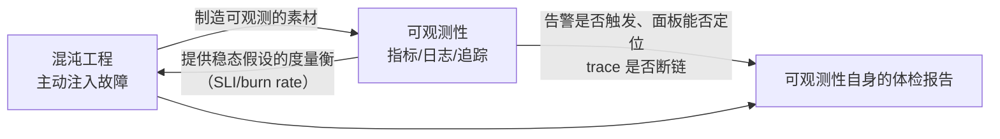
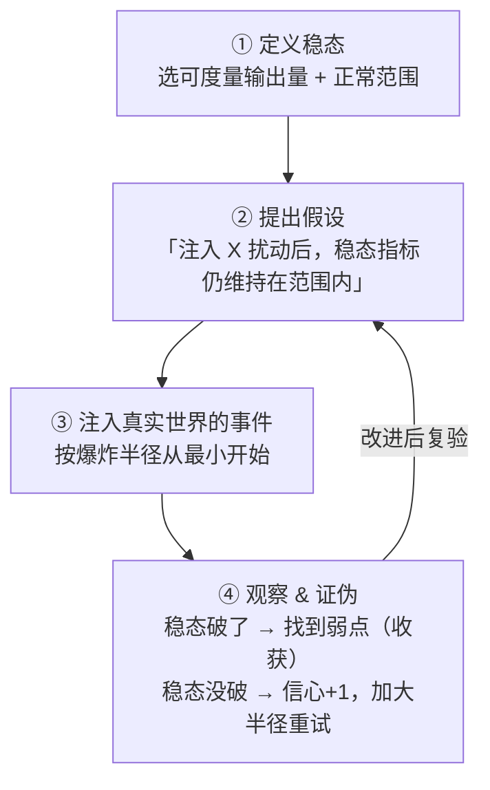
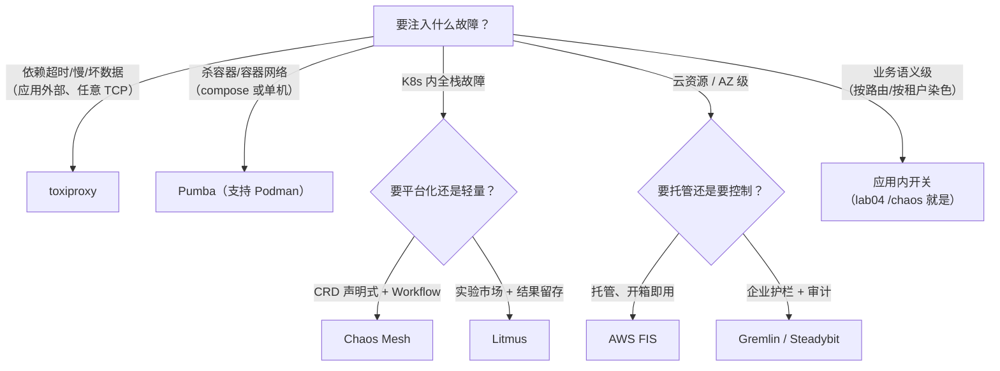

# 混沌工程与故障演练：主动制造故障，检验系统与可观测性本身

> 阶段 7 · 实践专题 · 笔记 7-1
>
> 前六个阶段回答的是"可观测体系怎么建、怎么设计"，本篇回答"它到底牢不牢"。
> 覆盖：稳态假设与实验设计方法、爆炸半径控制、常见故障注入类型在各层的实现原理、
> 主流工具的定位与取舍、演练日（Game Day）怎么组织，以及最关键的一点——
> **混沌实验怎样反过来检验可观测性本身**（告警是否触发、面板能否定位、追踪是否断链）。
> 动手部分可直接在 [lab04](../../labs/lab04-three-pillars/README.md) 环境完成三个实验（错误注入、击杀依赖、击杀观测系统），全部步骤实测过。
> 前置：[SLO 与错误预算](../04-integration/slo.md)（稳态的度量衡）、[统一仪表盘与排障 SOP](../04-integration/unified-dashboard.md)。

## 目录

1. [混沌工程是什么：与测试、与"故意搞挂"的区别](#1-混沌工程是什么与测试与故意搞挂的区别)
2. [稳态假设与实验设计方法](#2-稳态假设与实验设计方法)
3. [爆炸半径控制](#3-爆炸半径控制)
4. [常见故障注入类型及各层实现原理](#4-常见故障注入类型及各层实现原理)
5. [主流工具的定位与取舍](#5-主流工具的定位与取舍)
6. [演练日（Game Day）怎么组织](#6-演练日game-day怎么组织)
7. [混沌实验检验可观测性本身（本篇核心）](#7-混沌实验检验可观测性本身本篇核心)
8. [动手：在 lab04 完成三个实验](#8-动手在-lab04-完成三个实验)
9. [常见坑与排查](#9-常见坑与排查)
10. [面试题小结](#10-面试题小结)
11. [参考资料](#11-参考资料)

---

## 1. 混沌工程是什么：与测试、与"故意搞挂"的区别

混沌工程（Chaos Engineering）的定义来自 Principles of Chaos：

> 混沌工程是在**分布式系统上进行实验**的学科，通过主动注入真实世界的故障
> （机器崩溃、网络延迟、依赖不可用……），**发现系统的弱点**，
> 并建立对系统**在 turbulent（动荡）条件下挺住**的信心。

三个关键词划清了边界：

| 容易混淆的概念 | 与混沌工程的区别 |
| --- | --- |
| **故障测试（fault injection testing）** | 测试验证**已知预期**："断开 A，接口应返回降级结果"——断言是事先写死的。混沌实验是**探索性**的："断开 A，观察哪些稳态指标会破"——可能发现没人预料到的耦合 |
| **渗透测试 / 红蓝对抗** | 目标是**安全**漏洞；混沌的目标是**可靠性**弱点 |
| **"故意搞挂生产"** | 混沌工程恰恰反对不可控的破坏：每一步都有稳态假设、爆炸半径与中止条件。没有假设、没有度量的"搞挂"只是事故 |

一句话：**测试找 bug，混沌找"没人知道的存在的问题"**——尤其是分布式系统里那些只在真实故障组合下才暴露的耦合（缓存雪崩、重试风暴、级联超时、脑裂后的数据不一致）。

### 1.1 为什么"高可用是练出来的"

三个真实的公开事故，说明同一件事——**没有被演练过的恢复路径，在真实故障面前不可信**：

1. **AWS S3（2017-02-28，us-east-1）**：工程师执行计费子系统排障的 playbook 时输错一个参数，导致索引与 placement 子系统的服务器被大量下线。事后报告里最关键的一句是：**这些子系统已有数年没有以这个规模重启过**，重启与依赖预热耗时远超预期，最终故障持续约三个半小时，大量依赖 S3 的网站连锁受影响；状态页自己也因依赖 S3 而无法更新。
   事后报告：<https://aws.amazon.com/message/41926/>（访问日期：2026-11-13）
2. **GitHub（2018-10-21/22）**：一次 43 秒的东西海岸网络分区，触发 MySQL 集群脑裂，官方事后分析称整体降级持续 24 小时 11 分钟——43 秒的故障换来 24 小时的恢复，因为**分区分裂后的选举与修复路径从未真正演练过**，恢复只能靠备份回放 binlog。
   事后分析：<https://github.blog/news-insights/company-news/oct21-post-incident-analysis/>（访问日期：2026-11-13）
3. **Cloudflare（2019-07-02）**：一条 WAF 新规则里的正则引发灾难性回溯，边缘节点 CPU 打满，全球大范围 502 持续 27 分钟（完整恢复窗口约 6 小时）。规则部署在几秒内全球生效——**没有分级放量的"大爆炸半径发布"** 让一条坏正则瞬间影响全网。
   事后报告：<https://blog.cloudflare.com/details-of-the-cloudflare-outage-on-july-2-2019/>（访问日期：2026-11-13）

Netflix 把这个逻辑制度化：2010–2011 年迁移 AWS 期间引入 Chaos Monkey（随机杀死生产实例），后来扩展为 Simian Army（含下线整个区域的 Chaos Kong），2017 年 Casey Rosenthal 与 Nora Jones 把这套实践总结为《Chaos Engineering》一书（O'Reilly）。原 SimianArmy 仓库 2021 年归档，独立版 ChaosMonkey 继续维护（<https://github.com/Netflix/chaosmonkey>，访问日期：2026-11-13）。

### 1.2 与可观测性的关系：一枚硬币的两面

本站视角下，混沌工程与可观测性互为校验：



没有可观测性的混沌是盲飞（注入了故障却不知道系统反应）；没有混沌的可观测性是纸上谈兵（告警配了几百条，没人知道真出事时它们响不响）。

---

## 2. 稳态假设与实验设计方法

### 2.1 稳态（steady state）：混沌实验的地基

稳态是"系统正常工作时，某个**可观测指标**的正常范围"。注意三个要点：

1. **稳态必须可度量**——它就是你已有的 SLI（见 [slo.md](../04-integration/slo.md) §3）。
   说"系统正常"不可证伪，说"可用性 SLI 的 5m 错误比例 ≈ 0.02"才可证伪；
2. **稳态是输出量，不是输入量**：CPU 80% 不是稳态，"订单成功率 99.9%"才是。
   输入（资源用量）波动是常态，输出（用户可见的健康度）稳定才是设计目标；
3. **实验前必须先记录稳态基线**：否则故障注入后你无法回答"这是异常还是本来就这样"。

### 2.2 实验的四步法与假设句式

Principles of Chaos 给出的标准流程：



把假设写成**可证伪的句子**，这是初学者最容易省略、也最不该省略的一步：

```text
差的假设：kill 掉一个 inventory 实例，看看会怎样。（无法判定成败）
好的假设：在背景流量 ~2.5 rps 下，停止 inventory 容器，
        demo-app 的 5m 可用性 SLI 将因 502 升高，
        但 SLOAvailabilityBurnRateFast 在 5 分钟内告警（检测），
        且 trace 中 CLIENT span 记录连接失败事件（定位）。
        若告警未在预期时间触发，或 trace 断链，则可观测体系不达标。
```

### 2.3 实验设计模板（一行一实验，进登记表）

| 字段 | 示例值 |
| --- | --- |
| 实验名 | kill-inventory-single |
| 稳态假设 | 5m 错误比例 ≤ 0.05；burn-rate 告警 5 分钟内触发 |
| 注入动作 | `podman compose stop inventory` |
| 爆炸半径 | lab04 环境（非生产）；单实例；流量 ~2.5 rps |
| 持续时长 | ≤ 6 分钟 |
| 自动中止条件 | 5m 错误比例 > 0.95 持续 2 分钟；或人工喊停（演练日） |
| 观察点 | 告警（哪个、多久）、dashboard、trace 完整性、日志 reason 字段 |
| 回滚 | `podman compose start inventory`，观察错误比例回落 |
| 结果 | 稳态保持 / 被打破 + 发现清单 |

这个模板同时服务两个产出：**系统发现**（服务怎么挂的）与**可观测性发现**（你多快知道的）——后者是 §7 的主题。

---

## 3. 爆炸半径控制

爆炸半径（blast radius）= 实验可能影响的范围 × 强度。混沌工程的纪律核心不是"敢不敢注入故障"，而是**每次只把半径扩大一格**。

### 3.1 四个控制维度

| 维度 | 手段 | 示例 |
| --- | --- | --- |
| **范围** | 环境隔离 / 命名空间 / 标签选择器 / 实例数或百分比 | 先 staging 后生产；先 1% Pod 后 10%；只选 `app=demo-app,chaos=true` 的实例（混沌标签是标准做法：只有打了标的实例才允许被实验） |
| **强度** | 故障参数分级 | 延迟 100ms → 500ms → 2s；错误率 5% → 60% → 100% |
| **时长** | 实验闹钟 + 最长自动停止 | 每次实验设 TTL，到点无条件撤销注入（工具都支持 duration/scheduler） |
| **人口** | 流量染色 | 只让带测试 header 的请求走故障路径（应用内开关比基础设施注入更容易做到） |

### 3.2 自动中止条件（abort conditions）

生产实验必备的安全绳：**注入故障后，若稳态指标越过硬阈值，实验平台自动撤销注入**。

- 中止条件用与稳态相同的 SLI 表达：如 `availability_error_ratio_5m > 0.2 → abort`；
- 商业平台（Gremlin / Steadybit / AWS FIS）内置此能力；开源方案用"实验编排脚本 + 指标查询 + 超时回滚"拼装（本站实验就是最小实现）；
- 自动中止之外，**演练现场必须有一个持有终止权的人**（见 §6），自动条件是保险丝，不是决策者。

### 3.3 环境分级与"到底敢不敢在生产做"

| 环境 | 价值 | 风险 | 建议 |
| --- | --- | --- | --- |
| 开发/实验环境（lab04） | 验证流程、练手、教学 | 低保真（没有真实流量形态与容量压力） | **从这里开始**，本篇 §8 三个实验全部在此完成 |
| 预发/Staging | 接近生产的拓扑与依赖 | 共享依赖时可能误伤他人 | 中期目标：跑定时化、无人值守的小半径实验 |
| 生产 | 唯一能发现"真问题"的地方（真实流量、真实容量、真实依赖） | 直接影响用户 → 消耗错误预算 | 有前置条件才进入：稳态基线清晰、告警经过验证、自动中止可用、错误预算富余（见 [slo.md](../04-integration/slo.md) §8：预算紧张时做实验 = 主动烧预算，需要走预算政策的例外审批） |

Netflix 的经验（Chaos Monkey 在生产随机杀实例）常被误读为"第一天就该在生产干"。事实是它有漫长的前置：服务必须先通过冗余与优雅退出设计、有健康检查与自动恢复，"被猴子杀死"只是日常的最后一道抽检。

---

## 4. 常见故障注入类型及各层实现原理

故障注入不是黑魔法，每一层都有明确的技术原点。理解原理才能选对工具、估准风险：

| 层 | 故障类型 | 实现原理 | 代表工具 / 手段 |
| --- | --- | --- | --- |
| **应用层** | 错误响应、异常、慢返回 | 在应用代码或拦截器里按概率/开关抛错（业务语义最准） | lab04 的 `/chaos` 开关（错误率参数）；Chaos Mesh `Schedule`+`HTTPChaos`（对指定 Pod 的出入站 HTTP 改状态码/延迟）；Spring/中间件故障注入过滤器 |
| **进程/容器层** | 杀进程、停容器、暂停 | 发送信号：SIGKILL（不可捕获，模拟硬崩）vs SIGTERM（走优雅退出，两者表现完全不同，都要练）；容器暂停用 cgroup freezer | Pumba（kill/stop/pause/remove）；Chaos Mesh `PodChaos`（kill/pause/container-kill）；裸机 `kill -9` |
| **网络层** | 延迟、丢包、乱序、带宽限制、分区、DNS 失败 | Linux 流量控制：`tc` + `netem`（netem 是内核 qdisc 排队规则，在发包路径上注入延迟/丢包/重复）；toxiproxy 则是**用户态 TCP 代理**，连接两边之间插入 toxic（延迟、超时、带宽、切片），不改内核、对任意 TCP 依赖可用 | toxiproxy（依赖级，应用不必跑在 K8s）；Pumba netem（容器级）；Chaos Mesh `NetworkChaos`（Pod 级，分方向/端口） |
| **资源层** | CPU 满载、内存压力、磁盘写满、IO 慢、时钟漂移 | cgroup 限额 + stress 类压测工具；时钟漂移用 `libfaketime` 或 Chaos Mesh `TimeChaos`（改容器可见时间——证书校验、定时任务、TSDB 时序都会翻车） | stress-ng；Chaos Mesh `StressChaos` / `TimeChaos` / `DiskChaos`（fio） |
| **依赖层** | 下游超时、返回坏数据、限流 429 | 代理改写（toxiproxy 的 timeout/slowloris toxic）或 mock；比"直接停掉依赖"更精细——**停掉是二元的，超时与慢响应才是日常主旋律** | toxiproxy；lab04 实验 B（停 inventory）是依赖不可用的最粗粒度版本 |
| **平台层** | 节点下线、可用区断网、断电 | 云 API 踢节点 / 安全组断网 / 关机；区域级演练（Netflix Chaos Kong 的思路） | AWS FIS（`aws:fis:az-outage` 等预置 action）、Chaos Mesh `AWSChaos`、商业平台 |

两条工程判断：

1. **越靠下层越"真实"，越靠上层越"可控"**：tc 分区能发现 SDK 层注入发现不了的连接池问题；但应用层开关能精确到"只对这条路由、只带染色 header 的流量生效"。成熟团队是两头并用：下层做定期抽检，上层做高频细粒度；
2. **SIGKILL 与 SIGTERM 必须分开练**：优雅退出路径（SIGTERM → flush → 摘流量 → 退出）与硬崩路径（连接半开、队列丢数据）暴露的问题完全不同。lab04 的 app 在 lifespan 里 `TELE.shutdown()` flush 批处理器，就是优雅退出设计的最小样例（见 [sdk-design-server](../06-system-design/sdk-design-server.md) §6）。

---

## 5. 主流工具的定位与取舍

以下状态截至 2026-11（CNCF 成熟度、活跃度均经核对，见参考资料）：

| 工具 | 定位 | 覆盖层 | CNCF/维护状态 | 什么时候选它 |
| --- | --- | --- | --- | --- |
| **toxiproxy** | 用户态 TCP 故障代理 | 依赖层（延迟/超时/丢包/带宽） | Shopify 维护，v2.12+，活跃 | **非 K8s 环境（如本站 podman compose lab）做依赖故障的首选**；CI 里跑弹性测试也很常用 |
| **Pumba** | 容器混沌 CLI | 容器层（kill/stop/pause）+ 网络层（netem） | v1.2.x（2026-08 仍有发布），活跃，明确支持 Docker/containerd/**Podman** | compose 环境"杀容器"实验：`pumba --random kill` 一条命令；不想写编排时的瑞士军刀 |
| **Chaos Mesh** | K8s 全栈混沌平台 | Pod/网络/IO/时间/内核/HTTP/云（AWS 等） | **CNCF Incubating**（2022-02 起），PingCAP 发起 | K8s 生产环境的主力开源选择：CRD 声明实验（`NetworkChaos` 等），Workflow 编排多步实验，有仪表盘 |
| **LitmusChaos** | K8s 混沌平台 + 实验中心 | 容器/网络/应用（大量 hub 实验） | **CNCF Incubating** | 想用社区维护的"实验商店"（hub.litmuschaos.io）快速起步、需要混沌结果 CRD 化留存时 |
| **ChaosBlade** | 多环境混沌工具箱 | 主机/容器/K8s | CNCF **Sandbox**（2021-04 起），阿里巴巴发起 | 中文社区、非 K8s 主机场景（blade CLI 直接在主机注入 CPU/网络/进程故障） |
| **Chaos Monkey** | 随机终止生产实例 | 实例层 | Netflix 维护（SimianArmy 已于 2021-03 归档） | 历史原点；现在更多是"制度符号"——多数团队用 Chaos Mesh/Litmus 达成同样目的 |
| **AWS FIS** | 托管故障注入服务 | 云资源（EC2/EKS/RDS/AZ） | AWS 服务 | 全在 AWS 上、要 IAM 权限模型与 CloudWatch 集成时；`az-outage` 等 action 开箱即用 |
| **Gremlin / Steadybit** | 商业混沌平台 | 全栈 + 安全防护（自动中止、爆炸半径策略） | 商业 | 需要企业级权限、审计、防护栏与报表，没有自建平台团队时 |

### 5.1 选型决策



三条实践经验：

1. **别急着上平台**。第一个混沌实验不需要任何混沌工具：`podman compose stop inventory` 就是实验 B。工具的价值在规模化（调度、编排、安全护栏），流程与方法论才是内核；
2. **应用内开关被系统性低估**。按路由、按租户、按流量百分比的故障注入，只有应用层做得到，而它同时是最可控的爆炸半径（§3.1 的"流量染色"）。代价是要自己开发并保证开关本身安全（默认关闭、有 TTL、有审计）；
3. **K8s 环境在 Chaos Mesh 与 Litmus 之间按"组织心智"选**：前者是声明式 CRD + Workflow，适合 GitOps 团队；后者是"实验即资源 + 中心化 Hub"，适合想复用社区实验的场景。两者都覆盖你 90% 的需求，选哪个都不会错到底。

---

## 6. 演练日（Game Day）怎么组织

演练日（Game Day / 故障演练日）是把混沌实验、排障 SOP、事件响应流程打包成一次**团队演习**的形式。一次有产出的演练日长这样：

### 6.1 议程模板（半天版）

| 时间 | 环节 | 产出 |
| --- | --- | --- |
| T-1 周 | 选场景与目标（从复盘 action item、架构变更、依赖清单里挑）；写实验卡（§2.3 模板）；通知干系人 | 实验卡 + 演练公告（含静默窗口，见 [alertmanager-in-depth](../04-integration/alertmanager-in-depth.md) §6 的维护窗口纪律） |
| 0:00–0:20 | 开场：稳态基线展示、爆炸半径与中止条件宣读、角色分配 | 全员对"正常长什么样"对齐 |
| 0:20–1:30 | 注入与响应：值班按真实 SOP 走"告警确认 → dashboard 定位 → trace 下钻 → 修复决策"（[unified-dashboard](../04-integration/unified-dashboard.md) 的五步剧本） | 过程时间线（谁、何时、看到什么、做了什么） |
| 1:30–2:00 | 加压变体：换注入点 / 加大半径 / 叠加第二个故障（"故障从不单独来"） | 系统级发现（级联、雪崩点） |
| 2:00–3:00 | 复盘会：三张清单（§6.3） | 改进项（有人、有期限、可验证） |

### 6.2 角色分工

| 角色 | 职责 | 备注 |
| --- | --- | --- |
| 实验负责人（Game Master） | 唯一的注入决策者；控制节奏与变体 | 不参与排障，避免既当裁判又当球员 |
| 终止权持有者（Safety Officer） | 随时可喊停；持有回滚手册 | 与实验负责人分设；生产演练必须独立于值班 |
| 值班（响应者） | 按真实 SOP 排障 | **演练的价值就在这一步：平时练不到的肌肉** |
| 记录员（Scribe） | 记时间线：何时注入、何时首条告警、何时定位、何时恢复 | 事后复盘与 MTTD/MTTR 统计的原始素材（衔接[事件响应](incident-response.md)的角色模型——演练用的就是事件响应的角色） |
| 观察员 | 看流程不看点：SOP 卡在哪一步、工具哪里不顺 | 改进 SOP 的最佳输入 |

### 6.3 复盘的三张清单

1. **系统发现**：哪里破了稳态？级联路径是什么？（进架构改进项）
2. **可观测性发现**：告警多快、面板能否定位、trace 是否断链（§7 的检验表）？（进观测改进项）
3. **流程发现**：SOP 哪步走不通、角色缺位、通知渠道失灵？（进演练制度改进项）

与[无责复盘](../04-integration/unified-dashboard.md#7-postmortem-文化要点)同理：演练复盘也不追责"值班响应慢"，只改流程与工具。

---

## 7. 混沌实验检验可观测性本身（本篇核心）

**告警配好≠告警会响；面板画好≠面板能定位；trace 采了≠链路不断。** 唯一的验证方式，就是在受控条件下真实地制造一次故障。把"可观测性的体检"结构化为三层检验：

### 7.1 三层检验清单

| 检验层 | 检验问题 | 不达标的典型根因 | 修法指向 |
| --- | --- | --- | --- |
| **① 检测（告警触发了吗）** | 注入后多久首条告警？是预期的档位吗（快档页呼 vs 工单档）？有没有该响没响的？有没有不该响却响的（连带告警风暴）？ | 窗口/for 时长与故障持续时间不匹配（[slo.md](../04-integration/slo.md) §6.5：双窗口+for 共同决定告警延迟下限）；阈值基数抄错；采集链路断了没人知道（→ 检验③） | 调档位/窗口；给告警本身配"告警不响"的元告警 |
| **② 定位（面板与下钻可用吗）** | 统一 dashboard 能否在 1~2 分钟内收敛爆炸半径（哪个服务、哪条路由、从何时开始）？日志→trace→日志的互跳是否走得通？ | dashboard 变量默认值没数据；时间窗与故障窗不对齐；derivedFields 正则与日志格式不匹配（[correlation](../04-integration/correlation.md) 的 checklist） | 按 [unified-dashboard](../04-integration/unified-dashboard.md) 的五层结构补面板与链接 |
| **③ 证据（trace 是否断链、日志是否有因）** | 失败请求的 trace 是否完整（跨服务段都在）？ERROR 日志是否有结构化的原因字段？ | 采样不一致断链（[sampling.md](../05-production/sampling.md) §7.1：下游没套 ParentBased）；context 没跨进程传播（消息队列、线程池）；tail_sampling 的 decision_wait 太短丢迟到 span（§7.4）；错误只记了 message 没记 reason 字段 | 采样器统一 ParentBased；传播补 W3C traceparent；日志结构化字段进排障 SOP |

### 7.2 "trace 断链"专题：三个高发来源

断链是"检验可观测性"里最有价值的一类发现，因为它平时安静、战时致命——真出事时你恰好需要那条链。三个高发来源（原理详见 [sampling.md](../05-production/sampling.md)）：

1. **采样决策不一致**：下游服务用 `TraceIDRatioBased` 裸配没包 `ParentBased`，已采样的 trace 后半段被独立概率丢弃；
2. **context 传播缺口**：异步任务、消息队列、自建线程池没把 traceparent 带过去，下游成了"新 root"；
3. **tail_sampling 缓冲逐出/超时**：`num_traces` 被突发流量挤爆、或 `decision_wait` 小于下游 P99 延迟，慢 trace 恰好是被丢的那批。

在实验设计里专门加一条观察点："抽取 5 条失败请求的 trace_id，逐条核对跨服务 span 是否齐全"——把断链从"战时发现"变成"演练发现"。

### 7.3 观测系统的自观测（元检验）

第三类实验对象是**观测系统自己**：Collector 挂了、Prometheus 挂了、Grafana 挂了，谁来告诉你？Facebook 2021-10-04 的全球故障（约 6 小时）有个著名细节：内部工具与门禁系统同样依赖受影响的域名，工程师连"进入机房排查"这一步都被拖慢（公开事后说明见 <https://engineering.fb.com/2021/10/05/update-about-october-4-outage/>，访问日期：2026-11-13）。观测链路必须与被观测面解耦：

- 采集层挂 → Prometheus 的 target 掉 → `up == 0` 告警（lab04 已配 `OtelCollectorScrapeDown`，实验 C 实测它 1~2 分钟内触发）；
- 存储挂 → dashboard 空 → 需要**独立的可用性拨测**（黑盒监控，不经过被观测的技术栈）；
- 通知渠道挂 → 页呼电话短信多通道，互为备份；
- 告警规则本身失效 → 元监控（meta-monitoring）：监控 Prometheus 的 Prometheus，或定期"合成告警"演练（手动 fire 一条测试告警走完整个通知链）。

---

## 8. 动手：在 lab04 完成三个实验

以下三个实验全部在 [lab04](../../labs/lab04-three-pillars/README.md) 环境实测完成（2026-11-13，Apple Silicon / podman 5.8.2 / 4GB VM）。开始前先启动环境并确认稳态：

```bash
cd labs/lab04-three-pillars
podman compose up -d --build        # 7 个容器 Up 约 1~2 分钟，数据链路就绪再等 1~2 分钟

# 稳态基线（§2.1：先记基线再注入）
curl -s 'http://localhost:9090/api/v1/query' \
  --data-urlencode 'query=slo:demo_app_availability:error_ratio_rate5m' | python3 -m json.tool
# 预期 value ≈ 0.02（内置 2% 基础错误率）
```

### 实验 A · 错误注入：验证"告警 → 面板 → trace"全链路

**假设**：注入 60% 错误率后，`SLOAvailabilityBurnRateFast` 在 5 分钟内 firing；ERROR 日志与 error trace 同步出现；停止注入后 5 分钟内 resolved。

```bash
# ① 注入（爆炸半径：教学环境 + 可随时撤销的开关）
curl -X POST "http://localhost:8000/chaos?rate=0.6"

# ② 每 30s 观察 5m 错误比例爬升（约 60~90s 后稳定在 ≈0.6）
curl -s 'http://localhost:9090/api/v1/query' \
  --data-urlencode 'query=slo:demo_app_availability:error_ratio_rate5m' | python3 -m json.tool

# ③ 告警状态（实测时间线见下）
curl -s http://localhost:9090/api/v1/rules | python3 -m json.tool | grep -E 'alertname|state'

# ④ 检验②：面板定位——打开统一 dashboard，按 SOP 锁时间窗、看错误率曲线与日志面板
#    检验③：trace 完整性——日志行点 TraceID 跳 Tempo，核对
#    demo-app → orders.process → GET(client) → demo-inventory 四段齐全，orders.process 标 ERROR

# ⑤ 恢复 + 验证 resolved
curl -X POST "http://localhost:8000/chaos?rate=0.02"
curl -s http://localhost:9093/api/v2/alerts | python3 -m json.tool | grep -E 'alertname|"state"'
```

**实测时间线（2026-11-13，注入时序：t0=POST /chaos?rate=0.6）**：

- t0：注入成功，`/chaos` 返回 `{"error_rate":0.6}`；
- t0+30s~90s：`rate5m` 从 0.02 逐步爬升到 ≈0.58（5m 窗口内新旧样本混合，需要 1~2 个窗口才收敛到注入值）；
- t0+90s 左右：`SLOAvailabilityBurnRateFast` 进入 **pending**（双窗口条件已满足，等 `for: 2m` 计时）；
- t0+3~4 分钟：**firing**，Alertmanager 按 `severity=critical` 路由 webhook，<http://localhost:8000/alerts> 展示页出现红色 firing 行；
- 停止注入后 3~5 分钟：`rate5m` 回落至 ≈0.02，告警转 **resolved**（webhook `send_resolved: true`，展示页变绿）。

结论：检测层达标（延迟 ≈3.5 分钟，符合 slo.md §6.5 的理论下限：5m 窗口收敛 + `for: 2m`）；定位与证据层达标（日志 reason 字段、trace 四段完整且 ERROR span 可见）。

### 实验 B · 击杀依赖：观察级联失败与跨服务证据

**假设**：`inventory` 不可用后，demo-app 的失败从"概率性 500"变为"100% 502"（连接失败）；CLIENT span 记录异常事件；burn-rate 告警仍能触发。

```bash
# ① 击杀依赖（比错误注入更真实的故障：进程消失，不是返回错误）
podman compose stop inventory

# ② 业务表现：连续请求全部 502（上游把连接失败包装为 502 inventory unavailable）
for i in $(seq 1 5); do curl -s -o /dev/null -w "%{http_code} " http://localhost:8000/api/orders; done; echo
# 实测输出：502 502 502 502 502

# ③ 检验③：日志里的原因字段（ERROR 行 reason=inventory unavailable，带 trace_id）
curl -s "http://localhost:3100/loki/api/v1/query_range" \
  --data-urlencode 'query={service_name="demo-app"} | json | level="ERROR"' \
  --data-urlencode 'limit=1' | python3 -m json.tool | head -20

# ④ 检验③：Tempo 里 CLIENT span 的异常事件
#    TraceQL: {resource.service.name = "demo-app" && status = error}
#    span 详情里有 exception.type=ConnectionError 事件（record_exception 的功劳）

# ⑤ 恢复
podman compose start inventory    # 实测 ~60s 后错误比例回落
```

与实验 A 的对照收获：**进程消失 ≠ 返回错误**。连接超时/拒绝在应用侧的表现是异常路径（记录 `ConnectionError`），日志与 span 的形态都不同——这正是"依赖层故障要用停进程和慢响应两种形态分别练"的原因（§4 依赖层）。

### 实验 C · 击杀观测系统：元检验

**假设**：Collector 停止后，`OtelCollectorScrapeDown`（`up{job="otel-collector"}==0`，`for: 1m`）在 1~2 分钟内 firing；但业务告警**不应该**误报——因为指标停更后 Prometheus 的 staleness 机制让 `rate()` 查询返回空而不是旧值。

```bash
podman compose stop otel-collector

# ① 元告警：~70s 后 target 显示 DOWN，~2 分钟 OtelCollectorScrapeDown firing
curl -s http://localhost:9090/api/v1/targets | python3 -m json.tool | grep -E 'scrapeUrl|health'

# ② 观察：业务指标停更（rate5m 查询返回空结果集），而非停留在旧值——
curl -s 'http://localhost:9090/api/v1/query' \
  --data-urlencode 'query=slo:demo_app_availability:error_ratio_rate5m' | python3 -m json.tool

podman compose start otel-collector   # ~60s 后指标恢复流动
```

**实测要点**（对照 §7.3）：

- Collector 停止后 5 分钟内的表现：`rate5m` 录制序列在 staleness 标记生效前仍带旧值查询得到，约 5 分钟后（默认 `lookback` × scrape interval 的 staleness 行为）查询开始返回空——所以**不能**依赖"查询报错"来发现采集挂了，必须靠 `up`/元告警；
- 恢复 Collector 后有一个数据缺口（停机期间的三信号永久缺失）——这就是观测链路的"盲窗"，生产上需要评估 Collector 的可用性目标与持久队列（[ingestion-pipeline](../06-system-design/ingestion-pipeline.md) 的背压与可靠性主题）。

### 实验报告模板

每个实验按 §2.3 的登记表归档一页报告：假设 / 注入动作与时间线（§6 的 Scribe 素材）/ 三层检验结果（①检测 ②定位 ③证据）/ 发现与改进项。**改进项必须进 tracker**——这是混沌工程与[事件响应复盘](incident-response.md)共用的闭环纪律。

---

## 9. 常见坑与排查

| # | 症状 / 事故模式 | 根因 | 解法 |
| --- | --- | --- | --- |
| 1 | 实验做了，但说不清"有没有问题" | 没有事先记录稳态基线与假设（§2.1） | 注入前先截图/存档 SLI 基线；假设写成可证伪句 |
| 2 | 演练变事故（波及真实用户） | 爆炸半径失控：环境标签没隔离、生产误选、注入强度跳级 | 混沌标签 + 白名单机制；半径每次只扩一格（§3.1）；自动中止条件（§3.2） |
| 3 | 故障注入后没人发现，事后才炸 | 以为"没人喊疼=系统没事"，其实告警根本没配/没响 | 每次实验必带 §7.1 检验①——告警没响本身就是最大的发现 |
| 4 | 注入了 5 分钟就撤销，什么都没观察到 | 故障窗口短于告警延迟下限（5m 窗口收敛 + `for` 时长） | 注入持续时间 ≥ 最慢观察链路的 2 倍（slo.md §6.5 的计算） |
| 5 | SIGTERM 实验一切正常，生产硬崩时数据丢失 | 只练了优雅退出，没练 SIGKILL | 两种信号分别设计实验（§4 进程层） |
| 6 | 依赖"停掉"的实验永远通过，真实依赖是"变慢" | 只注入二元故障（up/down），没注入延迟/超时/限流 | 用 toxiproxy 补依赖层连续谱故障（§4） |
| 7 | 演练现场乱成一团：注入者也在排障 | 角色没有分工 | Game Day 角色表（§6.2），注入/终止/响应/记录分离 |
| 8 | K8s 上 NetworkChaos 全局生效，波及无辜 | 网络故障默认没有方向与选择器 | 用 label/namespace selectors + direction 字段把网络故障限定到具体路径 |
| 9 | 定时混沌实验半夜触发，无人值守 | scheduler 配了却没限流与静默 | 无人值守实验只允许小半径 + 自动中止；大半径只在有人值守窗口 |
| 10 | 演练报告写完就归档，下次事故还是同一个根因 | 改进项没有进入 issue tracker 与验收流程 | 改进项带 owner/截止日/验收标准（与复盘同款纪律） |

---

## 10. 面试题小结

**Q1：混沌工程和故障注入测试有什么区别？**
A：故障注入是手段，混沌工程是方法论。测试是**验证已知预期**（断言写死），混沌是**探索未知**（观察稳态是否被打破、寻找没人预料的弱点）。混沌实验必须先定义稳态与假设，再注入，然后试图证伪——没有假设与度量的"搞挂生产"不是混沌工程。

**Q2：什么是稳态假设？为什么它是实验的核心？**
A：稳态是系统正常工作时某个可观测输出量（通常是 SLI）的正常范围；假设是"注入扰动 X 后稳态仍维持"的可证伪陈述。它把"系统可靠"变成可判定的实验结论：稳态破了→发现弱点；没破→信心增加、半径升级。没有稳态，注入后无法区分"正常波动"与"异常"。

**Q3：如何控制混沌实验的爆炸半径？**
A：四个维度：范围（环境/命名空间/混沌标签/实例百分比）、强度（延迟与错误率分级）、时长（TTL 到点自动撤销）、人口（流量染色，只让测试请求走故障路径）。外加两道保险：稳态越过硬阈值的自动中止条件、现场独立持有的终止权。生产实验还需错误预算富余（预算紧张时实验=主动烧预算）。

**Q4：列举三类常见故障注入及其实现原理。**
A：①容器层：kill/stop/pause，本质是信号（SIGKILL 硬崩 vs SIGTERM 优雅退出）与 cgroup freezer；②网络层：延迟/丢包/分区，内核态用 tc+netem（qdisc 排队规则），用户态用 toxiproxy（TCP 代理插入 toxic）；③资源层：CPU/内存压力（stress-ng/cgroup）、磁盘（fio）、时钟漂移（libfaketime/TimeChaos，可暴露证书与定时任务问题）。

**Q5：混沌工程怎么反过来检验可观测性？**
A：三层检验清单——①检测：注入后告警是否在预期时间触发且档位正确；②定位：统一 dashboard 能否快速收敛爆炸半径、互跳是否可用；③证据：失败请求 trace 是否断链、日志是否有结构化原因字段。另外加第四类"元检验"：击杀观测系统自身，验证 up 元告警与 staleness 行为。这类实验把"战时才发现告警不响/链路断"提前到受控环境。

**Q6：Chaos Mesh 和 Litmus 怎么选？toxiproxy 用在什么场景？**
A：两者都是 CNCF Incubating 的 K8s 混沌平台：Chaos Mesh 走 CRD 声明式 + Workflow 编排，适合 GitOps 组织；Litmus 提供 Hub 实验市场与混沌结果 CRD 留存。toxiproxy 是用户态 TCP 故障代理，不依赖 K8s，适合对任意 TCP 依赖（数据库、缓存、第三方 API）注入延迟/超时/限速，也常进 CI 做弹性测试；本站 compose 型 lab 就选它或 Pumba。

**Q7：如何组织一次 Game Day？关键角色有哪些？**
A：流程：提前一周选场景写实验卡（含稳态假设、半径、中止条件）→ 开场宣读基线与角色 → 注入后由值班按真实 SOP 响应（记录时间线）→ 变体加压 → 复盘出三张清单（系统/可观测性/流程）。角色：实验负责人（唯一注入决策）、终止权持有者（独立喊停权）、值班响应者、记录员、观察员。演练用的角色模型与真实事件响应一致。

**Q8：为什么说"高可用是练出来的"？举一个公开案例。**
A：没被演练过的恢复路径在真实故障前不可信。AWS 2017 S3 故障：一个 typo 下线大量索引子系统服务器，而该子系统数年没有以该规模重启过，重启耗时远超预期，故障持续约三个半小时。如果"大规模重启"作为混沌场景被定期演练，恢复时长就不至于失控。GitHub 2018 的 43 秒分区→24 小时恢复同理：分区后的修复路径从未演练。

---

## 11. 参考资料

- Principles of Chaos（混沌工程原则原始定义）：<https://principlesofchaos.org/>（访问日期：2026-11-13）
- Netflix Chaos Monkey（独立版仓库）：<https://github.com/Netflix/chaosmonkey>（访问日期：2026-11-13）
- Netflix Simian Army（2021-03 归档）：<https://github.com/Netflix/simianarmy>（访问日期：2026-11-13）
- Chaos Mesh（CNCF Incubating）：<https://chaos-mesh.org/> 与 <https://www.cncf.io/projects/chaosmesh/>（访问日期：2026-11-13）
- LitmusChaos（CNCF Incubating）：<https://litmuschaos.io/> 与 <https://www.cncf.io/projects/litmus/>（访问日期：2026-11-13）
- ChaosBlade（CNCF Sandbox）：<https://www.cncf.io/projects/chaosblade/>（访问日期：2026-11-13）
- toxiproxy（Shopify）：<https://github.com/Shopify/toxiproxy>（访问日期：2026-11-13）
- Pumba：<https://github.com/alexei-led/pumba>（访问日期：2026-11-13）
- AWS Fault Injection Service：<https://docs.aws.amazon.com/fis/latest/userguide/what-is.html>（访问日期：2026-11-13）
- Casey Rosenthal, Nora Jones 等，《Chaos Engineering》（O'Reilly, 2017）
- AWS S3 事后报告（2017-02-28）：<https://aws.amazon.com/message/41926/>（访问日期：2026-11-13）
- GitHub 事后分析（2018-10-21）：<https://github.blog/news-insights/company-news/oct21-post-incident-analysis/>（访问日期：2026-11-13）
- Cloudflare 事后报告（2019-07-02）：<https://blog.cloudflare.com/details-of-the-cloudflare-outage-on-july-2-2019/>（访问日期：2026-11-13）
- Facebook 事后说明（2021-10-04）：<https://engineering.fb.com/2021/10/05/update-about-october-4-outage/>（访问日期：2026-11-13）
- 本工作区相关笔记：[SLO 与错误预算](../04-integration/slo.md)、[统一仪表盘与排障 SOP](../04-integration/unified-dashboard.md)、[三大支柱关联](../04-integration/correlation.md)、[采样策略](../05-production/sampling.md)、[接入管道设计](../06-system-design/ingestion-pipeline.md)、[事件响应与值班](incident-response.md)；
  配套实验：[lab04 三支柱整合](../../labs/lab04-three-pillars/README.md)（本篇 §8 的实验环境）

## 附：ASCII 图替换清单

| 原图位置（章节标题） | 原图内容简述 | 替换结果 |
| --- | --- | --- |
| 1.2 与可观测性的关系 | 混沌工程与可观测性互相校验的关系图 | flowchart LR |
| 2.2 实验的四步法 | 定义稳态→假设→注入→观察证伪的循环 | flowchart TD |
| 5.1 选型决策 | 故障注入类型到工具选择的分支决策 | flowchart TD |

### 保留说明（未替换的原图）

无——本篇为新增笔记，插图全部以 Mermaid 编写，未引入 ASCII 图。
