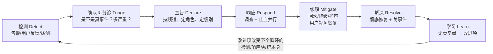
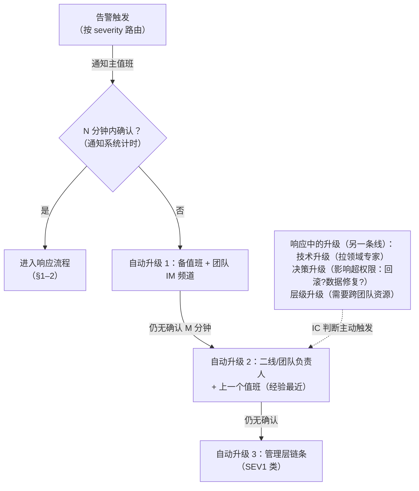
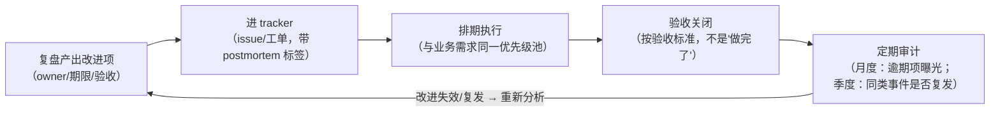

# 事件响应与值班：告警响了之后，人如何组织起来

> 阶段 7 · 实践专题 · 笔记 7-2
>
> 可观测性回答"知道"，事件响应回答"知道之后怎么办"。本篇覆盖：事件的生命周期与角色分工、
> 严重度分级、值班轮转与升级策略的设计、告警疲劳的成因与治理、无责复盘的方法与文档结构、
> 从复盘到改进项的闭环，以及它们如何与站内的 SLO/错误预算体系
> （[slo.md](../04-integration/slo.md)）衔接成一个运营闭环。
> 动手部分可在 [lab04](../../labs/lab04-three-pillars/README.md) 上完成一次 30 分钟的值班演练并产出第一份复盘。
> 前置：[SLO 与错误预算](../04-integration/slo.md)、[Alertmanager 深入](../04-integration/alertmanager-in-depth.md)、[统一仪表盘与排障 SOP](../04-integration/unified-dashboard.md)。

## 目录

1. [事件的生命周期：从检测到学习](#1-事件的生命周期从检测到学习)
2. [角色分工：事件指挥官模型](#2-角色分工事件指挥官模型)
3. [严重度分级：让"多严重"有共同语言](#3-严重度分级让多严重有共同语言)
4. [值班轮转与升级策略的设计](#4-值班轮转与升级策略的设计)
5. [告警疲劳的成因与治理](#5-告警疲劳的成因与治理)
6. [无责复盘：方法与文档结构](#6-无责复盘方法与文档结构)
7. [从复盘到改进项的闭环](#7-从复盘到改进项的闭环)
8. [与 SLO / 错误预算的衔接](#8-与-slo--错误预算的衔接)
9. [动手：在 lab04 做一次值班演练并写复盘](#9-动手在-lab04-做一次值班演练并写复盘)
10. [常见坑与排查](#10-常见坑与排查)
11. [面试题小结](#11-面试题小结)
12. [参考资料](#12-参考资料)

---

## 1. 事件的生命周期：从检测到学习

一次事件（incident）不是"告警响一次"，而是一个有状态的过程：



两个最容易被忽略的认知：

1. **"缓解"与"解决"是两个里程碑**。用户视角恢复（回滚、切流量、降级）之后事件才算缓解，而根因修复与预防（补丁、架构调整）是解决。把它们分开，才能理直气壮地"先回滚再说"——GitHub 2018-10-21 事故的官方分析里，43 秒的网络分区后，团队选择在降级状态下谨慎恢复（回放 binlog 校验数据）而不是急着"修好"，总耗时 24 小时 11 分钟，但保住了数据一致性（事后分析见 [参考资料](#12-参考资料)）；
2. **"学习"是生命周期的一部分，不是善后杂务**。没有复盘环节，检测与响应的每一分投入都无法复利（§6–7）。

与 MTTR 的关系（[unified-dashboard.md](../04-integration/unified-dashboard.md) 的分解）：

```text
MTTR = 检测 + 确认 + 定位 + 修复 + 验证
        ↑SLO告警  ↑分级/宣告  ↑三支柱下钻  ↑回滚/降级  ↑指标回落+resolved
```

事件响应体系的设计，就是逐段压缩这五个时间片，而不是只盯着"修 bug"。

---

## 2. 角色分工：事件指挥官模型

多人在场而没有分工，是最典型的响应失败模式：七个人同时查七个 dashboard，没人对外沟通，没人记时间线。Google SRE 书《Managing Incidents》一章给出的解法是**事件指挥官（Incident Commander, IC）模型**，PagerDuty 的响应指南（response.pagerduty.com）把同一模型产品化成了行业事实标准：

| 角色 | 职责 | 关键纪律 |
| --- | --- | --- |
| **事件指挥官 IC** | 掌全局：定目标与优先级、分配任务、做关键决策、判断何时升降级/关闭 | **不亲手排障**——一旦低头敲命令就没人看全局；决策基于其他人汇报的事实 |
| **运营负责人 Ops** | 亲手执行：查 dashboard、跑命令、回滚、扩容（可以是多人，按子系统分工） | 所有破坏性操作向 IC 报备后执行；操作与结果同步到频道 |
| **沟通负责人 Comms** | 对外：状态页更新、客户/管理层通报、客服口径（内部频道信息 → 外部可说的版本） | 按固定节奏更新（如每 30 分钟一条），而不是"有进展才说"；避免技术黑话 |
| **记录员 Scribe** | 记时间线：何时检测、何时宣告、每个决策的时点与理由、关键证据截图链接 | 只记事实与决定，不记情绪；这份时间线就是复盘的原料 |
| **后续待命 / 升级对象（on-call escalation）** | 被拉进来的领域专家、必要时接手 IC | 进频道先读置顶 + 时间线摘要，不打断进行中的操作 |

工程细节（照抄即可生效）：

1. **角色在宣告时显式任命**："`@张三 你是 IC，@李四 记录`"——隐式分工等于没分工；
2. **小事件一人多角，大事件严格分离**：P3 单人处理可以同时是 IC 和 Ops；P1 时 IC 绝不碰键盘；
3. **指挥权可移交**（IC handoff）：值班交接、长事件换班时，新 IC 先复述当前状态与目标再接手；
4. **专用事件频道**：一事一频道（`#inc-2026-11-14-orders`），命名可检索；跨团队拉人由 IC 决定；
5. **"讨论"与"作战"分流**：大事件开两个频道——作战频道只放操作与状态（低噪声、可回放），讨论频道随便聊。

这套模型与本站 [混沌演练日](chaos-engineering.md#6-演练日game-day怎么组织) 的角色（实验负责人/终止权/值班/记录员）是同一套心智：演练就是在没有真实压力的情况下练习角色分工。

---

## 3. 严重度分级：让"多严重"有共同语言

### 3.1 分级的原则

严重度（Severity，常写 SEV 或 P 级）回答三个问题：**要多少人、多快、用什么渠道响应**。设计分级的三条原则：

1. **从用户影响出发，不从技术组件出发**："支付下单失败"是 SEV1，"某台实例 CPU 高"只是症状；
2. **级别决定资源**：级别一宣告，响应人数、是否叫醒二线、是否开状态页全部自动确定，不再临场讨论；
3. **宁高勿低，允许降级**：不确定时先按高级别启动，随信息澄清再降级——反过来"先等等看"是延误的最大来源。

### 3.2 一个可落地的四级表（与本站告警分级对齐）

本站的告警体系已用 P0–P3 分级路由（[alertmanager-in-depth.md](../04-integration/alertmanager-in-depth.md) §8.1），事件严重度沿用同一把尺子并向下延伸：

| 级别 | 定义（用户/SLO 视角） | 响应要求 | 通知与动作 | 典型信号 |
| --- | --- | --- | --- | --- |
| **SEV1 / P0** | 核心旅程不可用或数据出错；错误预算高速燃烧（burn ≥ 14.4 档） | 5 分钟响应，7×24；IC 模型全员到位 | 电话页呼；开事件频道；考虑状态页 | `SLOAvailabilityBurnRateFast` firing |
| **SEV2 / P1** | 明显降级（部分用户/部分功能）；中速烧预算（burn 6 档） | 30 分钟内，工作时间升级为 7×24 | IM 强提醒；一人主导 | `SLOAvailabilityBurnRateSlow` |
| **SEV3 / P2** | 轻微/局部影响，趋势性风险（burn 3~1 档） | 当天处理 | 工单 + 周会跟踪 | BurnRateTicket1d/3d |
| **SEV4 / P3** | 无用户影响的异常（内部工具、单实例自愈） | 排期处理 | 只上面板/周报 | demo 指标，不进告警通道 |

两个衔接点：

- **宣告阈值写进告警 annotations**：P0 告警的 description 里直接写"触发即视为 SEV1，按 SEV1 runbook 宣告"，把分级从"临场判断"变成"预案执行"；
- **数据类故障单列一类**：数据错误（算错钱、写坏库）哪怕流量全绿也是 SEV1——可用性 SLI 测不出正确性，正确性要靠业务 SLI（[slo.md](../04-integration/slo.md) §3.2 的③）与对账监控兜底。

### 3.3 谁来定级

初判由**收到告警的值班**给出（宁可判高），确认与调整是 **IC 的第一个正式决策**。分级变化（升级/降级）必须记录进时间线——复盘时"为什么 20 分钟后才从 SEV2 升到 SEV1"往往比技术根因更有改进价值。

---

## 4. 值班轮转与升级策略的设计

### 4.1 轮转的结构参数

| 参数 | 常见选择 | 设计理由 |
| --- | --- | --- |
| 值班单元 | 主值班（primary）+ 备值班（secondary） | 主不响应（超时/手机静音）自动转备；备是"影子"也是培养线 |
| 轮次长度 | 1 周为主（7×24）；避免 2 周连值 | 太短交接成本高，太长疲劳累积。白班/夜班分开排（如欧洲"早班+晚班"）可降低夜间打断 |
| 轮转规模 | 24×7 一周一轮，N 人轮转 → 每人每 N 周被吵一周 | 算术题：N=4 时恢复间隔仅 3 周，长期必然疲劳；6~8 人是常见下限。Google SRE《Being On-Call》的平衡目标：每班次页呼个位数（书中的示例上限为每 12 小时 2 次） |
| 交接 | 书面 handoff：本周已知风险（发版计划、脆弱依赖、未关闭事件）+ 待跟进 | 交接文档即"值班上下文"，模板固定、例会 15 分钟过一遍 |
| 补偿 | 侵占休息时间的页呼补偿 / 调休 | 不是福利问题，是可持续性问题：无补偿的 7×24 会在半年内耗尽任何人 |

非 7×24 团队的变体：工作时间 IM 强提醒 + 非工作时间只对 SEV1 电话；或多时区 follow-the-sun（各区域值自己白天）。原则：**承诺要与资源匹配**——没有夜间响应能力，就不要配置夜间会响的 P1 告警，把这类信号降为次日工单（这本身就是一次告警治理，见 §5）。

### 4.2 升级策略（escalation policy）

升级回答"第一响应人失效时怎么办"。设计成**自动的阶梯**，不依赖当事人的判断：



两条正交的升级线要分清：

1. **可达性升级**（通知系统自动做）：人没接电话就往上找人——纯机械，交给 Alertmanager 路由 + 值班平台（Escalation Policy）实现；
2. **能力/权限升级**（IC 主动做）：接了电话但搞不定——拉专家、找有权限做回滚决策的人。这条线写进 runbook：每个 SEV1 的 runbook 里列"这个系统谁最懂、谁能批回滚"。

工具落点：Alertmanager 的 route 树按 `severity` 分流（[alertmanager-in-depth.md](../04-integration/alertmanager-in-depth.md) §4），但"X 分钟未确认自动升级"由值班管理平台（PagerDuty/Opsgenie/自建 webhook 服务）承担——这是 Alertmanager 与值班平台职责边界的经典问题：**告警收敛归 Alertmanager，人的可达性归值班平台**。

---

## 5. 告警疲劳的成因与治理

### 5.1 为什么会疲劳：成因解剖

告警疲劳（alert fatigue）不是"告警太多"这么简单，而是**信噪比**问题：值班的大脑被训练成"响=大概率没事"，于是真事件的页呼也会被下意识拖延。成因按频率排序：

| # | 成因 | 机制 | 站内对应 |
| --- | --- | --- | --- |
| 1 | **症状告警**（CPU 高、队列长、重启了） | 用户无感也页呼；触发条件与"需要人"脱钩 | [slo.md](../04-integration/slo.md) 反模式 #2：内部指标当 SLI |
| 2 | **阈值拍脑袋**（错误率 > 1% 就告警） | 低流量服务 1 个错误就触发；高流量服务触发即太晚 | slo.md §6.1：单阈值告警是错的，多窗口多燃烧率替代 |
| 3 | **无人认领的告警** | 触发了没人负责、也没人敢删 | 告警必须挂 owner 与 runbook_url |
| 4 | **告警风暴**（一次故障连环响 40 条） | 下游依赖集体告警，值班逐条读 | 分组（group_by）、抑制（inhibition）、根因告警优先——[alertmanager-in-depth.md](../04-integration/alertmanager-in-depth.md) §5–6 |
| 5 | **只会响不会恢复**（flapping） | 边界抖动反复触发/恢复 | 规则侧加 `for`、hysteresis；告警侧抑制重复 |
| 6 | **已知问题页呼**（循环故障、慢性病） | 每次都响，但"大家都知道" | 静默要有期限；慢性问题要么修要么降级为工单，不允许"永久已知" |

### 5.2 治理：一套闭环打法

**第一步：度量**（不可度量则不可治理）。每条页呼打三个标签，周报汇总（模板见 [alertmanager-in-depth.md](../04-integration/alertmanager-in-depth.md) §8.2）：

```text
有效（真的需要人介入）/ 无效（自动恢复、无需动作）/ 未行动（响了没人管——最危险的一类）
核心指标：每周页呼数（按 owner/服务分布）+ 页呼有效率
治理红线（示例）：值班每周页呼 > 10 或有效率 < 50% 时，本周必须完成一轮告警清理
```

**第二步：结构治理**（把告警的产生逻辑改对）：

1. 页呼通道只放 SLO burn-rate 告警（快档）与"元告警"（采集链路断了）；其余全部降为 IM/工单/面板——通道即资源，页呼是稀缺品；
2. 每条告警过"三问"：谁会在何时做什么（[alertmanager-in-depth.md](../04-integration/alertmanager-in-depth.md) §8.1）？答案写进 annotations（runbook_url、dashboard 链接）；
3. 通知层用尽分组/抑制/静默，把"一次故障"压缩为"一通电话"；
4. 慢性告警进专门的"技术债看板"，带 owner 与期限，静默只允许静默到期限日。

**第三步：验证**。治理不是改完就信——用[混沌实验](chaos-engineering.md#7-混沌实验检验可观测性本身本篇核心)验证"删掉/降级后的告警，真故障时该响的还响"（lab04 实验 A 就是验证样例：注入 60% 错误率，确认快档页呼按时触发）。

Google SRE Workbook《Alerting on SLOs》是这套打法的原始出处（见 [参考资料](#12-参考资料)）；本站的落地配置就是 lab04 的 `slo-burn-rate.yml`。

---

## 6. 无责复盘：方法与文档结构

站内 [unified-dashboard.md §7](../04-integration/unified-dashboard.md#7-postmortem-文化要点) 已给出复盘的文档模板与文化要点，本篇补齐**怎么开好会、怎么防跑偏**。

### 6.1 为什么"无责"是技术前提，不是道德姿态

追责式复盘的失败不是"不厚道"，而是**拿不到数据**：一旦时间线与"谁的错"挂钩，下一场事故的参与者就会无意识地美化时间线（晚报发现时点、模糊决策理由）。而没有真实的时间线，根因分析必然失真。Sidney Dekker 在《The Field Guide to Understanding "Human Error"》里的论断可以作为复盘座右铭：**"人的错误"是结果不是原因——去问"为什么在当时当地的 信息/工具/时间压力下，这个动作看起来是合理的"**。John Allspaw（Etsy）据此把无责复盘发展为可复用的引导方法，开源为 Debriefing Facilitation Guide（见 [参考资料](#12-参考资料)）。

### 6.2 会议怎么开（90 分钟版）

| 阶段 | 时长 | 做法 |
| --- | --- | --- |
| 开场 | 5' | 主持人重申规则："我们假设所有人都在当时条件下做了合理决策；今天找的是系统缺陷，不是责任人" |
| 时间线回放 | 25' | 记录员的时间线逐条过；**只补事实，不辩论**；证据（告警截图、trace 链接）贴进文档 |
| 找"差距" | 20' | 引导问题（Allspaw 式）：检测为什么花了 X 分钟？值班当时的仪表盘上有什么、没什么？回滚决策卡在哪条信息？——每个差距都可能长出改进项 |
| 根因（技术+流程） | 20' | 用 5 Why / 因果链往系统与流程层追：技术根因之上，问"哪道流程防线本可拦住它"（未灰度？未演练？告警缺失？） |
| 改进项 | 15' | 每条写 owner/期限/验收标准（§7）；区分"防再发"与"早发现"两类 |
| 结束 | 5' | 复述改进项清单；确认对外沟通是否需要更新（状态页/客户口径） |

主持人技巧（决定成败的细节）：

- 出现"为什么当时不……"的句式立即改写为"当时的信息是什么，让另一个选项不可见？"；
- 高管在场时格外警惕——必要时分开"工程复盘"与"管理简报"两会；
- 复盘会不解决"谁的绩效"，那是另一个会议（也不该有）。

### 6.3 文档结构（骨架）

```markdown
# Postmortem：<标题：系统+影响>（YYYY-MM-DD）
状态：草稿/已评审    严重度：SEV1    审核：无责（blameless）

## 摘要（3 句话：什么时间、影响谁多久、根因一句话）
## 影响（用户视角量化：失败请求数/时长/错误预算消耗）
## 时间线（检测/宣告/缓解/解决各里程碑 + 关键决策点，带绝对时间）
## 根因分析（技术根因 + 流程根因，因果链呈现）
## 检测与响应评估（告警多快？定位多久？SOP 哪步卡住？——可观测性体检）
## 做得好的（同样重要：哪些防线生效了）
## 改进项（编号 | 类型(防再发/早发现) | owner | 截止 | 验收标准）
## 经验教训（可被其他团队复用的一句话）
## 附录（证据链接：dashboard、trace、日志查询、告警记录）
```

与 unified-dashboard.md §7.1 模板的差异：多了"检测与响应评估"一节——把 §5 的告警三问固化进每次复盘，让**可观测性改进与系统改进同权重**。

### 6.4 出稿纪律

48 小时内初稿（记忆与证据都还新鲜）；全公司可读（内部的敏感例外走附录加密）；只复盘不改的清单会反过来毒害文化——改进项到期未完成的，下一次复盘会第一项就是它。

---

## 7. 从复盘到改进项的闭环

复盘的产出不是文档，是**仓库里的 diff 与系统里的变化**。闭环的四环：



落地细节：

1. **改进项分两类**，避免全是"防再发"而忽略"早发现"：
   - 防再发（prevent）：修 bug、灰度流程、架构冗余——通常归服务团队；
   - 早发现（detect）：新告警、新面板、新拨测、SOP 更新——归可观测性 owner；
   一次健康复盘两类各至少一条；
2. **数量纪律**：改进项 3~6 条为宜。列 20 条等于没有——集中资源在高杠杆项（警惕"全面加强""举一反三"式不可验证项）；
3. **验收标准必须可执行**："压测报告含连接池场景"（可验收）vs "以后加强发布审核"（不可验收）；
4. **复发审计**：季度回看——同一根因（同一条因果链）再次出现，说明上轮改进项选错了杠杆点，重新复盘而不是追加同类改进项；
5. **与演练联动**：高危改进项（如"新回滚路径"）完成后，用[混沌实验](chaos-engineering.md)验证它真的生效——改进项的验收标准里可以直接写"在下一次演练中验证"。

---

## 8. 与 SLO / 错误预算的衔接

事件响应体系不是独立建起来的，它就架在阶段 4 的 SLO 体系上。衔接点一张表说清：

| SLO 体系的构件 | 在事件响应中的角色 |
| --- | --- |
| **SLI（好事件比例）** | 事件影响的度量衡：复盘的"影响"一节直接写"烧掉 X% 预算"，管理层无需理解技术细节（[slo.md](../04-integration/slo.md) §5.1 的换算） |
| **多窗口燃烧率档位（14.4/6/3/1）** | 严重度的信号源：快档=SEV1、慢档=SEV2、工单档=SEV3（§3.2 的映射），分级从临场判断变成预案执行 |
| **burn rate 回落 < 1** | "缓解"的客观判据：不是"感觉好了"，是错误率回到预算速度以下（lab04 实验 A 的 resolved 验证） |
| **错误预算政策** | 事件的经营后果：预算烧穿 → 冻结发版、全力还债（slo.md §8）。事件复盘的结论"该不该触发冻结"用政策回答，而非人情 |
| **预算会议** | 事件响应的周期性治理场：月度过各 SLO 消耗、超支原因、下月计划——与 §5 的告警周报同频 |

反方向的流动同样存在：**事件复盘是 SLO 体系年检的数据源**。两个例子：

- 复盘发现"404 爬虫流量烧光预算"→ 修订 SLI 分母（排除健康检查/爬虫，slo.md §10 坑 9）；
- 复盘发现"慢档告警响了三天没人管"→ 档位响应动作定义失效，要么改动作要么降档——SLO 告警的生命线是"每个档位都有人、有动作"。

一句话总结这个闭环：**SLO 定义的"正常"是稳态；事件是对稳态的打破；复盘把打破的原因变成系统与流程的 diff；错误预算决定打破之后组织还剩多少冒险额度；混沌实验再主动验证这一切真的在运转。**

---

## 9. 动手：在 lab04 做一次值班演练并写复盘

30 分钟在 [lab04](../../labs/lab04-three-pillars/README.md) 上走完"检测 → 宣告 → 响应 → 缓解 → 复盘"全流程。需要两人以上效果最佳（分别扮演值班与记录员；单人可自我分身，但务必书面记录）。

### 9.1 演练脚本

```bash
cd labs/lab04-three-pillars && podman compose up -d --build

# [T0 · 注入] 由"实验负责人"执行（值班背对屏幕，不知道注入了什么）
curl -X POST "http://localhost:8000/chaos?rate=0.6"

# [T0+~3~4min · 检测] 值班收到"页呼"（lab04 用展示页模拟：刷新 http://localhost:8000/alerts）
# 记录员记下：首条 firing 的时刻与 alertname（预期 SLOAvailabilityBurnRateFast）

# [宣告] 值班按 §3.2 宣告 SEV1，频道里任命角色（IC/记录员）
# [响应] IC 指挥，按 unified-dashboard.md 的五步 SOP 走：
#   ① 告警确认（哪个 SLO 哪一档） → ② 统一 dashboard 锁时间窗、收敛半径
#   → ③ 日志面板点 TraceID 跳 trace → ④ 根因确认（reason=payment_gateway_timeout）
#   → ⑤ 决策"回滚"（本环境即关闭注入）

# [缓解]
curl -X POST "http://localhost:8000/chaos?rate=0.02"
# 记录员记下：告警 resolved 的时刻（预期 3~5 分钟内）

# [验证] 三重验证：指标回落 + resolved + burn 回落
curl -s 'http://localhost:9090/api/v1/query' \
  --data-urlencode 'query=slo:demo_app_availability:error_ratio_rate5m' | python3 -m json.tool
```

时间线素材全部自动可得：`/alerts` 展示页（通知时刻）、Prometheus rules API（状态翻转时刻）、Grafana 面板截图。进阶：换用[混沌笔记](chaos-engineering.md#8-动手在-lab04-完成三个实验)实验 B（击杀 inventory），体验"依赖故障"的另一种响应路径。

### 9.2 产出第一份复盘

按 §6.3 骨架填写，重点填两节：

- **时间线**：用 9.1 记录的真实时刻（注入 T0、首条告警、宣告、定位完成、缓解、resolved）；
- **检测与响应评估**：检测延迟 = 首条告警 − T0（对照 slo.md §6.5 的理论下限）；定位延迟 = ⑤ 决策时刻 − 告警时刻；SOP 哪一步最慢？

虚构示例（供对照格式，非真实事故——与 unified-dashboard.md §7.1 的虚构样例同源）：

```text
检测：注入后 ~3.5min 首条 SEV1 告警（理论下限 ~3min，达标）
定位：dashboard 锁窗 40s → 日志点 TraceID 30s → 根因确认 90s（共 2m40s，达标）
改进项①（早发现）：告警 annotations 补"已知原因排查顺序"（reason 字段的枚举值清单）
改进项②（防再发）：payment 段增加超时降级，慢于 800ms 返回兜底（对应 SOP 第 5 步的降级分支）
```

### 9.3 治理侧的练习（选做）

演练结束后做一次"告警三问"（§5.2）：lab04 的 8 条告警逐条问"谁在何时做什么"；把不达标的那条改掉（例如给 `DemoAppNoTraffic` 补 runbook 说明），体验一次 10 分钟的告警治理。

---

## 10. 常见坑与排查

| # | 症状 | 根因 | 解法 |
| --- | --- | --- | --- |
| 1 | 事件频道 30 条消息，没人知道当前状态 | 无 IC / 无时间线 | 宣告时任命 IC 与记录员；状态用置顶消息滚动更新 |
| 2 | 修复了，用户还在报障 | "解决"当"缓解"：只修了根因没切流量/没补数据 | 缓解用用户视角判据（SLI 回稳 + burn<1），不是"代码合了" |
| 3 | 复盘会变成追责现场，下一次没人写真时间线 | 主持人没立规则/高管施压 | §6.2 开场白；必要时工程复盘与管理简报分开 |
| 4 | 改进项列了 20 条，三个月后一条没关 | 不可执行、无 owner、无验收 | 3~6 条硬上限；验收标准可执行；月度审计曝光逾期 |
| 5 | 值班周页呼 30 次，真事件反而漏接 | 告警疲劳（§5） | 通道收缩 + 三问治理 + 混沌验证 |
| 6 | 升级靠"感觉该找了" | 升级策略在人脑里不在系统里 | 自动阶梯（§4.2）+ runbook 列专家名单 |
| 7 | 夜间 SEV1 电话没人接 | 无备值班/无自动升级/手机静默习惯 | primary+secondary 双层；通知平台计时自动升级 |
| 8 | 事件结束三天了还没人写复盘 | 无出稿时限、复盘被视为额外工作 | 48h 初稿进流程（关闭事件的前置条件）；复盘是值班工作量的正式部分 |
| 9 | 同一根因一年三次复盘 | 改进项选错杠杆点或未验收关闭 | §7.4 复发审计：重新分析，而非追加同类项 |
| 10 | 状态页 6 小时没更新 | 无沟通负责人/无更新节奏 | Comms 角色固定节奏更新（§2）；状态页不在受影响的依赖上（Facebook 2021 的教训） |
| 11 | 值班交接后复发上周已知问题 | 无书面 handoff | 交接模板：进行中事件、已知风险、发版计划、待跟进 |
| 12 | IC 在敲命令，没人看全局 | 角色混同 | P1 及以上 IC 不碰键盘（§2 纪律 1） |

---

## 11. 面试题小结

**Q1：描述一次完整的事件响应流程。**
A：检测（告警/用户反馈）→ 确认与分诊（是否真事件、初判级别）→ 宣告（拉频道、任命 IC/记录员、定级）→ 响应（调查与止血并行，按 SOP 下钻）→ 缓解（用户视角恢复：回滚/降级/扩容，判据是 SLI 回稳与 burn rate 回落）→ 解决（根因修复）→ 学习（无责复盘 → 改进项闭环）。关键是"缓解"与"解决"分离：先止血再治病。

**Q2：事件指挥官模型里有哪些角色？为什么 IC 不能亲自排障？**
A：IC（全局决策与资源调度）、Ops（执行排障操作）、Comms（对外沟通与状态页）、Scribe（时间线记录）。IC 不碰键盘是因为注意力是最稀缺资源：一旦进入执行细节就失去全局视图，无人做决策与协调，多人响应会退化为无组织状态。

**Q3：严重度分级怎么设计？和 SLO 体系怎么衔接？**
A：从用户影响出发定 4 级（SEV1 核心旅程不可用 → SEV4 无用户影响），级别决定响应人数/时限/渠道；衔接点是让 SLO 燃烧率档位成为分级的信号源（burn 14.4 快档=SEV1、6 档=SEV2、3~1 档=SEV3），分级从临场判断变成预案执行；数据正确性类故障单列（可用性 SLI 测不出）。

**Q4：值班轮转怎么设计才可持续？**
A：主+备双层；一周一轮、避免连值；团队规模用算术算（N 人轮转=每人每 N 周值一周，6~8 人起步）；页呼量控制在每班次个位数（超了先治理告警而不是加人）；书面交接（进行中事件/已知风险/发版计划）；对侵占休息时间的页呼有补偿机制。

**Q5：升级策略有哪两条正交的线？**
A：可达性升级（人没接电话→备值班→二线→管理层，由值班平台按计时自动执行，机械可靠）与能力/权限升级（接了但搞不定→拉领域专家、找有决策权的人，由 IC 按预案主动触发，名单写进 runbook）。前者自动化，后者流程化，不能混为一谈。

**Q6：告警疲劳怎么治理？**
A：先度量（每条页呼标有效/无效/未行动，周报页呼量与有效率）→ 结构治理（页呼通道只放 SLO 快档与元告警；每条告警过三问"谁在何时做什么"；分组/抑制/静默压缩风暴；慢性问题进带期限的债看板）→ 混沌验证（确认删减后真故障仍能触发）。本质是信噪比问题：目标是每条页呼都值得被打断。

**Q7：为什么复盘必须无责？怎么开好复盘会？**
A：无责是技术前提：追责会失真时间线（人趋利避害），拿不到真实数据则根因分析必然失真。Dekker 的视角：把"人的错误"当结果不当原因，问"当时条件下为何该动作看似合理"。开好会：主持人开场立规则、时间线回放只补事实不辩论、用引导问题找检测/定位/决策的差距、改进项 3~6 条带 owner/期限/验收、48 小时初稿。

**Q8：怎么保证复盘的改进项真正落地？**
A：改进项进 tracker 与业务需求同池排期；分"防再发/早发现"两类；验收标准可执行（"压测报告含 X 场景"）；月度审计曝光逾期项；季度复审同类事件是否复发，复发说明杠杆点选错要重新分析；高危改进项用混沌实验验收。

**Q9：错误预算在事件响应里扮演什么角色？**
A：三重角色——影响度量（复盘用"烧掉 X% 预算"量化，跨技术/管理层通用）、缓解判据（burn rate 回落 <1 才算止血完成）、经营后果（预算烧穿触发发版冻结，事件的组织代价由政策而非人情决定）。反过来，复盘也是 SLO 年检的数据源（修 SLI 口径、调档位动作）。

**Q10：你值班收到一条 P1 告警，前 10 分钟做什么？**
A：① 确认告警（哪个 SLO 哪档、开始时间、annotations 里的下钻链接）；② 快速初判影响（dashboard 锁时间窗看半径：全量还是局部）；③ 决定是否宣告事件与级别（宁高勿低）；④ 若宣告：拉频道、任命角色（哪怕只有自己：书面自任 IC 并开始记时间线）；⑤ 若刚发过版/有变更，优先回滚（最大概率根因）；⑥ 按五步 SOP 下钻定位。全程把动作与时刻同步到频道。

---

## 12. 参考资料

- Google SRE Book · Managing Incidents（IC 模型原始论述）：<https://sre.google/sre-book/managing-incidents/>（访问日期：2026-11-13）
- Google SRE Book · Being On-Call（平衡的页呼策略）：<https://sre.google/sre-book/being-on-call/>（访问日期：2026-11-13）
- Google SRE Workbook · Incident Response：<https://sre.google/workbook/incident-response/>（访问日期：2026-11-13）
- Google SRE Workbook · Alerting on SLOs（告警疲劳治理的方法论源头）：<https://sre.google/workbook/alerting-on-slos/>（访问日期：2026-11-13）
- Google SRE Book · Postmortem Culture：<https://sre.google/sre-book/postmortem-culture/>（访问日期：2026-11-13）
- Google SRE Workbook · Postmortem 模板与案例：<https://sre.google/workbook/postmortem-examples/>（访问日期：2026-11-13）
- Howie（Google 开源的轻量事件响应指南，可 fork 定制）：<https://github.com/google/howie>（访问日期：2026-11-13）
- PagerDuty Incident Response（角色/分级/模板的行业事实标准）：<https://response.pagerduty.com/>（访问日期：2026-11-13）
- Etsy · Debriefing Facilitation Guide（John Allspaw，无责复盘引导手册）：<https://github.com/etsy/DebriefingFacilitationGuide>（访问日期：2026-11-13）
- Etsy Code as Craft · Blameless PostMortems（2012）：<https://codeascraft.com/2012/05/22/blameless-postmortems/>（访问日期：2026-11-13）
- Sidney Dekker,《The Field Guide to Understanding "Human Error"》（第三版, CRC Press）
- GitHub · 2018-10-21 事后分析（缓解与解决分离的范例）：<https://github.blog/news-insights/company-news/oct21-post-incident-analysis/>（访问日期：2026-11-13）
- Facebook · 2021-10-04 事后说明（工具链与被观测面解耦的教训）：<https://engineering.fb.com/2021/10/05/update-about-october-4-outage/>（访问日期：2026-11-13）
- 本工作区相关笔记：[SLO 与错误预算](../04-integration/slo.md)、[Alertmanager 深入](../04-integration/alertmanager-in-depth.md)、[统一仪表盘与排障 SOP](../04-integration/unified-dashboard.md)（§7 复盘模板）、[混沌工程](chaos-engineering.md)；
  配套实验：[lab04 三支柱整合](../../labs/lab04-three-pillars/README.md)（§9 演练环境）

## 附：ASCII 图替换清单

| 原图位置（章节标题） | 原图内容简述 | 替换结果 |
| --- | --- | --- |
| 1. 事件的生命周期 | 检测→分诊→宣告→响应→缓解→解决→学习的循环 | flowchart LR |
| 4.2 升级策略 | 未确认自动升级阶梯 + IC 主动升级两条线 | flowchart TD |
| 7. 从复盘到改进项的闭环 | 改进项从产出到审计的五环循环 | flowchart LR |

### 保留说明（未替换的原图）

无——本篇为新增笔记，插图全部以 Mermaid 编写，未引入 ASCII 图。
