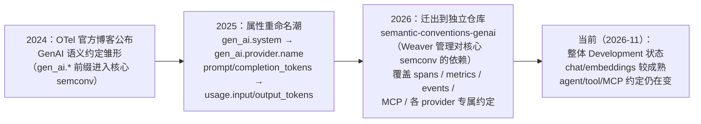
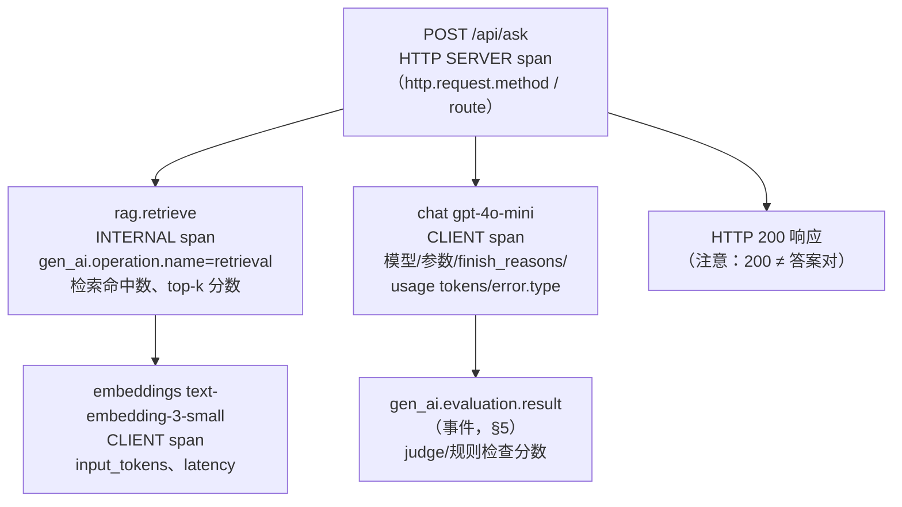
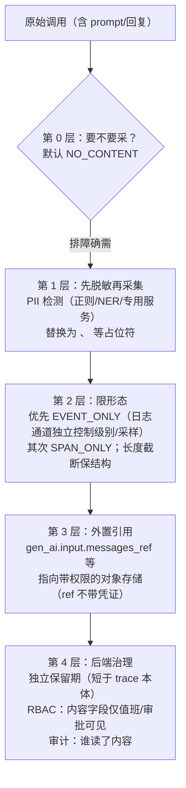

# 大模型应用的可观测性：当"依赖"会说话

> 阶段 7 · 实践专题 · 笔记 7-3
>
> 把阶段 0–6 的方法论迁移到一类新负载：以 LLM 为核心组件的应用（chatbot、RAG、agent）。
> 本篇覆盖：这类应用与传统服务在可观测性上的差别、OpenTelemetry 生成式 AI 语义约定的现状与
> 核心内容、一次调用链该记录什么、token 用量与成本的度量、质量评估信号怎样纳入可观测体系、
> 以及提示词与回复内容的隐私与脱敏问题。
>
> **时效声明**：本篇涉及的标准仍在快速演进。OpenTelemetry 的 GenAI 语义约定目前整体处于
> **Development（开发中）**状态（尚无 Stable 属性，也无冻结承诺），且已从核心 semconv 仓库
> 迁出到独立仓库维护；文中所有属性名、指标名、事件名与环境变量均于 **2026-11-13**
> 对照官方仓库核对（见参考资料）。写代码前请再核对当时版本的约定。
> 前置：[OpenTelemetry 概念](../00-concepts/opentelemetry-overview.md)、[语义约定](../00-concepts/semantic-conventions.md)、[OTel SDK 实战](../03-tracing/otel-sdk.md)。

## 目录

1. [LLM 应用与传统服务的七个可观测性差别](#1-llm-应用与传统服务的七个可观测性差别)
2. [OpenTelemetry GenAI 语义约定：现状与演进](#2-opentelemetry-genai-语义约定现状与演进)
3. [一次调用链该记录哪些信息](#3-一次调用链该记录哪些信息)
4. [token 用量与成本的度量](#4-token-用量与成本的度量)
5. [质量评估信号纳入可观测体系](#5-质量评估信号纳入可观测体系)
6. [隐私与脱敏：内容采集的红线](#6-隐私与脱敏内容采集的红线)
7. [从零落地的最小路径](#7-从零落地的最小路径)
8. [常见坑与排查](#8-常见坑与排查)
9. [面试题小结](#9-面试题小结)
10. [参考资料](#10-参考资料)

---

## 1. LLM 应用与传统服务的七个可观测性差别

传统服务的可观测性围绕"请求-处理-响应"的确定性流程展开（RED 指标 + trace + 日志）。
当核心组件换成一个** probabilistic（概率性）、外部托管、按 token 计费、延迟由输出长度决定**
的模型 API，几乎每条观测假设都要重写：

| # | 维度 | 传统 Web 服务 | LLM 应用 | 对可观测性的冲击 |
| --- | --- | --- | --- | --- |
| 1 | **失败形态** | 5xx、超时、崩溃——**显式失败** | 大量失败是 **200 OK 但答案错**（幻觉、跑题、格式破坏、拒绝回答、泄敏） | 状态码与 span status 测不出"答案质量"；正确性成为一等观测对象（§5） |
| 2 | **延迟结构** | 服务端处理时间为主 | 流式响应分 **TTFT（首 token 时间）** 与总时长；总时长 ≈ TTFT + 输出 token 数 × 每 token 速率 | p99 由**输出长度**主导——不看 token 数就没法解释延迟；TTFT 是体感的关键指标 |
| 3 | **成本模型** | 机器成本（间接、摊销） | **按 token 直接计费**；不同模型单价差数量级；缓存命中（prompt caching）价差大 | 成本是**每次请求的运行时属性**，必须进指标与 trace（§4） |
| 4 | **确定性** | 同输入同输出 | 同 prompt 不同输出；模型供应商**静默升级**可让行为悄悄漂移 | "没有变更"不等于"不会劣化"；需要版本切分的质量信号与对照检测（§5） |
| 5 | **依赖形态** | 内部服务 + DB | 外部模型 API（限流、区域故障、突发的 capacity 短缺），常**多 provider 路由** | provider.name 维度必不可少；错误类型（限流/超时/内容策略拒绝）语义各异 |
| 6 | **链路形态** | 一次请求一棵较浅的 span 树 | agent 是**循环**：规划 → 工具调用 → 观察 → 再规划……单次"请求"的 span 数不定、可能自环 | trace 更深更长；工具调用/检索每一步都要可归因；循环上限与步数本身是健康信号 |
| 7 | **数据敏感性** | 日志主要含业务数据 | **prompt 与回复天然聚集 PII 与商业机密**（用户把一切都说给 chatbot） | 内容采集是双刃剑：排障需要 vs 合规风险（§6），默认必须关闭 |

一句话总结：传统服务的可观测性问"**快不快、挂没挂**"，LLM 应用要多问两句"**对不对（质量）、贵不贵（成本）**"——而这两问恰好是标准可观测性体系最不擅长、正在补建的（§2）。

---

## 2. OpenTelemetry GenAI 语义约定：现状与演进

### 2.1 演进脉络（理解现状为什么要"带着日期读"）



两个对工程决策有直接影响的现状：

1. **没有任何 gen_ai.* 属性进入 Stable**。这意味着跨版本升级时属性名可能再变（上面的重命名潮就是前车之鉴）——选型时把 instrumentation 的 semconv 版本钉死，升级当作变更管理；
2. **约定已独立成仓**（<https://github.com/open-telemetry/semantic-conventions-genai>），核心 semconv 仓库里的旧页面只作跳转；查询文档时认准这个仓库，搜索引擎里的旧文章（尤其 2024–2025 年的）很可能引用已废弃的名字。

### 2.2 核心约定速览（2026-11-13 核对版）

**推理（inference）span**——调用一次模型的 span：

- 命名：`{gen_ai.operation.name} {gen_ai.request.model}`（如 `chat gpt-4o-mini`），kind 为 `CLIENT`（进程内本地模型 MAY 为 `INTERNAL`）；
- `gen_ai.operation.name` 的常见取值：`chat`、`generate_content`、`text_completion`、`embeddings`、`invoke_agent`、`execute_tool`、`retrieval` 等（完整枚举见仓库，全部 Development）。

核心属性（均 Development，除注明外）：

| 属性 | 类型/示例 | 要求级别 | 说明 |
| --- | --- | --- | --- |
| `gen_ai.operation.name` | `chat` | Required | 操作类型，也是 span 名第一段 |
| `gen_ai.provider.name` | `openai` / `anthropic` / `gcp.gemini` / `ollama` … | Required | 提供商（注意：不是旧的 `gen_ai.system`） |
| `gen_ai.request.model` | `gpt-4o-mini` | Cond. Required（可得时） | **请求的**模型名 |
| `gen_ai.response.model` | `gpt-4o-mini-2024-07-18` | Recommended | **实际服务的**模型快照名——检测"静默升级"的关键（§5） |
| `gen_ai.request.max_tokens` | `1024` | Recommended | 生成上限 |
| `gen_ai.request.temperature` / `top_p` | `0.7` / `1.0` | Recommended | 采样参数 |
| `gen_ai.response.finish_reasons` | `["stop"]` | Recommended | 结束原因数组（stop/length/tool_calls/content_filter…） |
| `gen_ai.response.id` | `chatcmpl-xxx` | Recommended | 供应商响应 id，客服排查用 |
| `gen_ai.usage.input_tokens` | `523` | Recommended | 输入 token（含缓存命中部分） |
| `gen_ai.usage.output_tokens` | `180` | Recommended | 输出 token（含推理 token） |
| `gen_ai.conversation.id` | 会话 id | Cond. Required（可得时） | 串联多轮会话（低基数，才允许进属性） |
| `gen_ai.prompt.name` / `gen_ai.prompt.version` | `support-bot` / `17` | Cond. Required | **提示词资产化后**的版本追踪——质量归因的主维度（§5） |
| `error.type` | `timeout` | Cond. Required（出错时） | 注意：用的是**核心（已 Stable）的 `error.type`**，没有 `gen_ai.` 前缀 |

**内容属性（Opt-In，默认不采集，§6）**：`gen_ai.input.messages`、`gen_ai.output.messages`、`gen_ai.system_instructions`、`gen_ai.tool.definitions`，以及把内容外置到自有存储的引用变体 `gen_ai.input.messages_ref` 等。

**事件（events）**：约定推荐把完整调用详情作为**日志信号**记录（事件 `gen_ai.client.inference.operation.details`，DEBUG 级/severity 5），而不是塞进 span 属性——日志通道可独立控制级别与采样，这是内容治理的第一道闸（§6.2）。

**指标**（§4 详解）：token 计数器 `gen_ai.client.inference.usage.input_tokens` / `.output_tokens`（单位 `{token}`）、token 直方图 `gen_ai.client.inference.operation.input_tokens` / `.output_tokens`、通用时长 `gen_ai.client.operation.duration`、模型服务端指标 `gen_ai.server.time_to_first_token` 等。

**instrumentation 生态**：OpenTelemetry 已为 GenAI 建立专门的 instrumentation 项目（如 Python 的专用仓库，2026-10 发布的 `opentelemetry-instrumentation-genai-openai` v1.3b0，取代早期的 `opentelemetry-instrumentation-openai-v2`；覆盖 chat completions、Responses API 与 embeddings，OpenAI 兼容端点的各家供应商可复用）。注意过渡期的不一致：**规范**层面定义的采集开关是 `OTEL_INSTRUMENTATION_GENAI_CAPTURE_CONTENT`（值 `NO_CONTENT`（默认）/`SPAN_ONLY`/`EVENT_ONLY`/`SPAN_AND_EVENT`），而上述 Python 包当前实现用的是历史名 `OTEL_INSTRUMENTATION_GENAI_CAPTURE_MESSAGE_CONTENT`（值同名但小写：`no_content` 等）——用哪个包就核对哪个包的 README，别按本文照抄进生产。

---

## 3. 一次调用链该记录哪些信息

### 3.1 一个 RAG 场景的 trace 形态



普通 Web 应用的"一次请求一棵树"仍然成立，但多了三种 span：**embedding（算钱的 IO）**、**retrieval（质量的决定因素）**、**inference（贵而慢的核心调用）**；agent 场景则把"工具调用 → 观察 → 再推理"的循环展开成一串 sibling span——步数本身就是应记录的属性（约定提供了 agent 级 `gen_ai.invoke_agent.tool_calls` 等直方图指标）。

### 3.2 每层记录什么的速查表

| 信号 | 必记 | 选记 | 不要记 |
| --- | --- | --- | --- |
| **inference span** | operation/provider/request.model/response.model/usage 两 token/error.type | 采样参数、finish_reasons、response.id、conversation.id、prompt.name+version | 完整 prompt/回复正文（默认关，走 Opt-In + §6 治理） |
| **embedding span** | operation、model、input_tokens | batch 大小、维度 | 逐条文本内容 |
| **retrieval span** | 数据源标识、命中条数 | top-k 分数、检索耗时分解 | 原文语料 |
| **tool/agent span** | 工具名、成败 | 步数、循环深度 | 工具入参里的敏感字段（脱敏后可记） |
| **入口 HTTP span** | 常规 http semconv（route 模板防高基数） | user 标识的**低基数**哈希 | 原始问题全文进 span 属性 |
| **日志** | 结构化事件（含 trace_id 关联，站内 [correlation.md](../04-integration/correlation.md) 的老配方） | DEBUG 级调用详情事件（内容采集开时） | 无 trace_id 的散日志 |

### 3.3 手写 instrumentation 的最小样例（不依赖 GenAI 专用包）

GenAI instrumentation 包尚在快速迭代（且各 provider 覆盖度不一），很多团队的第一步是**在自家网关/封装层手写 span**——好处是属性完全自控、与版本解耦。Python 最小样例（OTel SDK 常规 API，属性按 §2.2 填）：

```python
from opentelemetry import trace
from opentelemetry.trace import Status, StatusCode

tracer = trace.get_tracer("rag.gateway", "1.0.0")

def call_llm(client, model: str, messages: list[dict]) -> str:
    # span 名按约定：{operation} {request.model}
    with tracer.start_as_current_span(f"chat {model}") as span:
        span.set_attribute("gen_ai.operation.name", "chat")
        span.set_attribute("gen_ai.provider.name", "openai")
        span.set_attribute("gen_ai.request.model", model)
        span.set_attribute("gen_ai.request.temperature", 0.7)
        span.set_attribute("gen_ai.request.max_tokens", 1024)
        span.set_attribute("gen_ai.prompt.name", "support-bot")
        span.set_attribute("gen_ai.prompt.version", "17")
        try:
            resp = client.chat.completions.create(
                model=model, messages=messages, temperature=0.7, max_tokens=1024
            )
        except Exception as exc:  # noqa: BLE001
            span.set_status(Status(StatusCode.ERROR, str(exc)))
            span.set_attribute("error.type", type(exc).__name__)
            raise
        usage = resp.usage
        if usage is not None:
            span.set_attribute("gen_ai.usage.input_tokens", usage.prompt_tokens)
            span.set_attribute("gen_ai.usage.output_tokens", usage.completion_tokens)
        # 注意：response.model 是实际服务版本（含日期后缀），静默升级检测就靠它
        span.set_attribute("gen_ai.response.model", resp.model or model)
        span.set_attribute("gen_ai.response.finish_reasons",
                           [resp.choices[0].finish_reason] if resp.choices else ["unknown"])
        return resp.choices[0].message.content or ""
```

要点：**token 数从响应的 usage 字段来**（不同供应商都提供，字段名略有差异）；错误路径必须写 `error.type` 并置 span status——LLM 供应商的错误（限流 429、内容策略拒绝、capacity 短缺）是稳定信号源，值得单独做错误率面板。此样例在本地以 OTLP/JSON 导出验证过 span 与属性完整落库（见 [lab06](../../labs/lab06-mini-platform/README.md) 的 demo app，它用的就是这套手写埋点）。

---

## 4. token 用量与成本的度量

### 4.1 约定定义的指标（2026-11-13 核对）

| 指标 | 类型 | 单位 | 维度（属性） | 用途 |
| --- | --- | --- | --- | --- |
| `gen_ai.client.inference.usage.input_tokens` / `.output_tokens` | Counter | `{token}` | operation/provider/token modality（text/image/audio）/request.model/response.model | 成本核算、趋势、预算燃烧 |
| `gen_ai.client.inference.usage.cache_read.input_tokens` / `cache_write.input_tokens` | Counter | `{token}` | 同上 | **缓存命中率的成本价值**（命中部分单价低数倍） |
| `gen_ai.client.inference.usage.reasoning.output_tokens` | Counter | `{token}` | operation/provider | 推理模型的思考 token（隐藏成本） |
| `gen_ai.client.inference.operation.input_tokens` / `.output_tokens` | Histogram | `{token}`（显式桶） | operation/provider/model/error.type | 单次请求的 token 分布——长尾"巨型对话"排查 |
| `gen_ai.client.operation.duration` | Histogram | `s` | operation/provider/model/error.type | 通用时长（约定注明推理/嵌入等应用专用指标优先） |
| `gen_ai.server.time_to_first_token` / `time_per_output_token` | Histogram | `s` | provider/model | **自托管模型服务端**的体感指标（托管 API 侧由客户端测 TTFT 记 span） |

### 4.2 成本核算的工程做法

**指标记 token，单价放配置**——供应商调价是业务事件，不该重埋点：

```text
成本/请求 ≈ Σ token(model, kind) × 单价表[model][kind]      # kind ∈ {input, output, cached_input, ...}
```

三种实现层次，按需选择：

1. **面板端计算**：Prometheus 里 token 指标 × 单价（单价以 Grafana 变量/常量维护）——零开发，最快见效；
2. **导出时计算**：自研网关（很多团队本来就有 LLM 网关做路由/限流）在记 span 的同时直接记一个 `llm.cost.usd` 指标——最准，能含缓存折扣与多 provider 价差；
3. **离线对账**：token 指标 × 单价 vs 供应商账单，月度对账校准（差异通常来自：未记到的失败请求重试、供应商侧计费口径差异、批量 API 折扣）。

**预算告警照抄 SLO 的燃烧率思路**（[slo.md](../04-integration/slo.md) §6）：设月度 token/成本预算，按 `消耗速度 ÷ 允许速度` 设快慢双档——快档（如 1 小时烧掉 2% 月预算）页呼，慢档工单。这比"单日成本 > X"的拍脑袋阈值更能兼容流量自然波动。

### 4.3 成本下钻：token 直方图 + trace

成本异常（某功能烧钱暴增）的定位路径：成本面板按 `request.model` / `prompt.name` 拆分 → 锁定维度 → 用 token 直方图看是"请求变多"还是"单次变大" → 抽 exemplar/trace 看具体对话（内容采集开着时）→ 常见根因：系统提示词膨胀、多轮对话永不截断（该上 `gen_ai.conversation.compacted` 类的上下文压缩）、agent 循环失控、embedding 重复调用。

---

## 5. 质量评估信号纳入可观测体系

### 5.1 质量信号的三层来源

| 层 | 信号 | 延迟 | 噪声 | 例子 |
| --- | --- | --- | --- | --- |
| **行为代理（在线）** | 用户/系统的"下游行为" | 秒级 | 低 | 重试率、用户明确点踩、人工接管率（chatbot 转人工）、工具调用成功率、复制/编辑回答的比例、refusal 率、空答率 |
| **自动评估（在线/近线）** | 规则检查器、LLM-as-judge | 分钟级 | 中 | 格式校验（JSON 可解析？）、敏感词/PII 泄漏检测、judge 对回答的打分、RAG 引用忠实度（faithfulness） |
| **离线评估** | 金标数据集回归 | 小时~天 | 低 | 版本发布前跑评测集：质量、成本、延迟三维对比新旧 prompt/模型 |

可观测体系主要消费前两层；第三层是发布门禁（属 CI/CD），但其结论应回流为元数据（如 deployment 与评测分数的关联面板）。

### 5.2 约定里的评估事件：`gen_ai.evaluation.result`

GenAI 约定专门定义了评估事件（Development 状态）：评估器（judge 或规则）对某次生成打分时，发一条挂在该次生成 span 下的事件（无 span 上下文时用 `gen_ai.response.id` 关联），属性包括：

- `gen_ai.evaluation.name`（如 `faithfulness`、`tone_check`）——Required；
- `gen_ai.evaluation.score.value`（数值分）与/或 `gen_ai.evaluation.score.label`（低基数标签，如 `pass`/`fail`）；
- `gen_ai.evaluation.explanation`（解释文本，Recommended）；
- `error.type`（评估器自身失败时）。

工程价值：**质量信号从此有了与 trace 同源的语义格式**——可以在后端按 `(prompt.name, prompt.version, response.model)` 任意切片看质量分布，把"质量劣化"和"版本变更"对上号。落地提醒：`score.label` 必须低基数（pass/fail 级别，不要放 1~100 的分数当 label——那是高基数反模式，[cardinality.md](../05-production/cardinality.md) 的老问题换了个马甲）；连续分数放 value 或转直方图。

### 5.3 漂移监控：静默升级与 prompt 版本

三个必须建立的对照维度：

1. **`gen_ai.response.model` ≠ `gen_ai.request.model` 的监控**：请求 `gpt-4o` 实际服务的是哪个快照？供应商把默认快照指向新版时，你的质量/延迟/成本都会"无变更漂移"——把 response.model 的取值变化做成变更事件告警；
2. **`gen_ai.prompt.name` + `gen_ai.prompt.version` 切分一切质量信号**：prompt 是 LLM 应用的"代码"，没有版本维度，质量归因一律失真。prompt 资产化（入库、编号、灰度）是质量可观测的前置条件；
3. **对照组请求**：对一小部分流量（或定时探针）发送固定的小问题集，跟踪其延迟/成本/关键特征——用极低成本兜住"整条链路静默劣化"这种最难发现的故障。

### 5.4 质量告警的原则

质量信号噪声大、基线漂移快，直接设阈值告警会重蹈告警疲劳（[incident-response.md](incident-response.md) §5）。分层建议：

- **先面板后告警**：质量信号先上图（按版本切分），观察两周再谈阈值；
- **告"行为代理"不告"原始分"**：重试率/接管率/refusal 率这类用户可感知的行为代理更适合告警；judge 分数更适合面板与周报；
- **变更联动**：质量劣化告警的第一怀疑对象永远是"最近改了什么"（prompt 版本、模型快照、检索语料更新）——把这三者做成 annotation/事件叠在质量面板上。

---

## 6. 隐私与脱敏：内容采集的红线

### 6.1 为什么 LLM 应用的内容采集是新的合规地雷

传统服务的日志治理已经很难；LLM 应用加了两条杠杆：

1. **内容聚集效应**：用户会把身份、工资、代码、客户数据、内心想法原样敲进对话框——prompt 与回复是**全站 PII 密度最高的数据流**，而它现在正要进你的 trace/日志后端；
2. **保留期错配**：业务库里的敏感数据有严格的保留与权限策略；而观测后端常常"全工程师可读、保留 30 天起步、无行级权限"。把内容灌进观测管道 = 敏感数据复制到**权限最宽、保留最久**的系统——方向恰好反了。

因此 GenAI 约定把所有内容属性定为 **Opt-In：默认不采集，用户显式开启**（instrumentation "SHOULD NOT capture them by default"），并提供了分层开关：`OTEL_INSTRUMENTATION_GENAI_CAPTURE_CONTENT` 取 `NO_CONTENT`（默认，什么都不采）/`SPAN_ONLY` / `EVENT_ONLY`（采进日志事件，可按级别与采样策略控制）/`SPAN_AND_EVENT`。

### 6.2 分层脱敏策略（按顺序执行）



工程细节：

- **脱敏在采集侧做**（SDK hook / Collector processor），不在后端做——一旦原文进管道，后端的一切措施都是补丁。instrumentation 的 completion hook（如 Python 包的 `OTEL_INSTRUMENTATION_GENAI_COMPLETION_HOOK=upload` + fsspec 路径）就是官方留的挂点，可以在 hook 里做脱敏/外置；
- **占位符保持结构**：约定要求内容属性是符合 JSON schema 的 AnyValue（消息数组结构），脱敏要替换值而不是删结构，否则排障时读不了对话轮次；
- **测试环境用假数据**：内容采集的验证在 staging 用合成对话完成，生产开内容采集需要走数据合规评审（与业务库变更同级）；
- **用户侧承诺要兑现**：产品向用户承诺"对话不用于 X"的同时，观测管道也不该存原文——隐私承诺的边界必须覆盖观测后端。

### 6.3 采集比例：内容也要"采样"

即使脱敏后，全量内容仍不必要。参考 [sampling.md](../05-production/sampling.md) 的思路：**错误与慢请求全采内容、正常请求采 1%**——排障价值最高的恰好是失败样本；正常样本的对话只需统计形态（轮次、长度）。tail-based 采样在 LLM 应用多了一条判据："judge 打分低的样本全保"。

---

## 7. 从零落地的最小路径

给"下周就要给自己的 chatbot 上可观测性"的团队一条最短路径（全部基于本站已有技能）：

| 步 | 动作 | 产出 | 复用站内知识 |
| --- | --- | --- | --- |
| 1 | 自研封装层手写 gen_ai span（§3.3 样例），OTLP 发给现有 Collector | trace 里可见 `chat <model>` span 及其 token/参数 | [otel-sdk.md](../03-tracing/otel-sdk.md)；Collector 无需任何改动（OTLP 透传） |
| 2 | 同时记三个指标：请求 counter（含 error.type）、input/output token counter、时长 histogram | RED + 成本的原始数据 | [data-model.md](../01-metrics/data-model.md) |
| 3 | 面板四行：RED + token/成本（按 model 与 prompt.name 拆分） | 一张总览 | [unified-dashboard.md](../04-integration/unified-dashboard.md) 的分层思路 |
| 4 | 告警两件事：错误率（含限流/内容拒绝分开）、成本燃烧率（§4.2） | 页呼有据 | [slo.md](../04-integration/slo.md) 的双档燃烧率 |
| 5 | 质量先上面板：重试率/接管率/refusal 率 + judge 分（`gen_ai.evaluation.result` 事件） | 质量趋势（先不告警） | 本文 §5 |
| 6 | 内容采集默认关；确需时走 §6.2 分层策略 + 合规评审 | 安全的内容排障能力 | 本文 §6 |

没有第 1 步的"封装层"，后面全是空中楼阁——**LLM 应用的可观测性第一决策是：所有模型调用必须穿过自家代码**（网关/SDK 封装），而不是业务代码到处直连供应商 SDK。

---

## 8. 常见坑与排查

| # | 症状 | 根因 | 解法 |
| --- | --- | --- | --- |
| 1 | 属性名对不上文档 | 引用了过时的 semconv 版本（2024–2025 博客里的 `gen_ai.system`、`prompt_tokens` 等已改名/迁移） | 以 semantic-conventions-genai 仓库当前版为准；instrumentation 钉版本 |
| 2 | trace 里找不到模型调用 span | 业务直连供应商 SDK，未过封装层；或 instrumentation 没装/没启用 | 建封装层手写（§7 步 1）；或引入官方 GenAI instrumentation 并核对覆盖的 SDK 版本 |
| 3 | 延迟告警狂响但"服务正常" | 用传统总时长阈值告警，而 p99 由输出长度主导 | 记录并按输出 token 归一（每 token 速率）；TTFT 单独观测 |
| 4 | 成本面板与账单对不上 | 重试未记、缓存折扣没算、批量 API 折扣、供应商计费口径差异 | §4.2 层次 3 的月度对账；网关侧记最终成本 |
| 5 | 质量劣化查不出原因 | 无 prompt 版本 / response.model 快照维度 | `gen_ai.prompt.name/version` + `gen_ai.response.model` 全链必记（§5.3） |
| 6 | judge 分数做成告警后疲劳 | 质量信号噪声大、阈值难定 | 先面板后告警；告行为代理（§5.4） |
| 7 | 观测后端搜到用户工资 | 内容采集默认开了（或全开无脱敏） | 默认 NO_CONTENT；开启必走 §6.2 分层；采集侧脱敏 hook |
| 8 | 把原始 prompt 塞进 span 属性 | 以为 span 属性和日志一样无所谓 | 内容是 Opt-In 属性且有专门事件通道（EVENT_ONLY）；span 属性膨胀还会拖慢导出 |
| 9 | conversation.id 用了 user_id/会话全文 | 高基数反模式（TSDB/索引爆炸） | 低基数 id（会话标识）；user 维度用受控哈希，或只入日志/trace 属性不入 metrics |
| 10 | agent 应用 span 爆量 | 循环 × 工具调用 × 检索的乘法 | agent 轮次上限 + 步数属性；采样策略给 agent trace 更低保留率（成本优先） |
| 11 | 多 provider 路由后指标混成一锅 | 没按 provider.name 拆分 | provider.name 必记（限流/延迟/错误形态各 provider 差异大） |
| 12 | 流式响应没有 token 数 | 流式接口的 usage 需要显式请求（如 `stream_options`）或从 chunk 累加 | 开启供应商的流式 usage 选项；或在封装层累加近似计数并标注口径 |

---

## 9. 面试题小结

**Q1：LLM 应用与传统 Web 服务在可观测性上的核心差别？**
A：三个新增维度——①失败形态：大量"200 OK 但答案错"，正确性（质量）成为一等观测对象，靠状态码与 span status 测不出；②成本：按 token 直接计费，成本是每次请求的运行时属性，必须进指标；③非确定性：同输入不同输出、供应商静默升级导致无变更漂移，需要 response.model 快照与 prompt 版本维度做质量归因。此外延迟要拆 TTFT 与每 token 速率（总时长由输出长度主导）。

**Q2：OTel GenAI 语义约定现在的稳定性状态？写代码要注意什么？**
A：整体 Development（无 Stable 属性），且已从核心 semconv 仓库迁出到独立的 semantic-conventions-genai 仓库维护（2026-11 现状）。历史上已发生过成批重命名（gen_ai.system→gen_ai.provider.name、prompt/completion_tokens→usage.input/output_tokens）。工程对策：钉死 instrumentation 与 semconv 版本，升级按变更管理，属性名以该仓库当前文档为准。

**Q3：一次 LLM 调用的 span 至少记哪些属性？**
A：`gen_ai.operation.name`（如 chat）、`gen_ai.provider.name`、`gen_ai.request.model`、`gen_ai.response.model`（实际服务快照）、`gen_ai.usage.input_tokens`/`output_tokens`、出错时核心属性 `error.type`；建议再加采样参数、`finish_reasons`、`response.id`、`conversation.id`、`gen_ai.prompt.name`/`version`。span 名按约定是 `{operation} {request.model}`，kind 为 CLIENT。prompt/回复正文默认不采（Opt-In）。

**Q4：token 成本怎么度量与治理？**
A：指标记 token 不记钱（计数器 + 直方图，按 model/provider/modality 拆分，缓存与推理 token 单列）；单价放配置（面板端算、网关端算或离线对账三层实现）；预算告警抄 SLO 多窗口燃烧率思路（快档页呼慢档工单）；异常下钻用 token 直方图区分"请求变多 vs 单次变大"，再用 trace 定位（常见根因：上下文不截断、agent 循环失控、重复 embedding）。

**Q5：质量信号怎么进可观测体系？**
A：三层来源：在线行为代理（重试率/点踩/人工接管率/工具成功率——低噪声、可告警）、自动评估（规则检查器与 LLM-as-judge，产出按约定的 `gen_ai.evaluation.result` 事件挂到生成 span 下，score.label 低基数）、离线评测（发布门禁，结论回流元数据）。漂移监控靠三个对照维度：response.model 快照变化、prompt.name+version 切分、对照组探针。告警原则：先面板后告警，告行为代理不告原始分。

**Q6：prompt/回复内容能不能进观测数据？怎么做才安全？**
A：默认不能。约定把内容属性定为 Opt-In、开关默认 NO_CONTENT，因为 prompt 是全站 PII 密度最高的数据流，而观测后端权限宽、保留久，直接采集等于把敏感数据复制到治理最弱的系统。安全开启的分层：采集侧先脱敏（占位符保结构）→ 优先 EVENT_ONLY（日志通道可独立控级控采样）→ 或外置 `_ref` 引用到带权限存储 → 后端独立保留期 + RBAC + 读取审计。采样上错误/慢样本全保、正常 1%。

**Q7：为什么 TTFT 和每 token 速率要分开观测？**
A：流式响应的体感由两段构成：首 token 时间（排队+prefill，用户盯着空转的焦虑）与每 token 速率（decode 阶段，决定长答案总时长）。两者劣化的根因不同（TTFT 差常见于供应商容量/prefill 瓶颈；每 token 速率差与模型大小/输出并发相关），混在总时长里既没法定阈值也没法归因。

**Q8：给一个刚上线的内部 chatbot 设计最小可观测方案，你做什么？**
A：先建统一封装层（所有模型调用过自家代码）→ 手写 gen_ai span（token/参数/错误/版本）+ 三个指标（请求含 error.type、token 两计数、时长直方图）→ 一张面板（RED+成本，按 model 与 prompt 版本拆）→ 两个告警（错误率含限流单列、成本燃烧率双档）→ 质量先上面板（行为代理 + judge 事件）→ 内容默认关、开启需脱敏与合规评审。

---

## 10. 参考资料

（以下 OpenTelemetry 内容均于 2026-11-13 访问核对；该领域演进快，使用时请核对当时版本）

- GenAI 语义约定仓库（现维护地，整体 Development 状态）：<https://github.com/open-telemetry/semantic-conventions-genai>
- 推理 span 约定（属性表/命名/operation 枚举）：<https://github.com/open-telemetry/semantic-conventions-genai/blob/main/docs/gen-ai/client-inference.md>
- 模型 span 约定（内容采集 Opt-In 与 CAPTURE_CONTENT 开关）：<https://github.com/open-telemetry/semantic-conventions-genai/blob/main/docs/gen-ai/gen-ai-spans.md>
- token 指标约定：<https://github.com/open-telemetry/semantic-conventions-genai/blob/main/docs/gen-ai/gen-ai-token-metrics.md>
- 通用/服务端/agent 指标约定：<https://github.com/open-telemetry/semantic-conventions-genai/blob/main/docs/gen-ai/gen-ai-metrics.md>
- 评估事件约定（gen_ai.evaluation.result）：<https://github.com/open-telemetry/semantic-conventions-genai/blob/main/docs/gen-ai/gen-ai-events.md>
- 核心 semconv 的 GenAI 注册表（旧页面，标注已迁移/Deprecated）：<https://opentelemetry.io/docs/specs/semconv/registry/attributes/gen-ai/>
- Python GenAI instrumentation（专用仓库与包）：<https://github.com/open-telemetry/opentelemetry-python-genai>、<https://pypi.org/project/opentelemetry-instrumentation-genai-openai/>
- OTel 官方博客 · Generative AI 公告（2024，历史脉络）：<https://opentelemetry.io/blog/2024/otel-generative-ai/>
- 本工作区相关笔记：[语义约定](../00-concepts/semantic-conventions.md)、[OTel SDK 实战](../03-tracing/otel-sdk.md)、[三大支柱关联](../04-integration/correlation.md)、[SLO 与错误预算](../04-integration/slo.md)、[采样策略](../05-production/sampling.md)、[高基数问题](../05-production/cardinality.md)、[事件响应与值班](incident-response.md)；
  配套实验：[lab06 mini 可观测平台](../../labs/lab06-mini-platform/README.md)（demo 应用用本文 §3.3 的手写埋点，OTLP/JSON 可直接观察 gen_ai span）

## 附：ASCII 图替换清单

| 原图位置（章节标题） | 原图内容简述 | 替换结果 |
| --- | --- | --- |
| 2.1 演进脉络 | 2024 雏形 → 2025 重命名 → 2026 独立仓库 → 当前状态 | flowchart LR |
| 3.1 RAG 调用链 | HTTP → retrieval/embedding/inference span 与评估事件 | flowchart TD |
| 6.2 分层脱敏策略 | 采集决策 → 脱敏 → 形态 → 外置 → 后端治理五层 | flowchart TD |

### 保留说明（未替换的原图）

无——本篇为新增笔记，插图全部以 Mermaid 编写，未引入 ASCII 图。
