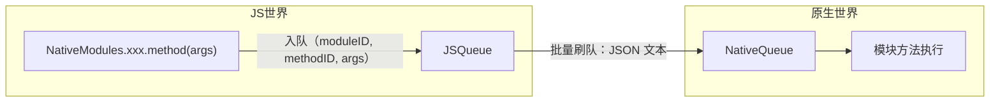
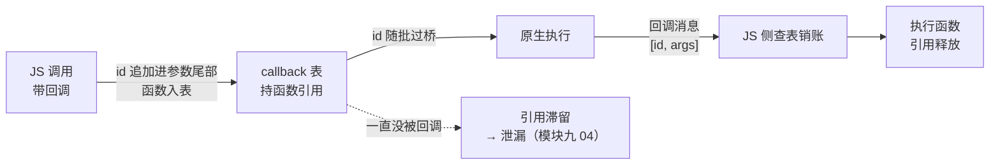
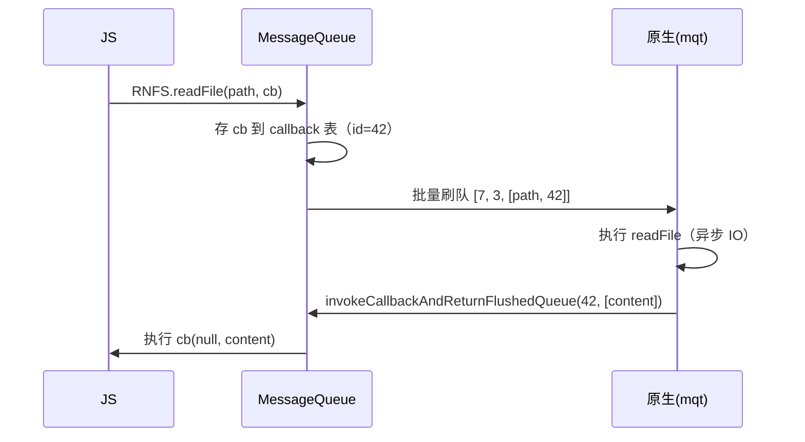

# Bridge 本质与消息队列

> 把旧架构的 Bridge 说透，只需要回答三个问题：**消息长什么样？什么时候发？怎么序列化？** 对应 MessageQueue 的三个队列、批量窗口和 JSON 编码。源码以 `Libraries/BatchedBridge/` 为根。

## 1. Bridge 是什么

Bridge 不是一个"组件"，而是一套约定：**JS 与原生之间只允许传"消息"，消息是异步的、成批的、纯数据的（JSON 可序列化）**。



核心源码：`Libraries/BatchedBridge/MessageQueue.js`（JS 侧队列）、Android `JavaModuleWrapper` / iOS `RCTBridgeModule`（原生侧分发）。

### 1.1 为什么是"消息"而不是"函数调用"

单线程 JS 与多线程原生共处一个进程，直接函数调用有四个绕不开的障碍——Bridge 的每条"保守约定"都是对其中一个的回答：

| 直接调用的障碍 | Bridge 的回答 | 代价（后文展开） |
|--------------|-------------|----------------|
| 两边线程模型完全不同（JS 单线程 / 原生多线程） | 异步消息：不等待、不阻塞 | 一切调用失去同步语义（死穴 ①，第 6 节） |
| 两边对象内存布局互不可见 | 只传纯数据（JSON 可序列化） | 序列化税（第 4 节） |
| JS 引擎（JSC/Hermes）与 Java/OC 没有公共类型系统 | 编号化约定（moduleID + methodID） | 无类型安全（死穴 ③） |
| 高频调用若逐条跨线程，调度开销乘不掉 | 成批刷队（批量窗口） | 单条延迟上浮（第 3 节） |

一句话：Bridge 不是"没想到直接调用"，而是在 JSI 出现之前，**JS 引擎与原生之间没有一条便宜的直调通道**——消息队列是当时工程上最稳的公约数。等 C++ 层把"直调"变成可能（[模块七 01 · JSI 原理](../rn-新架构/01-JSI原理.md)），这套约定才有了被替换的资格。

### 1.2 全双工 = 两条对称的单向管道

"Bridge"这个词容易被想象成一根管道，实际是**两条方向相反、机制对称的管道**：

| | 上行（JS → 原生） | 下行（原生 → JS） |
|--|-----------------|-----------------|
| 发起方 | 业务 JS 调 `NativeModules.*` | 原生回调 / 事件 |
| 队列宿主 | MessageQueue 的 `_queue` | 原生侧批量队列 |
| 寻址方式 | moduleID + methodID | 回调 id / 事件名 |
| 内容形态 | 参数数组（JSON） | 参数数组（JSON） |
| 攒批发送 | JS 侧攒批发 | 原生侧攒批发 |

对称性带来两个推论：**机制只学一次，两个方向都适用**；两侧的瓶颈也对称——上行会堵在序列化，下行同样会（高频事件下行一样付序列化税，[模块四 03 · Bridge 瓶颈量化](03-Bridge瓶颈量化.md)的双向判读正基于此）。

### 1.3 这套约定隐含的世界观

把三条约定翻译成"Bridge 假设你如何写 App"：

1. **异步**假设：跨端调用大多可以"发完就忘"——UI 不需要立刻知道结果；
2. **批量**假设：调用有攒批的余地——宁可单条晚一点，也要摊薄序列化与跨线程成本；
3. **纯数据**假设：跨界只需要数据，不需要行为——行为（方法）靠编号约定，状态各存各的内存。

这三条假设在"列表展示 + 表单 + 网络请求"的经典 RN 应用里基本成立，Bridge 因此成功；它们在"每帧跟手的动画/手势"里全部破产——新架构的每个特性都精确对着一条假设反着来（第 6 节）。

## 2. 消息长什么样：moduleID + methodID + args

JS 调 `NativeModules.Toast.show('hi')` 时，不会真的存在一个"show 函数"，而是构造一条消息：

```js
// MessageQueue.enqueueNativeCall 的实质（简化）
queue.push([moduleID, methodID, args]);
// 例如 [4, 1, ["hi"]] —— Toast 模块是 4 号，show 是 1 号方法
```

所以 Bridge 的世界里**没有函数，只有编号**。编号表在启动时由原生模块注册顺序决定（上一级原因见模块二"模块注册"），这就是为什么：

- 调用不存在的方法只会静默失败或抛"不可调用"；
- 模块注册顺序变化在极端情况（跨包缓存）下会导致调错方法。

### 2.1 编号表从哪来：启动期的远程配置

编号不是写死的，是**启动期由原生注入的配置表**决定的：


配置表的每个模块条目大致是"模块名 + constants + 方法名清单"的数组形态，`NativeModules.js` 的 genModule 流程逐条构建代理对象：**模块在数组的下标即 moduleID，方法在条目内的下标即 methodID**。这条注入发生在启动流程的桥初始化阶段（[模块二 01 · Android 启动链路](../rn-启动流程原理/01-Android启动链路.md)），先于任何业务代码执行——这就是为什么业务 JS 一 import 就能直接调 `NativeModules`。调用链两端（代理生成 → 原生执行）的完整展开在[模块四 02 · NativeModules 调用链](02-NativeModules调用链.md)。

### 2.2 constants：不走消息的静态通道

模块可以把"静态只读数据"编进配置表一并注入（Android 的 `getConstants`/`constantsToExport`，iOS 的 `constantsToExport`，JS 侧经 `getConstants()` 读）：

```js
// JS 侧读 constants：不走消息，启动期已经躺在对象上
const { AppVersion } = NativeModules.AppConfig.getConstants();
```

constants 的特殊之处：**启动期一次性过桥，之后读它是纯 JS 属性访问，零消息成本**。适用边界同样明显：只放真正的静态值（版本号、feature flag）；运行时会变的状态走消息（回调）或事件，别塞 constants。

### 2.3 为什么用编号而不用名字

用字符串名字直接寻址不是更直观吗？Bridge 选编号是一笔带宽账：

| 方案 | 每条消息的寻址开销 | 契约强度 |
|------|-----------------|---------|
| 名字寻址 | 每条都带完整字符串（模块名 + 方法名） | 强（自描述，出错可读） |
| 编号寻址 | 每条只带两个整数 | 弱（两端表必须一致，错位即灾难） |

低带宽假设下，编号省下的每条几十字节是可观的；代价是**把"两端配置表一致"变成隐式契约**——注册顺序一变，编号全体平移，跨包缓存的旧配置就会调错方法（这正是本节开头第二个现象的机制根源）。新架构 Codegen 用"构建期生成绑定 + 类型即契约"把这个权衡整个推翻（[模块七 04 · Codegen](../rn-新架构/04-Codegen.md)）。

## 3. 什么时候发：批量窗口

`MessageQueue` 有三个队列：

| 队列 | 内容 | 刷队时机 |
|------|------|---------|
| `_queue`（JS 调原生） | `[moduleID, methodID, args]` 数组 | `flushedQueue` 被调时（每帧 sweep / 调用满 5 条 / 定时） |
| `_successCallbacks` / callback 表 | 回调 id → JS 函数 | 原生回传时消费 |
| 原生 → JS 队列 | 事件与回调（`invokeCallbackAndReturnFlushedQueue`） | 对称的批量机制 |

刷队策略（`MIN_CALLS_PER_FLUSH = 5` 等常量）是**吞吐与延迟的折中**：攒得越多序列化摊薄成本越低，但单条延迟越高。

### 3.1 三个队列的内部账本

把上表展开成 MessageQueue 内部的记账模型：

- `_queue`：攒批主队列，实现上是平行数组（模块编号列、方法编号列、参数列），刷队时按行 zip 成一批消息；
- `_successCallbacks` / `_failureCallbacks`：两张回调表，`_callbackID` 单调自增发号；`enqueueNativeCall` 时若有回调，把 id **追加进参数尾部**一起过桥，函数本体留在 JS 侧表里；
- 原生回传 `invokeCallbackAndReturnFlushedQueue(cbID, args)` 时按 id 查表、取出函数执行、**销账置空**——回调是一次性的，函数引用随销账释放。

回调 id 挂在参数尾部的细节，解释了一条奇怪的签名约束：**原生方法里的 `Callback`/`Promise` 参数必须排在参数列表最后**——过桥协议要靠"参数尾部固定位置"识别回调 id（Android/iOS 两端校验都依赖这条约定，模块四 02 的参数契约节再遇它）。

回调的完整生命周期：



注意虚线路径：**没被 invoke 的回调是呆账**——函数连着闭包上下文一起滞留，是内存泄漏的经典来源（[模块九 04 · 内存与稳定性](../rn-性能优化原理/04-内存与稳定性.md)）。

### 3.2 刷队的触发点：什么时候真的过桥

攒批不会永远攒着，触发刷队的时机按"谁先到"生效：

| 触发点 | 机制 | 含义 |
|--------|------|------|
| 满额触发 | 单次 JS 调用入队时攒批数达到 `MIN_CALLS_PER_FLUSH`（5） | 立刻刷，不让队列无限长大 |
| 原生索取 | 原生处理完上一批后，回来调刷队函数取下一批 | **批次是链式的**：一批消化完才取下一批 |
| 原生调 JS 时顺带 | `callFunctionReturnFlushedQueue` / `invokeCallbackAndReturnFlushedQueue` 的返回值就是刷好的队列 | 下行顺带上行，一箭双雕 |
| 定时兜底 | 长时间没有上述触发时按定时刷 | 防止低频调用被无限滞留 |

"批次链式"值得画重点：**Bridge 不是固定每帧刷一次，而是"上一批处理完才发下一批"**。原生忙时，JS 攒的批会等——这就是排队延迟的机制来源之一（[模块四 03](03-Bridge瓶颈量化.md)的延迟解剖会用到）。

### 3.3 批量窗口的两面性

攒批是吞吐与延迟的折中，两个方向各有代价：

| 攒批收益 | 攒批代价 |
|---------|---------|
| N 条调用共享一次序列化调度与跨线程投递（摊薄固定成本） | 单条消息的**首条延迟**被后到者拖长 |
| 原生侧一次拿一批，分发挥发成本 | 高频场景批量越来越大，**尾延迟**上浮 |
| 双向对称，机制简单 | 无法插队：严格 FIFO，急事也得排队 |

这个折中在"每帧都要过桥"的场景里必然走向失败：批量救的是**固定成本**（每次调度、跨线程投递的开销），而动画场景的问题是**频率本身**——省掉的是每次的调度开销，省不掉每帧一次的序列化（第 4 节）。批量思想在渲染侧的同构实现见[模块五 03 · 视图提交与批量挂载](../rn-渲染原理/03-视图提交与批量挂载.md)——两处共享同一个"摊薄固定成本"的经济学。

### 3.4 一批消息长什么样

刷队发出的不是一条调用，而是**一批调用的数组**（大体是"编号三元组列表"的 JSON 化）：

```js
// 刷队产物的形态（示意）
[
  [4, 1, ["hi"]],        // Toast.show
  [7, 3, [path, 42]],    // RNFS.readFile（42 是回调 id）
  [9, 0, []],            // 另一个模块的调用
]
```

原生侧收到批后**按序逐条执行**——批内顺序即执行顺序（FIFO 落到批内）。三个推论：

1. 批内某一条参数解析失败，定位时要看"批里的第几条"；
2. 回调 id 与普通参数混在同一个数组里，靠"尾部位置约定"区分（3.1 的约束根源）；
3. 批量越大，原生侧一次 JSON 解析的峰值内存越高（下一节的内存税随批量叠加）。

## 4. 怎么序列化：JSON 的代价

消息跨线程前会被序列化成 JSON 字符串，落地再解析：


代价三段论：

1. **序列化/反序列化 CPU**：随参数体积线性增长——传一张 base64 图片等于自爆；
2. **拷贝**：字符串跨线程 memcpy，大对象翻倍内存；
3. **不可传递之物**：函数、循环引用、class 实例统统不行——回调只能传"回调 id"。

### 4.1 JSON 丢掉的东西

"JSON 可序列化"不只是慢，还**改变数据的形状**。一张速查表：

| JS 值 | 过桥后变成 |
|-------|-----------|
| 函数 | 数字回调 id（语义靠两端约定重建） |
| `undefined` | 丢失（数组中变 null 或被剔除） |
| `NaN` / `Infinity` | null |
| `Date` | ISO 字符串（不再是 Date 实例） |
| `Map` / `Set` / `TypedArray` | 不支持 |
| 循环引用 | 序列化直接抛错 |

工程上最常见的翻车是**静默变形**：日期变成字符串、undefined 消失导致默认值逻辑失效——不报错，只在下游逻辑里悄悄错。跨端数据契约要按"JSON 重建后的形状"来设计，而不是按 JS 内存里的形状。

### 4.2 体积放大器：谁在把参数喂大

序列化税 ∝ 参数体积，所以真正的工程问题是"谁把体积喂大的"。高频嫌疑人清单：

| 嫌疑人 | 典型形态 | 正确姿势 |
|--------|---------|---------|
| base64 内嵌资源 | 图片/音频转 base64 塞进参数 | 走文件路径/句柄，二进制不过 JSON |
| 全量对象上报 | 把整个 state/配置对象序列化过去 | 按需挑字段，增量上报 |
| 日志与埋点大包 | 一次打包几十条日志过桥 | 本地攒盘、批量低频同步 |
| 高频小对象 | 每帧发 {x, y, progress} | 原生闭环（模块六 02 / 04） |

> 这正是 Animated 的 JS 驱动每帧 setValue 会卡的原因：60fps 意味着每秒 60 次入队 + 序列化 + 跨线程。

动画的完整闭环分析与解法（useNativeDriver / worklet）展开在[模块六 04 · 动画系统原理](../rn-事件系统原理/04-动画系统原理.md)；高频小包的量化视角见[模块四 03 · 2.1 频率来源清单](03-Bridge瓶颈量化.md)。

### 4.3 序列化税的连带账单：内存与 GC

序列化的代价不止 CPU，还有两条连带账单：

- **双份内存**：消息跨线程前是"JS 对象 + JSON 字符串"两份，落地后是"JSON 字符串 + 原生对象树"两份——峰值内存随参数体积成倍放大；
- **GC 压力**：JS 侧的临时字符串与原生侧的临时对象树都是短命对象，高频调用会把两边的 GC 都喂出抖动（Hermes 的 GC 机制见[模块三 03 · Hermes 深潜](../rn-JS引擎与线程模型/03-Hermes深潜：字节码与GC.md)）。

所以"能不能传"之外还要问"值不值"：**大对象过桥的真正成本 = 序列化 CPU + 双份内存 + 两边 GC 抖动**——三者同源（都随体积线性），也同治（引用共享、文件句柄、分片传输）。

## 5. 一个完整来回

JS 读文件为例：



注意回调也是消息：原生"调不回"JS，只能再发一条**反向消息**。Bridge 是全双工的两条单向管道，不是一根电话线。

### 5.1 逐步表：把时序图翻译成账本

| 步 | 动作 | 谁做 | 数据形态 | 线程 |
|----|------|------|---------|------|
| 1 | `RNFS.readFile(path, cb)` 入队，cb 存表得 id=42 | MessageQueue | 参数 `[path, 42]`（42 追加尾部） | JS 线程 |
| 2 | 攒批/刷队：zip 出 `[7, 3, [path, 42]]` | MessageQueue | 待序列化数组 | JS 线程 |
| 3 | 序列化 + 跨线程投递 | Bridge | JSON 文本 | jsq → mqt |
| 4 | 反序列化、按 moduleID=7 查模块、methodID=3 查方法 | 原生注册表 | Java/OC 参数对象 | mqt |
| 5 | 执行 readFile（异步 IO），方法体立即返回 | 原生模块 | —— | mqt / IO |
| 6 | IO 完成，组装结果，发起回调消息 `[42, [content]]` | 原生 | JSON 文本 | mqt |
| 7 | 下行过桥 + JS 侧按 id=42 查表销账 | Bridge / MessageQueue | JSON → JS 值 | mqt → jsq |
| 8 | 执行 `cb(null, content)`，**顺带返回攒下的上行队列** | MessageQueue | 下一批上行消息（若有） | JS 线程 |

注意第 8 步：下行回调的返回值就是**攒着的上行队列**——双向批量在单次消息里耦合，这是 3.2"原生调 JS 时顺带"触发的实体形态。

### 5.2 这次来回里"没有发生什么"

负空间同样重要，四件"没发生"的事界定了 Bridge 的能力边界：

1. **没有锁竞争**：两条单向管道各自串行，谁也不碰谁的内存——线程安全的全部来源就是"零共享"；
2. **没有共享内存**：`content` 是复制品，JS 改它不影响原生的世界（也意味着大结果必付拷贝税）；
3. **没有回执**：readFile 的"已收到"不确认——消息语义是 fire-and-forget，可靠性靠"回调也是消息"来兜底；
4. **没有优先级**：严格 FIFO——紧急回调也排在前面所有消息后面（JS 线程作为单入口队列的全局视角见[模块三 02 · 四线程模型](../rn-JS引擎与线程模型/02-四线程模型.md)）。

"同步与异步的边界在新旧架构间如何移动"，另见[模块三 04 · 同步与异步的边界](../rn-JS引擎与线程模型/04-同步与异步的边界.md)。

## 6. Bridge 的三条死穴（新架构的动机）

1. **异步不可同步**：无法在 JS 里同步拿到原生结果（`measure` 只能回调）；
2. **序列化税**：高频大数据场景必然塌方；
3. **类型不安全**：moduleID/methodID/args 全靠约定，写错运行时才炸。

模块七将逐一对照 JSI 如何解决这三条。

### 6.1 三条死穴的具体形状

每条死穴配一个"业务摸得到"的场景：

| 死穴 | 具体场景 | 业务侧的体感 |
|------|---------|-------------|
| 异步不可同步 | JS 想在渲染前读原生布局（`measure`） | 只能回调/Promise，永远"慢一拍"，布局闪烁类 bug 的根源 |
| 序列化税 | 每帧 setValue / 手势进度上报 | 帧率塌方、动画滞后（[模块四 03](03-Bridge瓶颈量化.md)的塌方模型） |
| 类型不安全 | 原生模块重构改了方法名/参数 | 编译期全绿，运行时炸——且两端炸法不同（undefined is not an object / 参数解析异常） |

答案的落点提前给出：[模块七 01 · JSI 原理](../rn-新架构/01-JSI原理.md)——同步直调消灭死穴 ①，引用传递消灭 ②，Codegen 静态契约消灭 ③；系统级对照见[模块七 05 · 新旧架构对比与迁移](../rn-新架构/05-新旧架构对比与迁移.md)。

## 7. 常见误区清单

| 误区 | 事实 |
|------|------|
| "Bridge 是一根双向管道" | 是两条对称的单向管道，全双工靠复数（1.2） |
| "JS 调原生时原生立刻执行" | 消息先攒批，批次还受"上一批消化完才取下一批"约束（3.2） |
| "回调是原生直接调用 JS 函数" | 回调 = 回调 id + 反向消息，函数本体永远留在 JS 侧表里（3.1、5.1） |
| "constants 每次读都过桥" | constants 启动期一次性注入，读是纯属性访问（2.2） |
| "JSON 只是慢，数据是保真的" | undefined/Date/Map 等会静默变形，按 JSON 重建后的形状设计契约（4.1） |
| "消息有优先级，急事能插队" | 严格 FIFO，无插队（5.2）；急事靠架构手段（原生闭环）而非 Bridge |
| "模块名写错会有编译提示" | 名字到编号全靠启动期配置表，运行时才炸（2.1） |
| "大对象过桥只是序列化慢一点" | 还要付双份内存与两边 GC 抖动的连带账单（4.3） |
| "批内某条失败不影响其他消息" | 批按序逐条执行，定位时要看"批里的第几条"（3.4） |

## 8. 动手实验

1. **数队列**：开发期挂上 spy（[模块四 03 · 3.1](03-Bridge瓶颈量化.md)），统计一分钟内上行/下行消息条数与最大参数档位——给 App 出第一张"桥流量账单"；
2. **验证 constants 零消息**：高频循环里读 `getConstants()` 的属性与高频调一个空 `@ReactMethod`，用时间戳对比两者的量级差；
3. **验证回调一次性**：原生模块方法里对同一个 Callback invoke 两次，观察 JS 侧行为（查表失败的报错或静默）；
4. **制造呆账**：写一个"只在成功路径回调"的方法，反复走失败路径，用内存面板观察闭包滞留（对应 3.1 的虚线路径）；
5. **验证 FIFO**：快速连续入队 10 条调用再加 1 条"紧急"调用，用 spy 时间戳确认没有任何插队（5.2 的"没有优先级"）。

## 小结

- Bridge 三要素：编号化消息、批量窗口、JSON 序列化——一切 Bridge 相关现象都能还原到这三点。
- 回调的本质是"回调 id + 反向消息"，Bridge 是两条单向管道。
- 序列化税与异步强制，是贯穿后续所有模块的"问题背景"。

## 自测

1. Bridge 的三条约定各回答了"直接调用"的哪个障碍？每条的代价是什么？（→ 1.1 / 1.3）
2. moduleID 与 methodID 在什么时刻、由哪一侧决定？"跨包缓存调错方法"是怎么发生的？（→ 2.1 / 2.3）
3. `MIN_CALLS_PER_FLUSH` 攒批救的是哪一类成本？为什么救不了每帧动画？（→ 3.3）
4. 把 `new Date()`、一个函数、`undefined` 分别过桥，各自会发生什么？（→ 4.1）
5. 回调为什么必须排在参数列表最后？回调函数本体在哪一侧、何时销毁？（→ 3.1）
6. 一次完整来回里，上行与下行在哪个消息里发生了耦合？（→ 5.1 第 8 步）
7. 四件"没发生的事"分别界定了 Bridge 的哪条能力边界？（→ 5.2）
8. 大对象过桥的"真正成本"由哪三项构成？同治手段有哪些？（→ 4.3）
