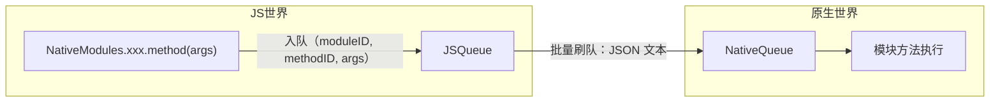
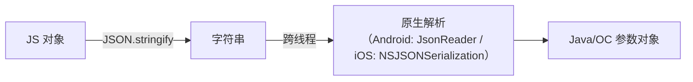
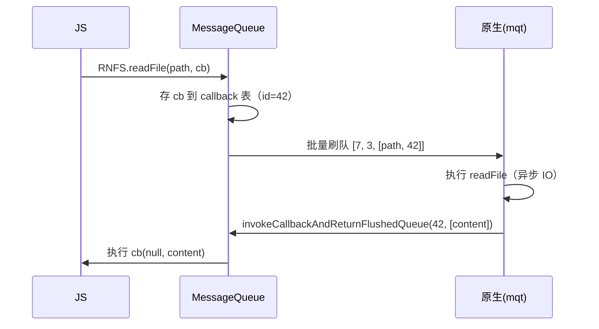

# Bridge 本质与消息队列

> 把旧架构的 Bridge 说透，只需要回答三个问题：**消息长什么样？什么时候发？怎么序列化？** 对应 MessageQueue 的三个队列、批量窗口和 JSON 编码。源码以 `Libraries/BatchedBridge/` 为根。

## 1. Bridge 是什么

Bridge 不是一个"组件"，而是一套约定：**JS 与原生之间只允许传"消息"，消息是异步的、成批的、纯数据的（JSON 可序列化）**。



核心源码：`Libraries/BatchedBridge/MessageQueue.js`（JS 侧队列）、Android `JavaModuleWrapper` / iOS `RCTBridgeModule`（原生侧分发）。

## 2. 消息长什么样：moduleID + methodID + args

JS 调 `NativeModules.Toast.show('hi')` 时，不会真的存在一个"show 函数"，而是构造一条消息：

```js
// MessageQueue.enqueueNativeCall 的实质（简化）
queue.push([moduleID, methodID, args]);
// 例如 [4, 1, ["hi"]] —— Toast 模块是 4 号，show 是 1 号方法
```

所以 Bridge 的世界里**没有函数，只有编号**。编号表在启动时由原生模块注册顺序决定（上一级原因见模块二"模块注册"），这就是为什么：

- 调用不存在的方法只会静默失败或抛"不可调用"；
- 模块注册顺序变化在极端情况（跨包缓存）下会导致调错方法。

## 3. 什么时候发：批量窗口

`MessageQueue` 有三个队列：

| 队列 | 内容 | 刷队时机 |
|------|------|---------|
| `_queue`（JS 调原生） | `[moduleID, methodID, args]` 数组 | `flushedQueue` 被调时（每帧 sweep / 调用满 5 条 / 定时） |
| `_successCallbacks` / callback 表 | 回调 id → JS 函数 | 原生回传时消费 |
| 原生 → JS 队列 | 事件与回调（`invokeCallbackAndReturnFlushedQueue`） | 对称的批量机制 |

刷队策略（`MIN_CALLS_PER_FLUSH = 5` 等常量）是**吞吐与延迟的折中**：攒得越多序列化摊薄成本越低，但单条延迟越高。

## 4. 怎么序列化：JSON 的代价

消息跨线程前会被序列化成 JSON 字符串，落地再解析：



代价三段论：

1. **序列化/反序列化 CPU**：随参数体积线性增长——传一张 base64 图片等于自爆；
2. **拷贝**：字符串跨线程 memcpy，大对象翻倍内存；
3. **不可传递之物**：函数、循环引用、class 实例统统不行——回调只能传"回调 id"。

> 这正是 Animated 的 JS 驱动每帧 setValue 会卡的原因：60fps 意味着每秒 60 次入队 + 序列化 + 跨线程。

## 5. 一个完整来回

JS 读文件为例：



注意回调也是消息：原生"调不回"JS，只能再发一条**反向消息**。Bridge 是全双工的两条单向管道，不是一根电话线。

## 6. Bridge 的三条死穴（新架构的动机）

1. **异步不可同步**：无法在 JS 里同步拿到原生结果（`measure` 只能回调）；
2. **序列化税**：高频大数据场景必然塌方；
3. **类型不安全**：moduleID/methodID/args 全靠约定，写错运行时才炸。

模块七将逐一对照 JSI 如何解决这三条。

## 小结

- Bridge 三要素：编号化消息、批量窗口、JSON 序列化——一切 Bridge 相关现象都能还原到这三点。
- 回调的本质是"回调 id + 反向消息"，Bridge 是两条单向管道。
- 序列化税与异步强制，是贯穿后续所有模块的"问题背景"。
