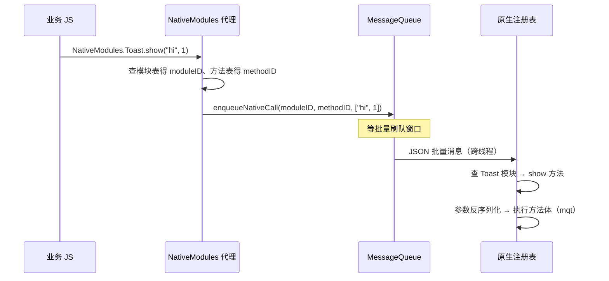
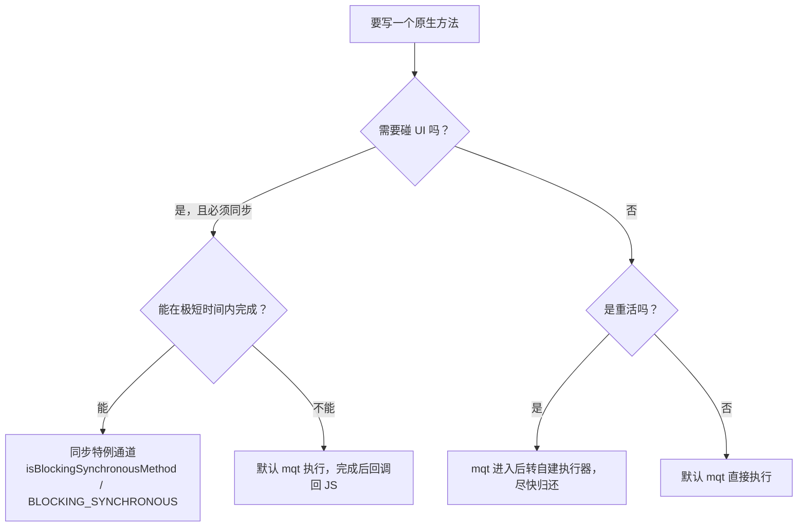

# Native Modules 调用链

> 从 `NativeModules.Foo.bar()` 这行代码的两端出发：JS 侧的"代理"是怎么凭空出现的，原生侧的方法是怎么被找到并执行的。读完本篇，你能徒手画出双向调用的完整链路。

## 1. JS 侧：凭空出现的 `NativeModules`

`import { NativeModules } from 'react-native'` 拿到的对象（源码：`Libraries/BatchedBridge/NativeModules.js`）：

```js
// 简化的本质
const NativeModules = new Proxy({}, {
  get(target, moduleName) {
    return new Proxy({}, {
      get(target, methodName) {
        return (...args) => {
          // 打包成消息：moduleID + methodID + args
          BatchedBridge.enqueueNativeCall(moduleID, methodID, args);
        };
      },
    });
  },
});
```

两层 Proxy 让 `NativeModules.任何名字.任何方法` 都是"合法"的——**真正的校验在原生侧**，所以模块名/方法名写错在 JS 期毫无提示（TurboModules + Codegen 的类型安全正是冲这来的）。

`moduleID` 哪来的？启动时原生把"模块名 → 编号"配置表注入 JS（`__fbGenNativeModule` / `NativeModules.js` 的 genModule 流程），JS 侧据此生成带真实编号的代理。

### 1.1 编号绑定的精确时刻与"代理不是对象"

把"moduleID 哪来的"展开成时刻表：

| 时刻 | 发生什么 | 结果 |
|------|---------|------|
| 启动期·注册 | 原生构建模块实例与方法表 | 原生侧注册表就绪 |
| 启动期·注入 | 注册表压缩成配置数组过桥 | JS 拿到"名字 → 编号"表 |
| 启动期·建代理 | genModule 逐模块逐方法生成闭包 | `NativeModules.Toast.show` 变成可调用物 |
| 业务运行期 | 调用走闭包 → `enqueueNativeCall` | 闭包捕获的编号永不改变 |
| reload | 实例销毁，以上全部重来 | 编号体系整体重建 |

两个推论：

1. **代理闭包极轻**——它只是"编号 + 入队"，不携带模块的任何状态；JS 侧的 `NativeModules.Toast` 不是模块本体，只是遥控器；
2. **编号在闭包里焊死**——运行期原生侧注册表无论如何变化，JS 闭包里的编号都不会跟着变；两端编号错位时，调用会"成功发出、落到错误的方法上"——比 `undefined` 更阴险的失败形态（模块四 01 · 2.3 的跨包缓存问题即此类）。

### 1.2 方法类型：默认 async / promise / sync 三种形态

配置表里每个方法除编号外还带**类型标注**，genMethod 按类型生成不同形态的调用函数：

| 类型 | JS 侧调用形态 | 两端的对应声明 |
|------|--------------|---------------|
| 默认（async） | `fn(...args, successCb, errorCb)` | 普通 `@ReactMethod` / `RCT_EXPORT_METHOD` |
| promise | 返回 Promise（`then/catch`） | Promise 参数（Android）/ `RCTPromiseResolveBlock`（iOS） |
| sync | **同步返回** | Android `isBlockingSynchronousMethod` / iOS `RCT_EXPORT_BLOCKING_SYNCHRONOUS_METHOD` |

sync 特例是 Bridge 里唯一的同步通道：JS 在调用栈里直接等原生返回。能开同步的原因与代价（阻塞 JS 线程、只许轻活）在[模块三 04 · 同步与异步的边界](../rn-JS引擎与线程模型/04-同步与异步的边界.md)展开；本篇只需记住它的存在——"Bridge 一切皆异步"的例外恰恰在这里。

## 2. 原生侧：注册与执行

### Android

1. **注册**：`ReactPackage.createNativeModules` 返回模块实例，`NativeModuleRegistryBuilder` 组装成注册表（发生在模块二讲的 `createReactContext` 阶段）；
2. **描述**：`JavaModuleWrapper` 用反射读取 `@ReactMethod` 注解方法，生成方法表；
3. **执行**：mqt 线程收到批量消息后 `JavaModuleWrapper.invoke(msg)`，按 methodID 查表、`NativeArgumentsParser` 解参数、反射调用。

```java
// 业务模块的样子
class ToastModule(reactContext) : ReactContextBaseJavaModule(reactContext) {
  override fun getName() = "Toast"                 // JS 侧的模块名
  @ReactMethod
  fun show(message: String, duration: Int) { ... } // JS 侧的方法名
}
```

#### Android 参数契约的精确清单

`@ReactMethod` 方法能接收的参数类型是**封闭集合**：

| Java/Kotlin 参数类型 | 对应 JS 侧的值 |
|---------------------|---------------|
| `int` / `double` / `float` | number |
| `boolean` | boolean |
| `String` | string |
| `ReadableArray` | array |
| `ReadableMap` | object |
| `Callback` | 回调函数（过桥即编号，模块四 01 · 3.1） |
| `Promise` | Promise（**必须排最后**） |

三条硬约束：

1. **返回值必须是 void**——方法没有返回值通道，结果只能经回调/Promise 回去；
2. **Promise 必须是最后一个参数**——回调 id 靠"参数尾部固定位置"识别（模块四 01 · 3.1 的账本）；
3. **回调与 Promise 不混用**——一个方法的异步出口二选一，两端校验都按此实现。

原生侧组装返回数据的真实形态（来源感：`com.facebook.react.bridge` 的 Writable 一族）：

```java
// 模块方法回传结构化数据的典型写法
WritableMap result = Arguments.createMap();
result.putString("path", path);
result.putInt("size", bytes.length);
successCallback.invoke(result);   // WritableMap 过桥 → JS 侧 plain object
```

### iOS

1. **注册**：类标 `RCT_EXTERN_MODULE(Toast, NSObject)`，`RCTCxxBridge` 启动时扫描所有 RCTBridgeModule 类构建模块表；
2. **执行**：`RCTModuleMethod` 包装 OC selector，消息到达后 `invokeWithBridge:...`，参数经 `RCTConvert` 转换。

#### iOS 的宏与承诺块

`RCT_EXPORT_*` 宏家族在编译期做的是"登记"而非魔法：模块宏把类挂进启动扫描名单，方法宏把 selector 与签名元数据登记成 `RCTModuleMethod`。业务侧的样子：

```objc
// 来源感：React/Base/RCTBridgeModule.h 的宏 + 业务模块类
RCT_EXPORT_MODULE(Toast);   // JS 侧名字（缺省用类名）

RCT_EXPORT_METHOD(show:(NSString *)message
                  duration:(NSInteger)duration)
{
  ...
}

// Promise 形态：resolve / reject 必须是最后两个参数
RCT_EXPORT_METHOD(readFile:(NSString *)path
                  resolve:(RCTPromiseResolveBlock)resolve
                  reject:(RCTPromiseRejectBlock)reject)
{
  ...
}
```

参数转换统一经 `RCTConvert`：JSON 反序列化出的 NSObject 按声明类型逐一转换，转不动就在参数解析阶段报错。Android 的 `ReadableMap`/`ReadableArray` 与 iOS 的 `RCTConvert` 是同一个契约的两种方言——**跨端写一个模块时，参数契约要对齐两者中更窄的那个**。

### 两个平台的共同点：全量、启动期、顺序敏感

两个平台的共同点：**注册发生在启动期、全量进行**——启动时间随模块数线性增长，TurboModules 懒加载的动机就在这。

把"共同点"再往下拆一层：

| 共性 | 机制后果 | 新架构的替换 |
|------|---------|-------------|
| 全量注册 | 启动时间随模块总数增长，**用不到的模块也付成本** | TurboModules 懒加载，用时才初始化（[模块七 03 · TurboModules](../rn-新架构/03-TurboModules.md)） |
| 启动期完成 | 注册是启动链路的一站（[模块二 01 · Android 启动链路](../rn-启动流程原理/01-Android启动链路.md)） | 注册表构建推迟到首次访问 |
| 顺序决定编号 | 两端各自注册，一致性是隐式契约 | Codegen 生成两端一致绑定，顺序不再敏感（[模块七 04 · Codegen](../rn-新架构/04-Codegen.md)） |

想亲手走一遍"注册 → 调用"全流程，参照[模块十 02 · 自定义 TurboModule 全流程](../rn-原理实战/02-自定义TurboModule全流程.md)里的旧架构对照段。

## 3. JS → 原生：全链路



### 3.1 逐步表：九步走完一次调用

| 步 | 动作 | 所在线程 | 校验/失败点 |
|----|------|---------|------------|
| 1 | JS 访问 `NativeModules.Toast` | JS 线程 | 模块名不在配置表 → undefined（第 6 节） |
| 2 | 访问 `.show`，拿到启动期生成的闭包 | JS 线程 | 方法名在闭包层无校验 |
| 3 | 调用闭包，参数进 `enqueueNativeCall` | JS 线程 | 参数非法到序列化时才炸 |
| 4 | 回调转 id、参数数组组装 | JS 线程 | 回调非函数 → 入表失败 |
| 5 | 攒批，等刷队窗口 | JS 线程 | ——（延迟在此累积，模块四 03） |
| 6 | 序列化 + 跨线程 | jsq → mqt | 序列化税随体积线性 |
| 7 | 原生查模块表、方法表 | mqt | 编号错位 → **调错方法**（1.1 推论 2） |
| 8 | 反序列化参数、类型转换 | mqt | 类型不匹配 → 解析异常 |
| 9 | 反射/selector 调用方法体 | mqt | 方法内部异常 → 错误回调 |

前 5 步全是 JS 线程的纯内存操作（成本极低，即模块四 03 成本解剖的"段①"），第 6-8 步是体积敏感区，第 9 步之后才进入业务代码。**排查"调用没生效"按这九步顺藤摸瓜**，比全局撒日志高效。

### 3.2 反射的代价花在哪

"查表 + 反射"这步的固定成本构成：

- **表查找**：模块表/方法表各查一次，启动期已构建，本身极廉价；
- **Android `Method.invoke`**：反射调用的参数装箱/拆箱与访问检查，每次调用都付；
- **iOS 的预处理红利**：`RCTModuleMethod` 在构建期把 selector 预处理成可直接调用的形态，运行期省去重复查找——同是反射体系，iOS 的执行段更薄。

这段成本的量级在[模块四 03](03-Bridge瓶颈量化.md)的成本解剖里归位：**每方法固定、与参数体积无关**——所以它只在高频小参数场景才露出獠牙（频率敏感区的固定成本部分）。

## 4. 原生 → JS：事件与回调

反向链路的两条主要通道：

### 4.1 回调（callback / Promise）

- 传的不是函数而是 callback id（模块四）；
- 原生执行完毕后 emit 回 JS；
- Promise 语义：JS 侧把 `@ReactMethod` 标注的 promise 方法包成 `(resolve, reject) => {...}`，本质仍是两个回调 id。

原生侧 `Callback.invoke(...)` 发出的仍是消息。完整的回调账本：


| 账本事件 | 发生什么 | 工程含义 |
|---------|---------|---------|
| 入账 | JS 调用时函数存入回调表，id 过桥 | **原生侧持有的是 id，不是函数** |
| 销账 | 回调消息到达，查表后置空 | 回调一次性：再次触发同一 id 查无此账 |
| 呆账 | 永远没被 invoke 的回调 | 函数引用滞留 JS 侧 → 内存泄漏（[模块九 04 · 内存与稳定性](../rn-性能优化原理/04-内存与稳定性.md)） |
| 错账 | 原生重复 invoke 同一 id | 查表失败，表现为"回调不存在"类错误 |

"保证失败路径也 invoke"因此是一条硬纪律：try/catch 的每个出口都要销账，否则就是呆账。

### 4.2 事件（EventEmitter）

原生主动推事件的标配（JS 侧 `DeviceEventEmitter` / 各组件的 `RCTEventEmitter`）：


注意 Android 的 `RCTDeviceEventEmitter` 与 iOS 的 `RCTEventEmitter` 事件命名约定不同——跨端模块常见坑。

事件与回调的本质差异在**是否有回执**：回调有 id 有销账，丢没丢可感知；事件没有回执、不重放，丢没丢不可知。两个直接推论：

1. **可靠性要求高的下行数据**（支付结果、登录态）要么走回调通道，要么在事件之上自建序号/确认协议；
2. **监听注册晚于事件发出 = 事件丢失**——事件不重放，早到的广播直接蒸发，推送/蓝牙类模块"偶发收不到"的坑多源于此。混合栈里"哪类数据走哪条通道"的边界纪律见[混合开发 02 · 混合导航与通信边界](../rn-混合开发/02-混合导航与通信边界.md)。

### 4.3 三条通道怎么选：constants / 回调 / 事件

反向通道加上 constants 共三种，选型按"数据方向 × 时效"：

| 通道 | 方向 | 时效 | 语义 | 适用 |
|------|------|------|------|------|
| constants | 原生 → JS | 启动期一次 | 静态快照 | 版本号、feature flag（模块四 01 · 2.2） |
| 回调/Promise | 原生 → JS | 一次 | 请求-应答 | IO 结果、计算结果 |
| 事件 | 原生 → JS | 持续 | fire-and-forget | 状态广播（电量、连接、推送） |

一张表定通道：**一次性应答用回调，持续广播用事件，启动期静态值用 constants**——把"持续广播"错写成回调，或把"一次性应答"错写成事件，都是常见的架构味道。

## 5. 线程标注：方法跑在哪

Android `@ReactMethod` 可加线程标注：

| 标注 | 执行线程 | 适用 |
|------|---------|------|
| 默认（NATIVE_MODULES_THREAD） | mqt | 大多数场景 |
| UI_BLOCK（`isBlockingSynchronousMethod` 特例） | 主线程 | 必须碰 View 的同步方法 |
| TRACE（新架构特有） | — | 打点型 |

**原生方法默认不卡 UI 线程**——这也是把重活下沉原生模块的合理性来源。

### 5.1 两端标注的代码形态

```java
// Android：同步特例（极少数场景，只许轻活）
@ReactMethod(isBlockingSynchronousMethod = true)
public float measureTextWidth(String text) { ... }
```

```objc
// iOS：给模块指定专属执行队列
- (dispatch_queue_t)methodQueue
{
  return dispatch_queue_create("com.app.slowio", DISPATCH_QUEUE_SERIAL);
}
```

iOS 的 `methodQueue` 是 per-module 的队列定制点——把"天然慢"的模块隔离出共享队列；Android 侧没有对应的注册期定制，只能在方法体内再 post。共享串行队列"一个慢全家等"的全局影响见[模块三 02 · 四线程模型](../rn-JS引擎与线程模型/02-四线程模型.md)2.5。

### 5.2 方法体内的再调度

标注决定"进入时的线程"，方法内部还可以（也常常需要）再调度：

| 需求 | Android 惯用 | iOS 惯用 |
|------|-------------|---------|
| 碰 UI | 主线程 Handler post / runOnUi 类工具 | 主队列 dispatch |
| 重 IO | 自建线程池，尽快归还 mqt | 专用 methodQueue 或 GCD 后台队列 |
| 回 JS | 直接 invoke 回调（框架负责切回 JS 线程） | 同左 |

纪律一句话：**mqt 是全模块共享的资源，方法体应"快进快出"**——重活转手给自建执行器，做完再经回调消息回 JS。把 mqt 长期占住的模块会拖慢一切其他模块的回调（队列积压的归因手段见[模块四 03](03-Bridge瓶颈量化.md)的 spy）。

### 5.3 线程决策树：写一个原生方法前先走一遍



读法：同步特例通道是最后的选择（阻塞 JS 线程），"mqt + 回调"是默认答案，重活再加一层自建执行器。决策树的结果几乎总是"异步 + 快进快出"——这不是保守，而是共享队列模型下的最优解（模块三 02 · 2.5 的全局视角）。

## 6. 调用链的 frail points（易断点）

- 模块没注册（Package 没加 / 类没扫描到）→ JS 侧 `undefined is not an object`；
- 方法名大小写不一致（Android 反射精确匹配 / OC selector 转换规则）→ 静默无回调；
- 参数类型不匹配 → 反序列化失败或隐式转换出错；
- 回调持有大对象 → callback 表泄漏（模块九）。

### 6.1 症状 → 根因 → 定位对照表

| 症状 | 对应 frail point | 定位手段 | 修复方向 |
|------|-----------------|---------|---------|
| `undefined is not an object (evaluating 'NativeModules.Foo')` | 模块未注册 | 检查 Package/宏注册、启动日志里的模块清单 | 补注册；名字对齐 |
| 调用后无回调、无报错 | 方法名大小写/参数个数不匹配 | spy 看消息是否发出、原生侧日志看是否进入方法（模块四 03） | 对齐两端方法表 |
| 回调收到的参数"变了形" | 参数类型隐式转换出错（模块四 01 · 4.1） | 在原生侧入口打印参数类型 | 用 ReadableMap/明确类型收紧契约 |
| 调到了"另一个"方法 | 编号错位（1.1 推论 2） | 核对两端注册顺序与配置表来源 | 统一注册来源；升级配置缓存策略 |
| 内存缓慢增长 | 回调呆账（4.1） | 回调表泄漏检查（[模块九 04](../rn-性能优化原理/04-内存与稳定性.md)） | 失败路径也 invoke；取消时销账 |

## 7. 常见误区清单

| 误区 | 事实 |
|------|------|
| "NativeModules 上的模块是原生对象在 JS 的引用" | 只是启动期配置生成的编号代理，无状态无原型（1.1） |
| "Bridge 调用全异步，没有同步的可能" | sync 特例通道存在，代价是阻塞 JS 线程、只许轻活（1.2） |
| "原生方法可以 return 结果给 JS" | 返回值通道不存在，结果只能走回调/Promise/事件（2 · Android 约束） |
| "回调可以多次触发，像监听器一样" | 回调一次性，销账后 id 作废；持续推送用事件（4.1 / 4.3） |
| "事件有回执，可靠性有保障" | 事件 fire-and-forget，无回执不重放，早到即丢（4.2） |
| "`@ReactMethod` 方法默认在主线程执行" | 默认在 mqt，不卡 UI；碰 UI 需自行再调度（5.2） |
| "iOS/Android 的事件模块行为完全一致" | 事件基类与命名约定两端口径不同，跨端模块的常见坑（4.2） |
| "方法签名随便写，框架会适配" | 参数类型封闭集合 + 位置硬约束，越界即解析失败（2 · Android） |
| "回调表泄漏是框架的问题" | 呆账源于"失败路径不回调"的模块实现，责任在写法（4.1） |

## 8. 动手实验

1. **看编号**：开发期用 spy 打印每条上行的 moduleID/methodID，对照原生侧的注册顺序验证"下标即编号"（模块四 01 · 2.1）；
2. **验证代理无校验**：JS 里访问 `NativeModules.不存在的模块.任意方法()`，观察它在哪一步才失败（1.1 的"校验在原生侧"）；
3. **验证 Promise 双回调 id**：写一个 Promise 方法，用 spy 观察参数尾部多出的 id 与 resolve/reject 的对应关系（4.1 账本）；
4. **验证队列隔离**（iOS）：一个模块自定义 methodQueue 并在方法内做耗时操作，另一个用默认队列——验证后者回调不被拖住；Android 侧用自建线程池做同样对照（5.1 / 5.2）；
5. **验证事件早到即丢**：原生在 JS 监听注册前发一次事件，确认监听者永远收不到（4.2 推论）；
6. **验证快进快出**：写一个在 mqt 上 sleep 的方法，连续调用它后再调一个空方法，用时间戳看空方法被排队（模块三 02 · 2.5 的共享串行）。

## 小结

- JS 侧是双层 Proxy 生成"编号调用"，原生侧是启动期注册的反射方法表——Bridge 两端共同构成一次调用。
- 反向链路 = 回调 id 机制 + EventEmitter 消息，本质都是"再发一条消息"。
- 全量注册、无类型校验、反射开销，是旧模块系统留给新架构的三道题。

## 自测

1. `NativeModules.Toast.show` 的闭包在什么时刻生成？它捕获了什么、没捕获什么？（→ 1.1）
2. 方法类型 async/promise/sync 在 JS 侧的调用形态各是什么？sync 的两端声明怎么写？（→ 1.2）
3. Android `@ReactMethod` 的参数封闭集合有哪些？三条硬约束是什么？（→ 2 · Android）
4. 九步调用表里，前 5 步与 6-8 步的成本特征有何不同？（→ 3.1，量化见模块四 03）
5. 回调账本的四类事件（入账/销账/呆账/错账）各对应什么工程现象？（→ 4.1）
6. constants、回调、事件三通道的选型依据是什么？"一次性应答写成事件"会怎样？（→ 4.3）
7. iOS `methodQueue` 解决什么问题？Android 对应的手法是什么？（→ 5.1 / 5.2）
8. 五个 frail point 各自的症状与定位手段是什么？（→ 6.1）
9. 线程决策树里，为什么"同步特例通道"总是最后的选择？（→ 5.3）
