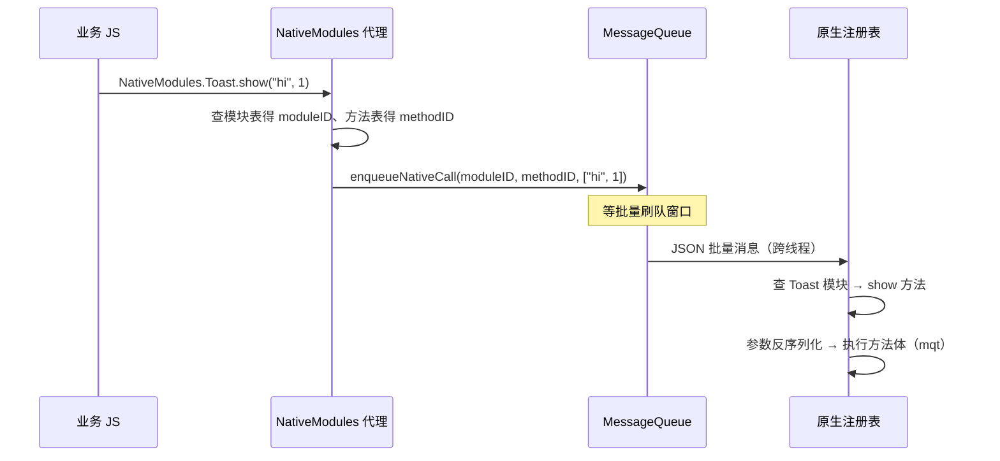
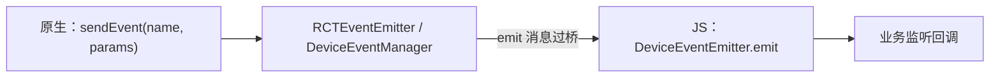

# Native Modules 调用链

> 从 `NativeModules.Foo.bar()` 这行代码的两端出发：JS 侧的"代理"是怎么凭空出现的，原生侧的方法是怎么被找到并执行的。读完本篇，你能徒手画出双向调用的完整链路。

## 1. JS 侧：凭空出现的 `NativeModules`

`import { NativeModules } from 'react-native'` 拿到的对象（源码：`Libraries/BatchedBridge/NativeModules.js`）：

```js
// 简化的本质
const NativeModules = new Proxy({}, {
  get(target, moduleName) {
    return new Proxy({}, {
      get(target, methodName) {
        return (...args) => {
          // 打包成消息：moduleID + methodID + args
          BatchedBridge.enqueueNativeCall(moduleID, methodID, args);
        };
      },
    });
  },
});
```

两层 Proxy 让 `NativeModules.任何名字.任何方法` 都是"合法"的——**真正的校验在原生侧**，所以模块名/方法名写错在 JS 期毫无提示（TurboModules + Codegen 的类型安全正是冲这来的）。

`moduleID` 哪来的？启动时原生把"模块名 → 编号"配置表注入 JS（`__fbGenNativeModule` / `NativeModules.js` 的 genModule 流程），JS 侧据此生成带真实编号的代理。

## 2. 原生侧：注册与执行

### Android

1. **注册**：`ReactPackage.createNativeModules` 返回模块实例，`NativeModuleRegistryBuilder` 组装成注册表（发生在模块二讲的 `createReactContext` 阶段）；
2. **描述**：`JavaModuleWrapper` 用反射读取 `@ReactMethod` 注解方法，生成方法表；
3. **执行**：mqt 线程收到批量消息后 `JavaModuleWrapper.invoke(msg)`，按 methodID 查表、`NativeArgumentsParser` 解参数、反射调用。

```java
// 业务模块的样子
class ToastModule(reactContext) : ReactContextBaseJavaModule(reactContext) {
  override fun getName() = "Toast"                 // JS 侧的模块名
  @ReactMethod
  fun show(message: String, duration: Int) { ... } // JS 侧的方法名
}
```

### iOS

1. **注册**：类标 `RCT_EXTERN_MODULE(Toast, NSObject)`，`RCTCxxBridge` 启动时扫描所有 RCTBridgeModule 类构建模块表；
2. **执行**：`RCTModuleMethod` 包装 OC selector，消息到达后 `invokeWithBridge:...`，参数经 `RCTConvert` 转换。

两个平台的共同点：**注册发生在启动期、全量进行**——启动时间随模块数线性增长，TurboModules 懒加载的动机就在这。

## 3. JS → 原生：全链路



## 4. 原生 → JS：事件与回调

反向链路的两条主要通道：

### 4.1 回调（callback / Promise）

- 传的不是函数而是 callback id（模块四）；
- 原生执行完毕后 emit 回 JS；
- Promise 语义：JS 侧把 `@ReactMethod` 标注的 promise 方法包成 `(resolve, reject) => {...}`，本质仍是两个回调 id。

### 4.2 事件（EventEmitter）

原生主动推事件的标配（JS 侧 `DeviceEventEmitter` / 各组件的 `RCTEventEmitter`）：



注意 Android 的 `RCTDeviceEventEmitter` 与 iOS 的 `RCTEventEmitter` 事件命名约定不同——跨端模块常见坑。

## 5. 线程标注：方法跑在哪

Android `@ReactMethod` 可加线程标注：

| 标注 | 执行线程 | 适用 |
|------|---------|------|
| 默认（NATIVE_MODULES_THREAD） | mqt | 大多数场景 |
| UI_BLOCK（`isBlockingSynchronousMethod` 特例） | 主线程 | 必须碰 View 的同步方法 |
| TRACE（新架构特有） | — | 打点型 |

**原生方法默认不卡 UI 线程**——这也是把重活下沉原生模块的合理性来源。

## 6. 调用链的 frail points（易断点）

- 模块没注册（Package 没加 / 类没扫描到）→ JS 侧 `undefined is not an object`；
- 方法名大小写不一致（Android 反射精确匹配 / OC selector 转换规则）→ 静默无回调；
- 参数类型不匹配 → 反序列化失败或隐式转换出错；
- 回调持有大对象 → callback 表泄漏（模块九）。

## 小结

- JS 侧是双层 Proxy 生成"编号调用"，原生侧是启动期注册的反射方法表——Bridge 两端共同构成一次调用。
- 反向链路 = 回调 id 机制 + EventEmitter 消息，本质都是"再发一条消息"。
- 全量注册、无类型校验、反射开销，是旧模块系统留给新架构的三道题。
