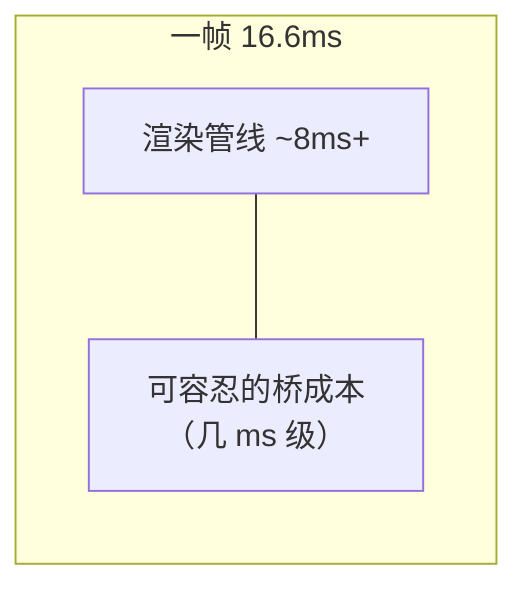
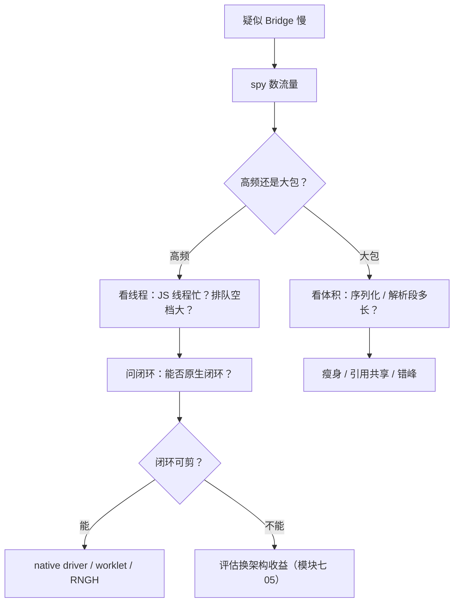

# Bridge 瓶颈量化

> "Bridge 慢"是结论，不是认知。本篇把一次跨桥调用的成本拆到**可测量的组成**，给出高频场景的塌方模型，以及亲手量一遍的方法。文中数字是量级示意，**真实数字永远自己测**。

## 1. 一次调用的成本解剖

JS 调一次 `NativeModules.Foo.bar(args)`，成本由五段组成：

| 段 | 内容 | 成本特征 |
|----|------|---------|
| ① 入队 | 构造 `[moduleID, methodID, args]` 压栈 | 极低（纯 JS） |
| ② 序列化 | `JSON.stringify` 整批消息 | **随参数体积线性**，大对象陡增 |
| ③ 跨线程 | 字符串 memcpy 到原生线程 | 随体积线性，拷贝双倍内存 |
| ④ 反序列化 | 原生 JSON 解析成对象树 | 随体积与嵌套深度线性 |
| ⑤ 分发执行 | 查表 + 反射/直接调用 | 每方法固定，模块四 02 |

量级感受（小参数、现代中端机）：单次调用端到端**百微秒级**；参数膨胀到几十 KB 后，②③④ 占绝对主导，单次可达**毫秒级**。真正致命的不是单次，是**频率 × 体积**。

### 1.1 固定成本与线性成本：五段的两分法

把五段按"成本随什么增长"重新分类，优化策略立刻分流：

| 类别 | 段 | 随什么增长 | 优化杠杆 |
|------|----|-----------|---------|
| 固定（每调用一份） | ① 入队、⑤ 分发执行 | 调用次数 | **降频**：攒批、合并、闭环化 |
| 线性（随体积） | ② 序列化、③ 跨线程、④ 反序列化 | 参数体积 × 调用次数 | **减积**：瘦身参数、引用共享、少传重复内容 |

两个杠杆不要用反：给"高频小包"场景做参数瘦身收效甚微（瓶颈在固定成本 × 频率）；给"低频大包"场景做攒批同样无效（瓶颈在体积本身）。**判断该用哪个杠杆，就是 3.1 的 spy 要回答的第一件事。**

### 1.2 下行方向：对称的另一份账单

上表只画了上行（JS → 原生），下行的五段完全对称地存在：

| 下行段 | 内容 | 高频来源 |
|--------|------|---------|
| 事件打包 | 原生组装事件参数（触摸坐标、滚动位置） | 系统事件持续发生 |
| 序列化 | 原生对象 → JSON 文本 | 同上行 ② |
| 跨线程 | 原生线程 → JS 线程 | 同上行 ③ |
| 反序列化 | JSON → JS 对象 | 同上行 ④ |
| 分发 | MessageQueue 按事件名派发给监听者 | 监听者越多派发越贵 |

对称性解释了一个反直觉现象：**即使 JS 什么都不调用，繁忙的触摸/滚动事件流也在持续支付下行序列化税**。双向流量都要计入预算——这正是 3.1 spy 判读要"看双向"的原因。

### 1.3 单次成本上浮的定性因素

"百微秒到毫秒"之间不是均匀分布。把单次成本推向高位的检查项（按贡献排序）：

1. **参数体积**（主因，线性）——②③④ 全随它涨；
2. **嵌套深度**——深对象树的解析遍历开销不成比例地增长（定性：深而大的树比"同体积的扁数组"更贵）；
3. **调用时的线程繁忙度**——JS/原生线程忙时，排队延迟叠加在服务时间之上；
4. **攒批规模**——批量越大，本条消息等待同伴的时间越长（模块四 01 · 3.3 的两面性）。

每一条都对应 3.1 / 3.2 的一个观测手段——先定性归因，再定量测量：

| 因素 | 观测手段 |
|------|---------|
| 参数体积 | spy 的参数档位 + 微基准的"体积-耗时"曲线 |
| 嵌套深度 | 微基准对照（同体积的扁数组 vs 深树） |
| 线程繁忙度 | trace 泳道上的排队空档 |
| 攒批规模 | spy 时间戳的间隔分布 |

## 2. 一帧预算沙盘

60fps → 每帧 16.6ms 预算，其中渲染管线本身（reconcile + 布局 + mount）就要吃掉一半。留给 Bridge 的余量极小：



三个经典塌方场景，全部是"每帧 N 次 × 帧率"的乘法：

| 场景 | 频率 | 为什么塌 |
|------|------|---------|
| Animated JS 驱动（`useNativeDriver: false`） | 每帧 ≥1 次 setValue 过桥 | 同时压榨 JS 线程 + Bridge + UI 线程（模块三 02） |
| 快速滚动 onScroll | iOS 默认节流下每秒仍可达数十次 | 事件下行 + 若 handler 里 setState 再触发上行，双向洪泛 |
| 拖拽跟手 | 每帧 pan 事件下行 + 位置更新上行 | 延迟叠加为肉眼可见的"滞后一截" |

共同结构：**闭环**——原生事件下行 → JS 计算 → 视图更新上行。闭环里的每一跳都过桥，延迟按跳数累乘。


### 2.1 频率从哪来：高频流量源清单

"每帧 N 次"的 N 不是抽象数字，流量源是可枚举的：

| 流量源 | 频率形态 | 逃逸通道 |
|--------|---------|---------|
| Animated JS 驱动 | 每帧 setValue | `useNativeDriver`（[模块六 04 · 动画系统原理](../rn-事件系统原理/04-动画系统原理.md)） |
| 滚动 onScroll | 每帧 / 节流后仍高频 | 原生滚动驱动、只在关键点回 JS（[模块六 03 · 滚动与列表事件](../rn-事件系统原理/03-滚动与列表事件.md)） |
| 手势 pan/state | 每帧跟手事件 | GestureHandler 原生仲裁（[模块六 01](../rn-事件系统原理/01-触摸事件链路与手势仲裁.md) / [02](../rn-事件系统原理/02-GestureHandler原理化.md)） |
| onLayout 级联 | 布局抖动时风暴 | 收敛布局、切断测量依赖环 |
| 高频定时器 | 每 N ms 一条 | 原生侧实现节拍，JS 只拿结果（模块三 02 · 第 4 节的定时器推论） |

### 2.2 体积 × 频率：二维判读矩阵

单看一维容易误判，两个维度交叉才是完整地图：

| | 小参数 | 大参数 |
|--|--------|--------|
| 低频 | 安全区（成本可忽略） | 单次尖刺：②③④ 主导，别放在交互路径上 |
| 高频 | **最危险区**：固定成本 × 频率，塌方无声 | 最重区：降频与减积都要做 |

高频小包是最容易被忽视的危险区：参数小到没人觉得需要优化，塌方全靠频率堆积——动画/手势场景都在这一格。低频大包则是"单次尖刺"型：平时没事，一调用就卡一下（大 JSON 解析、大对象上报）。

### 2.3 塌方的渐进过程（定性四阶段）

闭环洪泛不是瞬间塌的，定性过程分四段（各阶段的临界点因设备而异，**别背数字，学会认阶段**）：

| 阶段 | 现象 | 内部状态 |
|------|------|---------|
| Ⅰ 吞吐期 | 看似正常 | 每帧过桥量在消化能力内 |
| Ⅱ 排队期 | 单条延迟上浮 | 批量变大，批次链式等待开始累积（模块四 01 · 3.2） |
| Ⅲ 失稳期 | 延迟波动、偶发跳变 | JS 线程任务队列加深，反馈环每一跳都变慢 |
| Ⅳ 塌方期 | 肉眼可见滞后/掉帧 | 闭环延迟超过一帧预算，视觉反馈"追不上手" |

认阶段的工程价值：**在 Ⅱ 阶段出手（降频/瘦身）是普通优化；到 Ⅳ 阶段只剩架构级手段（原生闭环）**。阶段判读靠 3.1 的 spy 时间序列。

### 2.4 一帧预算的记账练习（构造性）

给自己的一帧做记账（数字以自己设备的 trace 为准）：

1. 抓一次包含交互的 trace，量出渲染管线段的时长（reconcile / 布局 / mount 三段）；
2. 16.6ms 减去它，剩下的就是你的"可容忍桥成本"上界；
3. 用 spy 数出该交互每帧的过桥条数与体积档位，估算桥成本的占比；
4. 若占比过半，这个场景已进入 2.3 的 Ⅱ 阶段——**先于掉帧出现就该出手**。

练习的意义：**"预算"不是背出来的 16.6ms，而是自己 trace 里量出来的余量**——每台设备、每个页面都不一样。

## 3. 亲手量化：三种手段

### 3.1 MessageQueue spy（最直接）

```js
import MessageQueue from 'react-native/Libraries/BatchedBridge/MessageQueue';
MessageQueue.spy((msg) => {
  if (msg.type === 0 /* NODE_CALL */) {
    console.log(`→ ${msg.module}.${msg.method}`, Date.now());
  }
});
```

能看到每条上行消息的时刻与参数体积——**先确认"到底有多少流量"，再谈优化**。

spy 判读三问（按顺序问，别跳）：

1. **频率多高**：单位时间上行/下行各多少条？高频源是哪一个（对照 2.1 清单）？
2. **体积多大**：参数是几字节的小包还是几十 KB 的大包？大包是哪次调用发的？
3. **双向是否对称**：只在上行堵还是双向都满？单向满 → 查该方向的发送方；双向满 → 闭环场景实锤（2.3）。

两条使用纪律：spy 回调本身跑在 JS 线程、有观测成本，**只用于开发期诊断，别留在生产包**；spy 里别做重活——打印大参数对象本身就能制造新的掉帧。

### 3.2 Perfetto / Systrace（看线程真身）

抓 trace 后过滤 jsq / mqt / main 线程：Bridge 刷队表现为原生线程上的连续 JSON 解析段。掉帧归因到线程的方法在模块九 01。

trace 判读的两个要点：

- **找解析段**：模块线程上的连续 JSON 解析段是下行反序列化税（④），JS 线程上的 stringify/parse 段是上行序列化税（②）——线程泳道把 ②④ 物理隔开，正好对号入座；
- **看空档**：排队延迟不表现为"某段很长"，而表现为"段与段之间的空档"——消息到达与开始处理之间的 gap 就是等待（线程全景见[模块三 02 · 四线程模型](../rn-JS引擎与线程模型/02-四线程模型.md)；操作手册见[模块九 05 · 性能剖析操作手册](../rn-性能优化原理/05-性能剖析操作手册.md)）。

线程与段的对应关系（抓 trace 时对号入座）：

| 泳道 | 在这里找什么 |
|------|-------------|
| jsq（JS 线程） | stringify 段（②）、JS handler 执行、spy 的消耗 |
| mqt / 模块线程 | JSON 解析段（④）、模块方法执行（⑤） |
| main / UI 线程 | mount 与绘制——**桥成本不该出现在这里**（出现了说明有人在主线程做过桥解析或重活） |

### 3.3 微基准（对比用）

固定参数体积（10B / 1KB / 100KB），循环调用 1000 次取均值，画出"体积-耗时"曲线——②③④ 的线性特征会直接显形。

微基准的设计注意（否则测出来的"线性"不可信）：

1. **预热**：首轮调用含引擎/解析器冷启动，剔除；
2. **控制批量**：固定"每批一条"与"批量刷"分别测，否则批量窗口混入结果；
3. **防 GC 噪声**：大参数循环会喂出 GC 停顿，多轮取中位数而非平均；
4. **对照组**：同一逻辑的纯 JS 版本（不过桥）作对照，差值才是"桥税"本身。

### 3.4 延迟账单练习（构造性）

给自己的 App 出一张"桥流量账单"：选一个交互场景（如列表滚动一秒），用 spy 记录窗口内全部消息，整理成表：

| 字段 | 记什么 |
|------|--------|
| 方向 | 上行 / 下行 |
| 来源 | onScroll / setValue / … |
| 条数 | N |
| 单条体积档位 | 小/中/大（定性即可） |
| 是否在闭环内 | 是 / 否 |

填完就能回答：这个场景塌在哪一类（频率敏感 or 体积敏感）、该用哪个杠杆（1.1）。**练习的价值在分类过程，不在数字**——数字因设备而异，分类结论是稳定的。

### 3.5 动手清单

1. **抓双向**：给 spy 的回调同时记录 `msg.type`，把上行与下行分开统计——很多人第一次做会发现下行流量比自己以为的多；
2. **看空档**：抓一次滚动 trace，量一下"消息到达"与"开始解析"之间的 gap 占总延迟的比例；
3. **画曲线**：微基准跑 10B / 1KB / 100KB 三档，确认 ②③④ 段的线性形状（3.3 的四个控制变量都要做）；
4. **找闭环**：挑一个你写的交互，画出"下行事件 → JS → 上行更新"的跳数，数一数有几跳过桥。

## 4. 官方演进：在不动架构的前提下减负

Bridge 时代官方做过两类改良，理解它们有助于分清"优化"与"换架构"：

1. **BatchedBridge → 拆分队列（AsyncBatchedBridge 时代）**：JS 队列与原生分发解耦，减少双向争抢；批量窗口参数（`MIN_CALLS_PER_FLUSH` 等）调优吞吐-延迟折中；
2. **逃逸通道**：`useNativeDriver` 把动画驱动整个挪到原生侧（每帧 0 过桥）；`setNativeProps` 减少一次 reconcile——都是**绕开 Bridge**，而非让 Bridge 变快。

### 4.1 逃逸通道逐个展开

| 通道 | 机制 | 剪掉了闭环的哪一跳 |
|------|------|-------------------|
| `useNativeDriver` | 动画参数与插值曲线启动时一次性下发，驱动循环在原生侧自转 | 每帧上行（setValue）整跳消失 |
| `setNativeProps` | 绕过 reconcile 直接改原生视图属性 | JS 线程的 reconcile 段消失（上行仍在） |
| RNGH / Reanimated worklet | 手势仲裁与动画帧回调整体搬到原生 / 独立 Runtime | 下行事件 + 上行更新双跳消失（模块六 02 / 04） |

三条通道的共同句式：**把"每帧循环"从 JS 线程搬走，只留低频的配置面走消息**。这也是判断"能不能绕开 Bridge"的通用问法——这个循环真的需要每帧经过 JS 吗？

### 4.2 "优化"与"换架构"的判别式

> 结论：Bridge 的成本是**结构性的**（序列化 + 异步 + 跨线程），调参数只能削峰，不能改性质。这就是模块七换 JSI 的全部理由。

给这段结论配一个可操作的判别式：

| 问 | 若答案是 | 性质 |
|----|---------|------|
| 调参/绕行之后，序列化 + 异步 + 跨线程还在吗？ | 在 | 优化（削峰，性质未变） |
| 同上 | 不在（JSI 直调、引用传递） | 换架构（性质改变） |

换句话说：逃逸通道改造的是**特定场景**（动画、手势、挂载），Bridge 对其余场景的税照收；JSI 改造的是**通道本身**。收益边界的系统对照见[模块七 05 · 新旧架构对比与迁移](../rn-新架构/05-新旧架构对比与迁移.md)。

## 5. 瓶颈量化 checklist

1. 先数流量（spy / 打点）：每秒多少条、参数多大；
2. 再看分布：塌在②③④哪一段（体积敏感 = 序列化问题；频率敏感 = 设计问题）；
3. 问闭环：这个场景是不是"原生事件 → JS → 视图更新"闭环？闭环能否剪断（原生侧闭环：native driver / worklet / RNGH）；
4. 最后才谈换架构收益（模块七 05 的迁移动机表）。

### 5.1 checklist 的走查示例（构造场景）

场景：拖拽进度条，拖动时 UI 明显滞后。走查：

1. **数流量**：spy 显示拖动期间每秒数十条 pan 上行 + 每帧进度下发——高频小包，频率敏感实锤（2.2 的危险区）；
2. **看分布**：trace 里 JS 线程处理段不长、段间空档大——排队为主，非序列化瓶颈；
3. **问闭环**：pan 下行 → JS 计算 → setState → 视图更新上行，标准闭环；闭环可剪断——改用 RNGH/原生驱动；
4. **换架构收益**：若项目已具备新架构条件，此场景迁 JSI 化手势库即可消除；旧架构则优先逃逸通道。

四步走完，手段排序自动涌现：**先剪闭环，再谈其他**。归因方法论的完整版在[模块九 01 · 性能定位方法论](../rn-性能优化原理/01-性能定位方法论.md)。

### 5.2 手法对照表：按场景选武器

| 手法 | 机制 | 适用场景 | 代价 |
|------|------|---------|------|
| 节流 / 防抖 | 降频（丢中间值） | onScroll 等回调型流量 | 响应粒度变粗 |
| 采样上报 | 降频（保样本） | 埋点 / 进度类 | 数据不完整 |
| 参数瘦身 | 减积 | 低频大包 | 几乎免费 |
| 引用共享 | 免序列化 | 文件 / 图片等大块数据 | 生命周期管理 |
| 原生闭环 | 双跳全剪 | 动画 / 手势每帧循环 | 逻辑迁原生，灵活性下降 |
| 换架构（JSI） | 性质改变 | 全面高频场景 | 迁移成本（模块七 05 / 06） |

读法：前四行是"优化"（性质不变），后两行是"结构性手段"。**同一个场景常需要组合拳**：先减积（免费），再降频（看粒度容忍度），最后考虑闭环。

### 5.3 三件套的决策顺序



## 6. 常见误区与性能坑

| 误区/坑 | 事实 |
|---------|------|
| "单次调用快，所以 Bridge 不慢" | 塌方模型是频率 × 体积，不是单点耗时（2.3） |
| "JS 不调原生就没有桥成本" | 下行事件流在持续支付序列化税（1.2） |
| "调刷队参数能救高频场景" | 攒批救固定成本，救不了频率本身（模块四 01 · 3.3） |
| "spy 可以留在生产包里常开" | spy 有观测成本且跑在 JS 线程，生产关闭（3.1） |
| "微基准随便跑跑就行" | 不预热/不控批量/不防 GC 噪声，线性特征测不出来（3.3） |
| "传几十 KB 也没事，反正异步" | 异步只是不阻塞，体积税照付且排队（1.3） |
| "优化 Bridge 就是优化 RN" | Bridge 成本是结构性的，绕行/换架构才是根治（4.2） |
| "节流是万能的" | 节流丢中间值，跟手场景（拖拽/动画）粒度变粗不可接受（5.2） |
| "桥成本会出现在 UI 线程" | 不会——出现在 UI 泳道说明有人把过桥解析或重活放上了主线程（3.2 对应表） |

## 7. 两类场景的量化走查（构造示例）

以下两个走查是**构造的说明性演示**（现象常见、路径真实，数字请以自己设备为准），演示量化三件套怎么串起来用。

### 案例 A：高频小包（Animated JS 驱动）

现象：动画运行期间整体掉帧，动画结束后恢复。走查：

| 检查 | 结果（构造） | 结论 |
|------|-------------|------|
| spy | 每帧一条 setValue 上行，参数几字节 | 高频小包（2.2 的危险区） |
| trace | jsq 上有节奏性小段，模块线程空闲 | 瓶颈在频率与 JS 线程，非体积 |
| 闭环 | setValue → JS 插值 → 视图更新上行 | 标准闭环（2 的闭环图） |

手段排序：`useNativeDriver: true`（整跳剪掉）→ 仍不满足再看能否迁 worklet。**参数瘦身在这里是无效药**（参数本来就小），对应 1.1 的"杠杆不要用反"。

### 案例 B：低频大包（初始化全量上报）

现象：进首页瞬间卡一下，之后流畅。走查：

| 检查 | 结果（构造） | 结论 |
|------|-------------|------|
| spy | 启动后一次数百 KB 级大包 | 体积敏感的单次尖刺 |
| trace | 模块线程上一段长 JSON 解析，恰压过一帧 | ④ 段主导，落在帧预算内最痛 |

手段排序：参数瘦身 / 增量上报（免费）→ 挪出首帧路径（错峰）→ 大块数据走文件句柄。**降频在这里无效**（本来就一次）。

两个案例合起来正是 2.2 矩阵的两个格子：**先定位格子，再选手法**——这就是 checklist 的全部内容，案例只是它的具象化。

## 小结

- 单次调用成本 = 入队 + 序列化 + 跨线程 + 反序列化 + 分发，**体积敏感**的是中间三段；
- 塌方的统一模型是**帧率 × 频率的闭环洪泛**（动画/滚动/拖拽），不是单点慢；
- 量化三件套：MessageQueue spy 数流量、Perfetto 看线程、微基准画曲线；
- Bridge 时代的一切优化本质是"绕开它"——结构性成本只能靠换架构消除。

## 自测

1. 五段成本如何两分？两个优化杠杆各对应哪类？（→ 1.1）
2. 为什么"JS 不调原生"不代表没有桥成本？（→ 1.2）
3. 塌方四阶段各是什么状态？为什么 Ⅱ 阶段与 Ⅳ 阶段的手段完全不同？（→ 2.3）
4. spy 判读三问是哪三问？两条使用纪律是什么？（→ 3.1）
5. trace 里"排队"长什么样？在哪条泳道上找解析段？（→ 3.2 判读要点）
6. 微基准要控制哪四个变量？（→ 3.3）
7. 三条逃逸通道各剪掉了闭环的哪一跳？"优化"与"换架构"的判别式是什么？（→ 4.1 / 4.2）
8. 案例 A 为什么不能用参数瘦身救？案例 B 为什么不能用降频救？（→ 7 / 1.1）
