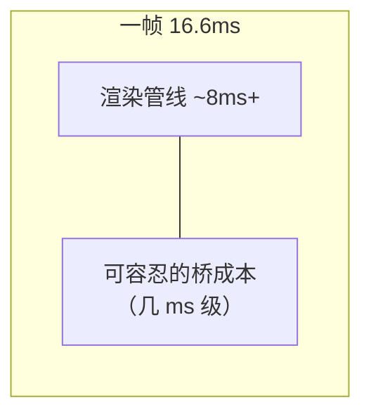

# Bridge 瓶颈量化

> "Bridge 慢"是结论，不是认知。本篇把一次跨桥调用的成本拆到**可测量的组成**，给出高频场景的塌方模型，以及亲手量一遍的方法。文中数字是量级示意，**真实数字永远自己测**。

## 1. 一次调用的成本解剖

JS 调一次 `NativeModules.Foo.bar(args)`，成本由五段组成：

| 段 | 内容 | 成本特征 |
|----|------|---------|
| ① 入队 | 构造 `[moduleID, methodID, args]` 压栈 | 极低（纯 JS） |
| ② 序列化 | `JSON.stringify` 整批消息 | **随参数体积线性**，大对象陡增 |
| ③ 跨线程 | 字符串 memcpy 到原生线程 | 随体积线性，拷贝双倍内存 |
| ④ 反序列化 | 原生 JSON 解析成对象树 | 随体积与嵌套深度线性 |
| ⑤ 分发执行 | 查表 + 反射/直接调用 | 每方法固定，模块四 02 |

量级感受（小参数、现代中端机）：单次调用端到端**百微秒级**；参数膨胀到几十 KB 后，②③④ 占绝对主导，单次可达**毫秒级**。真正致命的不是单次，是**频率 × 体积**。

## 2. 一帧预算沙盘

60fps → 每帧 16.6ms 预算，其中渲染管线本身（reconcile + 布局 + mount）就要吃掉一半。留给 Bridge 的余量极小：



三个经典塌方场景，全部是"每帧 N 次 × 帧率"的乘法：

| 场景 | 频率 | 为什么塌 |
|------|------|---------|
| Animated JS 驱动（`useNativeDriver: false`） | 每帧 ≥1 次 setValue 过桥 | 同时压榨 JS 线程 + Bridge + UI 线程（模块三 02） |
| 快速滚动 onScroll | iOS 默认节流下每秒仍可达数十次 | 事件下行 + 若 handler 里 setState 再触发上行，双向洪泛 |
| 拖拽跟手 | 每帧 pan 事件下行 + 位置更新上行 | 延迟叠加为肉眼可见的"滞后一截" |

共同结构：**闭环**——原生事件下行 → JS 计算 → 视图更新上行。闭环里的每一跳都过桥，延迟按跳数累乘。


## 3. 亲手量化：三种手段

### 3.1 MessageQueue spy（最直接）

```js
import MessageQueue from 'react-native/Libraries/BatchedBridge/MessageQueue';
MessageQueue.spy((msg) => {
  if (msg.type === 0 /* NODE_CALL */) {
    console.log(`→ ${msg.module}.${msg.method}`, Date.now());
  }
});
```

能看到每条上行消息的时刻与参数体积——**先确认"到底有多少流量"，再谈优化**。

### 3.2 Perfetto / Systrace（看线程真身）

抓 trace 后过滤 jsq / mqt / main 线程：Bridge 刷队表现为原生线程上的连续 JSON 解析段。掉帧归因到线程的方法在模块九 01。

### 3.3 微基准（对比用）

固定参数体积（10B / 1KB / 100KB），循环调用 1000 次取均值，画出"体积-耗时"曲线——②③④ 的线性特征会直接显形。

## 4. 官方演进：在不动架构的前提下减负

Bridge 时代官方做过两类改良，理解它们有助于分清"优化"与"换架构"：

1. **BatchedBridge → 拆分队列（AsyncBatchedBridge 时代）**：JS 队列与原生分发解耦，减少双向争抢；批量窗口参数（`MIN_CALLS_PER_FLUSH` 等）调优吞吐-延迟折中；
2. **逃逸通道**：`useNativeDriver` 把动画驱动整个挪到原生侧（每帧 0 过桥）；`setNativeProps` 减少一次 reconcile——都是**绕开 Bridge**，而非让 Bridge 变快。

> 结论：Bridge 的成本是**结构性的**（序列化 + 异步 + 跨线程），调参数只能削峰，不能改性质。这就是模块七换 JSI 的全部理由。

## 5. 瓶颈量化 checklist

1. 先数流量（spy / 打点）：每秒多少条、参数多大；
2. 再看分布：塌在②③④哪一段（体积敏感 = 序列化问题；频率敏感 = 设计问题）；
3. 问闭环：这个场景是不是"原生事件 → JS → 视图更新"闭环？闭环能否剪断（原生侧闭环：native driver / worklet / RNGH）；
4. 最后才谈换架构收益（模块七 05 的迁移动机表）。

## 小结

- 单次调用成本 = 入队 + 序列化 + 跨线程 + 反序列化 + 分发，**体积敏感**的是中间三段；
- 塌方的统一模型是**帧率 × 频率的闭环洪泛**（动画/滚动/拖拽），不是单点慢；
- 量化三件套：MessageQueue spy 数流量、Perfetto 看线程、微基准画曲线；
- Bridge 时代的一切优化本质是"绕开它"——结构性成本只能靠换架构消除。
