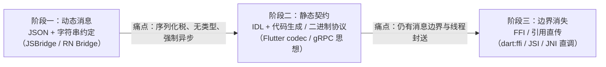
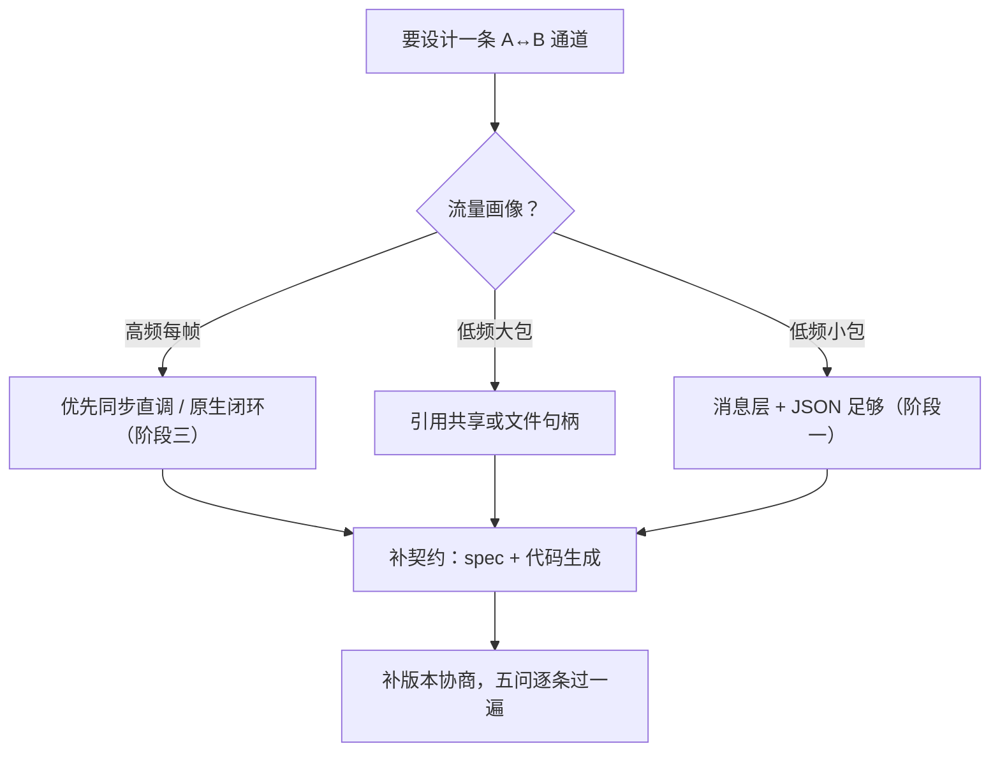

# 跨语言通信的通用设计

> 把模块四收束一下：RN Bridge 只是"跨语言通信"这个老问题的一个实例。抽出它的**设计空间**，再对照 WebView、Flutter、Electron——你会发现所有生态都走在同一条演化路径上，而 JSI 站在路径的尽头。

## 1. 跨语言通信的五要素

任何"语言 A 调语言 B"的机制都能拆成五个设计维度：

| 要素 | 问题 | 典型选项 |
|------|------|---------|
| 通道（transport） | 消息/调用怎么过去 | 队列、管道、socket、共享内存、直接函数调用 |
| 序列化（codec） | 数据怎么表示 | JSON、XML、二进制协议（protobuf/standard codec）、不序列化（引用/指针） |
| 线程封送（threading） | 谁执行、在哪执行、怎么等 | 固定线程 + 异步回调、同步阻塞、无锁直调 |
| 调用语义（semantics） | 同步还是异步、单向还是双向 | RPC（等待结果）、fire-and-forget、事件流 |
| 类型契约（contract） | 两边怎么对上接口 | 运行时约定（id + 顺序）、IDL/代码生成、动态 duck-typing |

**RN Bridge 的答案**：队列通道 / JSON / 固定线程异步 / 回调语义 / moduleID+methodID 运行时约定——每个维度都选了"最保守"的一档，于是五个维度的短板（异步、序列化税、无类型）它全占了。

### 1.1 五要素的耦合关系：不能单独选型

五要素不是五个独立旋钮，选项之间互相约束：

| 约束 | 逻辑 | 实例 |
|------|------|------|
| 契约 → 序列化 | 强类型 IDL 契约天然要求结构化/二进制编解码 | gRPC：proto IDL 与 protobuf 编码是绑定套装 |
| 通道 → 线程 | 通道越厚（进程/队列），线程封送越必要 | Electron 跨进程必然封送；JSI 同进程可同线程 |
| 序列化 → 语义 | 不序列化（引用直传）意味着被调方必须立刻处理 → 同步语义成主流 | JSI 直调默认同步；JSON 消息天然异步 |
| 线程 → 语义 | 跨线程封送即引入排队 → 排队即异步 | "固定线程 + 异步回调"总是成对出现 |

读法：当你为某端选了"最保守"的档位，其余四档往往被迫跟着保守——**RN Bridge 五档全保守不是偶然，是耦合的连锁**。同理，JSI 的"引用直传"一旦选定，同步语义、调用方线程、静态契约会被一起拉进来（模块七 01-04 的组合拳）。这个耦合也有工程上的另一面：**想单点改良旧通道，常被耦合拖住**——比如想给 JSON 换二进制 codec，但契约还是 id 约定，强类型 codec 的收益吃不满；想给某几个调用开同步，但通道还是队列，"同步"只能是阻塞式的假同步。这正是"优化救不了结构"（模块四 03 · 4.2）在五要素语言下的重述。

### 1.2 取值轴：每个要素从"消息"滑向"调用"

把五要素各画成一条轴，所有跨语言方案都能在轴上定位：

| 要素 | ← 消息端 | 调用端 → |
|------|---------|---------|
| 通道 | 队列 / 管道 / socket | 共享内存 / 函数表直调 |
| 序列化 | 文本协议（JSON） | 不序列化（引用） |
| 线程 | 专职跨线程封送 | 调用方线程直达 |
| 语义 | fire-and-forget 异步 | 同步 RPC |
| 契约 | 运行时字符串约定 | 构建期 IDL 生成 |

演化路径（第 3 节）就是"从轴左端滑向右端"的过程。注意**没有方案在所有轴上取最右端**——FFI 直调也常配异步包装；轴位置是按场景的权衡，不是评分。

### 1.3 用五要素复盘：RN 自己的通道全家福

RN（旧架构）内部其实并行着多条通道，每条都是五要素的一种取值组合：

| 设施 | 通道 | 序列化 | 语义 | 典型用途 |
|------|------|--------|------|---------|
| 模块方法（回调） | 消息队列 | JSON | 请求-应答 | 一次性原生能力 |
| constants | 启动期注入 | JSON | 静态快照 | 版本 / 配置（模块四 01 · 2.2） |
| 事件 | 消息队列 | JSON | fire-and-forget | 状态广播（模块四 02 · 4.2） |
| 存储类模块（AsyncStorage 一族） | 消息队列 | JSON | 请求-应答（异步 IO） | 持久化 |

同一套 Bridge 底座，长出了语义不同的多条通道——**要素组合是"通道"的 DNA**。看懂一个陌生框架的通信层，第一件事就是把它的每条通道按五要素填表；看不懂一个通道为什么难用，多半是某根轴取错了档。

## 2. 四个生态的同构对照

| | RN Bridge（旧） | WebView JSBridge | Flutter Platform Channel | Electron IPC | RN 新架构（JSI） |
|--|----------------|------------------|--------------------------|--------------|----------------|
| 通道 | 消息队列 | URL scheme / evaluateJS 注入 | 二进制消息通道（Dart 端端口） | Chromium Mojo | **C++ 函数表直调** |
| 序列化 | JSON 文本 | JSON 文本 | StandardMessageCodec（二进制） | Structured Clone | **不序列化（对象引用/HostObject）** |
| 线程 | 原生固定线程 | UI 线程 | Platform 线程（可配） | 独立进程 | 调用方线程直达 C++ |
| 语义 | 异步回调 | 异步回调 | 异步（可 await） | 异步 + invoke 同步壳 | **同步直调 + 异步自选** |
| 契约 | id 约定 | 字符串方法名 | 字符串方法名 + codec | 频道字符串 | **TS/Flow spec → Codegen 静态生成** |

观察三条规律：

1. **序列化逐级减负**：JSON 文本 → 二进制 codec → structured clone → 引用直传。数据表示越接近内存原貌，成本越低；
2. **契约逐级前移**：运行时字符串 → 运行时注册表 → 构建期 IDL 代码生成。类型检查从"线上炸"前移到"编译期炸"；
3. **通道逐级变薄**：队列 → 平台端口 → IPC 框架 → 纯虚函数表。中间层越薄，延迟与线程问题越少。

### 2.1 WebView JSBridge：不对称的双向

| 方向 | 机制 | 限制 |
|------|------|------|
| JS → 原生 | URL scheme 拦截 / 注入的 JS 桥对象 | scheme 拦截受 URL 长度与编码约束（定性） |
| 原生 → JS | `evaluateJavaScript` 注入执行 | 注入有窗口期，时机敏感 |

不对称的根源：两个世界只靠"WebView 容器提供的有限开口"通信——开口在哪，机制就长在哪。工程后果：上行大 payload 受 URL 长度限制，下行依赖注入时机，**两端的可用带宽与可靠性都不由你控制**——这是"开口决定机制"的直接代价。RN Bridge 的对称双管道相比它已是进步；但两者共享"文本协议 + 异步回调"的保守档位。混合栈里 WebView 与 RN 通信边界的取舍见[混合开发 02 · 混合导航与通信边界](../rn-混合开发/02-混合导航与通信边界.md)。

### 2.2 Flutter Platform Channel：通道命名的消息总线

Dart 与原生之间：字符串通道名路由 + 二进制 codec 编解码，`MethodChannel` / `EventChannel` 是常用封装形态。相比 JSON 文本，StandardMessageCodec 一类的二进制编码把"类型保真 + 体积更小"一次做到——**通道仍是消息队列，赢在 codec 档位**（序列化轴右移了一格，通道轴没动）。

把 MethodChannel 按五要素填表，与 RN Bridge 的对照自然浮现：

| 要素 | MethodChannel 的取值 |
|------|---------------------|
| 通道 | BinaryMessenger 的命名路由 |
| 序列化 | StandardMessageCodec（内置类型映射表） |
| 线程 | 调用方投递到 Platform 线程执行（可配） |
| 语义 | invoke 即异步 Future |
| 契约 | 通道名字符串 + 方法名字符串 |

### 2.3 Electron IPC：进程边界的封送

renderer 与 main 是两个进程：`ipcRenderer.invoke` ↔ `ipcMain.handle` 的请求-应答形态，载荷经结构化克隆序列化，`contextBridge` 负责把安全白名单暴露给页面。**进程边界把"线程封送"升级成"进程封送"**——这是线程轴的最保守档，也决定了 Electron IPC 的成本底数：跨进程必有拷贝与调度，大数据要么忍，要么走框架底层的共享内存旁路。

同样按五要素填表：通道 = 进程间消息；序列化 = 结构化克隆；线程 = 跨进程封送；语义 = 异步为主（同步变体会让发起方阻塞到被调方应答，文档一贯提示慎用）；契约 = 频道字符串 + 事件名约定。

### 2.4 用三条规律给生态定位

| 生态 | 序列化轴 | 契约轴 | 通道轴 |
|------|---------|--------|--------|
| WebView JSBridge | JSON 文本 | 字符串方法名 | 容器开口 |
| RN Bridge | JSON 文本 | id 约定 | 消息队列 |
| Flutter Channel | 二进制 codec | 字符串名 + codec | 平台消息总线 |
| Electron IPC | 结构化克隆 | 频道字符串 | 进程 IPC 框架 |
| RN 新架构（JSI） | 引用直传 | Codegen 静态 | 函数表 |

规律不是"新东西取代旧东西"，而是**每个生态在高频路径上都朝三轴右端迁移**：Flutter 在 Platform Channel 之外补 FFI、Electron 在 IPC 之下走 Mojo 共享内存、RN 直接把地基换成 JSI。

### 2.5 各生态通道的开销敏感点

| 生态 | 开销最敏感的一环 | 表现 |
|------|----------------|------|
| WebView JSBridge | 容器开口（拦截 / 注入） | 大 payload 受限，可靠性受注入时机约束 |
| RN Bridge | JSON 编解码（②④ 段） | 体积敏感 + 频率敏感（[模块四 03](03-Bridge瓶颈量化.md)） |
| Flutter Channel | codec 编解码 + 平台线程封送 | 大 payload 仍有拷贝，高频仍排队 |
| Electron IPC | 进程间封送与序列化 | 大数据要走共享内存旁路 |

敏感点各不相同，但都落在五要素的某一格——**没有生态在所有格子上都便宜**，选型就是把你的流量画像对准"敏感点最小"的方案。

## 3. 演化路径：所有生态的同一个方向

- Flutter 的演化是旁证：Platform Channel 之外补了 `dart:ffi` 直接调 C——**高频通道下沉到 FFI，低频通道留在消息层**；
- Electron 的 Mojo 也是同一逻辑：高频的合成器消息走共享内存与二进制，JS 层才暴露宽松的 IPC API；
- RN 的选择最彻底：把"JS 与原生共享的运行时层"（C++）作为一等公民，JSI 是函数表，Fabric/TurboModules 是建在函数表上的系统（模块七）。

### 3.1 阶段二的工程标本：契约前移

| 标本 | 契约形态 | 编解码 | 两端代码来源 |
|------|---------|--------|-------------|
| gRPC | proto 文件（IDL） | protobuf 二进制 | protoc 生成 stub |
| Flutter Channel | 通道名 + codec 类型表 | StandardMessageCodec | 手写（名字即契约） |
| RN 新架构 | TS/Flow spec | 直调（无需编码） | Codegen 生成（[模块七 04 · Codegen](../rn-新架构/04-Codegen.md)） |

阶段二的核心动作是**把契约从运行时搬到构建期**：字符串约定变成 schema，"线上炸"变成"编译期炸"。代价是构建流程复杂度——IDL 文件、生成步骤、产物管理，都是新的工程负担。

值得注意：**阶段二是稳定形态，不是过渡态**——Flutter Channel 停在阶段二运转良好。它解决的"类型保真与契约前移"对低中频场景已经够用，只有高频路径才需要继续向阶段三下沉。这也是迁移决策的一个刻度：先评估自己的流量够不够到阶段三。

### 3.2 阶段三的代价：序列化税换成管理税

引用直传不是免费的，它把三类新账单换到台面上：

| 新账单 | 内容 | 对应机制 |
|--------|------|---------|
| 生命周期管理 | 对象归谁释放？跨语言引用如何保活 | JSI 的 HostObject 持有与 GC 联动（模块七 01 · 2.3） |
| 线程亲和 | 直调发生在谁的调用栈？跨线程仍需封送 | Runtime 单线程亲和 + CallInvoker（模块七 01 · 4.1） |
| 崩溃越界 | C++ 段崩溃直接带崩进程，没有消息层的隔离垫 | 崩溃栈里 `facebook::jsi::` 帧是定位跨界崩溃的路标（模块七 01 · 7） |

一句话：**消息层的"笨重"同时也是"隔离垫"**——阶段三拆掉垫子的同时，垫子提供的保护也一起消失。这是 FFI 类方案总强调"边界处要谨慎"的原因。管理税的工程对策也由此派生：生命周期问题交给"句柄表 + 显式释放"或 GC 联动；线程亲和问题交给调用队列（CallInvoker 一族）；崩溃越界问题靠"边界处最小化、重活隔离到独立进程/线程"兜底。

### 3.3 为什么 RN 走得最彻底

几个生态里 RN 的起点最保守（五档全保守），走到阶段三的收益也最大：

- **引擎侧**：JSI 把"JS 引擎"变成可插拔件，Hermes 得以成为默认（[模块三 01 · JS 引擎对比与 Hermes 原理](../rn-JS引擎与线程模型/01-JS引擎对比与Hermes原理.md)）；
- **模块侧**：TurboModules 建在 HostObject 上，懒加载 + 静态契约（[模块七 03 · TurboModules](../rn-新架构/03-TurboModules.md)）；
- **渲染侧**：Fabric 的 C++ ShadowTree 直接受 reconciler 驱动，渲染指令不过消息层（[模块七 02 · Fabric 渲染管线](../rn-新架构/02-Fabric渲染管线.md)）；
- **生态侧写**：MMKV 一类纯 JSI 库证明了"地基本身就是发布能力"。

对照表里"RN 新架构"那一列为什么全是轴的最右端，到这里有了完整的解释。

### 3.4 演化路径给迁移决策的启示

- **不必一步到阶段三**：阶段二的收益（契约前移、二进制 codec）可以在不动架构的前提下兑现——Flutter Channel 就是停在阶段二的稳定形态（3.1）；
- **高频路径优先迁移**：所有生态都选择"高频通道先下沉"（Flutter 的 FFI、Electron 的 Mojo、RN 的 JSI），低频通道留在消息层已经足够便宜；
- **迁移是逐轴的**：先契约轴（Codegen 可独立引入），再序列化轴（引用直调），最后通道轴（拆 Bridge）——RN 新架构的整体切换见[模块七 05 · 新旧架构对比与迁移](../rn-新架构/05-新旧架构对比与迁移.md)与[模块七 06 · 迁移工程实践](../rn-新架构/06-迁移工程实践.md)。

## 4. 设计你自己的跨语言通道：五问 checklist

当你在业务里要设计一个 JS↔Native（或任何 A↔B）通道时，按五要素顺序问：

1. **频率与体积**：高频小包还是低频大包？高频 → 考虑同步直调/原生闭环；大包 → 考虑引用共享（文件句柄、内存块）而非序列化；
2. **谁在等谁**：调用方能不能等？能等且被调方无死锁风险 → 同步；否则异步 + 明确的取消/超时语义；
3. **线程归属**：被调代码必须在哪个线程跑（UI？IO？）？封送策略（post / 队列 / 直接）由此决定；
4. **契约形态**：接口多稳定？稳定 → IDL 生成（模块七 04 Codegen 思想）；探索期 → 动态注册但保留升级路径；
5. **版本兼容**：两端能否同时升级？不能 → 契约里带版本号与能力协商（热更新场景见模块八 02）。

五问的决策顺序可以浓缩成一张流程图：

### 4.1 五问的反面教材：每问答错会发生什么

| 问 | 答错的样子 | 后果 |
|----|-----------|------|
| 频率与体积 | 每帧动画用 JSON 消息闭环 | 塌方四阶段走完（[模块四 03](03-Bridge瓶颈量化.md)） |
| 谁在等谁 | 把可能死锁的被调方设计成同步 | 等待成环，双端挂死（模块三 02 · 第 7 节） |
| 线程归属 | 假设被调代码"在哪都能跑" | 随机崩溃或 UI 卡顿，看运气 |
| 契约形态 | 探索期就上重型 IDL | 迭代成本压死实验速度 |
| 版本兼容 | 两端独立升级、契约不带版本 | 热更后调用错位（[模块八 02 · 热更新原理](../rn-Metro打包与热更新/02-热更新原理.md)） |

反面教材的共同点：**错误不是"性能差一点"，而是结构性返工或线上事故**——五问是设计评审的最低配置，不是锦上添花。它同样适用于业务自建通道：WebView 桥、小程序容器、插件化宿主，全都是"A 调 B"的实例。

### 4.2 一个走查示例：设计"主题配置下发"通道

需求：原生侧持有主题配置（颜色、字号），JS 侧要在渲染前读到，且配置可在运行时被原生热改。按五问走一遍：

| 问 | 分析 | 取值 |
|----|------|------|
| ① 频率与体积 | 低频、中等体积（配置表几 KB） | 消息层足够，不必引用共享 |
| ② 谁在等谁 | JS 渲染前想立刻用 → 有"等"的诉求 | 初次读取要同步或极早异步 |
| ③ 线程归属 | 配置读写在原生侧，JS 只读 | 原生自管，下发只读快照 |
| ④ 契约形态 | 配置结构相对稳定 | TS 类型定义（为将来 Codegen 留路） |
| ⑤ 版本兼容 | 配置随版本演进，两端可能不同步 | 快照带 schemaVersion，JS 侧缺省降级 |

对应的落地形态（旧架构可用的保守版）：**启动期 constants 注入初版快照 + 运行时热改走事件通知 + JS 收到事件后再按需拉取**。若迁到新架构，"渲染前读到"升级为同步直调（[模块七 01 · 3](../rn-新架构/01-JSI原理.md)），事件通道保持不变——**通道按需逐条升级，不要求一刀切**。

把需求换一档再走一遍（对照的力量）：若需求变成"主题色驱动每帧动画联动"（如颜色随滚动插值），五问的答案全变：

| 问 | 变化 |
|----|------|
| ① | 高频每帧 → 消息层出局，进阶段三（原生闭环 / JSI 直调） |
| ② | JS 等"每帧的最新值" → 同步直调或原生侧闭环，不走回调 |
| ④ | 插值函数也要跨界 → 契约里增加曲线 / 插值描述 |
| ⑤ | 动画契约与配置契约分开版本化——两者演进节奏不同 |

同一接口，流量画像一变，五问答案全变——**通道设计跟着流量画像走，不跟着接口长相走**。

### 4.3 五问的输出物：一张通道设计卡

五问过完应产出一张"通道设计卡"（写进模块文档，评审用它）：

| 字段 | 示例（主题配置通道） |
|------|---------------------|
| 流量画像 | 低频、几 KB、双向 |
| 通道与序列化 | constants（初版快照）+ 事件 + JSON（热改通知） |
| 线程归属 | 原生自管；下发只读快照 |
| 同步语义 | 初次读取同步 / 极早异步；热改异步 |
| 契约与版本 | TS 类型 + schemaVersion + 缺省降级 |
| 演进路径 | 新架构下升级为同步直调，事件通道保留 |

设计卡的价值：**把"通道决策"从隐性经验变成可评审的显性产物**——跨端团队的通信协议评审从这张卡开始。

## 5. 回到 RN：本模块的完整拼图

- 01/02：Bridge 的结构（三队列、批量、注册与调用链）；
- 03：结构的成本量化（体积敏感 + 闭环洪泛）；
- 本篇：把 Bridge 放进通用设计空间——它的五个"保守选择"正是新架构逐项替换的清单：

| Bridge 的选择 | 新架构的替换 |
|---------------|-------------|
| 队列通道 | JSI 函数表（通道消失） |
| JSON | 对象引用 / 强类型 Props |
| 强制异步 | 同步直调 + 按需异步 |
| id 运行时约定 | Codegen 静态契约 |
| 固定线程封送 | 调用方线程直达 C++ |

### 5.1 拼图怎么用：三个入口

| 你带着什么问题来 | 走哪条线 |
|-----------------|---------|
| "为什么我调原生这么慢" | 01 三要素 → 03 成本解剖 → 03 checklist 定杠杆 |
| "为什么模块注册/回调总出幺蛾子" | 01 编号表 → 02 调用链九步 → 02 frail points 表 |
| "要不要迁新架构" | 04 演化路径 → [模块七 05 · 新旧架构对比与迁移](../rn-新架构/05-新旧架构对比与迁移.md) |

本模块是"问题侧"的完整画像；"答案侧"从[模块七 01 · JSI 原理](../rn-新架构/01-JSI原理.md)开始逐项对账——上表五行分别对应模块七 01（通道/序列化/线程三行）、03（懒加载与调用语义）、04（契约行）的展开。

### 5.2 与其他模块的接口

| 方向 | 接口 |
|------|------|
| 向前依赖 | [模块二 01](../rn-启动流程原理/01-Android启动链路.md)/[02](../rn-启动流程原理/02-iOS启动链路与runApplication.md)：注册发生在启动链路的哪一站 |
| 平行支撑 | [模块三 02 · 四线程模型](../rn-JS引擎与线程模型/02-四线程模型.md)（队列所在的线程模型）、[模块三 04](../rn-JS引擎与线程模型/04-同步与异步的边界.md)（同步异步边界） |
| 向后输出 | 模块七 01-06（JSI 逐项替换清单）、[模块七 05](../rn-新架构/05-新旧架构对比与迁移.md)（迁移对照） |
| 生态旁证 | [混合开发 02](../rn-混合开发/02-混合导航与通信边界.md)（WebView 与 RN 的通信边界）、[模块八 02](../rn-Metro打包与热更新/02-热更新原理.md)（契约版本兼容与热更新） |

## 6. 常见误区

| 误区 | 事实 |
|------|------|
| "五要素可以独立选型" | 选项互相约束，单点激进常被其余四档拖回（1.1） |
| "新机制一定全轴右移" | Flutter Channel 只动了序列化轴；演化是逐轴迁移（2.2 / 2.4） |
| "引用直传 = 零成本" | 序列化税换管理税：生命周期/线程亲和/崩溃越界（3.2） |
| "消息队列过时了" | 低频大包场景消息层仍是最稳的隔离垫；按场景选轴位（1.2 / 3.2） |
| "演化路径只有 RN 在走" | Flutter 补 FFI、Electron 用 Mojo 共享内存，同一方向（第 3 节旁证） |
| "五问 checklist 是给框架作者的" | 业务自建通道（WebView 桥、小程序容器、插件化）同样适用（4.1） |
| "阶段二是过渡态，迟早要淘汰" | 阶段二是稳定形态，低中频场景停在阶段二完全合理（3.1 / 3.4） |
| "通道设计定了就不用写文档" | 设计卡是评审与后续升级的依据（4.3） |
| "迁新架构必须一刀切" | 通道按需逐条升级，低频通道留在消息层合理（4.2 / 3.4） |
| "通道设计跟着接口长相走" | 跟着流量画像走：同一接口，高频化之后五问答案全变（4.2 对照） |

## 小结

- 跨语言通信 = 通道、序列化、线程、语义、契约五要素，任何方案都是这五个维度上的取值组合；
- 四大生态（RN/WebView/Flutter/Electron）的演化方向一致：**序列化减负、契约前移、通道变薄**；
- JSI 站在路径尽头：不序列化、静态契约、同步直调——模块七将看到它如何长成完整架构；
- 设计自查永远从五问开始：频率体积 / 谁等谁 / 线程归属 / 契约形态 / 版本兼容。

最后留一个"自检的姿态"：五要素框架不是让你每次写桥接代码前都填一张表，而是让你在方案评审时**知道要问什么**。大多数跨语言通道的问题，不是某个选项选错了，而是五个维度里有四个从未被显式决策过——只剩默认值在替团队做决定。把默认值变成决策，就是这一篇的全部目的。

一页速查卡（评审时对着勾）：

| 要素 | 取值轴（左弱右强） | 本站展开 |
|------|--------------------|----------|
| 通道 | 消息队列 ↔ 同步直调 | 模块四 01~03、模块七 01 |
| 序列化 | 全量编码 ↔ 引用直传 | 模块四 01、模块七 01 |
| 线程 | 双队列异线 ↔ 单线程亲和 | 模块三 02/04 |
| 语义 | 异步回调 ↔ 同步返回/流式 | 模块三 04、模块七 03 |
| 契约 | 隐式参数 ↔ 静态类型生成 | 模块七 04 |
| 演化 | 一刀切升级 ↔ 按通道逐轴迁移 | 本篇 2.2~2.4、模块七 05 |

## 自测

1. 五要素的两组耦合约束是什么？各举一个实例。（→ 1.1）
2. 把 Flutter Platform Channel 放到取值轴上，它动了哪根轴、没动哪根？（→ 1.2 / 2.2）
3. 阶段二"契约前移"的核心动作是什么？代价是什么？（→ 3.1）
4. 引用直传换来的三类新账单是什么？各对应 JSI 的哪个机制？（→ 3.2）
5. "优化还是换架构"的判别式是什么？（→ 模块四 03 · 4.2）
6. 五问 checklist 的每一问各配一个答错的后果。（→ 4.1）
7. 本模块四篇各自回答了拼图的哪一块？"答案侧"从哪里开始？（→ 5.1）
8. 为什么说阶段二是稳定形态？评估"要不要到阶段三"的刻度是什么？（→ 3.1 / 3.4）
9. 通道设计卡包含哪些字段？它的价值是什么？（→ 4.3）
10. 你的项目里挑一条现有原生桥接通道，按五要素给出当前取值：哪几个维度是"从未被决策的默认值"？
11. WebView 通信边界与 RN Bridge 同属"消息层"，为什么前者的契约形态通常更脆？（提示：无 Codegen 类工具时契约写在哪里）
12. 为什么"高频小包"通道升级到阶段三的收益最大，而"低频大包"留在阶段二反而合理？从两个要素的取值组合解释。
13. 五要素里哪一根轴的取值最难事后更改？为什么？（提示：想想哪根轴被写进了调用双方的代码形状里）
14. 用一句话向没读过本模块的同事解释：Bridge 时代和 JSI 时代的本质区别，落在这五要素的哪几根轴上？
