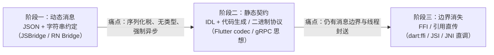

# 跨语言通信的通用设计

> 把模块四收束一下：RN Bridge 只是"跨语言通信"这个老问题的一个实例。抽出它的**设计空间**，再对照 WebView、Flutter、Electron——你会发现所有生态都走在同一条演化路径上，而 JSI 站在路径的尽头。

## 1. 跨语言通信的五要素

任何"语言 A 调语言 B"的机制都能拆成五个设计维度：

| 要素 | 问题 | 典型选项 |
|------|------|---------|
| 通道（transport） | 消息/调用怎么过去 | 队列、管道、socket、共享内存、直接函数调用 |
| 序列化（codec） | 数据怎么表示 | JSON、XML、二进制协议（protobuf/standard codec）、不序列化（引用/指针） |
| 线程封送（threading） | 谁执行、在哪执行、怎么等 | 固定线程 + 异步回调、同步阻塞、无锁直调 |
| 调用语义（semantics） | 同步还是异步、单向还是双向 | RPC（等待结果）、fire-and-forget、事件流 |
| 类型契约（contract） | 两边怎么对上接口 | 运行时约定（id + 顺序）、IDL/代码生成、动态 duck-typing |

**RN Bridge 的答案**：队列通道 / JSON / 固定线程异步 / 回调语义 / moduleID+methodID 运行时约定——每个维度都选了"最保守"的一档，于是五个维度的短板（异步、序列化税、无类型）它全占了。

## 2. 四个生态的同构对照

| | RN Bridge（旧） | WebView JSBridge | Flutter Platform Channel | Electron IPC | RN 新架构（JSI） |
|--|----------------|------------------|--------------------------|--------------|----------------|
| 通道 | 消息队列 | URL scheme / evaluateJS 注入 | 二进制消息通道（Dart 端端口） | Chromium Mojo | **C++ 函数表直调** |
| 序列化 | JSON 文本 | JSON 文本 | StandardMessageCodec（二进制） | Structured Clone | **不序列化（对象引用/HostObject）** |
| 线程 | 原生固定线程 | UI 线程 | Platform 线程（可配） | 独立进程 | 调用方线程直达 C++ |
| 语义 | 异步回调 | 异步回调 | 异步（可 await） | 异步 + invoke 同步壳 | **同步直调 + 异步自选** |
| 契约 | id 约定 | 字符串方法名 | 字符串方法名 + codec | 频道字符串 | **TS/Flow spec → Codegen 静态生成** |

观察三条规律：

1. **序列化逐级减负**：JSON 文本 → 二进制 codec → structured clone → 引用直传。数据表示越接近内存原貌，成本越低；
2. **契约逐级前移**：运行时字符串 → 运行时注册表 → 构建期 IDL 代码生成。类型检查从"线上炸"前移到"编译期炸"；
3. **通道逐级变薄**：队列 → 平台端口 → IPC 框架 → 纯虚函数表。中间层越薄，延迟与线程问题越少。

## 3. 演化路径：所有生态的同一个方向

- Flutter 的演化是旁证：Platform Channel 之外补了 `dart:ffi` 直接调 C——**高频通道下沉到 FFI，低频通道留在消息层**；
- Electron 的 Mojo 也是同一逻辑：高频的合成器消息走共享内存与二进制，JS 层才暴露宽松的 IPC API；
- RN 的选择最彻底：把"JS 与原生共享的运行时层"（C++）作为一等公民，JSI 是函数表，Fabric/TurboModules 是建在函数表上的系统（模块七）。

## 4. 设计你自己的跨语言通道：五问 checklist

当你在业务里要设计一个 JS↔Native（或任何 A↔B）通道时，按五要素顺序问：

1. **频率与体积**：高频小包还是低频大包？高频 → 考虑同步直调/原生闭环；大包 → 考虑引用共享（文件句柄、内存块）而非序列化；
2. **谁在等谁**：调用方能不能等？能等且被调方无死锁风险 → 同步；否则异步 + 明确的取消/超时语义；
3. **线程归属**：被调代码必须在哪个线程跑（UI？IO？）？封送策略（post / 队列 / 直接）由此决定；
4. **契约形态**：接口多稳定？稳定 → IDL 生成（模块七 04 Codegen 思想）；探索期 → 动态注册但保留升级路径；
5. **版本兼容**：两端能否同时升级？不能 → 契约里带版本号与能力协商（热更新场景见模块八 02）。

## 5. 回到 RN：本模块的完整拼图

- 01/02：Bridge 的结构（三队列、批量、注册与调用链）；
- 03：结构的成本量化（体积敏感 + 闭环洪泛）；
- 本篇：把 Bridge 放进通用设计空间——它的五个"保守选择"正是新架构逐项替换的清单：

| Bridge 的选择 | 新架构的替换 |
|---------------|-------------|
| 队列通道 | JSI 函数表（通道消失） |
| JSON | 对象引用 / 强类型 Props |
| 强制异步 | 同步直调 + 按需异步 |
| id 运行时约定 | Codegen 静态契约 |
| 固定线程封送 | 调用方线程直达 C++ |

## 小结

- 跨语言通信 = 通道、序列化、线程、语义、契约五要素，任何方案都是这五个维度上的取值组合；
- 四大生态（RN/WebView/Flutter/Electron）的演化方向一致：**序列化减负、契约前移、通道变薄**；
- JSI 站在路径尽头：不序列化、静态契约、同步直调——模块七将看到它如何长成完整架构；
- 设计自查永远从五问开始：频率体积 / 谁等谁 / 线程归属 / 契约形态 / 版本兼容。
