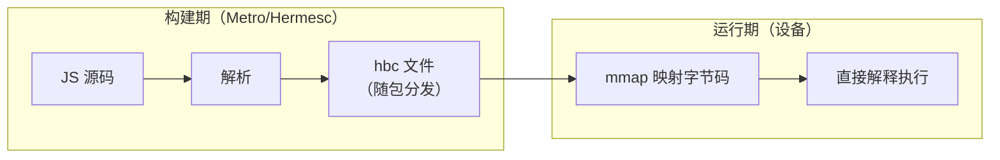
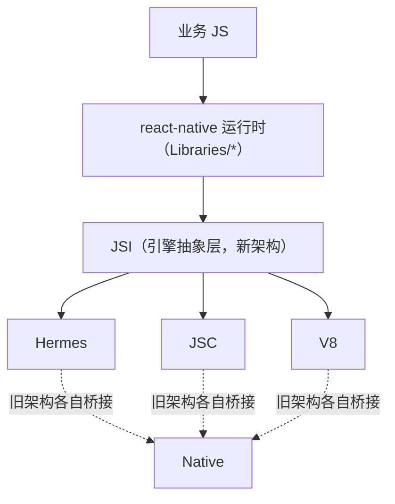

# JS 引擎对比与 Hermes 原理

> RN 历史上跑过三个引擎：JavaScriptCore（元老）、Hermes（亲儿子）、V8（可选件）。本篇讲三者取舍的底层逻辑，并拆开 Hermes"为什么快"的两个字：字节码。

## 1. 三个引擎一张表

| 维度 | JavaScriptCore | Hermes | V8（rn-v8） |
|------|---------------|--------|-------------|
| 来源 | WebKit | Meta 为 RN 定制 | Chrome / Node |
| 执行方式 | 解释 + JIT | 纯解释（AOT 字节码） | 解释 + JIT（移动端禁 JIT 分支） |
| 启动 | 慢：运行时解析源码 → 字节码 | 快：跳过解析，直接加载预编译 hbc | 中 |
| 包体 | 大（iOS 系统自带，Android 要打包 ~7MB） | 中（引擎小） | 大 |
| iOS 合规 | 系统内置，天然合规 | 合规（无 JIT） | 合规（禁 JIT 模式） |
| 调试 | Safari/CDP | Chrome DevTools（CDP） | Chrome DevTools |

选型主线：**iOS 用系统 JSC 零成本；Android 上 Hermes 几乎是无脑最优**——启动、内存、包体三赢，代价是没有 JIT，峰值计算性能略逊。

## 2. 为什么"预编译字节码"能赢

传统引擎启动三部曲（JSC 在设备上做的）：


源码解析是纯 CPU 开销，而且**每次启动都重复做**。Hermes 的思路：把 A、B、C 挪到**构建期**——`metro-code-transform` 在打包流水线里直接产出 hbc 字节码文件，设备端只做最后一步：



三个收益来源：

1. **跳过解析**：千模块的 bundle 解析时间直接归零；
2. **mmap 按需加载**：hbc 的函数表/字节码段可以被虚拟内存映射，用到的函数才真正载入物理内存——冷启动内存峰值显著降低；
3. **可共享**：只读字节码页多进程/多次启动可共享。

一个直观实验：把同一个 bundle 分别以源码与 hbc 形式加载，`RUN_JS_BUNDLE_START→END` 打点（模块二）通常差出数百毫秒到秒级（与模块数成正比）。

## 3. hbc 文件结构速览

```
┌────────────────────┐
│ Header（版本/Flags） │
├────────────────────┤
│ FunctionHeaders     │ ← 函数表：偏移、参数数、寄存器数
├────────────────────┤
│ StringTable         │ ← 字符串表（去重、可懒解析）
├────────────────────┤
│ ArrayBuffer 表      │
├────────────────────┤
│ Bytecode 段         │ ← 指令流，mmap 只读载入
└────────────────────┘
```

- 字节码版本（Bytecode Version）与 Hermes 运行时强绑定——**构建时的 hermesc 版本必须与运行时引擎兼容**，RN 版本升级时偶发的"Bytecode version mismatch"崩溃即来源于此。
- `hermes -dump-bytecode index.android.bundle` 可直接反汇编观察产物。

## 4. Hermes 的 GC：简而不慢

- 算法：Mark-Sweep（标记-清除）为主，**不采用 JS 引擎常见的分代式**（V8/JSC 的 generational GC）；
- 代价：对象晋升成本、GC 停顿特性不同；收益：实现简单、内存占用小、移动端内存预算友好；
- 增量与并发：新版 Hermes 引入 concurrent marking/sweeping 降低停顿；
- 与 Native 内存的关系：JS 对象持有原生资源（如 Image 引用）时，GC 时机决定原生内存释放时机——模块九内存篇再展开。

## 5. 引擎在架构中的位置



- 旧架构：每个引擎各写一套绑定（JSC 直接 C API、Hermes 走 NAPI 风格适配）；
- 新架构：**JSI 统一了引擎接口**，换引擎不再改桥——这是模块七 JSI 的伏笔。

## 小结

- 引擎选型的主轴是启动性能与 iOS 合规：JIT 不是移动端的好朋友，预编译字节码才是。
- Hermes 快的本质：把"解析源码"从每次启动挪到构建期一次完成 + mmap 按需载入。
- JSI 把引擎差异收敛到一层 C++ 抽象，理解它就理解了新架构的地基。
