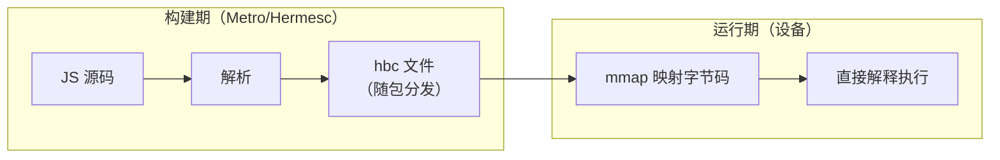
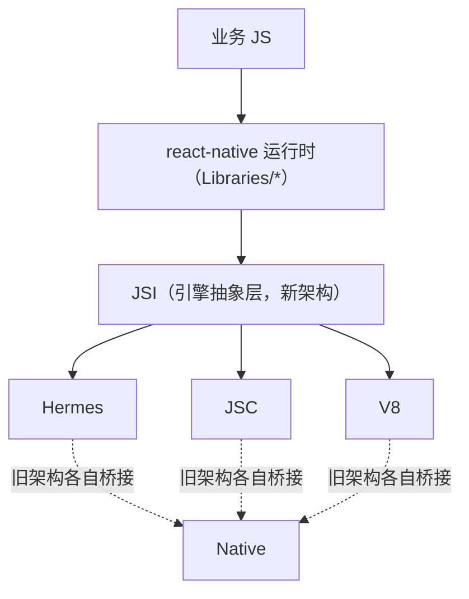
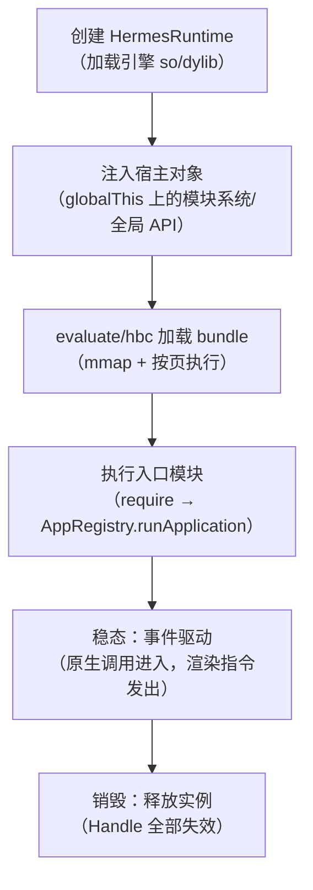

# JS 引擎对比与 Hermes 原理

> RN 历史上跑过三个引擎：JavaScriptCore（元老）、Hermes（亲儿子）、V8（可选件）。本篇讲三者取舍的底层逻辑，并拆开 Hermes"为什么快"的两个字：字节码。

## 1. 三个引擎一张表

| 维度 | JavaScriptCore | Hermes | V8（rn-v8） |
|------|---------------|--------|-------------|
| 来源 | WebKit | Meta 为 RN 定制 | Chrome / Node |
| 执行方式 | 解释 + JIT | 纯解释（AOT 字节码） | 解释 + JIT（移动端禁 JIT 分支） |
| 启动 | 慢：运行时解析源码 → 字节码 | 快：跳过解析，直接加载预编译 hbc | 中 |
| 包体 | 大（iOS 系统自带，Android 要打包 ~7MB） | 中（引擎小） | 大 |
| iOS 合规 | 系统内置，天然合规 | 合规（无 JIT） | 合规（禁 JIT 模式） |
| 调试 | Safari/CDP | Chrome DevTools（CDP） | Chrome DevTools |

选型主线：**iOS 用系统 JSC 零成本；Android 上 Hermes 几乎是无脑最优**——启动、内存、包体三赢，代价是没有 JIT，峰值计算性能略逊。

### 1.1 一分钟选型史（为什么是这三家）

- **JSC 是起点**：RN 诞生时选 WebKit 的 JSC 做引擎，iOS 系统自带、零包体；Android 系统没有公开的 JSC，只能随包带一个（体积可观），且版本与 iOS 系统内建的并不对齐；
- **Hermes 是反思**：Meta 面向"App 里的 JS"重写了执行模型——App 启动是低频、重前端的行为，解析/编译时间比峰值吞吐更重要，于是砍掉 JIT、把编译搬进构建期（2019 年开源；RN 0.70 起 Android 模板默认启用，iOS 稍后跟进默认开启）；
- **V8 是外挂**：社区通过 react-native-v8 把 V8 带进 RN，靠快照与禁 JIT 配置适配移动端，适合有 V8 生态诉求（如特定 Inspector/兼容性）的团队，属于小众选择。

一条隐藏主线：**三家都在向"无 JIT 的移动形态"收敛**——JSC 在 iOS 受系统约束、V8 在移动端开禁 JIT 分支、Hermes 干脆不做了。这不是巧合，是平台政策与 App 场景共同筛出来的结果（03 篇展开三重约束）。

### 1.2 名词对齐：引擎、运行时、Runtime

读文档时最容易混淆的四个词，本站口径统一如下：

| 词 | 含义 | 例子 |
|----|------|------|
| 引擎（engine） | 执行 JS 的语言实现（产品名） | JSC、Hermes、V8 |
| 运行时环境（runtime env） | 引擎 + 宿主注入 + 框架的整套执行环境 | "RN 运行时" |
| Runtime（JSI 接口） | JSI 定义的 C++ 抽象类，引擎的统一句柄 | `jsi::Runtime`、`HermesRuntime` |
| 引擎实例 | 一个进程里可存在多个引擎实例/上下文 | 主 JS 线程一个；Reanimated 在 UI 线程另起一个 |

最后一条值得展开：**"一个引擎"不等于"一个实例"**。Reanimated 的 worklet 就是跑在 UI 线程的另一个 Hermes 实例上（模块六 04）——所以"JS 单线程"更准确的说法是"**一个实例内单线程**"，多实例间的数据要走共享值而不是普通 JS 引用（[JSI 原理](../rn-新架构/01-JSI原理.md)）。

## 2. 为什么"预编译字节码"能赢

传统引擎启动三部曲（JSC 在设备上做的）：


源码解析是纯 CPU 开销，而且**每次启动都重复做**。Hermes 的思路：把 A、B、C 挪到**构建期**——`metro-code-transform` 在打包流水线里直接产出 hbc 字节码文件，设备端只做最后一步：



三个收益来源：

1. **跳过解析**：千模块的 bundle 解析时间直接归零；
2. **mmap 按需加载**：hbc 的函数表/字节码段可以被虚拟内存映射，用到的函数才真正载入物理内存——冷启动内存峰值显著降低；
3. **可共享**：只读字节码页多进程/多次启动可共享。

一个直观实验：把同一个 bundle 分别以源码与 hbc 形式加载，`RUN_JS_BUNDLE_START→END` 打点（模块二）通常差出数百毫秒到秒级（与模块数成正比）。

### 2.1 mmap 的三重红利展开

"mmap"这个词值得多看一眼，它一次带来三个层级的收益：

| 层级 | 机制 | 谁受益 |
|------|------|--------|
| 页面级懒加载 | 文件映射进虚拟地址空间，**访问到哪页才缺页加载哪页**——启动只触碰入口模块的页 | 冷启动内存峰值 |
| 页缓存共享 | 同一只读文件在 OS 页缓存中只有一份，二次启动直接命中 | 二次启动速度与整机内存 |
| 权限级安全 | 字节码段以只读映射，运行期不可写——顺带杜绝了"运行时改字节码"类问题 | 稳定性 |

对照理解：JSC 的源码文本也可以 mmap 读入，但**解析产物（AST/字节码）必须每次在堆上重建**——省掉的只是读文件，省不掉的是 CPU。Hermes 赢在"产物本身就是文件"。

### 2.2 三引擎启动步骤对照

| 步骤 | JSC | Hermes | V8（rn-v8 快照形态） |
|------|-----|--------|---------------------|
| 读入 | 源码文本 | hbc（mmap 只读） | 快照 + 源码 |
| 解析 | 每次启动全量解析 | 构建期已完成 | 快照免去大部分初始化 |
| 生成字节码 | 运行时逐段生成 | 无需（直接用） | 运行时按需生成 |
| 首帧前开销 | 与代码量线性 | 与入口模块相关（懒页） | 介于两者 |
| 峰值执行 | JIT 热身 | 恒定解释器 | 快照 + 分层编译（移动端受限） |

这张表也解释了"为什么 Hermes 在低端机优势更明显"：低端机的瓶颈是 CPU 与 IO 带宽，恰好是"预编译 + 懒加载"优化掉的那两段。

### 2.3 hermesc 在打包流水线的哪一步

"Hermes"实际是两个东西：**构建期编译器 hermesc** 与**运行期引擎**。前者嵌在 Metro 流水线里（`metro-react-native-babel-transformer` 之后的字节码转换阶段），链条如下：


验证产物形态的两个动作：

```bash
# 直接反汇编看字节码（顺带确认这真的是 hbc 而不是 JS 文本）
hermes -dump-bytecode index.android.bundle | head -40

# 工程侧确认开关（Android）
# gradle.properties: hermesEnabled=true
```

注意第 3、4 步的顺序关系：**Metro 仍然产出完整的 JS bundle 文本，hermesc 把它整体编译成 hbc**——所以"Tree Shaking/模块裁剪"这类包体优化发生在 hermesc 之前（模块八 04），hermesc 只负责形态转换，不会替你删代码。

## 3. hbc 文件结构速览

```
┌────────────────────┐
│ Header（版本/Flags） │
├────────────────────┤
│ FunctionHeaders     │ ← 函数表：偏移、参数数、寄存器数
├────────────────────┤
│ StringTable         │ ← 字符串表（去重、可懒解析）
├────────────────────┤
│ ArrayBuffer 表      │
├────────────────────┤
│ Bytecode 段         │ ← 指令流，mmap 只读载入
└────────────────────┘
```

- 字节码版本（Bytecode Version）与 Hermes 运行时强绑定——**构建时的 hermesc 版本必须与运行时引擎兼容**，RN 版本升级时偶发的"Bytecode version mismatch"崩溃即来源于此。
- `hermes -dump-bytecode index.android.bundle` 可直接反汇编观察产物。

### 3.1 每个分区为什么存在

| 分区 | 存在的理由 | 与启动的关系 |
|------|-----------|-------------|
| Header | 版本/flags/各表偏移——**先读它才知道其余怎么映射** | 必读，第一页 |
| FunctionHeaders | 跳转到任何函数只需要查表，不需要线性扫描 | 按需分页 |
| StringTable | 全部字符串字面量去重集中存放——解释器取字符串是最高频操作之一 | 热区常驻 |
| RegExp Table | 正则预编译信息，避免运行时重编 | 用到才加载 |
| Bytecode 段 | 指令流本体 | 按执行路径懒加载 |

一个常被忽略的推论：**字符串表 + 函数表的设计，使 hbc 天然适合"从中间开始执行"**——require 哪个模块就触碰哪些页。这与 JSC"必须先跑完全局解析"形成结构差，也是 03 篇讲懒加载路径的文件层依据。

## 4. Hermes 的 GC：简而不慢

- 算法：Mark-Sweep（标记-清除）为主，**不采用 JS 引擎常见的分代式**（V8/JSC 的 generational GC）；
- 代价：对象晋升成本、GC 停顿特性不同；收益：实现简单、内存占用小、移动端内存预算友好；
- 增量与并发：新版 Hermes 引入 concurrent marking/sweeping 降低停顿；
- 与 Native 内存的关系：JS 对象持有原生资源（如 Image 引用）时，GC 时机决定原生内存释放时机——模块九内存篇再展开。

GC 的完整深潜（Hades 的并发标记、segment 堆、写屏障、Handle 体系）在[03 · Hermes 深潜：字节码与 GC](03-Hermes深潜：字节码与GC.md)。本篇只强调一个选型级差异：

| GC 维度 | 传统分代式（V8/JSC） | Hermes（Hades 之前/之外的主路径） |
|---------|---------------------|----------------------------------|
| 假设 | 大多数对象朝生夕死 → 新生代频繁小回收 | 不赌分配寿命 → 全堆标记清扫 + 并发削减停顿 |
| 内存开销 | 两个代 + 晋升拷贝的结构成本 | segment 平铺，结构开销小 |
| 适配场景 | 长运行服务（网页/Node） | 内存预算紧、启动密集的 App |

### 4.1 从 GC 差异推出的三个工程推论

不深入算法（03 篇负责），只讲选型级推论：

1. **分配密集型代码要节制**：不分代意味着没有"新生代即抛即收"的便宜路径，高频创建闭包/临时对象会直接抬高全堆标记频率——列表里每帧 new 大量临时对象在 Hermes 上更"疼"；
2. **长生命周期缓存相对友好**：标记清扫对"活得久"的对象没有分代晋升税，常驻缓存（路由表、翻译表）的 GC 成本主要在标记遍历，不在于"搬家"；
3. **GC 时机影响原生内存**：JS 侧引用图片/文件句柄时，原生资源的释放被 GC 排期绑架——显式置 null/换用显式释放 API 是与引擎协作的方式（模块九 04）。

## 5. 引擎在架构中的位置



- 旧架构：每个引擎各写一套绑定（JSC 直接 C API、Hermes 走 NAPI 风格适配）；
- 新架构：**JSI 统一了引擎接口**，换引擎不再改桥——这是模块七 JSI 的伏笔。

### 5.1 引擎不提供的东西：宿主注入清单

一个高频误解是"`setTimeout`/`fetch` 是引擎的功能"。**不是**。ES 引擎只提供 ECMAScript 语义（对象/函数/正则/Promise…），RN 里这些"看似标准"的 API 全部是**宿主注入**（初始化入口：`Libraries/Core/InitializeCore.js`）：

| API | 实际提供者 | 背后机制 |
|-----|-----------|---------|
| `setTimeout/setInterval/clearTimeout` | JSTimers 模块 | 原生计时器线程 → 过桥回调 JS（模块三 02） |
| `console.log` | 宿主 Console 实现 | 转 native 日志/调试通道 |
| `XMLHttpRequest / fetch` | RN 的 XHR 实现（SetUpXHR） | 底层网络走原生模块 |
| `performance.now()` | 宿主实现 | 取原生时钟 |
| `require()` | Metro 打包运行时 | bundle 内的模块注册表 |
| `global.errorHandler` / ErrorUtils | 宿主全局 | 崩溃收集链路的挂点 |

这个视角的工程价值：**这些 API 的行为 = 引擎语义 + 宿主实现的叠加**。比如 `setTimeout(fn, 0)` 在 RN 里绝不是"下一个 tick"——它要过一次原生计时与回调链路（模块三 04 详解）；`fetch` 的进度、超时行为也取决于 RN 的 XHR 层而非"浏览器的 fetch"。跨端复用 JS 代码时，这类"名字相同、身体不同"的 API 是头号差异源。

### 5.2 引擎与调试的关系（容易测错的地方）

- **旧式远程调试**（Remote JS Debugging）把 JS 拿到 Chrome 里跑在 V8 上——这种模式下测出来的"性能"与设备上的 Hermes **毫无关系**，只有逻辑正确性可参考；
- **新一代调试器**（React Native DevTools，CDP 协议原地调试）在设备引擎上执行断点与检查，行为与线上一致，但断点/检查本身仍有开销；
- 结论：**性能结论永远来自 release 或 profile 构建**（模块九 01 的纪律），任何 dev 形态的数字都只能用于功能验证。

### 5.3 引擎实例的一生

把引擎放进启动时间线（详细启动链路在模块二），一个 Hermes 实例的生命周期是：



两个关键点：

1. **注入发生在执行业务代码之前**——所以业务代码从第一行起就能用 setTimeout/require，这是 5.1 清单的时序保证；
2. **销毁是全局失效事件**：实例回收后，原生侧若还持有旧实例的 Handle/函数引用再调用就是未定义行为——混合开发里"重载 JS"（热更新、调试 reload）时偶发的崩溃多与旧引用残留有关（模块八 02 的热更新生命周期会接上这条线）。

## 6. 被低估的 JSC：三笔隐藏成本

"iOS 系统自带 JSC 零成本"只对包体成立。JSC 路线还有三笔隐性账：

| 成本 | 机制 | 表现 |
|------|------|------|
| 版本错位 | iOS 用系统 JSC（随 OS 走），Android 随包带固定版本 JSC | 同一份业务代码在两端引擎语义有差异；依赖新 ES 特性时两端行为不一致 |
| 解析税 | 每次启动都要全量 parse bundle（第 2 节三部曲） | 冷启动随代码量线性劣化，低端机尤其明显 |
| 双实现维护 | 引擎注入层（Runtime 绑定）历史上有 JSC 专用路径 | 工程升级 RN 时的兼容面更大 |

第三笔账正在被 JSI 抹平——新架构的引擎抽象让"哪个引擎"退化为配置问题。但前两笔是 JSC 模型自带的，只能靠减小 bundle（模块八 04）缓解。这也回答了一个常见疑问：**"iOS 要不要也开 Hermes"**——官方模板已默认开启，理由就是这三笔账在 iOS 上同样存在，只是被"系统自带"的表象盖住了。

## 7. 选型评估方法论：怎么自己下结论

与其背"谁更快"，不如掌握评估框架。给业务选引擎时按五步走：

1. **定场景权重**：启动敏感（电商/内容）、稳态交互（工具类）、计算密集（图表/加密）三类业务，对启动/CPU 峰值/内存的权重完全不同；
2. **看硬约束**：iOS 合规（JIT 禁令）与包体预算先筛掉不可选项；
3. **定指标**：冷启动到首帧、稳态内存、CPU 峰值任务耗时、包体增量——四项都可用平台工具采集（模块二打点 + 模块九工具箱）；
4. **同基准对比**：同一份业务 bundle，切换引擎开关（Android 的 `hermesEnabled` gradle 属性 / iOS 的 Pod 配置）出两个包，同设备各测多轮取中位数；
5. **看生态**：调试器、Profiler、崩溃聚合平台对三家的支持度（Hermes 生态已是 RN 默认路径的事实标准）。

红线只有一条：**不用别人的数字替自己下结论**——设备分布、代码形态不同，结论可能反转（模块四 03 同款纪律）。

### 7.1 权重矩阵示例（说明性，非推荐值）

三类典型业务的权重倾向（供定制自己的矩阵）：

| 业务形态 | 启动 | 峰值 CPU | 稳态内存 | 包体 |
|---------|------|---------|---------|------|
| 电商/内容（首帧即转化） | 高 | 中 | 高 | 中 |
| 工具/效率（长驻前台） | 中 | 中 | 高 | 低 |
| 图表/处理密集 | 中 | 高 | 中 | 中 |

矩阵的用法不是打分求和，而是**先找"一票否决"项**（如包体预算超了直接出局），再在候选里看综合——顺序错了容易选出"总分高但不满足硬约束"的方案。

## 8. 常见误区

| 误区 | 事实 | 一句话纠正 |
|------|------|-----------|
| "没 JIT 就一定慢" | App 场景峰值热循环少，解释器 + AOT 常态更快到达可用 | 快慢要看"到首帧"，不是单循环峰值 |
| "Hermes 到处默认，不用管了" | 旧工程/特殊配置仍可能关着；构建参数要与包体策略核对 | 用 `HermesInternal` 全局对象的存在性验证 |
| "dev 调试时的性能代表 Hermes" | 旧式远程调试跑在 Chrome V8 | 性能只在 release/profile 下测 |
| "`setTimeout` 是引擎提供的" | 全部宿主注入（5.1 清单） | 引擎只管 ECMAScript |
| "换引擎只是换个依赖" | 旧架构绑定层随引擎走；新架构 JSI 统一但仍有细节差异 | 换引擎 = 重测全链路 |
| "hbc 与 JS 产物可混用" | 字节码版本与引擎强绑定 | 升级必须整包重出 |
| "dev 正常 release 崩，是代码 bug" | dev 是 JS 文本、release 是 hbc，形态都不同 | 先查产物配对，再查代码（8.1） |
| "引擎崩栈直接可读" | hbc 栈是字节码偏移，需 source map 符号化 | 发布流程归档 source map（11） |

### 8.1 两个经典故障走查

**故障一：升级 RN 后启动即崩（Bytecode version mismatch 类报错）。** 归因：hbc 的字节码版本随 hermesc 演进，新引擎拒载旧字节码（或反之）。走查顺序：确认 bundle 是否随 RN 版本一起重新构建（热更新通道里的旧包是高发源头，模块八 02）；确认构建机 hermesc 与 App 内引擎版本一致。修法就是"整包重出"，没有兼容模式。

**故障二：dev 正常、release 白屏/报错。** 归因方向之一：dev 的 bundle 是 JS 文本（支持 source map 与热载），release 才编译为 hbc——**两端跑的形态根本不同**。某个依赖里的实验性语法或 babel 插件产物若 hermesc 不接受，就只在 release 暴露。走查：本地用 release/profile 构建复现；用 `hermes` CLI 单独编译可疑 bundle 看报错行。

两个走查共同的教训：**引擎问题先查"产物形态与版本配对"，再查代码逻辑**——dev 与 release 不是同一个程序。

## 9. 动手实验

1. **验证引擎身份**：`typeof HermesInternal !== 'undefined'` 区分是否 Hermes；配合 `HermesInternal.getRuntimeProperties()`（可用时）查看字节码版本等运行时属性；
2. **两种产物对比**：gradle 里切 `hermesEnabled` 出两个包，用模块二的启动打点比较 `RUN_JS_BUNDLE_START→END`（多轮取中位数，同设备）；
3. **看一眼字节码**：`hermes -dump-bytecode` 观察函数表与字符串表规模，找一两个业务函数对应到指令段（03 篇有读法）；
4. **宿主注入验证**：在 JS 里 `console.log(typeof setTimeout, typeof fetch, typeof HermesInternal)`，再用 `Object.getOwnPropertyDescriptor(globalThis, 'setTimeout')` 看它是否可枚举/可写——感受"宿主注入"与"语言内置"在属性形态上的区别。

## 10. 与本模块其他篇目的分工

- 本篇：为什么是这三个引擎、Hermes 赢在哪、怎么选怎么验；
- [02 · 四线程模型](02-四线程模型.md)：引擎（JS 线程）与另外三条线程的协作全景；
- [03 · Hermes 深潜](03-Hermes深潜：字节码与GC.md)：hbc 机器级细节、无 JIT 的三重约束、Hades GC 全流程；
- [04 · 同步与异步的边界](04-同步与异步的边界.md)：引擎的任务模型（微任务/rAF）在 RN 里的真实形态。

一句话分工：**本篇管"选"，02 管"跑在哪"，03 管"里面什么样"，04 管"什么时候回话"**。

## 11. 三引擎工具链对照（选型的第四张表）

前两张表看运行时指标，这张表看**可运维性**——出问题时有没有手段看进去，往往比快慢更影响团队体验：

| 能力 | JSC | Hermes | V8（rn-v8） |
|------|-----|--------|-------------|
| 断点调试 | Safari（iOS）/ CDP 方案 | Chrome DevTools（CDP） | Chrome DevTools |
| CPU Profile | 生态方案有限 | 采样 profiler + DevTools 火焰图 | DevTools 完整 |
| 堆快照 | 有限 | CDP heap snapshot（分配视图） | DevTools 完整 |
| 产物检查 | JS 文本直接看 | `hermes`/`hbctool` 反汇编 | 快照/文本 |
| 崩溃栈符号化 | source map | source map（字节码偏移 → 源码） | source map |

两个实操要点：

1. **hbc 崩溃栈必须配对构建时的 source map** 才能还原到源码行——线上崩溃采集要连 source map 一起归档（发布流程没归档 source map 是常见事故）；
2. 引擎调试能力都以 dev/debuggable 构建为前提，**线上只能靠崩溃报表与埋点**，设计可观测性时要按"无调试器"假设（模块九 01）。

另一个容易忽视的差异：**采样 profiler 会轻微改变时间分布**（采样间隔内的事件被聚合），对比引擎时 profile 数据用于找热点，不用于对比绝对耗时——绝对耗时回到 release 打点。

## 自测题（答不上就回读对应小节）

1. 三引擎在"执行方式/启动/包体/iOS 合规"上的差异各是什么？（→ 1）
2. 为什么三家都向"无 JIT 移动形态"收敛？（→ 1.1 / 03 篇）
3. mmap 带来的三重红利分别是什么？JSC 为什么吃不到？（→ 2.1）
4. hbc 各分区为什么这么设计？"从中间开始执行"依赖哪些分区？（→ 3.1）
5. setTimeout/console/fetch 分别由谁提供？这个视角对跨端复用代码有什么意义？（→ 5.1）
6. 为什么旧式远程调试测不出 Hermes 性能？（→ 5.2）
7. JSC 的三笔隐藏成本是什么？"iOS 零成本"对哪个维度成立？（→ 6）
8. 给业务选引擎的五步是什么？红线是什么？（→ 7）
9. "一个引擎"等于"一个实例"吗？反例是谁？（→ 1.2）
10. hermesc 在 Metro 流水线的哪一步？它会不会帮你删代码？（→ 2.3）
11. hbc 的线上崩溃栈为什么依赖构建期文件？依赖哪个文件？（→ 11）
12. 引擎实例销毁时，原生侧残留引用会导致什么？（→ 5.3）

## 小结

- 引擎选型的主轴是启动性能与 iOS 合规：JIT 不是移动端的好朋友，预编译字节码才是。
- Hermes 快的本质：把"解析源码"从每次启动挪到构建期一次完成 + mmap 按需载入。
- JSI 把引擎差异收敛到一层 C++ 抽象，理解它就理解了新架构的地基。
- 引擎只提供 ECMAScript 语义，宿主 API 全靠注入——性能与行为都要"引擎 × 宿主"两层归因。
- 工具链与可运维性是第四张选型表；hbc 的线上崩溃栈依赖构建期 source map 归档。
- 引擎、运行时、Runtime（JSI）、实例是四个不同的词；"JS 单线程"精确说是"单实例内单线程"。
