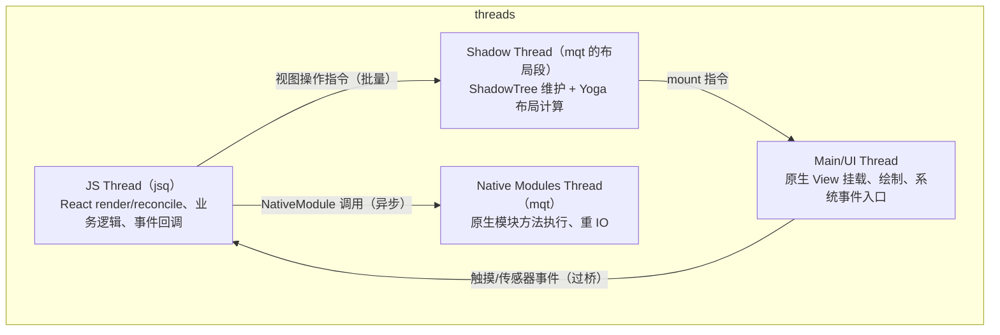
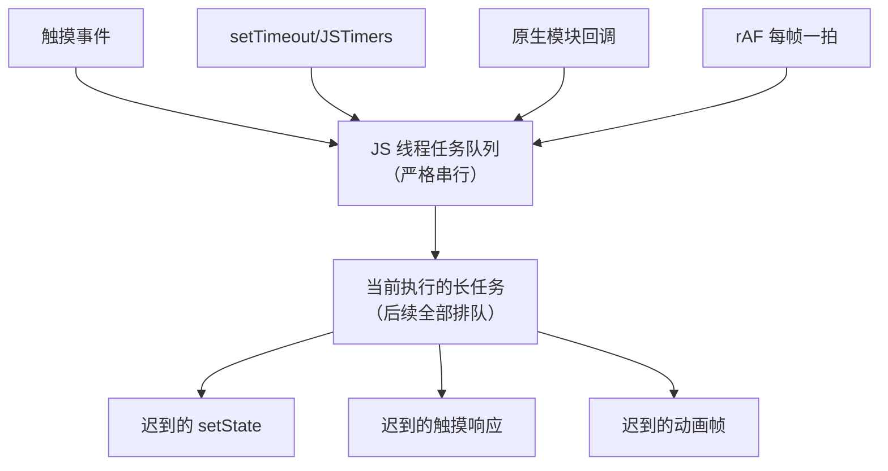
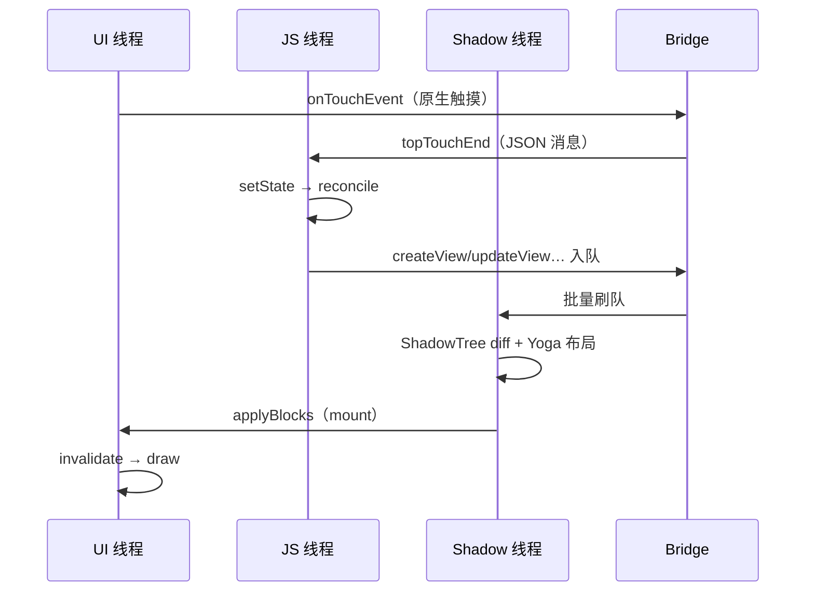

# 四线程模型

> RN 不是"JS 单线程跑一切"：渲染指令的生产、布局计算、原生调用各占一条线程。**做任何性能归因前，先判断问题发生在哪条线程**——这是模块九方法论的基石。

## 1. 四条线程一张图



> 说明：不同资料对线程命名口径不一。Android 侧的 `NativeModulesQueueThread`（mqt）同时承担原生模块执行；Shadow 布局在旧架构由 `NativeModulesQueueThread` 上的布局段/独立布局队列处理，iOS 侧为 `_jsThread` + GCD 队列组合。**重要的是职责划分，不是线程名字。**

### 1.1 线程的诞生与真名（trace 里认人用）

线程不是凭空存在的，它们由 RN 的"实例"对象创建，生命周期也随实例走：

| 职责 | Android 真名/来源 | iOS 对应物 | 在 trace 里找 |
|------|------------------|-----------|--------------|
| JS 线程 | `mqt_js`（CatalystInstanceImpl 创建的 HandlerThread） | RCTBridge 的 JS 线程 | `mqt_js` / js 相关泳道 |
| 原生模块线程 | `mqt_native_modules`（同上） | 模块方法队列（默认共享串行队列） | `mqt_native_modules` |
| Shadow/布局段 | 寄居于上述队列/独立布局队列（版本有差异） | shadow queue（RCTUIManager 的串行队列） | 模块线程上的 UI 段 |
| UI 线程 | 进程主线程 | 主线程 | 包名/main 泳道 |

三件事由这张表直接推出：

1. **线程随 CatalystInstance/bridge 重建**：调试 reload、某些混合场景会销毁重建实例——线程也换了一批，长时间采集中看到"线程换了"不代表异常；
2. **模块线程是共享单队列**（细节见 2.5）：任何模块的慢方法都会拖住其他模块；
3. **trace 认线程靠名字**，但版本与架构（旧/新）会改名——归因时先确认当前架构形态（模块九 05 的线程泳道表）。

### 1.2 消息怎么在线程间流动

四条线程之间没有共享可变状态，全部靠**投递**（这是理解一切"等待"的钥匙）：

| 边界 | 机制（Android） | 机制（iOS） |
|------|----------------|-------------|
| JS → Shadow/模块 | Bridge 刷队（JSON 批） | 同左（bridge 分发到队列） |
| Shadow → UI | 视图操作批 post 到主线程 Handler | dispatch_async 到主队列 |
| UI → JS | 原生调用 `callFunctionReturnFlushedQueue`（模块四 01） | 同左 |
| 任意 → JS | 一切进入 JS 线程的调用都串行排队执行 | 同左 |

最后一条最重要：**JS 线程是单入口队列**——触摸事件、定时器回调、原生模块回调、rAF，全都在同一个队列里排队。任何一个长任务都会让后面的所有入口迟到，这就是"点了没反应"的物理形态。

把这张"单入口"画出来：



注意它**不是优先级队列**（旧架构下）：触摸事件不会"插队"到长任务前面——这正是"JS 线程忙 → 手感全卡"的结构性原因，也是新架构引入优先级调度要修复的核心问题（第 5 节）。

## 2. 各线程的职责与"守则"

### 2.1 JS 线程：大脑

- 跑 React reconciler、业务代码、Promise/微任务、定时器；
- **守则**：任何长任务（同步计算、大 JSON）都会冻结 UI 更新——因为渲染指令由它生产。表现为"JS 线程掉帧"。

典型掉帧代码形态：

```js
// ① 大同步计算：一次循环吃掉整帧预算
const result = hugeArray.map((x) => expensive(x));

// ② 大 JSON 同步序列化/解析
const parsed = JSON.parse(megaJsonString);

// ③ 同步加密/哈希（纯 JS 实现）
const digest = sha256(bigString);
```

共同特征：**单次调用栈占用过长**——不是"总 CPU 高"，而是"一口气的栈太深"。修法三板斧：分帧（rAF 切片）、下沉（重活进原生/Worker 形态）、缓存（避免重复算）。

### 2.2 Shadow/布局线程：绘图员

- 维护 ShadowTree，执行 Yoga `calculateLayout`；
- **守则**：布局计算量 ∝ 树的复杂度。巨型 Flex 嵌套在这里塌方，表现为"布局掉帧"。

高发场景与信号：深层嵌套改约束（键盘弹起时容器高度动画）、超长列表一次性挂载（首批建树+布局）、文本测量风暴（动态文本频繁变化）。判别特征：JS 线程与 UI 线程都不满，但帧还是丢——问题在"中间那条"（Yoga 机制见[模块五 02 · Yoga 布局引擎](../rn-渲染原理/02-Yoga布局引擎.md)）。

### 2.3 Native Modules 线程：苦力

- 执行 `@ReactMethod` 方法体（旧架构）、重 IO（网络、文件）；
- **守则**：方法里做重活没问题（这正是它的意义），但**回调回 JS 又要过桥**——长链路 = 长延迟。

### 2.4 UI 线程：画笔

- 原生 View 的 create/layout/draw、系统输入事件的第一站；
- **守则**：任何被 post 到主线程的重活（包括 RN 的 mount 批操作过大）都直接掉帧，表现为"UI 线程掉帧"，最接近"原生卡顿"体感。

高发场景：大批量挂载（首屏/切页）、LayoutAnimation 应用、业务原生代码在主线程做 IO/解码、以及**别的库的主线程回调**（RN 只是主线程的住户之一，不是唯一——归因别只盯 RN）。

### 2.5 模块线程的隐藏属性：共享串行队列

旧架构一个反直觉的事实：**所有原生模块（默认）共享一条串行队列**。含义：

| 现象 | 原因 |
|------|------|
| A 模块慢方法执行中，B 模块的调用排队等待 | 同一条 mqt 串行执行 |
| 某个模块一个 100ms 的同步 IO，拖慢所有模块回调 | 同上 |
| iOS 上某模块方法可以不排队 | iOS 支持 per-module `methodQueue`（实现 `-methodQueue` 返回自定义队列） |
| Android 旧架构模块想换线程 | 只能在方法体内部再 post（执行线程仍是 mqt） |

工程推论：**把"必须快"的模块与"天然慢"的模块隔离**（iOS 用 methodQueue；Android 把慢活再丢到自建线程池，尽快归还 mqt）；排查"回调总是慢半拍"时，先看看队列里有没有别的模块在搬砖（模块四 03 的 spy 能看到排队延迟）。

### 2.6 四线程总表：职责 × 产物 × 归属

| 线程 | 干什么 | 产出什么 | 不该干什么 | 掉帧时的第一嫌疑 |
|------|--------|---------|-----------|-----------------|
| JS | render/reconcile/业务/微任务 | 视图指令、模块调用 | 长同步任务、大 JSON | reconcile 风暴、长任务 |
| Shadow | 影子树维护 + Yoga | 布局结果（x/y/w/h） | ——（它只做这两件事） | 深树、文本测量、大批建树 |
| mqt | 模块方法执行 | IO 结果 → 回调消息 | 在方法里同步等别的线程 | 共享队列积压 |
| UI | 挂载/绘制/事件入口 | 像素 | 任何重活 | mount 批过大、业务主线程代码 |

这张表的用法：出现掉帧先在心里过一遍五列——**每条线程"不该干什么"就是它掉帧的原因候选**。

## 3. 一次点击-更新-渲染的跨线程时序



数一数跨线程/跨边界次数，就能理解为什么一次交互的端到端延迟天然有 1–2 帧的"底数"。

### 3.1 逐步拆表：七次跳转，各等什么

| 跳 | 从 → 到 | 携带什么 | 等待来源 |
|----|---------|---------|---------|
| 1 | UI → JS | 触摸事件（JSON） | JS 队列里前序任务清空 |
| 2 | JS 内部 | reconcile + commit | 本帧 JS 计算 |
| 3 | JS → Shadow | 视图指令批 | 批量窗口 + 队列 |
| 4 | Shadow 内部 | 影子树更新 + 布局 | 树复杂度 |
| 5 | Shadow → UI | 视图操作批 | 帧信号（下一拍） |
| 6 | UI 内部 | mount + 绘制 | 帧预算 |
| 7 | UI → 用户视网膜 | 合成上屏 | vsync |

每一跳都是一次"排队"——**总延迟 ≈ Σ(各跳的服务时间 + 排队时间)**。优化无非两种：砍跳数（原生闭环，如 native driver/worklet）或减服务时间（更小的批/更浅的树）。

### 3.2 动手：数一次真实交互的跳数

给自己的 App 做一次"延迟解剖"（构造性练习，方法重于数字）：

1. 在按钮 onPress 里打第一个时间戳，在最终视图变化的 useEffect（或 onLayout）里打第二个；
2. 用 spy（模块四 03）记录这段时间窗口内的所有桥消息；
3. 对照 trace（模块九 05）标注每跳发生在哪条线程的哪个段；
4. 回答三个问题：哪一跳的服务时间最长？哪一跳的排队时间最长？有没有跳是可以砍掉的？

这个练习的价值：把"卡"从形容词变成**结构化的延迟账单**——之后任何优化（同步 API、原生闭环、新架构迁移）都能按"砍掉哪几跳"来计价。

## 4. 从线程模型推出三条经典结论

1. **动画为什么卡**：旧架构 `Animated` 的 JS 驱动值（每帧 setValue 过桥）同时压榨 JS 线程、Bridge、UI 线程；`useNativeDriver: true` 把插值下放原生，绕开前两者。
2. **交互中为什么不要 setState 风暴**：JS 线程被 reconcile 占满，触摸事件排队，表现为"点了没反应"。`InteractionManager.setDeadline` / `requestAnimationFrame` 分帧是把活拆回帧预算内的工具。
3. **原生模块阻塞的不是 UI**：`@ReactMethod` 默认跑 mqt——重活不会卡界面；但如果方法内部又 `runOnUIThread` 做重活，就把问题转移给了 UI 线程。

再补一条与定时器有关的推论：

4. **setTimeout 不是免费的"下一拍"**：定时器由 JSTimers 原生模块实现（原生计时 → 回调过桥进 JS 队列）。两层含义：高频定时器=高频跨线程流量；JS 线程忙时，到点的回调只能排队——**定时精度受 JS 队列深度影响**，做节拍敏感的逻辑（节流器、动画计时）要意识到这一点（模块三 04 展开任务边界）。

## 5. 新架构的线程变化

| 旧架构 | 新架构（Fabric） |
|--------|-----------------|
| 布局在 Shadow 线程异步完成 | commit 阶段同步完成布局（仍在独立线程上下文，但与提交原子化） |
| mount 固定批次 | mount 按优先级（lane）调度，交互响应优先 |
| JS→原生必须跨线程投递 | JSI 可同步直达 C++ 层（HostFunction 直接调用） |

线程还是那几条，但**跨线程的"等待点"大幅减少**——新架构性能收益的本质。

用等待点的视角把新旧架构再对一遍：

| 等待点 | 旧架构 | 新架构 |
|--------|--------|--------|
| 事件进 JS | Bridge 批量窗口 | JSI 事件直投（仍需在 JS 线程排队） |
| JS 更新影子树 | 发消息，等 Shadow 线程执行 | commit 事务内直达 C++（同调用栈） |
| 布局 | Shadow 段异步 | 事务内同步（可中断/插队） |
| mount | 等帧信号整批 | 按优先级调度上屏 |
| 原生模块调用 | 队列 + 回调 | TurboModule 直调（IO 类仍异步） |

注意"仍需排队"的那些格：**新架构消灭的是跨语言与部分跨线程等待，没有消灭"单线程队列"这个基本事实**——JS 线程忙，一切照旧排队。所以模块九的 JS 瓶颈优化在新架构下依然有效。

把新旧等待点画成对照图：


图里被拿掉的不是"排队"本身，而是**结构性的中间层等待**（批量窗口、过桥、独立影子队列、无优先级帧批）。这就是"新架构快"的机制化表述——不是任何一段代码跑得更快，而是**等待的段数变少了**。

## 6. 判读表：从现象到线程

| 现象 | 首先怀疑 | 验证手段 |
|------|---------|---------|
| 点了没反应，几百 ms 后连响应 | JS 线程长任务 | Perfetto 看 mqt_js 活跃段（模块九 05） |
| 滚动掉帧但 JS 不忙 | UI 线程（挂载/绘制）或布局段 | trace 三色归因 |
| 长列表进入瞬间卡 | UI 批挂载过大 / 布局段建树 | 分帧挂载实验 |
| 动画定期顿挫 | JS 驱动动画 / 定时器风暴 | 换 useNativeDriver 对照 |
| 回调总是"慢半拍" | mqt 队列积压（别的模块在忙） | spy 看调用间隔 |
| 白屏一闪后恢复 | 首批挂载超帧预算 | trace 首帧段 |

这张表是模块九 01 三步法的速查版——**先定线程，再定环节，最后才改代码**。

### 6.1 归因工具速查

| 问题 | 工具 | 见 |
|------|------|----|
| 哪条线程掉帧 | Perfetto/Systrace 泳道 | [模块九 05 · 性能剖析操作手册](../rn-性能优化原理/05-性能剖析操作手册.md) |
| JS 里面谁在跑 | Hermes 采样 Profiler / React Profiler | 模块九 01 |
| 桥上流量多大 | MessageQueue spy | [模块四 03 · Bridge 瓶颈量化](../rn-Bridge通信原理/03-Bridge瓶颈量化.md) |
| 挂载批多大 | trace 的 UI 段 + spy 的 createView 计数 | 模块五 03 |

## 7. 死锁与线程陷阱

跨线程模型自带几个经典陷阱，都是"等待成环"的变体：

1. **同步方法里要 UI 线程**：`isBlockingSynchronousCall = true` 的方法跑在 JS 线程，若它内部再 `runOnUIThread` 并同步等待结果——JS 线程等 UI 线程，而 UI 线程可能正在等 JS 线程的某个批次返回，环成立，死锁；
2. **模块方法里同步等 JS 回调**：方法在 mqt 执行，等待一个"将来由 JS 发出的回调消息"——而那条消息可能需要 mqt 空闲后才能处理的相关批次，环成立；
3. **JS 线程被原生长同步调用占住**：一切同步直调（含新架构 JSI 调用）都发生在 JS 线程的调用栈里——HostFunction 做重活等于把 JS 线程烧掉，与 JS 自己写长任务无异。

安全守则一句话：**同步路径上绝不"跨线程再等"**——要么全同步（单线程内完成），要么异步回调（不持锁等待）。这条守则在新架构下更重要（同步直调变多，误用面变大），模块七 03 的 TurboModules 会再遇到它。

用代码把陷阱 1 的形状钉住（反面示例，禁止模仿）：

```java
// 反例：同步方法里跨线程同步等待 —— 死锁候选
@ReactMethod(isBlockingSynchronousCall = true)
public WritableMap measureNow(int tag) {
    final WritableMap[] out = new WritableMap[1];
    uiHandler.post(() -> out[0] = doMeasureOnUI(tag)); // 投给 UI 线程
    while (out[0] == null) { /* 自旋等 UI 线程回填 */ }   // JS 线程被钉死在等待
    return out[0];
}
// 如果 UI 线程此刻恰好在等 JS 线程产出（如某批次的回调），环闭合 → 双方永久等待
```

正解二选一：异步回调（方法改 callback/Promise 形态，UI 线程量完再回）；或新架构下的同步 measure（JSI 事务内直接读布局缓存，无需跨线程等待）。

## 8. 常见误区

| 误区 | 事实 | 一句话纠正 |
|------|------|-----------|
| "RN 卡就是 JS 慢" | 四条线程各有掉帧形态 | 先归因线程，再谈原因 |
| "原生方法慢会卡 UI" | 默认在 mqt，不占 UI 线程 | 卡 UI 的往往是主线程挂载/绘制 |
| "模块之间互不影响" | 共享串行队列，一个慢全家等 | 慢活隔离到自建线程/自定义队列 |
| "setTimeout 精确" | 实现是原生计时+过桥回调，受队列深度影响 | 节拍敏感逻辑别依赖它 |
| "新架构没有排队了" | 只是等待点变少，单线程队列仍是基本事实 | JS 线程长任务照样卡一切 |
| "reload 后线程还在" | 线程随实例重建 | 长采集注意线程身份变化 |
| "死锁是玄学偶发" | 都是"同步等待成环"的结构问题 | 同步路径绝不跨线程再等（7） |

## 9. 两个优化案例的四线程走查（构造示例）

以下两个案例是**构造的说明性走查**（现象常见、路径真实，数字请以自己设备为准），演示"线程模型怎么用"。

### 案例 A：进页白屏一闪

现象：点击进新页，先白屏一拍再出内容。走查：

| 检查 | 结果（构造） | 结论 |
|------|-------------|------|
| JS 线程段 | 导航事件 → reconcile 整页组件树，活跃段较长但未跨多帧 | 有贡献但非唯一 |
| Shadow 段 | 一次大批建树（整页节点）+ 布局 | 单帧重活 |
| UI 线程段 | 一个超长的 mount 段正好压过 vsync | **主嫌疑** |

优化按嫌疑排序：首屏减节点/骨架屏（减 JS 与 Shadow 的活）、分帧挂载（拆 UI 批）、预取数据（减整体等待）。每个手段都对应一条线程的减负——这就是归因的意义。

### 案例 B：滚动长列表掉帧

现象：快速滚动时掉帧、静止时正常。走查：spy 显示 onScroll 高频下行，JS 段里 handler 触发 setState → 每帧 reconcile；Shadow 段文本测量密集。这是"闭环洪泛"（模块四 03）+ 布局压力的复合问题。手段分层：事件减频（节流/只在 snap 点 setState）、列表虚拟化与固定高度（模块九 02）、滚动驱动动画 native 化（砍 JS 环节）。

两个案例的共同套路：**现象 → 判读表定线程 → 对应段找证据 → 按线程减负排序出手**。把这套流程走熟，四线程模型就从知识变成工具。

## 10. 动手实验

1. **认线程**：release 构建抓一次 Perfetto，在泳道里找到（或确认找不到）`mqt_js`/`mqt_native_modules`——注意你当前架构版本的命名；
2. **制造 JS 掉帧**：按钮里同步跑一段大循环，开 Perf Monitor 观察"JS 线程帧率"与 UI 帧率的分道扬镳；
3. **制造 UI 批超载**：一次性 setState 渲染几百个节点，观察主线程的 mount 段；再改成分帧追加对比；
4. **观察队列积压**：写一个"慢模块"（方法内 sleep），连续调用它两次 + 立刻调用一个快模块，用时间戳验证快模块被排队；
5. **验证单入口排队**：JS 长任务运行时连续快速点按，观察响应是否"成串迟到"——单入口队列的直接体感。

## 自测题（答不上就回读对应小节）

1. 四条线程各自的"守则"与典型掉帧代码形态是什么？（→ 2.1–2.4）
2. Android/iOS 的线程真名是什么？为什么"职责比名字重要"？（→ 1.1）
3. JS 线程的入口为什么说是"单入口队列"？这对"点了没反应"意味着什么？（→ 1.2）
4. 模块线程"共享串行"带来什么现象？两端各自的隔离手段？（→ 2.5）
5. 一次点击-更新-渲染有哪七跳？每跳在等什么？（→ 3.1）
6. 哪些等待点被新架构消灭了？哪些没有被消灭？（→ 5）
7. 三种死锁/陷阱的"环"分别怎么构成？正解是什么？（→ 7）
8. 案例 A/B 的走查套路四步是什么？（→ 9）

## 小结

- 四线程：JS（大脑）、Shadow（绘图员）、Native Modules（苦力）、UI（画笔），职责比名字重要。
- 性能归因第一步永远是"哪条线程掉帧"，第二步才是"为什么"。
- 旧架构的跨线程等待点 = 新架构的优化清单。
- 线程间只靠投递、JS 是单入口队列、模块线程共享串行——这三个结构性事实比任何具体优化技巧更耐用。
- 优化案例的通用套路：现象定线程、证据定环节、按线程减负排序出手；新架构减少的是等待段数，不是排队本身。
- 动手实验五连（认线程/JS 掉帧/UI 批超载/队列积压/单入口排队）能把本篇每个结论变成亲手见过的事实。
