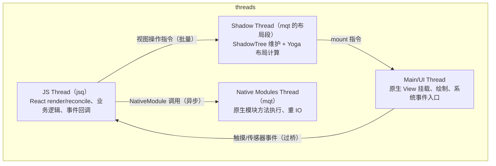
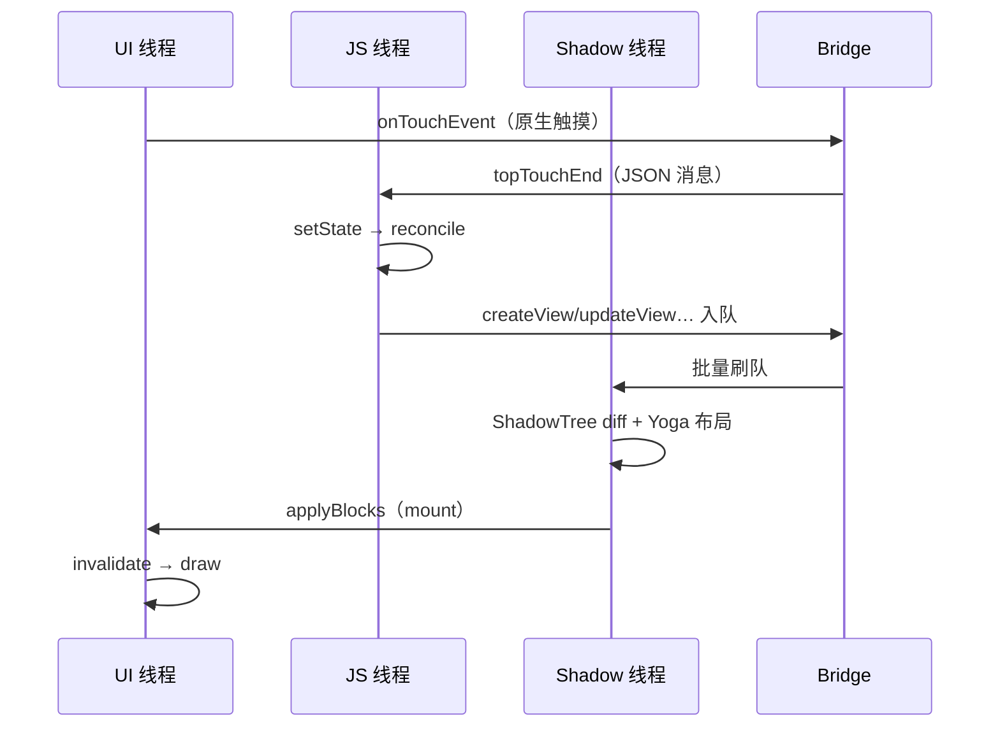

# 四线程模型

> RN 不是"JS 单线程跑一切"：渲染指令的生产、布局计算、原生调用各占一条线程。**做任何性能归因前，先判断问题发生在哪条线程**——这是模块九方法论的基石。

## 1. 四条线程一张图

> 说明：不同资料对线程命名口径不一。Android 侧的 `NativeModulesQueueThread`（mqt）同时承担原生模块执行；Shadow 布局在旧架构由 `NativeModulesQueueThread` 上的布局段/独立布局队列处理，iOS 侧为 `_jsThread` + GCD 队列组合。**重要的是职责划分，不是线程名字。**

## 2. 各线程的职责与"守则"

### 2.1 JS 线程：大脑

- 跑 React reconciler、业务代码、Promise/微任务、定时器；
- **守则**：任何长任务（同步计算、大 JSON）都会冻结 UI 更新——因为渲染指令由它生产。表现为"JS 线程掉帧"。

### 2.2 Shadow/布局线程：绘图员

- 维护 ShadowTree，执行 Yoga `calculateLayout`；
- **守则**：布局计算量 ∝ 树的复杂度。巨型 Flex 嵌套在这里塌方，表现为"布局掉帧"。

### 2.3 Native Modules 线程：苦力

- 执行 `@ReactMethod` 方法体（旧架构）、重 IO（网络、文件）；
- **守则**：方法里做重活没问题（这正是它的意义），但**回调回 JS 又要过桥**——长链路 = 长延迟。

### 2.4 UI 线程：画笔

- 原生 View 的 create/layout/draw、系统输入事件的第一站；
- **守则**：任何被 post 到主线程的重活（包括 RN 的 mount 批操作过大）都直接掉帧，表现为"UI 线程掉帧"，最接近"原生卡顿"体感。

## 3. 一次点击-更新-渲染的跨线程时序

数一数跨线程/跨边界次数，就能理解为什么一次交互的端到端延迟天然有 1–2 帧的"底数"。

## 4. 从线程模型推出三条经典结论

1. **动画为什么卡**：旧架构 `Animated` 的 JS 驱动值（每帧 setValue 过桥）同时压榨 JS 线程、Bridge、UI 线程；`useNativeDriver: true` 把插值下放原生，绕开前两者。
2. **交互中为什么不要 setState 风暴**：JS 线程被 reconcile 占满，触摸事件排队，表现为"点了没反应"。`InteractionManager.setDeadline` / `requestAnimationFrame` 分帧是把活拆回帧预算内的工具。
3. **原生模块阻塞的不是 UI**：`@ReactMethod` 默认跑 mqt——重活不会卡界面；但如果方法内部又 `runOnUIThread` 做重活，就把问题转移给了 UI 线程。

## 5. 新架构的线程变化

| 旧架构 | 新架构（Fabric） |
|--------|-----------------|
| 布局在 Shadow 线程异步完成 | commit 阶段同步完成布局（仍在独立线程上下文，但与提交原子化） |
| mount 固定批次 | mount 按优先级（lane）调度，交互响应优先 |
| JS→原生必须跨线程投递 | JSI 可同步直达 C++ 层（HostFunction 直接调用） |

线程还是那几条，但**跨线程的"等待点"大幅减少**——新架构性能收益的本质。

## 小结

- 四线程：JS（大脑）、Shadow（绘图员）、Native Modules（苦力）、UI（画笔），职责比名字重要。
- 性能归因第一步永远是"哪条线程掉帧"，第二步才是"为什么"。
- 旧架构的跨线程等待点 = 新架构的优化清单。
