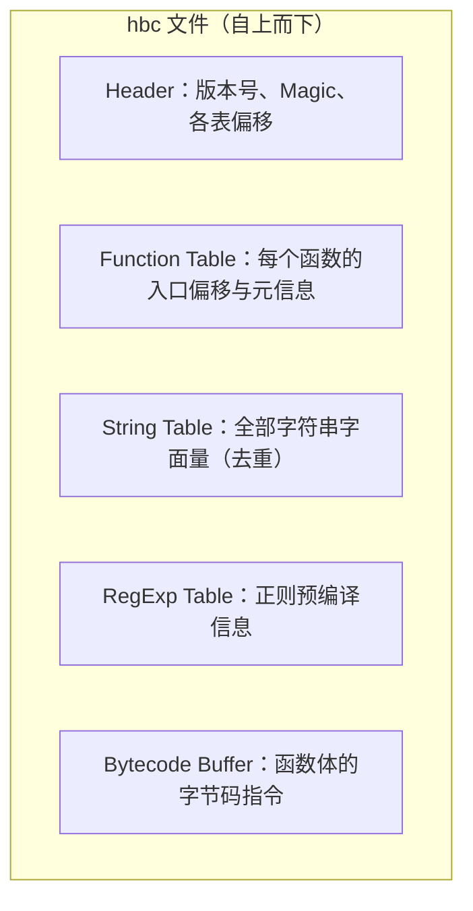
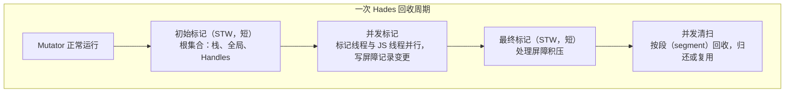

# Hermes 深潜：字节码与 GC

> 01 篇讲了"为什么选 Hermes"，本篇拆开机器：**hbc 文件里到底装了什么？为什么没有 JIT？GC 又是怎么在移动端内存预算内工作的？** 源码对应 facebook/hermes 仓库。

## 1. hbc 文件格式：一张预编译好的"执行计划"

构建期 `hermesc` 把 JS 编译为 Hermes Bytecode（hbc），文件是**分区结构**：

启动时引擎**直接映射（mmap）字节码区**，跳过 parse 与 AST 构建——这就是"预编译省启动"的机械原理：**把编译成本前移到了 CI 的构建机上**。

验证工具：`hbctool` 可以反汇编/查看 hbc 文件（函数表、字符串表一目了然）；`react-native` 的 iOS 构建里能看到 `compileHermes` 相关任务把 jsbundle 转成 hbc。

> 一个常被忽略的推论：**hbc 与引擎版本强绑定**（字节码版本号不匹配直接拒载）。所以升级 RN 版本必须整包重出 bundle，不存在"旧 bundle + 新引擎"的组合。

## 2. 为什么没有 JIT：移动端的三重约束

| 约束 | 内容 | 对 JIT 的影响 |
|------|------|--------------|
| iOS 平台政策 | App 内禁止 W^X（写时不可执行）页——JIT 需要运行时生成机器码再执行 | **法律层面不可用** |
| 内存预算 | JIT 需要代码缓存、优化编译器元数据，几十 MB 起步 | 低端机不可承受 |
| 冷启动特征 | App 代码多为"跑一次的页面逻辑"，峰值热循环少 | JIT 投入产出比差，峰值收益有限 |

所以 Hermes 选择了**寄存器式解释器**（register-based interpreter）：

- 字节码指令直接操作虚拟寄存器（而非栈机反复 push/pop），解释分发次数更少；
- 常见优化（内联缓存等）做在 AOT 与解释器内部，而不是运行时探测热点；
- 代价：极限计算性能低于 V8 JIT——换来的是**稳定、低内存、快启动**，与 App 场景匹配。

## 3. GC：Hades——"尽量并发"的 Mark-Sweep

Hermes GC（代号 Hades）的目标函数：**暂停时间短、内存占用低、不占主线程太久**。

关键机制：

1. **堆按 segment 组织**：分配在连续小段上进行，清扫以段为单位，死对象全占的段直接归还 OS；
2. **写屏障（write barrier）**：并发标记期间 JS 仍在改引用，屏障把"黑对象指向白对象"的漏标场景记录下来，交给最终标记补齐——正确性的基石；
3. **分代（young gen）**：实验性开关（`-Xgc-init-young-gen`）把短命对象集中在年轻代、频繁小规模回收，进一步压低单次暂停；
4. **Handle 体系**：原生代码（JSI 侧）持有 JS 对象必须走 `vm::Scope`/Handle 包装，把原生指针注册为 GC 根——这解释了模块七 JSI HostObject 与 Hermes 生命周期的耦合点。

## 4. 与 RN 工程相关的调优入口

| 参数/机制 | 作用 | 备注 |
|-----------|------|------|
| `-Xmx` / `XX:MaxHeapSize` | JS 堆上限 | 压缩 OOM 排查空间（模块九 04） |
| `-Xgc-init-young-gen` | 开启年轻代 | 分配密集型业务可实验 |
| `HermesRuntime`采样（`react-native-performance` / DevTools Memory） | 看分配热点 | 配合 Heap Snapshot |
| 字节码版本 | 与引擎绑定 | 升级 RN = 重出包 |

> 调优原则：**先看分配（谁在制造垃圾），再调 GC（回收节奏）**。GC 参数救不了分配风暴。

## 5. 把三篇引擎内容串起来

- 01 篇：三条引擎路线的取舍 → 为什么 Hermes 胜出；
- 本篇：胜出的两个支柱——**AOT 字节码（省启动）+ Hades 并发 GC（稳运行）**；
- 02 篇 + 04 篇（同步异步边界）：Hermes 作为 JSI 的一等公民，同步直调与 Handle 生命周期如何落在它身上。

## 小结

- hbc = 函数表 + 字符串表 + 正则表 + 指令区，启动 mmap 直接执行——**编译成本前移到 CI**；
- 无 JIT 是 iOS 政策 + 内存预算 + 冷启动特征共同决定的工程理性，寄存器解释器是折中最优；
- Hades = 并发 mark-sweep + segment 堆 + 写屏障（+ 可选分代），原生侧持对象必须走 Handle；
- 引擎问题的归因顺序：先分配后回收，先测量后参数。
