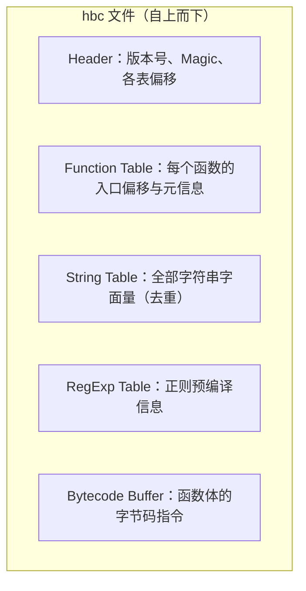
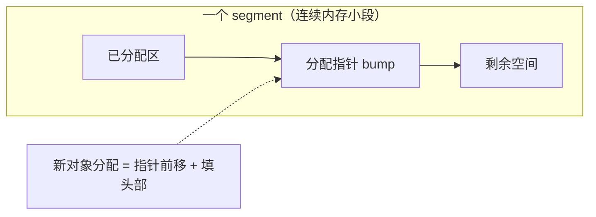
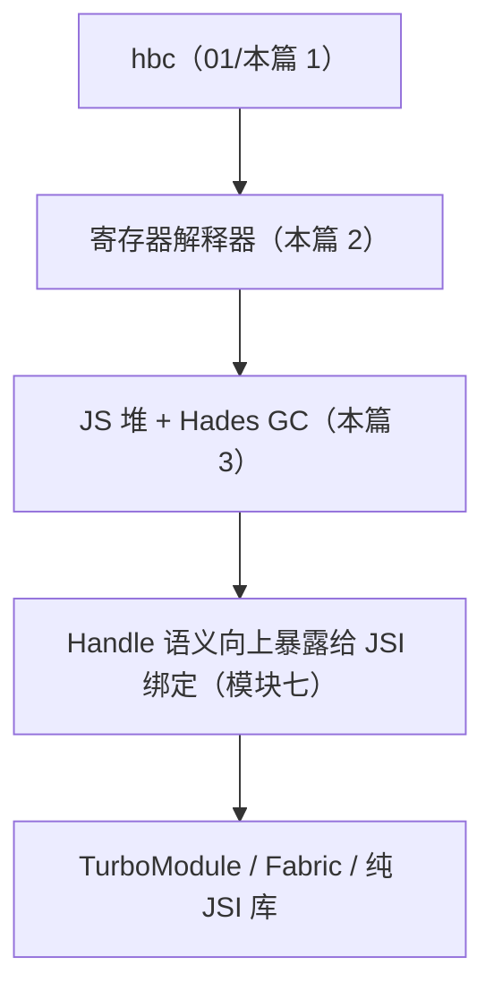

# Hermes 深潜：字节码与 GC

> 01 篇讲了"为什么选 Hermes"，本篇拆开机器：**hbc 文件里到底装了什么？为什么没有 JIT？GC 又是怎么在移动端内存预算内工作的？** 源码对应 facebook/hermes 仓库。

## 1. hbc 文件格式：一张预编译好的"执行计划"

构建期 `hermesc` 把 JS 编译为 Hermes Bytecode（hbc），文件是**分区结构**：



启动时引擎**直接映射（mmap）字节码区**，跳过 parse 与 AST 构建——这就是"预编译省启动"的机械原理：**把编译成本前移到了 CI 的构建机上**。

验证工具：`hbctool` 可以反汇编/查看 hbc 文件（函数表、字符串表一目了然）；`react-native` 的 iOS 构建里能看到 `compileHermes` 相关任务把 jsbundle 转成 hbc。

> 一个常被忽略的推论：**hbc 与引擎版本强绑定**（字节码版本号不匹配直接拒载）。所以升级 RN 版本必须整包重出 bundle，不存在"旧 bundle + 新引擎"的组合。

### 1.1 字节码长什么样（示意）

用一段极简函数看字节码的"形状"（示意性描述；真实输出以 `hermes -dump-bytecode` 为准）：

```js
// 源码
function add(a, b) { return a + b; }
```

```text
（示意）Function<add>：参数 2 个，寄存器若干
  LoadParam      r0, 1        ; 取参数 a 进寄存器
  LoadParam      r1, 2        ; 取参数 b
  Add            r2, r0, r1   ; 寄存器相加，结果进 r2
  Ret            r2           ; 返回寄存器值
```

对照栈式虚拟机（JSC 的字节码形态之一）能看出"寄存器式"的差异：

| 形态 | 加法 a+b 的指令流 | 特点 |
|------|------------------|------|
| 栈式 | push a; push b; add; → 结果在栈顶 | 指令短但条数多，访存频繁 |
| 寄存器式（Hermes） | 一条 Add，操作数直接写寄存器 | 条数少、分发次数少，单条编码略长 |

指令族谱按用途大致分：常量/参数装载（LoadConst*/LoadParam）、对象操作（GetById/PutById/NewObject/NewArray）、调用（Call*/Construct）、控制流（条件/无条件跳转）、算逻比较、返回。**没有"访问内存里的机器码"这类指令——因为根本不存在运行时生成的机器码**。

### 1.2 字符串表：去重与懒物化

字符串是 JS 运行时最重的"配件"之一（属性名、标识符、字面量全都是）。hbc 的字符串表做两件事：

1. **构建期去重**：同一字符串只存一份（identifier/字面量/属性名共享）——省的是文件体积与启动时的表载入；
2. **运行期懒物化**：表里先存的是"串的描述"（ASCII/UTF-16、长度、内容偏移），**真正创建字符串对象发生在第一次被使用时**——冷启动只物化入口路径用到的串，长尾串永远不进堆。

这个设计与 mmap 懒页加载是同一哲学：**"文件里的一切都是承诺，不是开销"**——用到的才付钱。

### 1.3 版本纪律的两个高发事故面

字节码版本绑定在实践中崩在两个地方（走查细节见[01 篇 8.1](01-JS引擎对比与Hermes原理.md)）：

| 事故面 | 机制 | 预防 |
|--------|------|------|
| 热更新通道 | 线上还存着旧 hbc，App 升级换了新引擎 → 拒载 | 发布系统把"RN 版本号"与 bundle 绑定校验（模块八 02） |
| 构建环境漂移 | 本地与 CI 的 hermesc 版本不一致，产物微妙不同 | 锁版本工具链，产物哈希入发布记录 |

记住原则：**hbc 是"引擎的一部分"而不是"数据文件"**——引擎升级=产物必须重出，任何把 bundle 当静态资源的运维假设都会踩坑。

## 2. 为什么没有 JIT：移动端的三重约束

| 约束 | 内容 | 对 JIT 的影响 |
|------|------|--------------|
| iOS 平台政策 | App 内禁止 W^X（写时不可执行）页——JIT 需要运行时生成机器码再执行 | **法律层面不可用** |
| 内存预算 | JIT 需要代码缓存、优化编译器元数据，几十 MB 起步 | 低端机不可承受 |
| 冷启动特征 | App 代码多为"跑一次的页面逻辑"，峰值热循环少 | JIT 投入产出比差，峰值收益有限 |

所以 Hermes 选择了**寄存器式解释器**（register-based interpreter）：

- 字节码指令直接操作虚拟寄存器（而非栈机反复 push/pop），解释分发次数更少；
- 常见优化（内联缓存等）做在 AOT 与解释器内部，而不是运行时探测热点；
- 代价：极限计算性能低于 V8 JIT——换来的是**稳定、低内存、快启动**，与 App 场景匹配。

### 2.1 解释器主循环：取指-译码-执行

解释器的本体是一个"永动循环"（`Interpreter.cpp` 的骨架，简化）：

```cpp
// 伪代码：解释器主循环
while (true) {
  Opcode op = fetch();          // 取指：当前 PC 处读操作码
  switch (op) {                 // 译码+执行：巨型 switch 分发
    case LoadConstInt:  r[dst] = imm;        break;
    case GetById:       r[dst] = getProperty(r[obj], name); break;
    case Call2:         r[dst] = call(r[f], r[a], r[b]);    break;
    case JmpTrue:       if (truthy(r[c])) pc = target;      break;
    ...
  }
  advance();
}
```

三个性能敏感点（也是 Hermes 工程化的用力点）：

1. **分发开销**：每条指令都要"读操作码 + 跳转"，纯解释的税就在这里——JIT 消灭的正是分发与重复译码；
2. **内联缓存**：属性访问（GetById）的查找结果可缓存（"这个形状的对象取这个属性走这条路径"），Hermes 把这类优化做进了解释器数据结构；
3. **寄存器映射**：虚拟寄存器映射到物理栈槽，函数调用的寄存器数量在函数表里就已确定（1.1 的 FunctionHeaders 元信息）——不需要运行时再算栈帧布局。

### 2.2 无 JIT 的代价边界

什么负载吃亏、什么无感，心里要有账：

| 负载类型 | 无 JIT 的相对代价 | RN 场景 |
|---------|------------------|---------|
| 长热循环/数值密集（图表计算、编解码、加密） | 吃亏明显 | 存在但少见；可下沉原生 |
| UI 驱动逻辑（事件→状态→渲染） | 基本无感 | 绝大多数业务代码 |
| IO 密集（网络/存储，等待为主） | 无感 | 大量 |
| 启动密集（模块初始化、首帧） | **反而占优**（无 JIT 预热） | 关键路径 |

结论：Hermes 输的不是"语言跑分"，是特定形状的负载——遇到这类负载，正确答案是下沉（原生/C++/worklet），而不是换引擎。

### 2.3 内联缓存：解释器里的"局部智能"

纯解释的属性访问要每次走完整查找链（对象自身 → 原型链），这是动态语言的另一笔税。Hermes 把**内联缓存（IC）**做进了解释器：同一条 GetById 指令记住"上次是什么形状的对象、在哪个槽位找到的"，下次命中直接取值。

| 缓存状态 | 含义 | 性能 |
|---------|------|------|
| 单态（monomorphic） | 总是同一种形状 | 最快：一步直达 |
| 多态（polymorphic） | 少数几种形状轮换 | 中：查小表 |
| 超多态（megamorphic） | 形状太多缓存放弃 | 退回完整查找 |

工程含义：**"对象形状稳定"的代码在解释器里也快**。反例是"同一函数处理大量不同形状的对象"（动态 key 拼接、混合类型的字典查询）——缓存永远不命中，每次全量查找。这是 JS 层可优化的真实旋钮（模块九 03 的数据结构选择会用到）。

## 3. GC：Hades——"尽量并发"的 Mark-Sweep

Hermes GC（代号 Hades）的目标函数：**暂停时间短、内存占用低、不占主线程太久**。

### 3.0 先对齐五个 GC 术语

后文会反复用到，先一次说清（都是通用 GC 术语，不是 Hermes 专属）：

| 术语 | 含义 |
|------|------|
| Mutator | 就是"跑业务的 JS 代码"——它不断改写对象引用，是 GC 要提防的"变更者" |
| STW（Stop The World） | 暂停全部 JS 执行的窗口——Hades 的目标就是把 STW 压到两小段 |
| 根集合（roots） | 从这里出发可达的对象算存活：调用栈、全局对象、Handle 注册的引用 |
| 写屏障（write barrier） | 引用被改写时插入的记录动作——并发正确性的代价与基石 |
| 浮动垃圾 | 并发期间死掉、但要等下一轮才回收的对象——"保守性"换并发的交易 |


关键机制：

1. **堆按 segment 组织**：分配在连续小段上进行，清扫以段为单位，死对象全占的段直接归还 OS；
2. **写屏障（write barrier）**：并发标记期间 JS 仍在改引用，屏障把"黑对象指向白对象"的漏标场景记录下来，交给最终标记补齐——正确性的基石；
3. **分代（young gen）**：实验性开关（`-Xgc-init-young-gen`）把短命对象集中在年轻代、频繁小规模回收，进一步压低单次暂停；
4. **Handle 体系**：原生代码（JSI 侧）持有 JS 对象必须走 `vm::Scope`/Handle 包装，把原生指针注册为 GC 根——这解释了模块七 JSI HostObject 与 Hermes 生命周期的耦合点。

### 3.1 三色抽象：屏障到底在防什么

并发标记用三色术语描述对象状态：**白**（未访问，候选垃圾）、**灰**（已访问但子引用未扫完）、**黑**（完全扫完）。漏标只发生在一种组合里：


写屏障的职责就是拦下这条边：**黑→白的引用一出现就记录**（Hades 采用快照式/SATB 风格的屏障思路：并发期开始时的存活对象一律视为存活），最终标记阶段统一补扫。代价是**浮动垃圾**（并发期间死掉的对象要等下一轮）——用一点内存延迟换"不漏标"，是并发 GC 的标准交易。

### 3.2 Handle：原生侧持对象的"合法姿势"

GC 移动/回收对象时，原生代码里的裸指针随时可能失效。Hermes 的解法是**间接层 + 根登记**：

```cpp
// facebook/hermes：Handle/Scope 的用法骨架（简化示意）
{
  vm::Scope scope(runtime);              // 栈上的 Scope：登记本块创建的所有 Handle
  auto obj = vm::handle<JSObject>::vmcast(...); // Handle = 一层间接 + 已注册

  // ... 中间任何时刻可能发生 GC：Handle 会被自动更新指向新位置
  callSomething(runtime, obj);           // 安全传递
}                                        // Scope 析构：这批 Handle 从根集合注销
```

三条工程推论：

1. **Handle 有成本**：登记/注销与间接访问都不是免费的——C++ 绑层里"随手 Handle 一大把"会增加根集合规模、拖慢标记；正确姿势是 Scope 尽量小、生命周期尽量短；
2. **裸指针只在"没有 GC 的窗口"合法**：同一调用栈内、确知不触发分配时可以短暂使用裸指针——但这是引擎内部代码的特权，业务绑定层不该赌这个窗口；
3. **JSI 的对象即 Handle 语义**：jsi::Object 在 Hermes 侧的实现就是"带生命周期的引用"，TurboModule/Fabric 里长持 jsi 对象要意识到 GC 的存在（模块七 01/03 会反复遇到）。

### 3.3 什么时候触发回收

触发策略的定性图景（具体阈值随版本演化，不背数字）：

- **分配驱动**：新分配累计到预算水位 → 触发一轮标记清扫——所以"分配风暴"直接等于"GC 频率风暴"；
- **内存压力**：系统内存吃紧时的兜底回收；
- **暂停的形状**：两段短 STW（初始/最终标记）+ 长段并发——业务可感知的卡顿主要来自 STW 段与标记占用 CPU 的间接挤压。

### 3.4 segment 堆：分配为什么便宜

标记清扫常被误解为"分配很贵"——恰恰相反，Hermes 的分配是**指针碰撞（bump allocation）**级别的：



| 问题 | 答案 |
|------|------|
| 分配要找空闲块吗？ | 不要——当前 segment 里指针前移即可，O(1) |
| segment 满了怎么办？ | 开新 segment（预留空间里领）或触发 GC |
| 回收后内存去哪？ | 死对象占比高的 segment 整段归还 OS，部分死的进入可复用池 |
| 碎片呢？ | 以 segment 为单位整理，不做对象级 compact——结构简单，移动少 |

这个设计把"分配快"和"回收糙"绑在一起卖：**对象级的极致分配吞吐换对象级的整理缺失**。对 JS 业务代码（大量短命小对象）是合算的；对"长期持有 + 频繁修改的大对象图"，标记成本会随图规模增长——又一个"分配行为决定 GC 行为"的注脚。

## 4. 与 RN 工程相关的调优入口

| 参数/机制 | 作用 | 备注 |
|-----------|------|------|
| `-Xmx` / `XX:MaxHeapSize` | JS 堆上限 | 压缩 OOM 排查空间（模块九 04） |
| `-Xgc-init-young-gen` | 开启年轻代 | 分配密集型业务可实验 |
| `HermesRuntime`采样（`react-native-performance` / DevTools Memory） | 看分配热点 | 配合 Heap Snapshot |
| 字节码版本 | 与引擎绑定 | 升级 RN = 重出包 |

> 调优原则：**先看分配（谁在制造垃圾），再调 GC（回收节奏）**。GC 参数救不了分配风暴。

### 4.1 观察工具三件套

1. **Heap Snapshot（DevTools Memory）**：看"什么对象活着、被谁引用"——查泄漏的起点；
2. **采样 Allocation**：看"谁在持续分配"——查分配风暴的起点；
3. **GC 事件可见性**：dev 形态下观察 GC 频率与暂停的体感对应关系（release 下以打点/埋点为准）。

纪律同前：**snapshot/采样本身有开销，数字用于找热点，不用于绝对值的跨版本比较**。

### 4.2 从现象到 GC 问题的归因流程

| 现象 | 第一步 | 第二步 | 常见根因 |
|------|--------|--------|---------|
| 内存只涨不跌 | 两时刻 heap snapshot 做差 | 看"新增且被引用"的对象类型 | 事件监听未解绑、闭包持有大对象、callback 表泄漏 |
| 周期性掉帧（与业务无关的节律） | 采样 allocation | 找分配速率尖峰来源 | 每帧新建大数组/字符串、轮询风暴 |
| 崩溃疑似 OOM | 崩溃时内存水位 + 堆上限 | 确认是 JS 堆还是原生内存 | JS 堆超限 / 原生位图泄漏（模块九 04 教你区分） |
| 启动后越来越卡 | snapshot 序列（3~5 个时间点） | 增长曲线的斜率与类型 | 缓存无上限、历史列表不释放 |

流程纪律：**先定位"哪类对象在增长/谁在分配"，再动代码；改完必须用同样的测量复验**——GC 问题最怕"感觉修好了"。

### 4.3 参数从哪里生效

调优入口最终要落到"构建/初始化的哪个环节"：

| 参数类别 | 生效位置 | 工程动作 |
|---------|---------|---------|
| 编译期（hermesc 选项：优化级别、兼容开关） | 打包流水线 | 构建脚本传参（具体属性名随 RN 版本演进，以官方文档为准） |
| 运行期（堆上限、GC 实验开关） | 引擎实例创建 | 宿主初始化配置注入 |
| 观测（采样/快照） | 运行期随时 | DevTools / 打点 |

原则：**编译期参数改产物，运行期参数改行为，观测不改变任何东西**——三类配置别混在"性能优化"一个抽屉里管理。

## 5. 把三篇引擎内容串起来

- 01 篇：三条引擎路线的取舍 → 为什么 Hermes 胜出；
- 本篇：胜出的两个支柱——**AOT 字节码（省启动）+ Hades 并发 GC（稳运行）**；
- 02 篇 + 04 篇（同步异步边界）：Hermes 作为 JSI 的一等公民，同步直调与 Handle 生命周期如何落在它身上。

补一张串起来的位置图：



一句话：**字节码决定"启动多快"，解释器决定"稳态多稳"，GC 决定"长跑多久不掉链子"**——三者合起来才是 Hermes 的完整画像。

### 5.1 问答速查：这个问题归哪篇

| 你遇到的问题 | 归属 |
|--------------|------|
| 启动慢，想比较引擎 | 01 篇（选型与验证方法） |
| 升级后启动崩溃（版本不匹配） | 01 篇 8.1 + 本篇 1.3 |
| 想看产物里到底有什么 | 本篇 1 |
| CPU 密集任务慢 | 本篇 2.2（先判断负载形状，再考虑下沉） |
| 内存只涨不跌 | 本篇 4.2 + 模块九 04 |
| 调原生库时对象莫名失效 | 本篇 3.2（Handle）+ 模块七 01 |

## 6. 动手实验

1. **读一次反汇编**：`hermes -dump-bytecode app.android.bundle | head -60`，对照 1.1 的指令族谱认出装载/调用/跳转三类指令；用 hbctool 看字符串表规模；
2. **验证懒物化直觉**：对比"加载完整 bundle"与"仅执行入口模块再退出"两种短脚本路径的堆快照差异（定性观察即可）；
3. **制造并归因一次泄漏**：注册 1000 个监听不解绑，隔 10s 打一次 snapshot，用 4.2 流程把增长类型指认出来，再解绑复测曲线走平；
4. **感受分配风暴与 GC 节律**：循环里每帧 new 大数组，观察掉帧节律与 allocation 采样的尖峰对应关系；
5. **IC 的体感**（进阶）：同一函数分别用"固定形状对象"与"动态 key 对象"跑高频属性访问，用 CPU 采样对比热点差异（定性）。

## 7. 常见误区

| 误区 | 事实 | 一句话纠正 |
|------|------|-----------|
| "无 JIT 所以整体都慢" | 慢的是特定形状负载（长热循环） | 吃亏负载下沉原生，而不是换引擎 |
| "字符串就是启动即创建的对象" | 字符串表懒物化，用到才进堆 | hbc 的一切都是"承诺不是开销" |
| "GC 停顿是随机玄学" | 停顿集中在两段短 STW，可归因 | 先看分配风暴再谈停顿 |
| "C++ 里拿住 JS 对象就行" | 必须走 Handle/Scope 注册为根 | 裸指针随时可能被 GC 失效 |
| "写屏障拖慢了程序" | 屏障只在并发标记窗口生效 | 换来的是并发正确性 |
| "hbc 反汇编不可读" | dump-bytecode/hbctool 就是给人读的 | 1.1 的读法五分钟入门 |

## 自测题（答不上就回读对应小节）

1. hbc 各分区装什么？字符串表的两招（去重/懒物化）各省什么？（→ 1 / 1.2）
2. 寄存器式与栈式解释器的差异是什么？分发开销为什么是纯解释的"税"？（→ 1.1 / 2.1）
3. 无 JIT 的三重约束是什么？哪类负载吃亏、哪类反而占优？（→ 2 / 2.2）
4. 三色抽象里漏标发生在哪条边？屏障怎么拦、代价是什么？（→ 3.1）
5. Handle/Scope 的机制与三条工程推论？（→ 3.2）
6. GC 触发的定性策略是什么？为什么"分配风暴=GC 风暴"？（→ 3.3）
7. 三个观察工具分别用于什么？（→ 4.1）
8. 内联缓存的单态/多态/超多态各是什么？对 JS 层数据结构选择有什么提示？（→ 2.3）
9. segment 堆的分配为什么是 O(1)？回收端付出了什么？（→ 3.4）
10. "内存只涨不跌"的归因两步是什么？（→ 4.2）

## 小结

- hbc = 函数表 + 字符串表 + 正则表 + 指令区，启动 mmap 直接执行——**编译成本前移到 CI**；
- 无 JIT 是 iOS 政策 + 内存预算 + 冷启动特征共同决定的工程理性，寄存器解释器是折中最优；
- Hades = 并发 mark-sweep + segment 堆 + 写屏障（+ 可选分代），原生侧持对象必须走 Handle；
- 引擎问题的归因顺序：先分配后回收，先测量后参数。
- 内联缓存偏爱形状稳定的对象；segment 堆让分配 O(1) 但把整理让给了"整段回收"——写 JS 时的数据结构习惯会直接落到这两点上。
