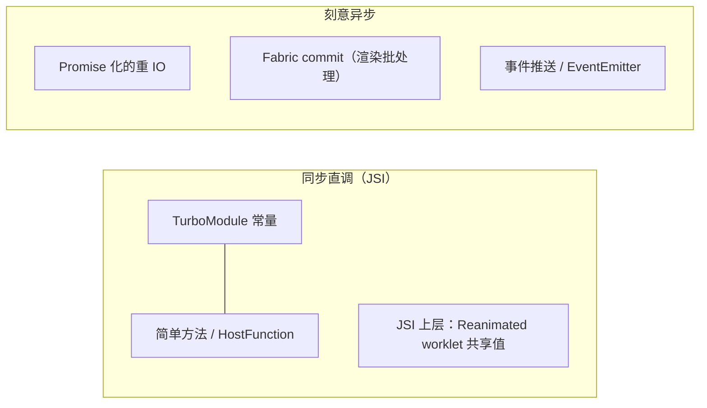
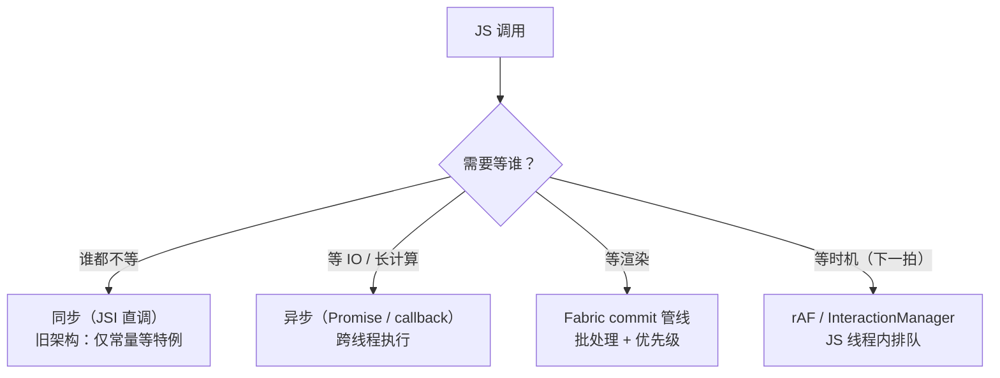

# 同步与异步的边界

> "RN 里 JS 调原生是异步的"——这句话**只对了一半**。旧架构把它当铁律，新架构把它当 bug。本篇画清同步/异步的真实边界：哪里必须异步、哪里可以同步、微任务和 rAF 到底跑在哪条线程。

## 1. 旧架构为什么"全异步"

模块四 01 的结论：Bridge 是**批量队列 + JSON 序列化**。设计约束推导出强制异步：

1. 消息要攒批（等 5 条或帧末），**同步返回值在语义上不可能**——等你这条到原生时，队列还没刷；
2. 原生方法跑在 mqt 线程，JS 在 jsq 线程——同步调用意味着**跨线程阻塞等待**，死锁风险（原生方法里再要 UI 线程锁就完了）；
3. JSON 世界里没有"引用"，回调只能用 id 反向投递。

所以旧架构的 API 形态天然是 `method(args, callback)` / Promise，`measure`、`getSize` 全家都逃不掉回调。

## 2. 旧架构里的三处"同步特例"

铁律上有三个补丁，值得知道（它们预示了新架构）：

| 特例 | 机制 | 用途 |
|------|------|------|
| 模块常量 `getConstants()` | 模块创建时**同步注入** JS 代理对象 | `Platform.constants`、屏幕尺寸等启动即得 |
| `@ReactMethod(isBlockingSynchronousCall = true)` | 方法标记为同步，**在 JS 线程直接执行原生代码** | 极少数（如早期 Animated 的取值）；滥用会卡 JS 线程甚至死锁 |
| 启动注入的全局（`NativeModules` 代理本身） | 注入时同步生成代理（方法仍是异步） | 只省了"查表"，不改变调用语义 |

教训：同步不是"把异步函数改个修饰符"——**它要求整条通道（线程模型 + 序列化）都为同步重新设计**，这正是 JSI 做的事。

## 3. 新架构：同步是常态，异步是选择

JSI（模块七 01）让 JS 直接持有 C++ 对象指针，HostObject 的方法调用是**同函数调用**——没有队列、没有序列化、没有线程切换。于是：

- TurboModule 常量、简单方法天然同步；
- **仍然异步的场景是刻意的**：重 IO（文件、网络）用 Promise；UI 变更走 Fabric 的 commit 管线（保持渲染批处理与并发调度）；事件本来就是"原生 → JS"的推送。



> 判断口径：**问"这次调用需要等谁"**。不等任何东西的（取常量、算个值）就该同步；等 IO 的用 Promise；等渲染管线的交给 commit。

## 4. 微任务：Promise 回调何时执行

Hermes/JSC 中，`.then` 回调进**微任务队列**，在**当前 JS 任务（调用栈）清空时**由引擎 drain。RN 的特殊性在于"JS 任务"由谁驱动：

1. 旧架构：每批 Bridge 消息处理是一个 JS 任务，**批末 drain 微任务**——所以 Promise 链的推进节奏与批量窗口耦合；
2. 新架构：JSI 直调后任务边界更细（每次原生调用、每个事件分发都是独立任务），微任务更及时；
3. 实践推论：**Promise 不会让你"跳出"当前帧**——同帧内链式 then 全部执行完；想推迟到"下一拍"要用 rAF/定时器。

```js
console.log('1');
Promise.resolve().then(() => console.log('3')); // 微任务：本任务末尾
setTimeout(() => console.log('4'), 0);          // 宏任务：下一拍
console.log('2');
// RN 中同样输出 1 2 3 4 —— 微任务语义与 Web 一致，差别只在"任务由谁调度"
```

## 5. 三个调度工具的线程语义

| API | 线程 | 语义 |
|-----|------|------|
| `requestAnimationFrame` | JS 线程（由原生 vsync 信号驱动） | 每帧一拍，做动画/分帧任务的标准节拍器 |
| `setNativeProps`（旧架构） | 绕过 reconcile，直接下发 `updateView` | "逃生舱"：无 React 参与地改原生属性；新架构中由 Fabric 的同步提交与并发渲染取代其职责 |
| `InteractionManager.runAfterInteractions` | JS 线程 | 等"交互句柄"全部清零后执行——把非紧急任务让位给动画/手势 |

三者共同的哲学：**JS 线程是稀缺资源，调度工具都是"排队策略"**。卡顿的常见根因不是某个 API 慢，而是把长任务插进了不该插的队列位置。

## 6. 一张边界图收束



## 小结

- 强制异步是 Bridge 的**结构产物**（批量 + 跨线程 + 序列化），不是 JS 语言的限制；
- 新架构里同步是 JSI 的常态，异步成为 IO/渲染/事件上的**主动选择**；
- 微任务语义与 Web 一致（栈空即 drain），差别只在任务边界由 Bridge 批（旧）或 JSI 调用（新）驱动；
- rAF / setNativeProps / InteractionManager 都是 JS 线程的排队策略——性能问题常出在"排错队"，不是"函数慢"。
