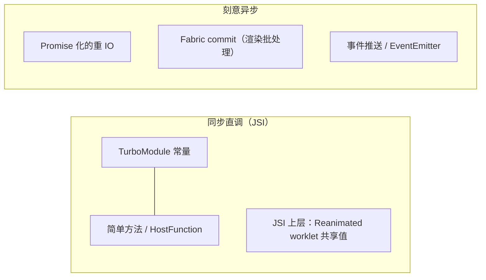
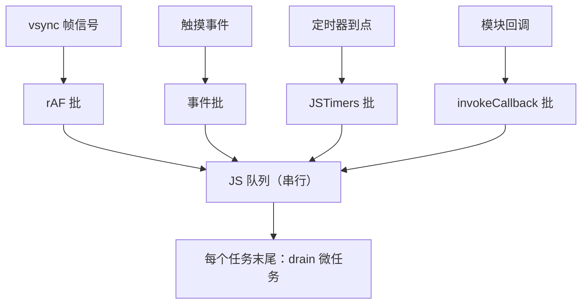
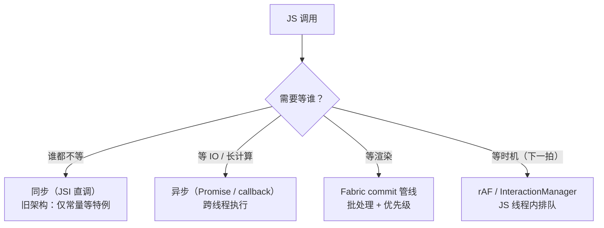

# 同步与异步的边界

> "RN 里 JS 调原生是异步的"——这句话**只对了一半**。旧架构把它当铁律，新架构把它当 bug。本篇画清同步/异步的真实边界：哪里必须异步、哪里可以同步、微任务和 rAF 到底跑在哪条线程。

## 1. 旧架构为什么"全异步"

模块四 01 的结论：Bridge 是**批量队列 + JSON 序列化**。设计约束推导出强制异步：

1. 消息要攒批（等 5 条或帧末），**同步返回值在语义上不可能**——等你这条到原生时，队列还没刷；
2. 原生方法跑在 mqt 线程，JS 在 jsq 线程——同步调用意味着**跨线程阻塞等待**，死锁风险（原生方法里再要 UI 线程锁就完了）；
3. JSON 世界里没有"引用"，回调只能用 id 反向投递。

所以旧架构的 API 形态天然是 `method(args, callback)` / Promise，`measure`、`getSize` 全家都逃不掉回调。

### 1.1 把三条推导各自再走深一步

**推导一（批量窗口否决同步）**：JS 的调用进入 `_queue` 后，要等 `flushedQueue` 窗口才序列化过桥——"调用发生"与"原生执行"之间隔着整个窗口。若强行同步返回，返回时原生还没收到消息，只能返回"尚未发生的未来"——这在语义上就不是返回值了。

**推导二（线程封送否决阻塞）**：假设让 JS 线程阻塞等 mqt 执行完——JS 线程被占住期间，所有事件（触摸、定时器、其他回调）全部排队；若 mqt 上的方法又恰好在等 UI 线程，而 UI 线程在等 JS 产出的下一批——环闭合（模块三 02 第 7 节的死锁三型）。**同步的价值抵不过系统级的死锁面**。

**推导三（序列化否决引用）**：JSON 拷贝的世界里，"把 JS 闭包传给原生保存"不可能——没有对象身份，只有数据副本。于是回调被降格为编号（callback id），原生"持有回调"实为"持有编号"，回传时再按编号取回 JS 函数执行。

三条合起来的元结论：**强制异步不是某个人拍板的限制，是"队列+跨线程+值拷贝"三个结构选择的联合产物**。改掉其中任何一个选择，同步才有生存空间——这正是 JSI 做的事（第 3 节）。

### 1.2 为什么当年不做同步：工程史的取舍

回看这条铁律的成因，"做不了"其实分两层：

1. **技术上做得了**（isBlockingSynchronousCall 证明通道存在），但**结构上不安全**——批量窗口与线程封送没有为同步设计，强行同步等于绕开所有安全机制裸奔；
2. **需求上不迫切**——2015 年前后的 RN 用例以页面逻辑为主，异步回调虽难写但不致命；真正把"同步缺失"推上桌面的是动画、手势、高频存储这类**闭环场景**的普及（模块四 03 的量化）。

这个视角的价值在于判断自己的技术决策：**当一个能力缺失长期存在时，先问"是做不了还是不划算"**——两者的破局路径完全不同（前者等技术，后者等场景）。

## 2. 旧架构里的三处"同步特例"

铁律上有三个补丁，值得知道（它们预示了新架构）：

| 特例 | 机制 | 用途 |
|------|------|------|
| 模块常量 `getConstants()` | 模块创建时**同步注入** JS 代理对象 | `Platform.constants`、屏幕尺寸等启动即得 |
| `@ReactMethod(isBlockingSynchronousCall = true)` | 方法标记为同步，**在 JS 线程直接执行原生代码** | 极少数（如早期 Animated 的取值）；滥用会卡 JS 线程甚至死锁 |
| 启动注入的全局（`NativeModules` 代理本身） | 注入时同步生成代理（方法仍是异步） | 只省了"查表"，不改变调用语义 |

教训：同步不是"把异步函数改个修饰符"——**它要求整条通道（线程模型 + 序列化）都为同步重新设计**，这正是 JSI 做的事。

### 2.1 常量注入：时序与形态

常量是"启动期一次性冻结"的数据，不经过队列：

```kotlin
// Android：模块声明常量（创建时被读走，随模块配置一次性注入 JS）
class DeviceModule(reactContext: ReactApplicationContext) :
    ReactContextBaseJavaModule(reactContext) {
  override fun getName() = "MyDevice"
  override fun getConstants(): Map<String, Any> = mapOf(
    "osVersion" to Build.VERSION.SDK_INT.toString(),
    "isTablet" to isTablet()
  )
}
```

```js
// JS 侧：读到的就是注入时的快照对象
NativeModules.MyDevice.osVersion; // 同步返回字符串
```

三条工程事实：

1. **常量是快照不是通道**——之后原生侧的值变了，JS 不会自动看到（要靠事件通知 + 主动查）；
2. 常量在**模块注册时**求值，放重逻辑会拖慢启动（模块二）；
3. "读常量同步、调方法异步"的分界提示了后来 TurboModule 的常量设计（模块七 03）。

### 2.2 isBlockingSynchronousCall：危险的补丁

```kotlin
@ReactMethod(isBlockingSynchronousCall = true)
fun getValueSync(key: String): String {
  return store.get(key)   // 跑在 JS 线程的调用栈里！
}
```

它证明"同步通道在技术上一直存在"，但被刻意锁死：

- 方法体跑在 **JS 线程**——重活直接烧掉 JS 线程（比异步慢方法危害更大）；
- 若方法内部再同步等待其他线程（UI/mqt），即踩模块三 02 的死锁三型；
- 因此官方长期只用于极少数启动期小方法。**"能用"与"该用"之间隔着整条线程模型**——这也是它作为"补丁"而非"方案"的原因。

### 2.3 第三处特例解剖：代理本身的"同步部分"

第三处特例最微妙：`NativeModules.X` 这个**取属性的动作**是同步的——第一次访问触发 `genModule`，用注入的模块配置生成代理对象并缓存。也就是说：

| 动作 | 同步性 | 说明 |
|------|--------|------|
| `NativeModules.Foo`（取模块） | 同步 | 查/生成代理，纯 JS 操作 |
| `NativeModules.Foo.bar`（取方法） | 同步 | 返回包装函数，仍没调用任何原生 |
| `NativeModules.Foo.bar()`（调用） | 异步 | 这才是入队过桥 |

它省掉的是"每次调用都查一遍模块配置"的 JS 成本，与原生通信无关。它的存在提醒我们：**"同步/异步"的边界要精确到动作**——笼统说"调原生是异步的"，三个动作里只有第三个成立。

## 3. 新架构：同步是常态，异步是选择

JSI（模块七 01）让 JS 直接持有 C++ 对象指针，HostObject 的方法调用是**同函数调用**——没有队列、没有序列化、没有线程切换。于是：

- TurboModule 常量、简单方法天然同步；
- **仍然异步的场景是刻意的**：重 IO（文件、网络）用 Promise；UI 变更走 Fabric 的 commit 管线（保持渲染批处理与并发调度）；事件本来就是"原生 → JS"的推送。

### 3.0 同一类需求，新旧两套 API 形态

同一件事在新旧架构下的"形状"对照（直观感受边界移动了多少）：

| 需求 | 旧架构写法 | 新架构写法 |
|------|-----------|-----------|
| 读模块常量 | `getConstants()` 快照（特例同步） | TurboModule 常量（同步，一等公民） |
| 量一个视图 | `measure(cb)` 回调 | 同步 measure（Fabric 布局在手） |
| 高频 KV 读写 | 异步方法 + 回调风暴 | JSI 同步直调 |
| 重 IO | Promise | Promise（不变——该等的仍然等） |
| 事件 | 反向消息 + EventEmitter | JSI 事件投递（仍是推送语义） |

读这张表的正确姿势：**右列的"同步"只出现在左列本来就不该等的行**——等待类型（第 6 节的边界图）没有变，变的是"被迫等的账单"被划掉了。



> 判断口径：**问"这次调用需要等谁"**。不等任何东西的（取常量、算个值）就该同步；等 IO 的用 Promise；等渲染管线的交给 commit。

### 3.1 Promise 是怎么"长"出来的

新旧架构都大量使用 Promise，但它的实现位置不同。旧架构的 Promise 化链路：

| 端 | 做什么 |
|----|--------|
| Android 模块 | 方法最后一个参数是 `Promise` 类型 → 注册表把它标注为 promise 方法 |
| iOS 模块 | 参数是 `RCTPromiseResolveBlock` + `RCTPromiseRejectBlock` 成对出现 → 同上 |
| JS 侧 genModule | 读到 promise 类型标注 → 把该方法包装成返回 `new Promise(...)` 的函数，resolve/reject 被登记为两个回调 id |

```kotlin
// Android：一个 promise 方法（旧架构自动识别为 promise 形态）
@ReactMethod
fun readConfig(key: String, promise: Promise) {
  try { promise.resolve(store.get(key)) }
  catch (e: Exception) { promise.reject("READ_FAIL", e) }
}
```

要点：**Promise 是回调语法的整理，不是异步机制的升级**——底层仍是"回调 id + 反向消息"。这也是为什么在旧架构里 Promise 链再长也不会"更快"，只是更好写。新架构里 Promise 由 JSI 直调 + 微任务驱动，语义没变，链路变短。

### 3.2 同步直调的纪律

同步能力解锁后，新架构反而更需要纪律：

1. **HostFunction 别做重活**——它跑在 JS 线程调用栈里（模块三 02），同步=长任务的直接入口；
2. **跨线程仍要封送**——JSI 消除跨语言成本，不消除跨线程成本；需要碰 UI/其他线程的实现依然要 post/queue（[JSI 原理](../rn-新架构/01-JSI原理.md)的 RuntimeExecutor 就是干这个的）；
3. **同步异常会直接抛进 JS**——错误处理从"回调第一个参数"变成同步 try/catch 语义，绑定层的异常边界要重新设计。

## 4. 微任务：Promise 回调何时执行

Hermes/JSC 中，`.then` 回调进**微任务队列**，在**当前 JS 任务（调用栈）清空时**由引擎 drain。RN 的特殊性在于"JS 任务"由谁驱动：

1. 旧架构：每批 Bridge 消息处理是一个 JS 任务，**批末 drain 微任务**——所以 Promise 链的推进节奏与批量窗口耦合；
2. 新架构：JSI 直调后任务边界更细（每次原生调用、每个事件分发都是独立任务），微任务更及时；
3. 实践推论：**Promise 不会让你"跳出"当前帧**——同帧内链式 then 全部执行完；想推迟到"下一拍"要用 rAF/定时器。

```js
console.log('1');
Promise.resolve().then(() => console.log('3')); // 微任务：本任务末尾
setTimeout(() => console.log('4'), 0);          // 宏任务：下一拍
console.log('2');
// RN 中同样输出 1 2 3 4 —— 微任务语义与 Web 一致，差别只在"任务由谁调度"
```

### 4.1 任务边界：旧批 vs 新细

| 维度 | 旧架构 | 新架构 |
|------|--------|--------|
| 任务定义 | 一批 Bridge 消息的处理 = 一个任务 | 每个原生直调/事件分发 = 独立任务 |
| 微任务 drain 时机 | 批末 | 每次调用返回时 |
| 长链 Promise 的推进 | 与批量窗口耦合，可能"挤"在下批 | 逐任务推进，更及时 |
| 对业务的可见影响 | 同帧内多步 then 的中间态对原生不可见 | 同左（微任务仍在同一批渲染前 drain） |

注意最后一行：**无论新旧，微任务都在"下一次渲染指令生成之前"跑完**——所以"用 Promise 拆步"不能达成"分帧渲染"，它只是把同一帧内的执行重新排队。分帧的唯一正解是 rAF/定时器这类宏任务级工具。

### 4.2 谁在制造"任务"：事件与回调的驱动链

微任务 drain 的前提是"有任务在跑"，那任务从哪来？旧架构里进入 JS 的入口几乎都是**原生调 JS**：



这张图与 4.1 的任务边界表互为表里：旧架构的"任务"颗粒 = 上图的每一批；新架构颗粒变细（每次 JSI 投递独立成任务），但**"入口都在原生、JS 只被动响应"的结构不变**——RN 的 JS 侧永远是个事件驱动系统，而不是自主循环。理解这一点，"什么时候该把逻辑搬到原生"就有了判断基准：**当你需要"非事件驱动"的连续行为（动画、传感器融合）时，它天然不属于 JS 层**。

## 5. 三个调度工具的线程语义

| API | 线程 | 语义 |
|-----|------|------|
| `requestAnimationFrame` | JS 线程（由原生 vsync 信号驱动） | 每帧一拍，做动画/分帧任务的标准节拍器 |
| `setNativeProps`（旧架构） | 绕过 reconcile，直接下发 `updateView` | "逃生舱"：无 React 参与地改原生属性；新架构中由 Fabric 的同步提交与并发渲染取代其职责 |
| `InteractionManager.runAfterInteractions` | JS 线程 | 等"交互句柄"全部清零后执行——把非紧急任务让位给动画/手势 |

三者共同的哲学：**JS 线程是稀缺资源，调度工具都是"排队策略"**。卡顿的常见根因不是某个 API 慢，而是把长任务插进了不该插的队列位置。

补两个常被混入这张表的"近亲"：

| API | 实质 | 与上三者的关系 |
|-----|------|---------------|
| `setTimeout/setInterval` | JSTimers 原生模块：原生计时 → 回调过桥 | 宏任务级推迟；精度受队列深度影响（模块三 02） |
| `queueMicrotask` | 引擎原生能力，当前任务末尾 drain | 微任务级，**不分帧**——别拿它当"下一拍"用 |

### 5.1 选型决策表

| 需求 | 用什么 | 不该用什么 |
|------|--------|-----------|
| 动画每帧驱动 | rAF（或 Animated 原生驱动） | setTimeout 模拟 |
| 把长任务拆到多帧 | rAF 分片 + 状态保存 | Promise.then（不分帧） |
| 交互结束后再干重活 | InteractionManager | setTimeout 固定延时 |
| 等"下一个可能的空闲" | InteractionManager / 分帧策略 | queueMicrotask |
| 立即但要靠后（同帧内） | 微任务 | 定时器 |

### 5.2 rAF 的驱动源：谁在打拍

rAF 的回调跑在 JS 线程，但**节拍来自原生**——vsync 信号驱动原生帧回调，再以"原生调 JS"的形态进入 JS 队列（第 1 节的反向链路）。两个直接推论：

1. **rAF 的节奏 = 合成器节奏，但回调时机 = JS 队列空闲时机**——JS 线程忙时 rAF 照样迟到，这不是 rAF 的 bug，是单入口队列的物理（模块三 02）；
2. 一帧内多次注册 rAF，回调在同一拍批量执行；想"每帧只跑一步"，要在回调里自己控制状态推进，而不是指望引擎替你节流。

对照 Web：浏览器里 rAF 与渲染管线同一帧内串行（回调→style→layout→paint）；RN 里 rAF 之后还要跨线程才到渲染——**rAF 回调完成 ≠ 本帧能看到结果**，旧架构下它更接近"下一帧之前的准备时间"。

## 6. 一张边界图收束



这张图的用法是**每次写跨端调用前先走一遍**：绝大多数误用（同步循环等回调、用 Promise 求分帧、把重 IO 放进 HostFunction）都能在图上被拦下来。

## 7. 实战判例：三个场景的同步/异步选择

**判例一：读配置常量。** `const cfg = await NativeModules.Config.get()` 放在启动路径上——即使数据是静态的，也付了一次往返。新架构正解：常量走同步（TurboModule constants / 纯 JSI），启动路径不欠任何一次等待。

**判例二：高频读写 KV。** 每次读写过桥的存储模块，在列表/动画场景是闭环洪泛（模块四 03）。正解：换 JSI 直连的同步存储（如 react-native-mmkv 一类），读写变成 JS 线程内的 C++ 调用——注意"同步快"的前提是单次操作本身轻。

**判例三：动画值更新。** 旧架构 JS 驱动 setValue 每帧过桥；正解不是"把调用改同步"，而是**把驱动下放**（useNativeDriver / Reanimated worklet 在 UI 线程的 Runtime 直改共享值）——**问题从来不是"异步慢"，而是"参与闭环的线程太多"**。三个判例共同的判断动作：先问"这次调用需要等谁"，再问"这个闭环里有几次跨界"。

用一张表把三判例收进"等待类型"框架：

| 判例 | 等待类型 | 错误方案 | 正解 |
|------|---------|---------|------|
| 读常量 | 谁都不等 | await 往返 | 同步常量 |
| 高频 KV | 谁都不等（单次很轻） | 每次过桥 | JSI 同步直调 |
| 动画值 | 等渲染 | JS 每帧同步推值 | 驱动下放，砍闭环 |

注意第一、二行同属"谁都不等"却曾用异步——**旧架构的技术限制让很多"不该等的调用"也被迫等了**；识别这类"历史欠账"是迁移新架构的价值清单（模块七 05）。

### 7.1 补一个判例：同步方法的错误语义

同步化还悄悄改变了**错误处理的形状**，迁移时最容易漏：

```js
// 旧：错误走回调第一个参数 / promise reject
const v = await store.get(key);       // reject 需要 try/catch 或 .catch

// 新：JSI 同步直调——异常是同步抛出的
try {
  const v = quickStore.get(key);
} catch (e) {
  // 原生 C++ 异常/错误码在这里直接可见
}
```

含义：原生侧的失败不再"延迟到某个回调"，而是出现在调用点——这更利于排查，但也意味着**忘写 try/catch 的同步调用会把原生异常一路炸到 React 边界**。迁移 checklist 里"为同步 API 补错误边界"应与"换 API"同步进行。

## 8. 常见误区

| 误区 | 事实 | 一句话纠正 |
|------|------|-----------|
| "await 让代码跑去了别的线程" | await 只是任务内的续体登记，仍在 JS 线程 | 异步≠并行（模块三 02） |
| "Promise 不阻塞就是不吃 CPU" | 同帧微任务照样烧 JS 线程 | 微任务不分帧 |
| "queueMicrotask 能推迟到下一帧" | 微任务在当前任务末尾 drain | 分帧用 rAF |
| "新架构全都同步了" | 同步是常态，IO/渲染/事件仍刻意异步 | 按需等待分层选择 |
| "同步 API 可以随便用" | 同步=跑在 JS 线程的调用栈里 | HostFunction 不做重活（3.2） |
| "旧架构常量会自动更新" | 常量是注入时的快照 | 变化要走事件/主动查 |
| "rAF 回调跑完当帧就能看到" | 回调后还有跨线程渲染链路 | rAF 是准备时间，不是呈现时刻（5.2） |

## 9. 动手实验

1. **微任务时序**：跑本篇 4 节的四行 log 代码，改写为在 rAF 回调里再嵌一层 Promise/setTimeout，观察输出顺序与输出所在"拍"；
2. **验证常量快照语义**：模块常量注入后从原生侧改变该值，JS 侧再读——确认不会自动更新；
3. **体感"Promise 不分帧"**：把一个 300ms 的同步计算拆成 30 段 `Promise.resolve().then(...)` 链，观察界面是否仍冻结（应该冻结——微任务连drain）；
4. **对比分帧**：同一段计算改用 rAF 分片，观察界面恢复响应；
5. **新旧对照**（如环境允许）：同一"读常量+高频 KV"脚本分别跑旧架构与新架构，用 spy（模块四 03）数桥流量差。

## 10. 与本模块的衔接

- 本篇的"强制异步三推导"建立在[01 · 引擎对比](01-JS引擎对比与Hermes原理.md)的引擎视角与[02 · 四线程模型](02-四线程模型.md)的线程视角之上——引擎决定微任务语义，线程模型决定等待的形状；
- [03 · Hermes 深潜](03-Hermes深潜：字节码与GC.md)的 Handle 体系是同步直调在原生侧的生命周期配套；
- 下一模块（模块四）把本篇的"异步形态"拆到字节级：消息、队列、序列化的机械结构。

阅读顺序建议：若先读本篇感到抽象，回到 02 篇第 7 节（死锁三型）再回来，"为什么不敢同步"会立刻具象。

## 自测题（答不上就回读对应小节）

1. 强制异步的三条推导分别是什么？为什么说它是"结构选择的联合产物"？（→ 1 / 1.1）
2. 三处同步特例各自的机制与限制？（→ 2）
3. 常量为什么能同步？它是快照还是通道？（→ 2.1）
4. isBlockingSynchronousCall 的两个危险面是什么？（→ 2.2 / 模块三 02）
5. Promise 在旧架构是怎么被"识别并包装"的？它加速了什么、没加速什么？（→ 3.1）
6. 微任务的 drain 时机在新旧架构有何不同？"用 Promise 拆步能分帧"错在哪？（→ 4 / 4.1）
7. rAF/setNativeProps/InteractionManager/定时器/微任务五个工具怎么选？（→ 5 / 5.1）
8. 三个判例各自的判断动作是什么？（→ 7）
9. "取模块/取方法/调方法"三个动作的同步性分别是什么？（→ 2.3）
10. 同步化之后错误语义发生了什么变化？迁移时要同步做什么？（→ 7.1）

## 小结

- 强制异步是 Bridge 的**结构产物**（批量 + 跨线程 + 序列化），不是 JS 语言的限制；
- 新架构里同步是 JSI 的常态，异步成为 IO/渲染/事件上的**主动选择**；
- 微任务语义与 Web 一致（栈空即 drain），差别只在任务边界由 Bridge 批（旧）或 JSI 调用（新）驱动；
- rAF / setNativeProps / InteractionManager 都是 JS 线程的排队策略——性能问题常出在"排错队"，不是"函数慢"。
- 同步/异步的边界要精确到动作（取模块/取方法/调方法），同步化还会改写错误语义——迁移时 API 与 try/catch 要一起换。
