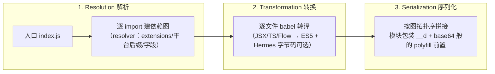

# Metro 三阶段与 Bundle 结构

> RN 的 bundle 不是黑盒，是一段可以逐行阅读的 JS。本篇先拆 Metro 的三阶段流水线，再解剖一个真实 bundle 的结构——读懂结构，热更新、拆包、启动优化都有了抓手。

## 1. Metro 是什么

Metro 是 RN 官方打包器（原 react-native-packager），为 RN 的场景定制：**单线程解析、按依赖图顺序输出、无 code-splitting**。它的流水线固定三阶段（源码：`metro/packages/metro/src/`）：



三个阶段各自可插拔（`metro.config.js` 的 `resolver / transformer / serializer` 三段）——monorepo watchFolders、按需转译、多 bundle 复用都在这三个口子上做文章。

## 2. 解析的规则要点

从 `require('./utils')` 到具体文件的决策链：

1. 补后缀：`./utils` → `.js` / `.tsx` / `.native.js` / `.ios.js` / `.android.js`（`sourceExts` + 平台后缀优先级）；
2. 目录则找 `index.*` 或 `package.json` 的 `main/react-native` 字段（`resolverMainFields` 默认 `['react-native', 'browser', 'main']`——**react-native 字段优先于 main**，库作者的跨端适配口）；
3. `node_modules` 黑盒/白名单与 `blockList` 控制图规模。

> 平台文件后缀是"平台分支"的打包级手段：`DatePicker.android.js` 与 `DatePicker.ios.js` 在解析期就分流，`Platform.select` 则是运行期分流。

## 3. Bundle 解剖：五个段

打开任何一个 `index.android.bundle`（顺序自上而下）：

```
┌────────────────────────────────────┐
│ ① polyfills：require/全局环境垫片    │ ← define 以及 __d/__r 定义在这
├────────────────────────────────────┤
│ ② 模块段：__d(factory, moduleId,    │ ← 每个文件一个 __d
│    dependencies)                   │
│    __d(function(g,r,a,m,e,d,i){…}, │
│       0, [1,517,8]);               │
├────────────────────────────────────┤
│ ③ 入口调用：__r(0)                  │ ← 运行起点
├────────────────────────────────────┤
│ ④ sourceMapComment（dev）           │
└────────────────────────────────────┘
```

三个角色：

- **`__d(factory, id, deps)`**：注册模块（define）。factory 不执行，只登记"怎么造这个模块"；
- **`__r(id)`**：执行模块（require）。首次调用才执行 factory，实现**懒执行**（注册全量、执行按需）；
- **moduleId**：数字编号（Metro 按依赖图顺序分配），require 依赖映射成数字数组 `[1,517,8]`。

```js
// 把 bundle 最小化到 10 行：自己就能写一个迷你运行时
const defs = new Map();
global.__d = (factory, id, deps) => defs.set(id, { factory, deps, exports: null });
global.__r = (id) => {
  const m = defs.get(id);
  if (m.exports) return m.exports;          // 缓存
  m.exports = {};                            // 循环依赖的半成品
  m.factory(g, global.__r, 0, m, m.exports, deps2Objs(m)); // deps 转成 require closure
  return m.exports;
};
```

**读懂这段，热更新与拆包的原理自动解锁**：

- 热更新 = 替换若干 `__d` 注册体后重新 `__r(0)`；
- 多 bundle = 公共包提供 A 的 `__d` 集，业务包只是追加新的 `__d` 段（id 空间要事先分配好——`createModuleIdFactory` 定制）；
- 循环依赖为何得到 `undefined`：`m.exports = {}` 先占位，factory 执行中取到的依赖可能尚未填充。

## 4. dev 与 prod 的差异清单

| 维度 | dev | prod |
|------|-----|------|
| 来源 | Metro Server HTTP（`index.bundle?platform=…`） | 内置文件（assets / main.jsbundle） |
| 转译 | 无压缩、含 HMR 客户端代码 | 压缩 +（可选）Hermes hbc |
| sourceMap | 内联/附带 | 单独 `.map` 文件（不进包） |
| 运行时开销 | 类型检查、告警全开 | 剥离 dev-only 代码 |

Hermes 场景下 prod 产物不再是文本 JS，而是 hbc 字节码——Metro 的 serializer 阶段挂 `metro-code-transform`（hermesc）完成"JS 文本 → 字节码"的最后一步（模块三）。

## 5. 与 Web 打包器的对照

| 能力 | Metro | Webpack/Vite 系 |
|------|-------|----------------|
| code splitting | 无（多 bundle 手工分） | 原生支持 |
| Tree shaking | 有限（CJS 语义为主） | ESM 精确裁剪 |
| HMR | 依赖级替换 + 重跑组件 | 模块级替换 |
| 转译 | 固定 babel 管线 | loader/插件生态 |

RN 生态以 CJS（`require`）为运行时底座，是历史决定——理解这一点，就理解了 RN 库"为什么打包后仍可能拖入意外依赖"（无 tree shaking 保险）。

## 小结

- Metro 三阶段：Resolution（建图）→ Transformation（转译）→ Serialization（拓扑序拼接）。
- Bundle = polyfill 段 + `__d` 注册段 + `__r(0)` 入口；注册全量、执行懒加载。
- `__d/__r` 十行迷你运行时是理解热更新、拆包、循环依赖的钥匙。
