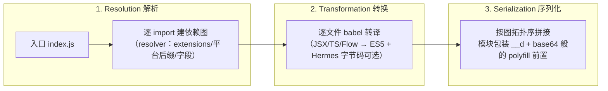

# Metro 三阶段与 Bundle 结构

> RN 的 bundle 不是黑盒，是一段可以逐行阅读的 JS。本篇先拆 Metro 的三阶段流水线，再解剖一个真实 bundle 的结构——读懂结构，热更新、拆包、启动优化都有了抓手。

## 1. Metro 是什么

Metro 是 RN 官方打包器（原 react-native-packager），为 RN 的场景定制：**单线程解析、按依赖图顺序输出、无 code-splitting**。它的流水线固定三阶段（源码：`metro/packages/metro/src/`）：



三个阶段各自可插拔（`metro.config.js` 的 `resolver / transformer / serializer` 三段）——monorepo watchFolders、按需转译、多 bundle 复用都在这三个口子上做文章。

### 1.1 Resolution：从入口到完整依赖图

解析阶段做的是**图的遍历**：从入口出发，逐个文件解析 `import/require`，直到没有新节点。每个"边"的解析是一次多步决策（`metro/packages/metro-resolver/src/`）：

```js
// 决策过程（概念示意）：require('./utils') 在 platform=ios 下的候选序列
// 0) 路径本身就是文件？（./utils 带了扩展名的情况）→ 直接命中
// 1) 外层按 sourceExts 顺序（默认 js → jsx → json → ts → tsx），
//    内层按「平台 → native → 无后缀」依次试：
//      ./utils.ios.js → ./utils.native.js → ./utils.js
//      ./utils.ios.jsx → …
//      ./utils.ios.ts → ./utils.native.ts → ./utils.ts → …
// 2) 都不是文件 → 当目录处理：
//      ./utils/package.json 按 resolverMainFields 取入口
//      否则 ./utils/index.{同上候选序列}
// 3) 命中即返回绝对路径；全部落空 → 抛出"Unable to resolve module"
```

裸模块名（`require('lodash')`）多一步"找包"：从当前文件所在目录逐级向上查 `node_modules/lodash`，再加上 `nodeModulesPaths` 里额外声明的目录（monorepo 的关键配置，03 篇）；找到包目录后回到上面的第 2 步。

三类特殊节点也在这个阶段处理：

| 节点类型 | 识别 | 图上的形态 |
|----------|------|-----------|
| 资产 `require('./logo.png')` | 扩展名在 `assetExts` | 不走普通 JS 转译，变成一个向资产注册表登记的小模块；`require` 得到的是资产编号 |
| 被排除的文件 | 路径匹配 `blockList` | 不进图；有代码引用它时解析失败 |
| 循环依赖 | 访问到已在图中的节点 | 允许建图（运行期的行为见第 3 节） |

工程上要知道的边界：**解析是确定性的**——同样的输入（文件树 + 配置 + 平台）必然得到同样的图。这份确定性是增量缓存、diff bundle、多包 id 稳定的共同前提（02/03 篇都靠它）。

### 1.2 Transformation：逐文件、可缓存、与图无关

转译阶段拿到的是"文件集合"，**不关心图的形状**——每个文件独立转译，因此天然可并行、可缓存：

- 缓存键 = 文件内容 + 转译配置 + 相关工具版本——改一行代码只重译一个文件，这是增量构建快的根源；
- babel 管线来自 RN 的共享预设（`@react-native/babel-preset`，前身 metro-react-native-babel-preset）：JSX/TS/Flow 语法转换、ES 模块语法转成 `require` 调用、以及可选的 **inline requires 改写**（把模块顶部的 `require` 挪到首次使用处——模块八 04 启动优化的关键开关）；
- 转译同时**收集依赖**：把源码里的 `require('x')` 改写成按下标取依赖表的形式，并把 `'x'` 记入该模块的依赖列表——解析阶段要的"边"正是从这里来的（所以实际运行中解析与转译是交替推进的，"三阶段"是逻辑划分）；
- 每个文件的转译产物附带自己的 source map 片段，序列化阶段拼接成最终 map。

`--reset-cache` 的作用点就在这层：缓存键被强制失效，全量重译。当"改了配置但构建结果没变"这类诡异现象出现时，先怀疑缓存（配置参与缓存键的部分是有边界的，03 篇展开）。

### 1.3 Serialization：从图到字符串

序列化阶段做拓扑遍历与拼接（`metro/src/DeltaBundler/Serializers/`）：

1. **定序与编号**：按依赖图的遍历顺序排列模块，id 也按首次遇到的顺序分配（入口通常是 0）。因为 `__d` 只注册不执行，**排列顺序不等于执行顺序**——执行顺序由 `__r` 的调用链决定；
2. **包装**：每个模块的转译产物包进 `__d(factory, id, deps)` 的注册体（第 3 节解剖）；
3. **拼装**：`getPolyfills` 返回的前置垫片（`require.js` 等）→ 模块段 → 入口执行语句（`getRunModuleStatements` 生成，默认是 `__r(入口id)` 一类）；
4. **可选加工**：压缩（minify）、source map 生成、以及 Hermes 路径的额外一步（第 4 节）。

增量点：Metro 内部的 DeltaBundler 维护"图的版本"，能算出"自上个版本以来增删改了哪些模块"——dev 下的 HMR 推送就是这份增量（第 4.1 节）。

## 2. 解析的规则要点

从 `require('./utils')` 到具体文件的决策链：

1. 补后缀：`./utils` → `.js` / `.tsx` / `.native.js` / `.ios.js` / `.android.js`（`sourceExts` + 平台后缀优先级）；
2. 目录则找 `index.*` 或 `package.json` 的 `main/react-native` 字段（`resolverMainFields` 默认 `['react-native', 'browser', 'main']`——**react-native 字段优先于 main**，库作者的跨端适配口）；
3. `node_modules` 黑盒/白名单与 `blockList` 控制图规模。

> 平台文件后缀是"平台分支"的打包级手段：`DatePicker.android.js` 与 `DatePicker.ios.js` 在解析期就分流，`Platform.select` 则是运行期分流。

### 2.1 解析配置速查（都在 metro.config 的 resolver 段）

| 配置 | 管什么 | 默认行为（要点） |
|------|--------|-----------------|
| `sourceExts` | 哪些扩展名算"源码" | js/jsx/json/ts/tsx |
| `platforms` | 哪些名字被当作平台后缀 | ios/android 等；`.native` 是独立的"原生通用"后缀，不在此列 |
| `resolverMainFields` | package.json 入口字段顺序 | react-native → browser → main |
| `assetExts` | 哪些扩展名算资产 | 图片/字体/音视频等，进资产注册表 |
| `nodeModulesPaths` | 额外的包查找目录 | monorepo 时手动补根目录（03 篇） |
| `blockList` | 哪些路径不进图 | 替代旧的黑名单配置 |
| `resolveRequest` | 完整接管解析的自定义函数 | 别名、mock、特殊协议的实现点（03 篇） |

### 2.2 用文件树走一遍平台分流

```text
src/
├── DatePicker.android.ts   ← platform=android 命中
├── DatePicker.ios.ts       ← platform=ios 命中
├── DatePicker.native.ts    ← 两个原生平台都可用（优先级低于平台后缀）
├── DatePicker.ts           ← 兜底（没有更具体的后缀时用它）
└── DatePicker.web.ts       ← platform=web 命中
```

两个推论：

- **同目录共存四份实现是常态**：解析优先级（平台 → native → 无后缀）保证每张图只含一个，bundle 不会翻倍；
- **`.native.` 的价值**是"双端一致但区别于 web"的实现落点——库作者最常用它。

### 2.3 resolverMainFields 为什么长这样

`react-native` 排在最前，是历史留给库作者的适配口：发布到 npm 的库可以在 package.json 里声明

```json
{
  "main": "dist/index.js",
  "react-native": "src/index.rn.js"
}
```

于是**同一个包，RN 取 `src/index.rn.js`，Node/Web 取 `dist/index.js`**——库可以针对 RN 单独提供实现（比如把 `window` 依赖换成 RN API）而不用发两个包。`browser` 排在 `main` 前面则沿袭了浏览器字段约定。排查"这个库在 RN 里进的是哪份代码"，第一步就是看它的 package.json 与这份字段顺序。

补一句现状：新式 npm 包用 `exports` 字段（条件导出）描述入口，它与 main fields 是两套机制；Metro 对 `exports` 的支持是后来加入、按版本逐步启用的（03 篇的 package exports 一节），遇到"装了包却解析不到子路径"时要同时检查这两套字段。

## 3. Bundle 解剖：五个段

打开任何一个 `index.android.bundle`（顺序自上而下）：

```
┌────────────────────────────────────┐
│ ① polyfills：require/全局环境垫片    │ ← define 以及 __d/__r 定义在这
├────────────────────────────────────┤
│ ② 模块段：__d(factory, moduleId,    │ ← 每个文件一个 __d
│    dependencies)                   │
│    __d(function(g,r,a,m,e,d,i){…}, │
│       0, [1,517,8]);               │
├────────────────────────────────────┤
│ ③ 入口调用：__r(0)                  │ ← 运行起点
├────────────────────────────────────┤
│ ④ sourceMapComment（dev）           │
└────────────────────────────────────┘
```

三个角色：

- **`__d(factory, id, deps)`**：注册模块（define）。factory 不执行，只登记"怎么造这个模块"；
- **`__r(id)`**：执行模块（require）。首次调用才执行 factory，实现**懒执行**（注册全量、执行按需）；
- **moduleId**：数字编号（Metro 按依赖图顺序分配），require 依赖映射成数字数组 `[1,517,8]`。

### 3.1 一个两模块的最小可运行例子

源码：

```js
// a.js（入口，id=0）
const b = require('./b');       // b 的 id=1
console.log('a ->', b.value);   // 输出 42

// b.js（id=1）
exports.value = 42;
```

bundle 化之后（结构还原，省略垫片段）：

```js
__d(function (g, r, i, a, m, e, d) {
  const b = r(d[0]);            // ← require('./b') 已变成 require(依赖表[0]) = __r(1)
  console.log('a ->', b.value);
}, 0, [1]);

__d(function (g, r, i, a, m, e, d) {
  e.value = 42;                 // ← exports.value 已变成对第 6 个形参的赋值
}, 1, []);

__r(0);                         // 入口执行：a → 触发 __r(1) → b 完成初始化 → 打印
```

逐行读它，能把本篇的所有概念落地：

- `__d(…, 0, [1])`：第三个参数就是这个模块的 dependencyMap；
- `r(d[0])`：**路径在产物里已不存在**，字符串在转译期换成了数组下标；
- `__r(0)` 只有一条：入口之外的模块都是被别的模块 `require` 时才执行的；
- b 的工厂先执行完（`e.value = 42`）再回到 a——**require 是同步的**（模块三 04），这不是 await。

### 3.2 循环依赖：占位机制的三步推演

```js
// a.js（入口）
const b = require('./b');           // ① 进入 b
console.log('a sees b.x =', b.x);   // ④ 'b done'（b 已完整执行）
exports.x = 'a done';               // ⑤ 此时才填充 a 的 exports

// b.js
const a = require('./a');           // ② a 正在执行中 → 拿到 a 的半成品 exports（空对象）
console.log('b sees a.x =', a.x);   // ③ undefined（a 还没执行到 ⑤）
exports.x = 'b done';
```

对照迷你运行时的三步：`__r(a)` 先 `m.exports = {}` 占位 → 执行 a 的工厂 → a 里 `__r(b)` → b 的工厂里 `__r(a)` 命中**缓存直接返回占位对象**（此时 a.x 还没赋值）→ b 执行完回到 a。结果：**后进入的一方（b）看到的是 undefined，先进入的一方（a）看到的是完整值**——不崩溃，但谁吃亏取决于谁先被 require，这正是循环依赖 bug "换个 import 顺序就好了/就坏了"的原因。

工程启示：

- **拿不到值 ≠ 没拿到模块**——拿到的是"还没填充完的同一个对象引用"，等双方都执行完后，通过**晚访问**（函数体内用时再取）仍能读到正确值；
- 解构 `const { x } = require('./b')` 把"晚访问"变成了"早拷贝"——循环依赖下必然 undefined。循环依赖的代码里**避免顶层解构**，这是硬规则；
- 真·初始化顺序依赖（A 必须先于 B）不该靠 require 顺序表达，那是循环依赖的信号，应重构为显式初始化入口。

```js
// 把 bundle 最小化到 10 行：自己就能写一个迷你运行时
const defs = new Map();
global.__d = (factory, id, deps) => defs.set(id, { factory, deps, exports: null });
global.__r = (id) => {
  const m = defs.get(id);
  if (m.exports) return m.exports;          // 缓存
  m.exports = {};                            // 循环依赖的半成品
  m.factory(g, global.__r, 0, m, m.exports, deps2Objs(m)); // deps 转成 require closure
  return m.exports;
};
```

真实 Metro 运行时（`metro-runtime/src/polyfills/require.js`）给工厂函数传 7 个实参，按**位置**对应如下（形参字母是压缩器起的，各版本不同，别按字母记）：

```js
__d(function (p1, p2, p3, p4, p5, p6, p7) { /* 你的模块代码 */ }, 0, [1, 517, 8]);
//            │   │   │   │   │   │   └─ dependencyMap：依赖 id 数组，即第三个实参 [1,517,8]
//            │   │   │   │   │   └───── exports：module.exports 的便捷引用
//            │   │   │   │   └───────── module：模块对象
//            │   │   │   └───────────── importAll：`import * as x` 的互操作辅助
//            │   │   └───────────────── importDefault：`import x from` 的互操作辅助
//            │   └───────────────────── require：按 id 取模块（懒执行的入口）
//            └───────────────────────── global：全局对象
```

模块体里的依赖访问因此长这样：`p2(p7[0])`——"用 require 取依赖表第 0 项对应的模块"。源码里的字符串路径在转译期已全部换成下标，**运行时没有任何路径解析**，这是 RN 启动时模块加载快于 Node 式 `require` 的原因之一。

上面的十行迷你版省略了两个 import 辅助参数，结构等价。

**读懂这段，热更新与拆包的原理自动解锁**：

- 热更新 = 替换若干 `__d` 注册体后重新 `__r(0)`；
- 多 bundle = 公共包提供 A 的 `__d` 集，业务包只是追加新的 `__d` 段（id 空间要事先分配好——`createModuleIdFactory` 定制）；
- 循环依赖为何得到 `undefined`：`m.exports = {}` 先占位，factory 执行中取到的依赖可能尚未填充。

## 4. dev 与 prod 的差异清单

| 维度 | dev | prod |
|------|-----|------|
| 来源 | Metro Server HTTP（`index.bundle?platform=…`） | 内置文件（assets / main.jsbundle） |
| 转译 | 无压缩、含 HMR 客户端代码 | 压缩 +（可选）Hermes hbc |
| sourceMap | 内联/附带 | 单独 `.map` 文件（不进包） |
| 运行时开销 | 类型检查、告警全开 | 剥离 dev-only 代码 |

Hermes 场景下 prod 产物不再是文本 JS，而是 hbc 字节码——Metro 的 serializer 阶段挂 `metro-code-transform`（hermesc）完成"JS 文本 → 字节码"的最后一步（模块三）。

### 4.1 Dev Server：HTTP 形态的三阶段

dev 模式下，三阶段流水线挂在一个本地服务后面（`metro/src/Server.js`）：

```bash
# 请求 bundle：查询参数就是"构建配置"
GET /index.bundle?platform=ios&dev=true&minify=false
# 请求 source map（红屏堆栈、调试器定位用）
GET /index.map?platform=ios&dev=true&minify=false
# 请求资产（dev 下图片不打进包，按需从 server 取）
GET /assets/src/img/logo.png?platform=ios&hash=...
# HMR：一条 WebSocket 长连接，Metro 主动推送变更
WS  /hot
```

- **`platform` 驱动解析**：同一个仓库对 ios/android 产出两张不同的图——平台分流在解析期完成（第 2 节）；
- **`dev` / `minify` 驱动转译与序列化**：dev 产物保留告警与断言、不压缩、带 HMR 客户端；
- **首次请求慢、之后快**：第一次要全量建图转译，之后靠文件监听 + 按文件缓存只处理改动的部分。

HMR 的一次推送流程：


这条链路与 02 篇的线上热更新共享同一个原理内核——**"替换若干模块的注册体"**——区别只在于：dev 下替换发生在运行中的内存里且无需校验，线上则要落盘、校验、下次启动生效。Fast Refresh 如何在替换后保住组件状态，见模块十 04。

### 4.2 产物的四种形态

| 形态 | 内容 | 出现场景 |
|------|------|---------|
| dev 文本 bundle | 未压缩、含 dev 告警与 HMR 客户端 | Metro Server 内存中，随请求生成 |
| prod 文本 bundle | 压缩后的 JS | 未启用 Hermes 的发布（存量 App） |
| prod hbc 字节码 | hermesc 编译产物 | 启用 Hermes 的发布构建（模块八 04） |
| source map | 位置映射文件 | 与产物并存，**不进安装包**，留给崩溃符号化（模块九 04） |

一个常被忽略的推论：**hbc 是"编译产物"而非"文本"**——它不可直接阅读、diff 特性更差（02 篇的差分权衡）、且与引擎版本绑定（模块三 03）。读懂第 3 节的 `__d/__r` 结构请用文本 bundle（dev 产物或未启用 Hermes 的构建）做教材。

## 5. 与 Web 打包器的对照

| 能力 | Metro | Webpack/Vite 系 |
|------|-------|----------------|
| code splitting | 无（多 bundle 手工分） | 原生支持 |
| Tree shaking | 有限（CJS 语义为主） | ESM 精确裁剪 |
| HMR | 依赖级替换 + 重跑组件 | 模块级替换 |
| 转译 | 固定 babel 管线 | loader/插件生态 |

RN 生态以 CJS（`require`）为运行时底座，是历史决定——理解这一点，就理解了 RN 库"为什么打包后仍可能拖入意外依赖"（无 tree shaking 保险）。

## 6. 常见误区速查

| 误解 | 实情 |
|------|------|
| "bundle 里模块的排列顺序 = 执行顺序" | 排列只是注册顺序（`__d` 不执行）；执行顺序由 `__r` 的调用链决定 |
| "`__r(0)` 会执行所有模块" | 只执行入口及其（传递）依赖；未被入口触达的模块注册了也不会执行 |
| "循环依赖会被 Metro 拦下" | 建图与执行都放行，运行期拿到"半成品 exports"（第 3 节的占位机制） |
| "sourceMap 没上线就没用" | 留在 CI 产物库用于崩溃符号化，是线上问题定位的生命线（模块九 04） |
| "dev 能跑 prod 一定能跑" | dev 有更宽松的告警与未压缩代码；发布流程必须在 release 产物上回归（模块九 01 的 dev/prod 失真） |
| "改了 metro.config 立即全量生效" | 部分配置参与缓存键的方式有边界，"结果没变"时先 `--reset-cache` 再排查（03 篇） |

## 7. 延伸阅读

- [02-热更新原理](02-热更新原理.md)：bundle 作为差分对象的安全链路；
- [03-Metro配置与工程化](03-Metro配置与工程化.md)：三段各自的定制口子；
- [04-包体与启动优化实操](04-包体与启动优化实操.md)：bundle 构成分析与懒执行落地；
- [../rn-启动流程原理/03-Bundle加载策略](../rn-启动流程原理/03-Bundle加载策略.md)：bundle 被谁、在何时加载；
- [../rn-JS引擎与线程模型/03-Hermes深潜：字节码与GC](../rn-JS引擎与线程模型/03-Hermes深潜：字节码与GC.md)：hbc 字节码的内部结构。

## 小结

- Metro 三阶段：Resolution（建图）→ Transformation（转译）→ Serialization（拓扑序拼接）。
- Bundle = polyfill 段 + `__d` 注册段 + `__r(0)` 入口；注册全量、执行懒加载。
- `__d/__r` 十行迷你运行时是理解热更新、拆包、循环依赖的钥匙。
- 解析确定性是增量缓存与 diff 的共同前提；转译按文件缓存（改一行只重译一个）；序列化支持 delta 输出。

## 自测

1. `require('./utils')` 在 iOS 平台的解析要经过哪些候选？平台后缀与扩展名的优先级关系是什么？
2. 转译阶段的缓存键由什么构成？为什么"改一行代码只重译一个文件"？
3. `__d` 与 `__r` 各做什么？为什么说"注册全量、执行按需"？循环依赖时拿到的是什么？
4. dev bundle 与 prod bundle 在来源、转译、映射、运行时开销四个维度各差在哪？
5. 多 bundle 公共包/业务包共享 id 空间，靠哪个序列化配置保证？不配会发生什么（03 篇）？
6. hbc 字节码为什么不能当文本 diff？这给热更新链路带来什么工程权衡（02 篇）？
