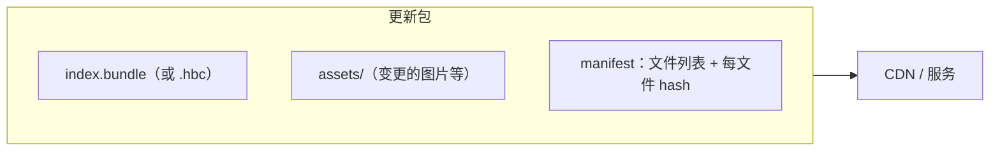
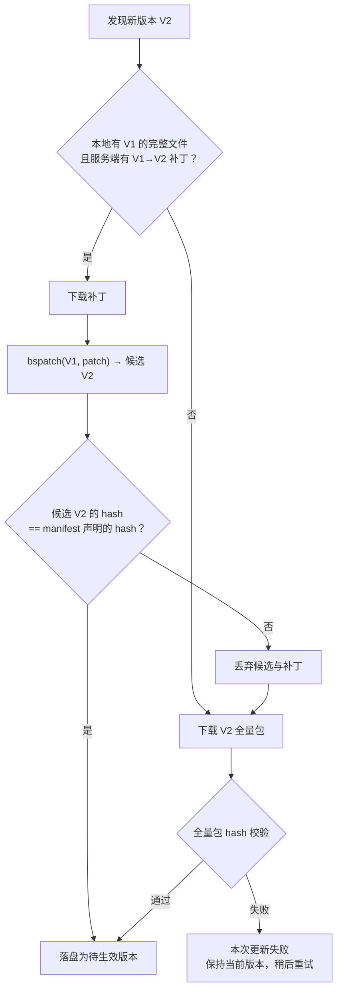
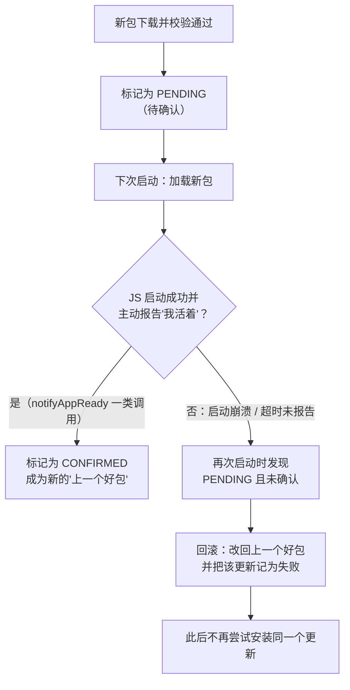
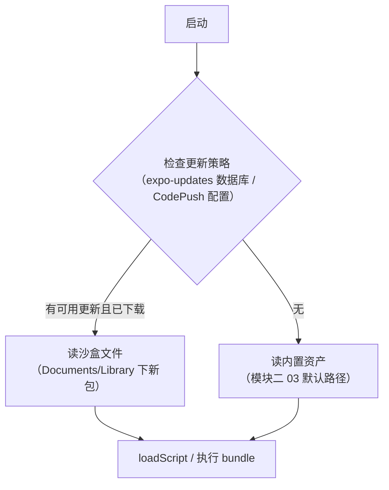

# 热更新原理（CodePush / expo-updates）

> 热更新 = **把模块二 03 里"prod 从资产读 bundle"的读取点，换成沙盒里下载的新文件**。理解了这一点，剩下的都是工程问题：怎么差分、怎么校验、怎么回滚、怎么灰度。本篇以 CodePush（经典）与 expo-updates（现行）为双主线。

## 1. 更新包里有什么

一个最小热更新包 = **新 bundle + 变更的静态资源 + 清单（manifest）**：



- manifest 记录每个文件的 hash 与相对路径——**下载后逐文件校验**的基础（第 3 节）；
- expo-updates 的 manifest 还承载元数据（channel、runtime version）；CodePush 用目录 + contentHash 组织；
- **runtime version 匹配是硬约束**：原生壳（含 Hermes 字节码版本，模块三 03）与 bundle 必须兼容——原生代码更新过的版本，旧 bundle 拒绝加载。

### 1.1 manifest 长什么样

以 expo-updates 协议为例，一份 manifest 的结构（示意，字段取自协议定义，值为占位）：

```json
{
  "id": "<本次更新的唯一 id>",
  "createdAt": "<发布时间>",
  "runtimeVersion": "<兼容域标识>",
  "launchAsset": {
    "key": "<bundle 的内容标识>",
    "contentType": "application/javascript",
    "url": "https://<cdn>/bundles/<...>",
    "hash": "<bundle 内容的 hash>"
  },
  "assets": [
    { "key": "<...>", "contentType": "image/png", "fileExtension": ".png",
      "url": "https://<cdn>/assets/<...>", "hash": "<...>" }
  ],
  "metadata": {},
  "extra": {}
}
```

| 字段 | 作用 | 对应本篇哪一节 |
|------|------|---------------|
| `id` | 更新的身份，客户端据此判断"这个我有没有" | 第 4 节选包 |
| `runtimeVersion` | 兼容域：与原生壳不一致就不该被加载 | 本节硬约束 |
| `launchAsset` | 启动要执行的 bundle | 第 4 节读取点 |
| `assets[]` | 图片等静态资源清单 | 4.2 节资源解析 |
| 各项的 `hash` | 下载后逐文件比对 | 第 3 节完整性 |
| `key` | 内容寻址：同 key 的文件本地已有则跳过下载 | 第 2 节文件级差分 |

manifest 本身很小，所以"检查更新"是一次轻量请求；真正的流量在后面按清单下载文件——**把"有没有更新"与"下载更新"拆成两步**，是所有热更新方案的共同结构。

### 1.2 更新包的生产侧：它是怎么来的

更新包不是特殊产物，就是 01 篇的 release 构建流程换了个出口：

```bash
# 概念流程（具体命令以所用方案的 CLI 为准）
# ① 用 release 配置跑 Metro：产出 bundle + 被引用的资产
npx react-native bundle --platform android --dev false \
  --entry-file index.js --bundle-output out/index.android.bundle --assets-dest out/
# ②（启用 Hermes 时）把 bundle 编译为 hbc
# ③ 计算每个文件的 hash，生成 manifest
# ④ 上传文件到存储/CDN，登记这次发布（渠道、目标 runtime version、放量比例）
```

两条生产侧纪律（05 篇展开成发布流程）：

- **构建环境必须与目标原生壳一致**：同一份依赖树、同一个 RN/Hermes 版本，否则产物与壳不兼容；
- **保留每次发布的原始产物**：它是下一次差分的"旧版本基线"，也是回滚时的实体。

## 2. 差分原理：bsdiff

全量包几十 MB，每次更新全下载不可接受。主流方案 **bsdiff/bspatch**：

1. 服务端对 old/new bundle 跑 bsdiff，产出补丁（通常只有原包大小的百分之几）；
2. 客户端下载补丁 + 本地保留的上一版本 → bspatch 还原出新 bundle；
3. **校验还原结果的 hash**，不一致则丢弃补丁、回退全量下载（整包兜底）。

注意差分的单位是"二进制文件"——JS bundle 是文本时差分效果好；**Hermes 字节码 diff 失真更严重**（指令区小改动可能扰动偏移表），所以部分链路选择"源码包差分、端上再编译"或直接全量 hbc——工程上在"补丁体积"与"还原可靠性"之间权衡。

### 2.1 三种差分粒度

"差分"不止 bsdiff 一种，按粒度从粗到细：

| 粒度 | 做法 | 省流量效果 | 复杂度与风险 |
|------|------|-----------|-------------|
| 全量 | 每次下载完整更新包 | 无 | 最简单，永远可用（所有方案的兜底） |
| 文件级 | 逐文件比对 hash/key，只下载变化的文件 | 资源多、改动集中时效果好；bundle 本身改一行也要整个重下 | 低：无需补丁运算，校验就是 hash 比对 |
| 二进制级（bsdiff 类） | 对新旧文件算字节级补丁 | bundle 小改动时补丁很小 | 高：端上要跑还原算法，依赖精确的旧版本基线 |

文件级差分是 expo-updates（按 `key` 跳过已有资产）与 CodePush 托管链路采用的思路；二进制级差分多见于社区与自研方案。二者不互斥——常见组合是"资源走文件级、bundle 走二进制级"。

### 2.2 bsdiff 在做什么

不必记算法细节，抓住三步即可（定性描述）：

1. **找相似**：对旧文件建立索引，在新文件里逐段寻找"旧文件中近似匹配的片段"；
2. **分三类数据输出**：控制信息（从旧文件哪里拷、拷多长、跳多远）、差异数据（近似匹配片段的逐字节差值，大量为 0，极易压缩）、新增数据（旧文件里找不到来源的全新内容）；
3. **压缩**：三类数据分别压缩后打包成补丁。

"近似匹配 + 记差值"是它对可执行文件/字节码仍然有效的原因：代码小改导致大量地址偏移，偏移后的字节与原字节的差值往往是规律的，压缩后很小。但它也有硬成本：**生成补丁耗内存耗时间（服务端）、还原补丁需要完整的旧文件在场（客户端）**。

客户端应用补丁的完整判定流：



### 2.3 基线管理：补丁是"一对一"的

补丁只对**生成它时所用的那个旧版本**有效。线上同时存在多个旧版本时：

| 策略 | 做法 | 代价 |
|------|------|------|
| 只对最近 N 个版本生成补丁 | 更老的版本走全量 | 发布时要算 N 份补丁；老用户首次更新流量大 |
| 链式补丁 | V1→V2→V3 逐级应用 | 端上多次还原，任何一环校验失败都要回退全量 |
| 以安装包内置版本为统一基线 | 所有补丁都相对于"出厂 bundle" | 补丁会随版本差距变大而变大，但基线永远在场 |

第三种的吸引力在于基线**确定存在**（内置资产不会丢）——这再次说明"保留一个不会失效的兜底版本"是热更新系统的结构性要求，而非可选项。

## 3. 安全机制：校验、签名、回滚

| 机制 | 做法 | 防的是什么 |
|------|------|-----------|
| 完整性校验 | manifest hash 逐文件比对 | 传输损坏 / 篡改 |
| 签名 | 更新包带签名，客户端公钥验签（expo-updates 的 `expectExpoSignature`） | 中间人替换恶意 bundle |
| 回滚 | 新包启动崩溃 → 自动回退上个好包（CodePush 的 rollback 策略 / expo-updates 保留 N 版可退） | "更新即事故" |
| 灰度 | 按用户百分比/渠道分批放量 | 把爆炸半径控制在小流量 |

回滚的关键是**保留上一可用版本**并区分"更新失败"（校验不过，装不上）与"运行失败"（装上后崩溃，要触发回滚）——后者需要崩溃上报与重启策略配合（模块九 04 的稳定性体系）。

### 3.1 信任链：三层各防一类威胁

| 层 | 机制 | 保证 | 不保证 |
|----|------|------|--------|
| 传输 | HTTPS | 传输途中不被窃听/篡改 | 服务端或 CDN 上的文件本身可信 |
| 完整性 | manifest 声明 hash，下载后比对 | 拿到的文件 == manifest 说的文件 | manifest 本身没被替换 |
| 来源 | manifest 签名，客户端内置公钥验签 | manifest 确实出自持有私钥的发布方 | 私钥没有泄露 |

三层是**链式依赖**：签名保 manifest，manifest 的 hash 保文件。少了签名这一层，攻击者只要能改 manifest（比如攻破 CDN 或更新服务），就能同时改 hash，完整性校验形同虚设。

为什么热更新必须比普通资源下载更严：它下发的是**会被执行的代码**，而且绕过了应用商店的审核与签名体系。原生安装包有系统级签名校验兜底，热更新包只有你自己实现的这条链。

### 3.2 回滚状态机：新包的"试用期"

回滚的核心设计是给新包一个**待确认**状态——装上不等于认可，跑稳了才转正（图中 PENDING/CONFIRMED 为概念命名，各 SDK 内部叫法不同）：



CodePush 系 SDK 把这个"报告"暴露为显式 API：

```js
import codePush from 'react-native-code-push';

// 写法一：sync() 内部会在合适时机自动确认
codePush.sync({ installMode: codePush.InstallMode.ON_NEXT_RESTART });

// 写法二：手动流程时必须自己确认，否则下次启动会被当作"运行失败"而回滚
codePush.notifyAppReady();
```

状态机里有三个设计点值得记住：

1. **"确认"必须由新包的 JS 自己发出**——只有新代码真的跑起来了，才有资格宣布成功。原生层单方面认为"加载没报错"是不够的（白屏、首屏逻辑异常原生都看不见）；
2. **失败的更新要记黑名单**——否则回滚后下次检查更新又把同一个坏包装回来，形成"装 → 崩 → 滚 → 装"的死循环；
3. **确认的时机是业务决策**——放在 JS 入口最顶部（只要引擎能跑就算成功）还是首屏渲染完成后（更严格），决定了回滚的灵敏度。越晚确认越安全，但也越容易把"用户手快杀进程"误判为失败。

### 3.3 两类失败的判定表

| | 更新失败 | 运行失败 |
|--|---------|---------|
| 发生时刻 | 下载/还原/校验阶段 | 新包已生效之后 |
| 用户感知 | 无（仍在跑旧版本） | 有（崩溃/白屏/功能异常） |
| 处置 | 丢弃，稍后重试 | 回滚到上一个好包 + 拉黑该更新 |
| 需要的基础设施 | hash/签名校验 | 待确认状态机 + 崩溃信号 |
| 能否自动发现 | 能，且是确定性的 | 只能发现"启动即崩"；功能性问题要靠线上监控 |

最后一行是自动回滚的能力边界：它只兜得住**启动阶段的硬崩溃**。"进了首页但下单按钮点不了"这种问题，状态机无能为力——只能靠灰度放量 + 监控指标 + 人工回滚（05 篇）。

### 3.4 手工推演：一次发布走出的四条命运线

把 3.2 的状态机跑一遍——同一次发布，四种用户现场，四种结局：

| # | 用户现场 | 时序 | 状态转移 | 结局 |
|---|---|---|---|---|
| ① | 正常用户 | 下载校验过 → 重启加载新包 → JS 起来并 notifyAppReady → 连续稳定 | PENDING → CONFIRMED | 新包转正，成为"上一个好包" |
| ② | 启动即崩 | 下载校验过 → 重启加载 → JS 入口抛异常，原生捕获崩溃信号 | PENDING 未确认 → 回滚 | 下次启动回旧包，该更新拉黑——**不再自动重装同一个** |
| ③ | 弱网用户 | 下载到一半断网，hash 对不上 | 丢弃未安装 | **无感知**：仍跑旧包，稍后重试（更新失败列：确定性、可自动） |
| ④ | 试用期内杀进程 | 新包加载 → 用户手快杀掉 → 未到 confirm 时机 | PENDING 超时未确认 → 下次启动判失败 | 回滚旧包——**误伤**：代码可能没问题，是确认时机太晚（3.2 设计点 3 的代价） |

三条读法：① 与 ② 的分界点只有一个——**新包的 JS 有没有机会发出确认信号**，所以崩溃监控要覆盖"JS 入口执行"这个最早时刻；③ 与 ② 对照出 3.3 判定表的分工：装不上是无感的，装上了崩才有感，基础设施的复杂度全部花在后者；④ 提醒确认时机的定价：放在入口顶部 = 灵敏但易误伤（④ 高发），放在首屏渲染完 = 稳健但漏检白屏之前的崩溃——没有免费的位置，只有与业务匹配的位置。把这张表和 05 篇 §5.2 的"回滚的两种形态"连读：这里是**客户端自动回滚**的微观机制，那边是**服务端人工止损**的宏观操作，两层各管一段。

## 4. 加载路径替换点：双平台各一处

热更新对启动链路的侵入极小，只在"bundle 从哪读"这一步分支：



- **Android**：旧架构传 `ReactInstanceManager.setJSBundleFile(codePush.getJSBundleFile())`；新架构在 `ReactHost` 的 bundle 加载处同理给文件路径；
- **iOS**：`RCTBridge` 的 `bundleURLBlock` / 新架构加载器返回沙盒 file URL；
- expo-updates 多一层"数据库选包"：启动时查库决定用哪个目录的包，策略（如"下次启动生效"）也在此实现。

两端的替换点代码（CodePush 系接入形态，简化示意）：

```java
// Android：android/app/src/main/java/.../MainApplication.java（旧架构形态，简化）
@Override
protected String getJSBundleFile() {
  // 返回 null → 走默认的内置 assets；返回文件路径 → 从该文件加载
  // SDK 内部逻辑：有已确认/待确认的更新包 → 返回沙盒里的路径；否则返回内置资产
  return CodePush.getJSBundleFile();
}
```

```objc
// iOS：ios/<App>/AppDelegate.mm（简化）
- (NSURL *)bundleURL {
#if DEBUG
  return [[RCTBundleURLProvider sharedSettings] jsBundleURLForBundleRoot:@"index"]; // dev：连 Metro
#else
  return [CodePush bundleURL];   // prod：沙盒新包或内置 main.jsbundle 的 file URL
#endif
}
```

读这两段要看到的是**侵入面之小**：整个热更新系统对宿主 App 的改动，就是把"返回一个固定路径"换成"问 SDK 要一个路径"。其余所有逻辑（下载、校验、状态机、回滚）都在这个返回值的背后。这也是为什么本篇开头敢说"热更新 = 换读取点"。

JS 侧的控制 API，两个方案各一组：

```js
// expo-updates：三步手动流程
import * as Updates from 'expo-updates';

const check = await Updates.checkForUpdateAsync();   // 拉 manifest，比对
if (check.isAvailable) {
  await Updates.fetchUpdateAsync();                   // 按清单下载并校验
  await Updates.reloadAsync();                        // 重载 JS：走一遍"启动选包"
}
```

```js
// CodePush 系：一步式，生效时机用 installMode 声明
codePush.sync({
  installMode: codePush.InstallMode.ON_NEXT_RESTART,        // 普通更新：下次冷启动生效
  mandatoryInstallMode: codePush.InstallMode.IMMEDIATE,     // 强制更新：下载完立即重载
});
```

### 4.1 生效时机的三种选择

| 时机 | 行为 | 适用 | 风险 |
|------|------|------|------|
| 下次冷启动 | 下载完静默等待，用户下次打开 App 生效 | 默认选择，用户无感 | 修复触达慢（取决于用户何时重启） |
| 下次回到前台 | App 从后台恢复时重载 | 希望更快触达又不打断当前操作 | 用户切回来发现页面状态丢失 |
| 立即 | 下载完马上重载 JS | 严重线上问题的紧急修复 | 打断用户正在进行的操作（表单、支付） |

无论哪种，本质都是**重新走一遍 JS 启动流程**：销毁当前 JS 运行时 → 重新选包 → 重新执行 bundle（模块二的启动链路重跑后半段）。所以"立即生效"一定伴随全部 JS 状态丢失，没有"无缝替换运行中代码"这回事——那是 dev 下 Fast Refresh 的能力，依赖 Metro 的增量协议与 dev 运行时，线上没有。

> 时序提醒：**下载新包不影响当前运行的 JS**——正在执行的代码不会中途替换，切换发生在下次启动；CodePush 的 `restartApp()` 与 expo-updates 的 reload 本质都是"重启后走新分支"。

### 4.2 资源怎么跟着更新：资产解析的重定向

bundle 换了读取点，图片怎么办？关键在 RN 的资产解析是**相对于 bundle 位置**的：

- JS 里 `require('./logo.png')` 得到的是资产编号（01 篇），运行时由资产解析器把编号换成实际路径；
- prod 下解析器以"当前 bundle 所在目录"为基准找资源文件——bundle 从沙盒加载时，基准目录自然变成沙盒里的更新目录；
- 所以更新包必须**带齐 bundle 引用的资源**（或由 SDK 负责把未变更的资源从内置包补齐/回退查找），否则出现"JS 更新了但图片全裂"。

| 症状 | 原因 |
|------|------|
| 更新后部分图片不显示 | 更新包只带了变更的图片，未变更的没被复制/回退到内置资源 |
| Android 上 drawable 资源找不到 | Android 内置资源走的是资源系统（按名称），沙盒更新走的是文件路径，两套寻址方式切换时出错 |
| 字体没更新 | 字体等通过原生工程链接的资源在原生侧注册（非 JS require），不在 bundle 的资产清单里——属于原生变更，OTA 发不了 |

## 5. CodePush 与 expo-updates 对照

| | CodePush（App Center 时代） | expo-updates |
|--|---------------------------|--------------|
| 现状 | App Center 已退休，社区维护版（如 codepush 项目延续） | 现行官方主流 |
| 清单 | 目录 + contentHash | JSON manifest（channel / runtimeVersion 语义强） |
| 灰度 | rollout 百分比、多部署（Staging/Production） | channel + branch 分流 |
| 签名 | 公钥校验（CodePush signing） | RS256 签名头 |
| 与 Expo 工程 | 需要额外适配 | 原生集成，EAS Update 一条龙 |

选型不看功能表看**生命周期**：热更新服务必须比你的 App 活得久，供应商退役是这类方案的最大风险（CodePush 的退役即是案例）。

## 6. 把热更新放回全站

- 原理基础：模块二 03 的加载策略（热更新 = 替换读取点）；
- 工程配套：模块八 01 的 bundle 结构（差分对象）、模块八 03 的 Metro 定制（多包/资源处理常与更新系统联动）；
- 风险闭环：签名与回滚属于"稳定性体系"（模块九 04），灰度属于发布工程——热更新省掉的是"过审时间"，**不能省掉"发布纪律"**。

延伸阅读：

- [01-Metro三阶段与Bundle结构](01-Metro三阶段与Bundle结构.md)：被替换的对象——bundle 的内部结构；
- [05-OTA更新工程实践](05-OTA更新工程实践.md)：通道、灰度、回滚的操作层；
- [../rn-启动流程原理/03-Bundle加载策略](../rn-启动流程原理/03-Bundle加载策略.md)：读取点所在的启动链路；
- [../rn-JS引擎与线程模型/03-Hermes深潜：字节码与GC](../rn-JS引擎与线程模型/03-Hermes深潜：字节码与GC.md)：字节码版本与引擎绑定的原因；
- [../rn-性能优化原理/04-内存与稳定性](../rn-性能优化原理/04-内存与稳定性.md)：崩溃信号与稳定性体系。

## 7. 常见坑速查

| 症状 | 根因 | 出路 |
|------|------|------|
| 更新后启动即崩，且反复崩 | 新 bundle 调用了壳里不存在的原生能力；回滚状态机没接或没拉黑 | runtime version 隔离；确认回滚链路真的生效（故障演练） |
| 更新"发了但没人收到" | runtime version / 渠道不匹配，客户端认为没有可用更新 | 发布前核对目标兼容域；这类"静默不更新"要有监控 |
| 补丁还原总是失败 | 客户端的旧版本与服务端生成补丁时的基线不是同一份 | 基线用内容 hash 标识而非版本号；失败回退全量 |
| dev 下一切正常，热更新后异常 | 热更新包是 release 产物，与 dev 行为有差异（压缩、dev-only 代码剥离） | 发布前在 release 构建上回归 |
| 回滚后又被装回坏包 | 没有记录失败更新 | 失败更新进黑名单，服务端同时下线该版本 |
| 强制立即更新导致用户数据丢失 | 重载 JS 清空了内存状态 | 关键流程中延后重载；或重载前持久化草稿 |
| 启动变慢 | 启动时同步等待检查更新 | 检查改为异步/设超时窗口，先用本地已有版本 |

## 小结

- 热更新的全部原理 = 沙盒换读取点 + 差分下载 + hash/签名校验 + 崩溃回滚 + 灰度放量；
- bsdiff 补丁小但还原必须整包校验兜底；Hermes 字节码让"diff 好不好"变成真问题；
- 新包下次启动才生效，运行中切换 = 重启；runtime version 匹配是不可逾越的安全线；
- CodePush 退役的教训：选热更新方案先评估其生命周期，再谈功能。
- 回滚靠"待确认"状态机：新包的 JS 主动报告存活才转正；自动回滚只兜启动硬崩溃，功能性问题靠灰度与监控。

## 自测

1. 一句话说明热更新对启动链路的侵入点在哪里？两端各改了什么？
2. manifest 里的 hash 与签名分别防什么？为什么只有 hash 没有签名是不够的？
3. 文件级差分与二进制级差分各自的适用场景与代价是什么？补丁还原后为什么必须再校验整包 hash？
4. 为什么补丁是"一对一"的？线上有多个旧版本时有哪些基线策略？
5. 回滚状态机里，"确认成功"为什么必须由新包的 JS 发出？失败的更新为什么要拉黑？
6. "更新失败"与"运行失败"的区别是什么？自动回滚能兜住哪一类、兜不住哪一类？
7. 为什么线上不存在"无缝替换运行中代码"？立即生效模式的代价是什么？
8. 更新后图片不显示，可能的原因有哪些？字体为什么不能通过 OTA 更新？
