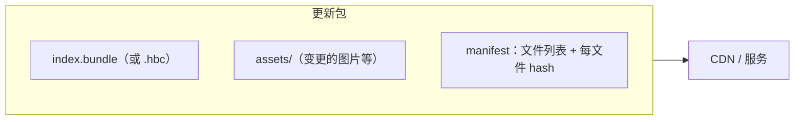
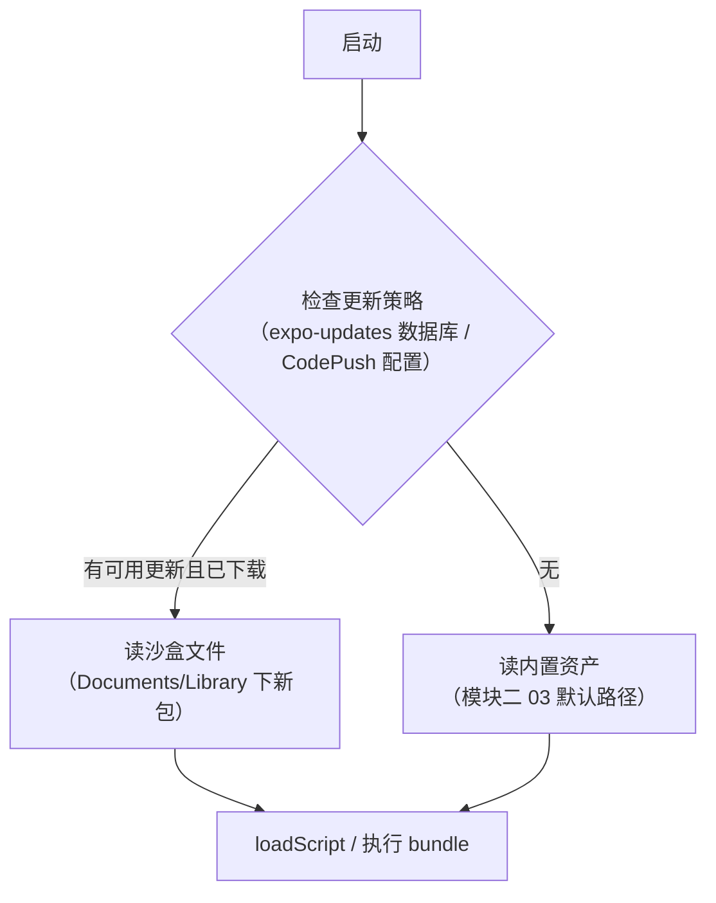

# 热更新原理（CodePush / expo-updates）

> 热更新 = **把模块二 03 里"prod 从资产读 bundle"的读取点，换成沙盒里下载的新文件**。理解了这一点，剩下的都是工程问题：怎么差分、怎么校验、怎么回滚、怎么灰度。本篇以 CodePush（经典）与 expo-updates（现行）为双主线。

## 1. 更新包里有什么

一个最小热更新包 = **新 bundle + 变更的静态资源 + 清单（manifest）**：

- manifest 记录每个文件的 hash 与相对路径——**下载后逐文件校验**的基础（第 3 节）；
- expo-updates 的 manifest 还承载元数据（channel、runtime version）；CodePush 用目录 + contentHash 组织；
- **runtime version 匹配是硬约束**：原生壳（含 Hermes 字节码版本，模块三 03）与 bundle 必须兼容——原生代码更新过的版本，旧 bundle 拒绝加载。

## 2. 差分原理：bsdiff

全量包几十 MB，每次更新全下载不可接受。主流方案 **bsdiff/bspatch**：

1. 服务端对 old/new bundle 跑 bsdiff，产出补丁（通常只有原包大小的百分之几）；
2. 客户端下载补丁 + 本地保留的上一版本 → bspatch 还原出新 bundle；
3. **校验还原结果的 hash**，不一致则丢弃补丁、回退全量下载（整包兜底）。

注意差分的单位是"二进制文件"——JS bundle 是文本时差分效果好；**Hermes 字节码 diff 失真更严重**（指令区小改动可能扰动偏移表），所以部分链路选择"源码包差分、端上再编译"或直接全量 hbc——工程上在"补丁体积"与"还原可靠性"之间权衡。

## 3. 安全机制：校验、签名、回滚

| 机制 | 做法 | 防的是什么 |
|------|------|-----------|
| 完整性校验 | manifest hash 逐文件比对 | 传输损坏 / 篡改 |
| 签名 | 更新包带签名，客户端公钥验签（expo-updates 的 `expectExpoSignature`） | 中间人替换恶意 bundle |
| 回滚 | 新包启动崩溃 → 自动回退上个好包（CodePush 的 rollback 策略 / expo-updates 保留 N 版可退） | "更新即事故" |
| 灰度 | 按用户百分比/渠道分批放量 | 把爆炸半径控制在小流量 |

回滚的关键是**保留上一可用版本**并区分"更新失败"（校验不过，装不上）与"运行失败"（装上后崩溃，要触发回滚）——后者需要崩溃上报与重启策略配合（模块九 04 的稳定性体系）。

## 4. 加载路径替换点：双平台各一处

热更新对启动链路的侵入极小，只在"bundle 从哪读"这一步分支：

- **Android**：旧架构传 `ReactInstanceManager.setJSBundleFile(codePush.getJSBundleFile())`；新架构在 `ReactHost` 的 bundle 加载处同理给文件路径；
- **iOS**：`RCTBridge` 的 `bundleURLBlock` / 新架构加载器返回沙盒 file URL；
- expo-updates 多一层"数据库选包"：启动时查库决定用哪个目录的包，策略（如"下次启动生效"）也在此实现。

> 时序提醒：**下载新包不影响当前运行的 JS**——正在执行的代码不会中途替换，切换发生在下次启动；CodePush 的 `restartApp()` 与 expo-updates 的 reload 本质都是"重启后走新分支"。

## 5. CodePush 与 expo-updates 对照

| | CodePush（App Center 时代） | expo-updates |
|--|---------------------------|--------------|
| 现状 | App Center 已退休，社区维护版（如 codepush 项目延续） | 现行官方主流 |
| 清单 | 目录 + contentHash | JSON manifest（channel / runtimeVersion 语义强） |
| 灰度 | rollout 百分比、多部署（Staging/Production） | channel + branch 分流 |
| 签名 | 公钥校验（CodePush signing） | RS256 签名头 |
| 与 Expo 工程 | 需要额外适配 | 原生集成，EAS Update 一条龙 |

选型不看功能表看**生命周期**：热更新服务必须比你的 App 活得久，供应商退役是这类方案的最大风险（CodePush 的退役即是案例）。

## 6. 把热更新放回全站

- 原理基础：模块二 03 的加载策略（热更新 = 替换读取点）；
- 工程配套：模块八 01 的 bundle 结构（差分对象）、模块八 03 的 Metro 定制（多包/资源处理常与更新系统联动）；
- 风险闭环：签名与回滚属于"稳定性体系"（模块九 04），灰度属于发布工程——热更新省掉的是"过审时间"，**不能省掉"发布纪律"**。

## 小结

- 热更新的全部原理 = 沙盒换读取点 + 差分下载 + hash/签名校验 + 崩溃回滚 + 灰度放量；
- bsdiff 补丁小但还原必须整包校验兜底；Hermes 字节码让"diff 好不好"变成真问题；
- 新包下次启动才生效，运行中切换 = 重启；runtime version 匹配是不可逾越的安全线；
- CodePush 退役的教训：选热更新方案先评估其生命周期，再谈功能。
