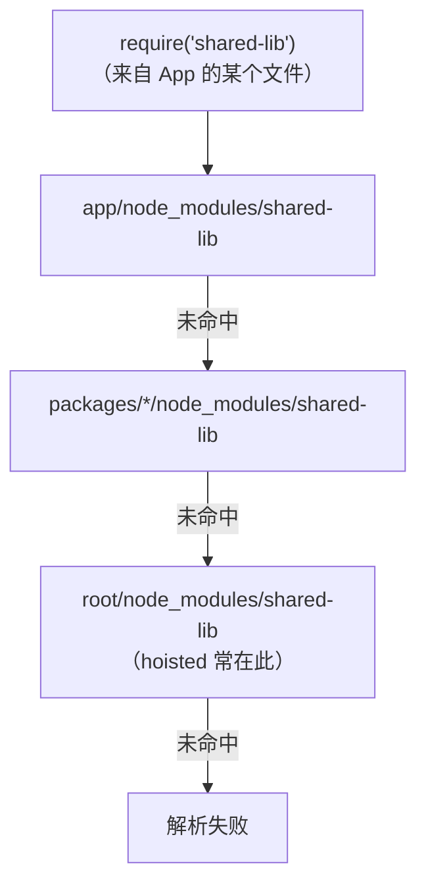

# Metro 配置与工程化

> 01 篇讲了 Metro 的三阶段（Resolution / Transformation / Serialization），本篇讲**这三段各能怎么改**：resolver 的平台与 monorepo、transformer 的注入、serializer 的多包 id，最后回答那个经典问题——**Metro 为什么没有 code-splitting**。

## 1. metro.config.js 的三段定制地图

```js
const { getDefaultConfig, mergeConfig } = require('react-native/metro.config');

const config = {
  resolver: {
    /* 模块怎么被"找到" */
  },
  transformer: {
    /* 源码怎么被"改写" */
  },
  serializer: {
    /* 模块怎么被"组织进 bundle" */
  },
};

module.exports = mergeConfig(getDefaultConfig(__dirname), config);
```

| 段 | 常用定制 | 典型用途 |
|----|---------|---------|
| resolver | `platforms`、`sourceExts`、`nodeModulesPaths`、`resolveRequest`（自定义解析函数） | 平台后缀、monorepo、别名、拦截特定依赖 |
| transformer | `babelTransformerPath`、`assetRegistryPath`、`assetPlugins` | 自定义 babel 预设、资产处理插件 |
| serializer | `processModuleFilter`、`createModuleIdFactory`、`getRunModuleStatements` | 挑模块、**自定义模块 id**、控制入口执行 |

> 原则：**永远从 `getDefaultConfig` 开始 merge**，不要手写整份配置——默认值里有平台后缀、流量置换（资产 registry）等大量隐含行为。

### 1.1 一份带注释的完整示例（monorepo 场景）

```js
// metro.config.js —— 各段都从默认值 merge，只覆写需要的键
const { getDefaultConfig, mergeConfig } = require('react-native/metro.config');
const path = require('path');

const root = path.resolve(__dirname, '../..');        // 仓库根
const app = __dirname;                                 // App 目录

const config = {
  // ① 监听范围：0.72+ 默认已覆盖根目录与 workspace 软链；
  //    老版本需要显式 watchFolders（已逐步退役的写法，存量工程里还常见）
  watchFolders: [root],

  resolver: {
    // ② 包查找路径：hoisted 的 node_modules 在根，本地装的在 app
    nodeModulesPaths: [
      path.resolve(app, 'node_modules'),
      path.resolve(root, 'node_modules'),
    ],
    // ③ 源码扩展名按需补充（如 monorepo 里共享包用别的扩展名）
    // sourceExts: [...defaults, 'cjs'],
    // ④ 现代包的 exports 字段按版本逐步支持，需要时显式开启
    // unstable_enablePackageExports: true,
  },

  transformer: {
    // ⑤ inline requires：启动优化的关键开关（模块八 04）
    getTransformOptions: async () => ({
      transform: {
        inlineRequires: true,           // require 挪到首次使用处（模块八 04）
      },
    }),
  },

  serializer: {
    // ⑥ 多 bundle 的稳定 id（第 3 节展开）
    // createModuleIdFactory: () => (path) => stableId(path),
    // processModuleFilter: (module) => shouldInclude(module),
  },
};

module.exports = mergeConfig(getDefaultConfig(__dirname), config);
```

读配置文件的顺序建议：**先找 watchFolders / nodeModulesPaths（图的范围），再看 resolver 的其余键（图长什么样），最后 serializer（产物怎么组织）**——与 01 篇三阶段的顺序一致，配置即阶段。

### 1.2 resolveRequest：接管解析的万能口

`resolveRequest` 是 resolver 段的"总闸"——完全接管一次解析，适合别名、mock、按环境替换实现这类需求：

```js
const { getDefaultConfig } = require('metro-config');

async function getConfig() {
  const defaultConfig = await getDefaultConfig(__dirname);
  const defaultResolveRequest = defaultConfig.resolver.resolveRequest;

  defaultConfig.resolver.resolveRequest = (context, moduleName, platform) => {
    // ① 别名：把 '@/x' 映射到 src 目录
    if (moduleName.startsWith('@/')) {
      return context.resolveRequest(
        context,
        moduleName.replace('@/', `${__dirname}/src/`),
        platform,
      );
    }
    // ② 环境替换：测试环境用 mock 实现
    if (moduleName === 'analytics' && process.env.NODE_ENV === 'test') {
      return { type: 'sourceFile', filePath: `${__dirname}/mocks/analytics.js` };
    }
    // ③ 兜底：其余交给默认解析（关键！不兜底则所有解析都被打断）
    return defaultResolveRequest(context, moduleName, platform);
  };
  return defaultConfig;
}
module.exports = getConfig;
```

三条使用纪律：

- **永远保存并回退到默认解析器**——resolveRequest 拦截的是每一次 require，一个异常会让整个构建失败；
- 返回值是"解析结果对象"而非路径字符串（老版本 API 形态不同，以所用 Metro 版本为准）；
- 只做"翻译"，不做 I/O 之外的逻辑——它跑在解析热路径上，慢一点整个增量构建都慢。

### 1.3 transformer 定制：以 SVG 转换器为例

transformer 段最常用的定制是换掉/串联转译器，生态里的标准例子是 SVG 组件化（`react-native-svg-transformer`）：

```js
// metro.config.js —— 让 .svg 不走资产通道，而是转译成 React 组件
const { getDefaultConfig, mergeConfig } = require('metro-config');

const config = {
  transformer: {
    babelTransformerPath: require.resolve('react-native-svg-transformer'),
  },
  resolver: {
    assetExts: getDefaultAssetExts.filter((ext) => ext !== 'svg'), // 从资产里移除
    sourceExts: [...getDefaultSourceExts, 'svg'],                    // 加入源码
  },
};
```

配置的语义：`babelTransformerPath` 指向一个实现转译接口的模块——它接到 `.svg` 文件后输出 JS 代码（把 SVG 转成 svg 组件的 render 调用），后续流程与普通 JS 无异。

两点判断标准，避免滥用 transformer：

- **值得用**：格式转换类需求（SVG/着色器/模板→JS）——输入非 JS、输出 JS，正好卡在转译职责上；
- **不该用**：业务逻辑注入、条件编译——这些放 babel 插件或 resolveRequest 更可控。transformer 影响每个文件的构建速度与缓存，变更要慎重。

## 2. monorepo：watchFolders 与 node_modules 转链接

把 RN App 放进 monorepo（与 Web 端、共享包同仓）时，Metro 默认"只看自己目录"的世界观会被打破，两个经典配置：

```js
resolver: {
  // ① 让 Metro 能"看到"工作区根（共享包在那里被引用与监听变更）
  //（0.72+ 已默认支持 watch 根目录与 symlinks，老版本需显式 watchFolders）
  // ② 告诉 Metro 去哪里解析依赖（hoisted 的 node_modules 在根目录）
  nodeModulesPaths: [`${root}/node_modules`, `${app}/node_modules`],
},
```

一次裸模块名查找的路径顺序（配合 `nodeModulesPaths` 理解）：



monorepo 配置的目标就是让这张图里的查找**总能命中同一份实现**——命中不同副本时，就会出现下面 2.1 节的"两份 React"病。

配套概念：

- **symlink 解析**：workspace 里的包是软链，`resolveSymlinks` 决定 Metro 把它当"真实路径"还是"链接路径"——影响的是**模块去重**（同一包若被解析成两个路径，会进 bundle 两次，单例状态失效）；
- **package exports**：现代 npm 包的 `exports` 字段默认不被 Metro 理解（历史原因），需要时显式开启——"明明装了包却 cannot resolve"的常见来源；
- 排查工具：`npx react-native config` 输出 Metro 视角下的依赖图，monorepo 问题先看它。
  （该命令给出 RN CLI 收集到的工程与依赖信息，包括各依赖被解析到的入口，monorepo 的"到底用了哪份"先看它。）

### 2.1 monorepo 的经典病：React 出现两份

workspace 里如果 App 与某个共享包各自依赖了 React/ReactDOM（哪怕版本相同），hoist 不彻底时可能出现**两份 React**——症状是运行期的 hook 报错（"Invalid hook call"一类）：渲染器与 reconciler 分属两个 React 实例，hook 状态对不上。

排查与治理：

1. 先确认两份实例的物理路径（构建报错/调试信息里通常带路径）——差异通常在"根 node_modules vs 某子包 node_modules"；
2. 治理方向是**保证 App 的图里只有一个 React**：依赖版本对齐、提升策略调整，或在 resolveRequest 里把 react/react-dom 强制解析到 App 侧的副本；
3. 同类问题会出现在一切"单例语义"的库上（不止 React）——凡是依赖全局副作用/全局注册表的库，重复进图都会出诡异 bug。

### 2.2 monorepo 的构建缓存陷阱

- **不同包不同 babel 配置**：缓存键含转译配置，共享包与 App 的预设若不一致，同一文件可能被转译两份（且语义可能不同）——共享包的 babel 配置应与 App 对齐或显式独立；
- **CI 缓存要带"配置指纹"**：metro/babel 的缓存若在 CI 复用，key 必须包含配置与依赖版本，否则"改了配置产物没变"；
- **软链与真实路径的混用**：同一包有时以链接路径、有时以真实路径进图，会被当成两个模块（单例失效）——保持 `resolveSymlinks` 行为全工程一致。

## 3. serializer：模块 id 与多 bundle

01 篇讲过 `__d(id, factory)` 的封装——**id 从哪来**就是 `createModuleIdFactory` 决定的：

```js
serializer: {
  // 单包默认：自增数字
  createModuleIdFactory: () => (path) => numberId(path),
  // 多包（模块二 03）必须改成"路径哈希"，保证同一个模块在所有包里 id 一致：
  createModuleIdFactory: () => (path) => stablePathId(path),
},
```

多 bundle 场景的三件套：

1. `createModuleIdFactory`：路径稳定 id（防跨包冲突）；
2. `processModuleFilter`：公共包构建时排除业务模块 / 业务包排除公共模块（防重复进包）；
3. 构建顺序与加载顺序：公共包先执行，业务包 `__r` 才找得到依赖（模块二 03）。

### 3.1 稳定 id 的一种实现

id 的要求只有一个：**同一模块在任何一次构建、任何包里，id 必须一致且唯一**。常见实现按"路径身份"生成：

```js
// createModuleIdFactory 的常见实现（示意）
const path = require('path');

function createModuleIdFactory() {
  return (modulePath) => {
    const rel = path.relative(path.resolve(__dirname, '../..'), modulePath);
    if (/node_modules/.test(rel)) {
      // 依赖：用 "包名/包内路径" —— 不含 node_modules 的层级噪声
      const m = rel.match(/node_modules\/((?:@[^/]+\/)?[^/]+)\/(.+)/);
      return `npm/${m[1]}/${m[2]}`;
    }
    return `app/${rel}`;              // 业务代码：仓库相对路径
  };
}
```

两条设计理由：

- **自增数字为什么不行**：数字取决于模块进图的顺序，加一个新依赖可能使所有 id 漂移——公共包与业务包的 id 对不上，热更/分包直接崩；
- **id 里带不带语义**（如上面的 `npm/`、`app/` 前缀）是自由选择，但**编码规则一旦上线不可更改**：id 是历史包之间的公共语言，改规则等于所有旧包失配。

### 3.2 processModuleFilter：谁进哪个包

```js
// 公共包构建：排除业务目录（只留 node_modules 与共享代码）
const commonFilter = (module) => !/\/biz\//.test(module.path);

// 业务包构建：排除已在公共包里的内容（业务自己的 node_modules 变更走业务包）
const bizFilter = (module) => /\/biz\//.test(module.path);
```

配套的加载侧约束（模块二 03 的执行序）：**公共包先加载执行（注册它的 `__d` 集），业务包后加载**——业务模块 factory 里 `r(d[i])` 要求被依赖者已注册。顺序错了不是"加载慢"，是直接 ReferenceError。

### 3.3 多包方案的维护成本清单

| 成本项 | 说明 |
|--------|------|
| id 规则冻结 | 规则上线后不可变，新增类型只能追加 |
| 公共/业务边界治理 | 依赖放错边：放公共包则公共包膨胀，放业务包则多个业务包重复 |
| 热更新联动 | 业务包可 OTA；公共包改动 = 需要重新协调多包版本（02/05 篇） |
| 构建流水线 | 公共包与业务包要按序构建、一起验证，不能各发各的 |

multi-bundle 是重武器——超过单包管理极限（团队规模、启动要求）再上，上了就要为"边界"建立评审机制（模块八 04 的实操细节）。

## 4. 为什么 Metro 没有 code-splitting

Web 打包器的 `import()` = **异步加载一个 chunk**（网络请求 + 时机可控）。RN 里这个语义不成立，原因有三层：

1. **require 是同步契约**：JS 代码假设"require 返回即得模块"（模块三 04 的同步边界）。没有"异步 require"，就没有天然的分割点；
2. **单 JS 环境**：一个 Hermes 引擎、一个全局模块表，`__d/__r` 都在同一个闭包世界里——chunk 的"隔离单元"不存在；
3. **加载通道受控**：Web 的 chunk 可以运行时 HTTP 拉；RN 的文件要么打进包、要么走热更新系统整体替换（模块八 02），没有"运行时按需拉一段 JS 插进模块表"的通道。

### 4.1 为什么 inline requires 不是 code-splitting

三者容易混淆，按"分割的对象"区分：

| 方案 | 分割了什么 | 没分割什么 |
|------|-----------|-----------|
| Web 的 `import()` | 文件：拆成独立 chunk，运行时按需网络加载 | — |
| inline requires | **执行时机**：require 调用挪到使用处，模块初始化延迟 | 文件仍在同一个 bundle，体积不变 |
| RAM bundle | **解析时机**：模块体按偏移懒解析 | 文件仍是单个，执行时机仍靠 require 位置 |
| multi-bundle | 文件与分发：多个产物、按序加载 | 没有运行时动态加载语义 |

一句话：**RN 的"按需"全部是"懒执行/懒解析"，不是"懒下载"**——网络拉取这一步要么发生在装包时（内置），要么整体交给热更新系统（02 篇），不存在"跑到某行代码才去下载模块"的通道。

替代方案谱系（共同思想：**把"分割"从运行时挪到工程时**）：

| 方案 | 机制 | 落点 |
|------|------|------|
| inline requires | require 延迟到使用处（执行懒，不分割文件） | babel 配置 |
| RAM bundle | 文件内按偏移懒解析 | 模块二 03 |
| multi-bundle | 工程期拆多个包，按需加载执行 | 本篇 + 模块二 03 |

## 5. 与 Web 打包器的心智对照

| | Metro | Webpack/Vite |
|--|-------|--------------|
| 目标环境 | 单 JS 引擎（Hermes/JSC），require 同步 | 浏览器，ESM/import() 异步 |
| 分包 | 无运行时 chunk，工程期多包 | 运行时 code-splitting 一等公民 |
| HMR | 模块级替换 + Fast Refresh（模块十 04） | 模块级替换 + 框架 HMR |
| 解析 | 平台后缀（.native/.ios）、导出字段保守 | exports/条件导出全面支持 |
| 定制哲学 | 默认保守，显式开启新行为 | 一切可配，生态插件 |

**迁移经验**：从 Web 工程转 RN，最容易踩的不是配置而是**心智**——"按需加载"在 RN 里是工程期决策（拆包/懒执行），不是运行时语法。

从 Vite/Webpack 迁移者的高频不适应清单：

- "为什么没有插件生态？"——Metro 的可插拔点固定在 resolver/transformer/serializer 三处，哲学是"够用且稳"，不是"一切可配"；
- "为什么改了源码没热更？"——先查监听范围（watchFolders/软链）与缓存（`--reset-cache`），再怀疑代码；
- "为什么 node 内置包用不了？"——目标环境是 Hermes/JSC，不是 Node：fs/crypto 等要么找 RN 实现，要么换 JS 纯实现；
- "为什么这个库进包了两份？"——回看 2.1/2.2：解析路径不一致是 monorepo 的常态病。

## 6. 常见报错速查

| 报错/现象 | 层 | 原因与出路 |
|-----------|----|-----------|
| `Unable to resolve module 'xxx'` | 解析 | 路径/扩展名/入口字段不对；monorepo 先补 `nodeModulesPaths`；exports 子路径问题查 `unstable_enablePackageExports` |
| `Invalid hook call` / 检测到两份 React | 解析 | 图里进了两个 React 实例（2.1 节） |
| 同一包的状态"各自为政" | 解析 | 软链解析不一致导致模块重复（2.2 节） |
| haste 名字冲突（同名模块） | 解析 | 两个文件声明了相同模块名/重复拷贝的库——去重或排除 |
| Linux 上 watch 报 ENOSPC | 监听 | 系统级 inotify 数量上限——调大限制或减小监听范围 |
| 改配置后构建产物"没变" | 缓存 | `--reset-cache` 后再判断；CI 缓存 key 带上配置指纹 |
| 多包后启动 ReferenceError | 序列化/加载 | id 规则不一致或加载顺序颠倒（第 3 节） |
| 新装依赖在 release 找不到 | 环境 | dev 与 release 用了不同的依赖树（比如 debug 附加的包） |

## 7. 延伸阅读

- [01-Metro三阶段与Bundle结构](01-Metro三阶段与Bundle结构.md)：三阶段的内部机制与本篇配置的对应关系；
- [02-热更新原理](02-热更新原理.md)：多包与热更新的联动约束；
- [04-包体与启动优化实操](04-包体与启动优化实操.md)：inline requires、multi-bundle 的实操细节；
- [../rn-启动流程原理/03-Bundle加载策略](../rn-启动流程原理/03-Bundle加载策略.md)：多包的加载顺序与本篇 serializer 配置如何互相咬合。

## 小结

- Metro 三段各管一段：resolver 找模块（monorepo/平台/别名）、transformer 改源码（babel/资产）、serializer 组织包（模块 id/过滤/入口）；
- monorepo 的核心是 watch 范围 + node_modules 路径 + symlink 解析的一致性，排查靠 `react-native config`；
- 无 code-splitting 是**同步 require + 单引擎 + 无运行时拉取通道**的结构性结果，替代方案全是"工程期分割 + 执行期懒"；
- 定制从 getDefaultConfig merge 起步，默认值里藏着大量隐含行为，覆写前先读。
- 多包三件套的约束链：id 规则冻结 → 边界治理 → 加载顺序 → 热更新联动，是一条决策链不是三个孤立配置。

## 自测

1. metro.config 的三段分别对应 Metro 流水线的哪个阶段？各举一个典型定制；
2. monorepo 场景为什么必须配 `nodeModulesPaths`？不配会怎样？
3. 自增数字 id 在多包方案里为什么不可用？稳定 id 的实现要点是什么？
4. `resolveRequest` 的写法里为什么必须保留默认解析器的回退？
5. Metro 没有 code-splitting 的三层结构性原因分别是什么？为什么说替代方案都是"把分割挪到工程时"？
6. "Invalid hook call" 在 RN monorepo 里最常见的触发条件是什么？
7. 公共包与业务包的加载顺序约束来自 bundle 内部的什么机制（回看 01 篇）？
8. inline requires、RAM bundle、multi-bundle 分别"分割"了什么、没分割什么？
