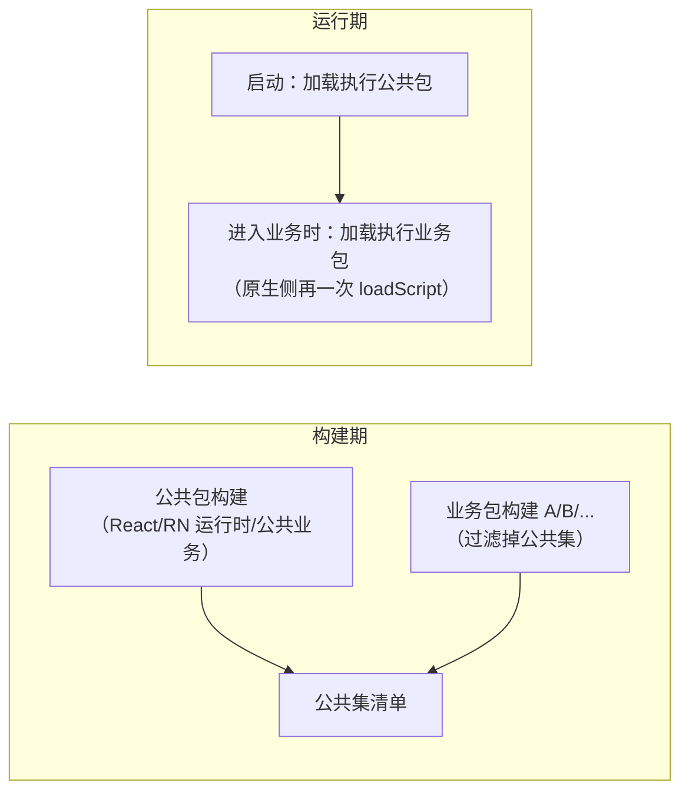

# 包体与启动优化实操（Hermes / 构成分析 / 拆包 / inline requires）

> 01 篇读完了 bundle 结构，03 篇认识了 Metro 的三个定制口子，本篇把它们兑现成**可以照着做的操作流程**：产物是怎么变成 Hermes 字节码的、包里到底装了谁、怎么把它变小、启动时怎么只付"必需模块"的成本。每一节都给命令与判读方法，并解释背后的机制——但先立一条纪律：**所有数字必须来自你自己的测量**，本篇不承诺"优化后快多少"，只给"怎么量、怎么改、为什么有效"。

## 1. 先立靶子：优化的对象到底是什么

"包太大、启动太慢"是两句体感，动工前要翻译成可度量的靶子：

| 靶子 | 度量的是什么 | 怎么量 |
|------|-------------|--------|
| 包体 | JS 产物（bundle/hbc）+ assets + so 的字节数 | 构建产物统计（本篇第 3 节） |
| 启动 | 冷启动 TTI：进程创建 → 首屏内容可交互 | 两端启动打点（模块二 04）+ trace（模块九 05） |
| 磁盘/内存 | 装机占用、首屏前 JS 堆 | 平台工具（模块九 04） |

启动这条链路在模块二拆过，复习一下归因位：


本篇的手段作用于 C/D 两段：**C 段看格式（字节码），D 段看执行了哪些模块（inline requires / 拆包）**。而"包体"与"D 段"高度相关——进包的模块越少，能执行的模块也越少，所以依赖治理是两者的公共解。

> 纪律重复（模块九 01）：先测量后优化，每个处方前后各采一次数。下面的操作流程默认你已经有了 TTI 基线或至少一个"对照包"。

### 1.1 把靶子写成可复测的验收语句

"包变小了""启动快了"不能当验收结论——换台设备、换个构建方式就翻脸。动工前把每个靶子改写成**一句可复测的语句**，格式固定为"对象 + 口径 + 环境"：

| 靶子 | 验收语句模板 | 必须固定的环境变量 |
|------|-------------|-------------------|
| 包体 | "同一入口、`--dev false`、Hermes 与生产一致的 `index.android.bundle`（+ hbc）字节数为 X" | 入口文件、RN 版本、依赖树（lockfile）、构建机 |
| 启动 | "冷启动 TTI：P50 / P95 各为多少毫秒" | 设备型号、系统版本、后台杀干净、飞行模式或固定网络 |
| 内存 | "首帧渲染完成后的 JS heap 占用" | 同启动口径，且同一套操作序列（点了哪些页面） |

三个口径细节，漏一个对比就作废：

1. **包体口径要成对**：文本 bundle 与 hbc 分开记录（第 2 节会看到两者体积关系不固定）；只记 APK 总大小会把 assets 与 so 的波动混进 JS 优化的账里（3.4 的三块拆分）；
2. **启动口径要写清"冷"的定义**：进程不存在才叫冷启动——热启动、温启动（进程在但 Activity 重建）的 TTI 不可比，模块二 04 的归因位也只对冷启动成立；
3. **每个处方前后各采一次，且只动一个变量**：同时换依赖 + 开 inline requires 再复测，数字变好了也说不清是谁的功劳，下一次回归时更说不清该回滚谁。

这张验收单不是形式主义：第 6 节的优化排序里，每一步的"做不做"都由"验收语句里那句数字有没有动"来裁决。

## 2. Hermes 字节码：prod 产物的真实形态

### 2.1 从 JS 文本到 hbc

Hermes 自 RN 0.70 起是双平台默认引擎（模块三 01）。开启 Hermes 的工程，release 构建在 Metro 序列化产出 JS 文本之后，还会多一步编译：


- 这一步由构建链路的打包任务自动执行（01 篇从 serializer 视角讲过它的挂点），不需要手工介入；
- 产物**不再是文本**：用文本编辑器打开 release 的 `index.android.bundle`，开头会是二进制头——那是 hbc 的 magic 与版本字段；
- 为什么启动快：引擎直接映射字节码执行，**跳过整个 parse 阶段**（模块三 03 拆过 hbc 的函数表/字符串表结构）；省的是 CPU，不是磁盘——hbc 与 minify 后的文本相比**不必然更小**，它带指令区、字符串表、函数表；
- sourcemap 要"组合"：hermesc 编译后报错位置落在 hbc 偏移上，需要把"源码→文本 bundle"与"文本 bundle→hbc"两段映射接起来，崩溃符号化（模块九 04）才能落回源码行号。

### 2.2 手动编译一次，看清产物

理解用的小实验（工程构建不需要这么干）：hermesc 就在依赖里。

```bash
# 位置随 RN 版本变化，形如 node_modules/react-native/sdks/hermesc/<平台>-bin/hermesc
node_modules/react-native/sdks/hermesc/osx-bin/hermesc \
  -emit-binary -out demo.hbc demo.js
ls -l demo.js demo.hbc
```

判读两点（具体大小关系以你的文件为准，不设预期数字）：

1. 对比两个文件字节数：体会"hbc 不是压缩"——它是另一种产物形态；
2. 用 `strings demo.hbc | head` 看字符串表：函数名/字符串字面量仍在，**体积没省，省的是运行期解析**。

> 版本注记：Hermes 在持续演进（0.82 起有实验性的新一代工具链、0.84 起转为默认），涉及具体优化选项时以你所用版本的 hermesc 文档与 RN 发布说明为准。

### 2.3 字节码版本：OTA 与引擎升级互斥的根源

hbc 头部带字节码版本，引擎加载时校验，**不匹配则拒绝执行**。这个事实向上解释了两个工程问题：

- **引擎随 RN 升级而升级**，旧版本 hbc 的更新包不保证还能加载——模块八 05 讲的 runtime version 必须把"引擎/Hermes 工具链版本"算进兼容维度，就是这一行校验的工程化；
- 02 篇说"字节码 diff 失真更严重"——hbc 内部有偏移表，源码小改动可能扰动大段偏移，所以差分链路要专门权衡（差分体积 vs 直接全量 hbc）。

dev/prod 差异（对照 01 篇的清单补一行）：**dev 默认不编译 hbc**——Fast Refresh 要按模块替换源码（模块十 04）、报错要源码行号，文本形态是调试链路的需要。这再次印证模块九 01 的告诫：dev 环境的性能结论不可信。

### 2.4 现场检查：这个产物真的是 hbc 吗

分析包体或排查启动问题之前，先确认手上的产物形态——"拿 dev 文本 bundle 当 release 产物分析"是本篇所有操作里最常见的起点错误。三个现场检查，从构建侧到运行侧：

| 检查 | 做法 | 通过标准 |
|------|------|---------|
| 文件头 | `xxd out/index.android.bundle \| head -1` | 起始字节非可读文本（hbc 的 magic + 版本字段，模块三 03 有头部结构图）；文本 bundle 开头通常是注释或 `"use strict"` |
| 构建日志 | release 构建输出里搜 hermesc / bytecod | 能看到字节码编译任务执行；没有任何编译记录说明 Hermes 没开或 gradle 任务被跳过 |
| 运行期 | JS 里取 `global.__HERMES__`（或检查 `global.HermesInternal` 是否存在） | Hermes 引擎下为真——它验证的是"引擎在跑字节码"，与文件检查互补 |

三道检查分别钉住"文件是 hbc""构建链路开了 Hermes""运行时真的是 Hermes"三个环节——包体分析对第一环负责，启动分析对三环都要负责。顺带一提，运行期检查也是线上灰度的廉价保险：升级引擎后发 OTA 前，在探针页面先确认新壳的 `__HERMES__` 与字节码版本行为符合预期（2.3 的兼容域问题在发版侧的落点）。

## 3. bundle 构成分析：谁把包撑大的

### 3.1 产出一个"可与线上对照"的包

分析的前提是产物形态对齐生产，dev 产物没有意义：

```bash
npx react-native bundle \
  --platform android --dev false --entry-file index.js \
  --bundle-output out/index.android.bundle \
  --sourcemap-output out/index.android.bundle.map \
  --assets-dest out/res/
```

三个容易失真的点：`--dev false`（否则 dev-only 代码、无压缩产物完全失真）；Hermes 开关与生产一致（否则分析的是文本 bundle）；`--platform` 与目标端一致（平台后缀文件分流，01 篇）。**把这一步挂进 CI**，每次发版留档 bundle + map，体积趋势与"哪次改动把包撑大了"就有据可查。

### 3.2 用 sourcemap 把字节归因回源文件

常用工具是 source-map-explorer（通用 sourcemap 体积分析工具，Metro 产物适用）：

```bash
npx source-map-explorer out/index.android.bundle out/index.android.bundle.map --tsv > sizes.tsv
```

原理：minify 后 bundle 里的每个字节区间都能经 sourcemap 映射回源文件，按文件聚合就得到"谁占多少"。Metro 的 sourcemap 还带模块路径等扩展字段，把文件路径归并到 npm 包名，就得到按依赖的分布。

读图纪律：

- **看大头不看长尾**：经验上前若干个依赖常占绝对份额，长尾的小文件不值得逐个治理；
- 每次只动一项，复测一次——多个改动叠在一起，归因就废了；
- 归因结果回答"谁大"，`npm ls <包名>`（或 `yarn why`）回答"**谁引入了它**"——两个问题分开问，才能决定是"换成按需入口"还是"把引用方改掉"。

### 3.3 常见大户与处置对照

| 大户特征 | 典型现象 | 处置方向 |
|---------|---------|---------|
| 多语言/区域库全量进包 | locale 数据文件成串出现 | 构建期确定目标 locale，只引所需子集 |
| 图标库全量 | 单包数千个图标资产 | 按引用子集化，或换资产管线 |
| 同一依赖多版本 | 同一包名多行、多份拷贝 | `npm ls` 找重复来源，resolutions/overrides 收敛到单版本 |
| 功能等价的重复工具库 | lodash 与 lodash-es 之类并存 | 统一引用面 |
| 庞大库只用一角 | CJS 语义无 tree shaking（01 篇） | 换按需入口/子路径导入；实在不行隔离成独立懒加载页 |

处置完的验收标准就是同一张构成表：**目标依赖的行消失或显著缩小**，且业务回归无损（按需引入最常见的事故是漏了动态引用的 locale/图标）。

### 3.4 一句话补上包体的另外两块

bundle 只是包体的一部分：**assets（图片等）与 so（原生库，含 RN/C++ 运行时）同样计重**。图片走降采样与合适格式（模块九 04 的图片内存算术同样适用于磁盘）；so 体积与架构变体（arm64-v8a 等拆分）有关——官方在移除旧架构代码的工作中明确把"缩减整体体积"列为收益之一，升级 RN 版本本身也可能是包体优化手段。

### 3.5 一次归因走查：从 TSV 到处置动作

把 3.2 的操作循环完整走一遍（下面 TSV 是**结构示意**，比例数字为编造的示例、不是任何实测——重点在每一步"看什么、判什么"）：

```text
# source-map-explorer 的 TSV 输出按体积排序后（示意）：
Source                                              Size
node_modules/moment/locale/zh-cn.js                 ...
node_modules/moment/locale/ja.js                    ...
node_modules/moment/locale/...（成串的 locale 文件）
node_modules/@mui/icons-material/...（数千个图标）
node_modules/lodash/lodash.js
src/pages/Home/...
...（长尾）
```

走查的判读链，对应 3.3 对照表的每一行：

1. **locale 成串** → 多语言库全量进包。先问"谁引入"：`npm ls moment`（或 `yarn why moment`）——若只有某工具库的间接依赖在用完整 moment，处置可以窄到"换那个引用点"；若业务直接依赖，再上"构建期锁定 locale 子集"的方案。**先窄后宽，改动面最小化**；
2. **图标库全量** → 单包数千个图标资产。核对引用侧是不是 `import * as Icons` 一类的桶导入——桶导入会把整棵树拉进图（01 篇的模块图按 require 展开），改成按名导入即可让 tree shaking 有机会工作；CJS 语义的库则回到 3.3 最后一行的处置；
3. **lodash 单行且巨大** → CJS 主入口全量进包（无 tree shaking）。换 `lodash-es` 或按函数子路径导入（`lodash/debounce`）——注意统一引用面，混用两套会演变成 3.3 的"等价重复库"；
4. **业务目录占比意外地高** → 别急着怀疑三方，业务代码里常有"复制粘贴的五套相似工具函数"。这一类不进 3.3 的表，归因后走的是代码重构而非依赖治理。

走查的产出物是一张"处置清单"：每行写明**目标依赖、引入方、处置动作、预期影响的文件**——然后一次只执行一行，复测一次 TSV，确认目标行消失再执行下一行。跳过复测连续动几项，哪一项真的有效就再也说不清了。

### 3.6 体积回归的防线：把构成分析挂进 CI

人工分析只能救火，防止复燃要靠流水线。最小可行的三步（都是方法描述，具体命令按你们的 CI 形态落地）：

1. **每次 PR 产出对照包**：3.1 的 `react-native bundle --dev false` 命令进 CI，产物与 sourcemap 存为构建工件——任何"这次改动让包大了多少"都有据可查；
2. **与基线做字节级 diff**：把 TSV 归并到 npm 包粒度，与主分支最近一次发版的同一张表逐行对比，体积上涨的包名列进 PR 检查输出。让"加依赖的人"在合并前就看到代价，比发版后追责有效得多；
3. **阈值只做告警不做硬卡**：绝对阈值（如"单次增长不超过 X KB"）容易误伤正当需求，通常做成"超阈值必须写一句理由"的软门禁——纪律的目的不是拦住变更，是让每次变更有意识地付出体积代价。

防线成立的前提是 1.1 的口径纪律：CI 产包的入口、Hermes 开关、依赖树若与生产不一致，diff 出来的数字就没有裁判力。

## 4. inline requires：零拆包成本的"懒执行"

### 4.1 机制：把执行从"模块初始化"挪到"首次使用"

01 篇的 `__d/__r` 运行时里，模块**注册即全量、执行按需**——但注意"执行按需"的单位是"被 require 的时机"。普通写法下，一个模块顶层的 `require('./X')` 会在**这个模块被执行时立刻拉起 X 的整棵依赖子树**。首页执行链上一个 require，就可能把深层依赖全部执行掉。

inline requires 让 Babel 把顶层 require 改写成"用到才 require"（作用于 require 调用；import 会被编译为 require 后同样处理）：

```js
// 转换前
const VeryExpensive = require('./VeryExpensive').default;

// 转换后（示意）
const VeryExpensive = () => require('./VeryExpensive').default;
```

效果：首页路径上不经过的模块（及其子树）的 factory **不执行**——省的是 evaluate 阶段的 CPU，**不是下载体积**（模块仍然全部在包里，对照第 5 节的拆包区别开）。它是 03 篇"无 code-splitting 的替代方案谱系"里成本最低的一项。

### 4.2 现状与配置

- RN CLI 模板工程**默认开启**（对 `node_modules` 同样生效）；Expo 工程默认关闭，需在 Metro 配置显式开启；
- 配置位置在 metro.config.js 的 transformer 段（`getTransformOptions` 返回的 `transform.inlineRequires`）：

```js
// metro.config.js
module.exports = {
  // ...其余配置
  transformer: {
    getTransformOptions: async () => ({
      transform: {
        inlineRequires: {
          blockList: {
            // 这个文件内的 require 不做 inline（依赖 import 副作用时用）
            [require.resolve('./src/sideEffectEntry.js')]: true,
          },
          // 按模块名全局豁免（不 inline 对这些目标的调用）
          nonInlinedRequires: ['react', 'react-native'],
        },
      },
    }),
  },
};
```

### 4.3 陷阱与验证

| 陷阱 | 成因 | 处理 |
|------|------|------|
| 副作用模块"不生效了" | import 时注册全局/打补丁的库被 inline 后，首个"使用"可能永远不发生 | 进 blockList / nonInlinedRequires |
| 初始化顺序假设破裂 | 模块求值时序整体改变，隐式的"A 先于 B 初始化"暴露 | 显式化依赖（在使用处 require），而不是关掉 inline |
| 与热更新/埋点的交互 | 埋点若依赖"模块加载"语义，计数口径变化 | 埋点挂在执行路径而不是模块加载上 |

验证手段：TTI 打点（模块二 04）前后对照是主证据；dev 下可以临时 monkey-patch `__r` 做模块执行计数，对比开关前后首帧前的执行数（实验代码，别带上线）。

### 4.4 手工推演：一张依赖图上数执行时机

"省的是 evaluate 阶段"这句话值得在纸上数一遍才真正属于你。构造一个最小的首页依赖图（箭头表示"require 了"）：

```text
index（入口）
 └─ App
     ├─ HomeScreen（首页）
     │    ├─ Nav 组件
     │    └─ utils/format
     └─ SettingsScreen（设置页，首页用不到）
          ├─ HeavyChart（重图表库的封装）
          │    └─ chart-lib（假设是那个"庞大库只用一角"的大户）
          └─ utils/format（公共依赖）
```

**改写前**（顶层 require）：入口执行 App → App 顶层 require 两个页面 → SettingsScreen 顶层 require HeavyChart → HeavyChart 顶层 require chart-lib。首帧之前，**index、App、HomeScreen、Nav、format、SettingsScreen、HeavyChart、chart-lib 八个模块的 factory 全部执行**——chart-lib 那几兆字节的顶层初始化代码，为一条首帧根本不会走到的路径买了单。

**改写后**（inline requires 生效）：App 顶层的两个页面 require 被挪进使用处；首帧路径只执行 index、App、HomeScreen、Nav、format——**SettingsScreen、HeavyChart、chart-lib 三个模块只注册不执行**。用 `__r` 计数器看，首帧前的执行数从 8 降到 5；三者的 factory 会在用户真正进设置页的那一刻补齐执行。

推演表把两种形态的账分开摆（表格中的"执行"专指 factory 执行，注册永远全量）：

| 模块 | 改写前首帧前执行？ | 改写后首帧前执行？ | 什么触发了它的执行 |
|------|------------------|------------------|-------------------|
| index / App / HomeScreen / Nav / format | 是 | 是 | 首帧渲染路径本身 |
| SettingsScreen | 是 | 否 | 用户点进设置页（使用处 require） |
| HeavyChart | 是 | 否 | 同上，随父模块一起 |
| chart-lib | 是 | 否 | 同上——重库的初始化成本被推迟到"要用" |

三个从推演里读出的结论：

1. **收益与"首页路径外的重量"成正比**：这张图里最值钱的只有 chart-lib 一格——如果依赖图整体都长在首页路径上，inline requires 省不了多少，出路是依赖治理（第 3 节）而不是执行时机；
2. **公共依赖在两边都执行**（format 那格）：inline 不改变"谁被 require"的事实，只改变"何时执行"——所以它救不了重复进包的体积问题，两件事别混；
3. **执行时序整体后移是新世界的新规则**：4.3 陷阱表里的三类故障，本质都是这张表里"什么时候执行"一列被改写后，某处代码还抱着改写前的假设。写模块时假设"import 时环境已就绪"的，都在暴露面上。

推演完这张表，再回到真实工程里跑 `__r` 计数器对照——纸面数字与实测数量对得上，说明你对机制的理解和工程的现状是一致的；对不上，通常是有比示意更深的 require 链或者副作用模块触发了额外执行，顺着计数器抓出来即可。

## 5. 拆包与按需加载：multi-bundle 工程实操

03 篇给了三件套的名字（稳定 id / 过滤 / 加载顺序），这里给落地代码与决策框架。

### 5.1 先做决策：值不值得

拆包买到两样东西：**启动只执行公共包+首页包**、**更新粒度从全量降到业务包级**（模块二 03）。代价是三个新故障域：

- 模块 id 跨包必须稳定，配置复杂度上升；
- 公共包任何变更 → 所有业务包重新构建/重发，发布矩阵变大；
- 加载时序成为问题（业务包就绪前用户点了进去）。

判断门槛（示意，按自己 App 的量裁剪）：构成分析显示"非首页必需"占比高，或组织上按业务团队分包交付时，收益才开始盖过成本。中小 App 用"单包 + inline requires"通常就够了（模块二 03 的对照表）。

### 5.2 三件套落地

**① 稳定模块 id**（`serializer.createModuleIdFactory`）：

```js
// metro.config.js —— 公共包与业务包的构建共用同一份实现
const path = require('path');
function createStableModuleIdFactory() {
  return (modulePath) => {
    // 以"相对仓库根的路径"为 id：跨包一致的唯一依托
    return path.relative(path.resolve(__dirname, '../..'), modulePath);
  };
}
module.exports = {
  // ...
  serializer: { createModuleIdFactory: createStableModuleIdFactory },
};
```

要点：id 稳定的前提是**解析路径稳定**——不同入口、不同机器构建时，同一模块必须解析到同一路径。03 篇讲 monorepo symlink 解析差异会导致"同一包两份拷贝"，在这里会直接演变成"同一模块两个 id"，业务包 `__r` 找不到公共包里的依赖。公共包与业务包**必须用同一份 id 工厂构建**。

**② 公共/业务分边过滤**（`serializer.processModuleFilter`）：

```js
// 业务包构建：排除"公共包已含"的模块（示意——公共集清单要与公共包构建保持同步）
const COMMON_PREFIXES = [
  path.resolve(__dirname, 'node_modules'),
  path.resolve(__dirname, 'src/common'),
];
module.exports = {
  // ...
  serializer: {
    processModuleFilter: (module) => {
      if (module.path === path.resolve(__dirname, 'business-entry.js')) return true; // 入口保留
      return !COMMON_PREFIXES.some((p) => module.path.startsWith(p));
    },
  },
};
```

两边清单不同步的症状很典型：业务包运行时 `__r` 抛"模块不存在"——依赖被过滤出了业务包，又没进公共包。**把公共集清单收敛成一份共享配置**（两套构建读同一份），比在两个配置里各写一遍更可靠。

**③ 构建与加载顺序**：



运行期加载第二包，两端落点（类名随 RN 版本演进，以所用版本源码/文档为准）：Android 旧架构在 `CatalystInstance` 的执行脚本通道，新架构走 `ReactHost` 的 bundle 加载链路；iOS 复用 `RCTJavaScriptLoader` 对另一个 file URL 的加载。工程上还需要一层 **JS 侧的"业务模块就绪"协议**：业务包末尾广播注册完成事件，导航层在收到之前展示兜底（加载中/失败可重试），避免"用户点进去白屏"。

### 5.3 验收清单

- [ ] 公共包单跑：纯公共能力页面全部可用；
- [ ] 业务包加载后 `__r` 能解析到公共包模块（id 稳定性）；
- [ ] 业务包缺失/损坏：进兜底页并可重试，而不是崩溃；
- [ ] 热更新链路（模块八 05）明确了两类包的更新顺序与原子性（公共包先行，业务包拒绝在公共包未就绪时加载）。

### 5.4 与 OTA 的联动：更新粒度变了，兼容矩阵也变了

单包世界里，"一个更新包 = 整个 bundle"，OTA 的原子性由更新系统包办（02/05 篇）。multi-bundle 之后，"bundle 文件"从一个变成多个，**更新系统默认管理的只有它认识的那个文件**——两类包怎么发、按什么顺序生效，是工程自己的协议，不是更新框架白送的。至少三件事要写进发布规范：

1. **公共包升级 = 兼容域变更**：公共包里躺着 React/RN 运行时，任何变更影响的都是所有业务包的运行地基。05 篇的 runtime version 思想在这里要落到"公共包版本"上：业务包发布时声明"要求公共包 ≥ x.y"，加载侧校验不满足则拒绝加载新业务包（宁可停留旧版，不可半新半旧地跑）；
2. **更新顺序固定为公共包先行**：一次涉及两类包的更新，必须等公共包就绪（下载 + 校验 + 就绪标记）后才允许业务包进入加载流程——5.3 最后一条验收项的运行期语义。顺序颠倒的故障形态就是 5.2 说的 `__r` 找不到模块，只是这次故障发生在**线上用户的启动路径上**；
3. **灰度按对灰**：公共包与业务包若都走灰度，分组口径必须一致（同一批设备同时拿到两类包的新版本），否则崩溃归因时分不清是"业务包新逻辑"还是"公共包与旧业务包的组合"出了问题——05 篇"用户跑的是什么组合"在 multi-bundle 下组合数翻倍，对账清单要提前设计。

一句话：拆包把发布矩阵从"壳 × 更新包"变成"壳 × 公共包 × 业务包"，05 篇的协同矩阵每一格都跟着变宽。**这不是反对拆包，是把它的维护成本摆上台面**——5.1 的决策门槛里，"组织成本"这一项在这里兑现。

## 6. 与启动链路合流：优化排序

把本篇手段放回模块二 04 的启动优化框架里，排序按"单位收益的成本"从低到高：

1. **测量定位**：TTI 打点 + 模块九 05 的剖析手册，先确认大头在 evaluate 段还是 runApplication 后的首帧渲染段——后者的大头常在数据加载与首屏组件（模块九 03），本篇手段帮不上；
2. **零成本项**：确认 Hermes 开启（已是默认）、inline requires 开启（CLI 工程默认）——存量老工程可能两项都没吃满；
3. **依赖治理**：构成分析 → 砍大户，体积与执行双收益；
4. **重武器最后**：拆包与按需加载，维护成本最高，且把问题从"构建期"挪到"运行期时序"。

## 7. 常见坑速查

| 症状 | 根因 | 出路 |
|------|------|------|
| 优化后"看起来没变小" | 拿 dev 产物或文本 bundle 当对照（3.1 的失真点） | 口径对齐生产：`--dev false` + Hermes 一致，产物走 2.4 的三道检查 |
| TTI 复测"变慢了"，但代码没动 | 设备/网络/启动类型口径漂移（1.1） | 回到验收语句逐项核对环境变量；P95 与 P50 分开看 |
| source-map-explorer 归因出来一堆 `<anon>` / 路径对不上 | sourcemap 与 bundle 版本不配对，或 hermesc 后没用组合 map | bundle 与 map 同一次构建产出；hbc 场景确认两段 map 已拼接（2.1） |
| 依赖"处理了"但体积没降 | 引入方没改（`npm ls` 查的引用方还在全量 require） | "谁大"与"谁引入"分开问（3.2）；处置动作落到引入方那一行 |
| inline requires 开了，某个库"偶尔"失效 | 副作用模块被延迟到首次使用（4.3 第一行） | blockList / nonInlinedRequires 豁免，而不是关掉整个开关 |
| 拆包后偶发 `__r` 找不到模块 | 公共集清单与业务包过滤不同步，或 id 工厂两份实现漂移（5.2） | 公共集收敛成一份共享配置；两套构建共用同一份 id 工厂 |
| 进二级页面白屏概率性出现 | 业务包未就绪用户已可点击（5.2 的时序协议缺失） | 业务模块就绪广播 + 导航层兜底（加载中/可重试） |
| OTA 后线上"半新半旧"组合崩溃 | 两类包更新顺序/兼容校验缺失（5.4） | 业务包声明公共包版本要求，加载侧校验拒绝不满足的组合 |
| so 占比远超预期 | 未按 ABI 拆分打包，全架构 so 进同一个安装包（3.4） | 架构变体拆分（app bundle / abiFilters），按设备分发 |

## 小结

- release 产物是 hbc 字节码：hermesc 在构建链路末尾编译，启动跳过 parse；**字节码版本与引擎绑定**是 OTA 兼容的硬约束（模块八 05 展开）；
- 构成分析的操作循环：`react-native bundle --dev false` 出对照包 → source-map-explorer 归因 → 砍大户 → 复测；"谁大"与"谁引入"是两个问题，分别用 sourcemap 与 `npm ls` 回答；
- inline requires 把执行成本从"模块初始化"挪到"首次使用"（省执行不省体积），副作用模块走 blockList 豁免；
- 拆包三件套（同一份稳定 id 工厂 / 同一份公共集清单 / 明确的加载时序协议）是 multi-bundle 的工程底线；
- 排序纪律：测量 → 引擎与 inline requires → 依赖治理 → 拆包，越往后越贵。

延伸阅读：

- [01-Metro三阶段与Bundle结构](01-Metro三阶段与Bundle结构.md)：`__d/__r` 运行时与模块图——第 4、5 节所有机制的底座；
- [02-热更新原理](02-热更新原理.md)：更新包的下载、校验与差分——产物形态（hbc）约束着差分链路的设计；
- [03-Metro配置与工程化](03-Metro配置与工程化.md)：本篇用到的每个配置项（transformer / serializer）的完整语义；
- [05-OTA更新工程实践](05-OTA更新工程实践.md)：两类包的发布通道、灰度与兼容矩阵（5.4 的展开）；
- [../rn-启动流程原理/04-启动优化原理](../rn-启动流程原理/04-启动优化原理.md)：启动链路全景与 TTI 归因位（模块二 04）；
- [../rn-JS引擎与线程模型/03-Hermes深潜：字节码与GC](../rn-JS引擎与线程模型/03-Hermes深潜：字节码与GC.md)：hbc 内部结构（函数表/字符串表）与引擎层细节（模块三 03）；
- [../rn-性能优化原理/05-性能剖析操作手册](../rn-性能优化原理/05-性能剖析操作手册.md)：TTI 之外的剖析工具箱（模块九 05）。

## 自测

1. hbc 相对 minify 后的文本 bundle，省了什么成本、不省什么成本？"hbc 不必然更小"的原因是什么？
2. 为什么字节码版本与引擎绑定会成为 OTA 与引擎升级互斥的根源？这个约束在 05 篇的哪个机制里被工程化了？
3. 产出一个"可与线上对照"的分析包，哪三处最容易失真？各自失真成什么样？
4. "谁大"与"谁引入"分别用什么工具回答？为什么处置动作要落在"引入方"上，而归因表按"体积"排序？
5. 写出 inline requires 前后，你在 4.4 那张依赖图上"首帧前执行模块数"的变化；并说明 chart-lib 的体积变化了吗、执行时机呢？
6. blockList 与 nonInlinedRequires 的豁免粒度有何不同？各自的典型使用场景是什么？
7. 拆包三件套各防止什么故障？公共集清单不同步的具体症状是什么、为什么它只在运行期暴露？
8. multi-bundle 之后 OTA 的发布矩阵多了哪个维度？"公共包先行"约束保护的是什么不变量？
9. 第 6 节的排序里，为什么"测量定位"排在所有手段之前？如果 TTI 归因显示大头在首帧渲染段，本篇哪些手段帮不上忙？
10. 把你当前工程代入 1.1 的验收语句模板，写出三条——检查一下：每条的"必须固定的环境变量"你现在能列全吗？
