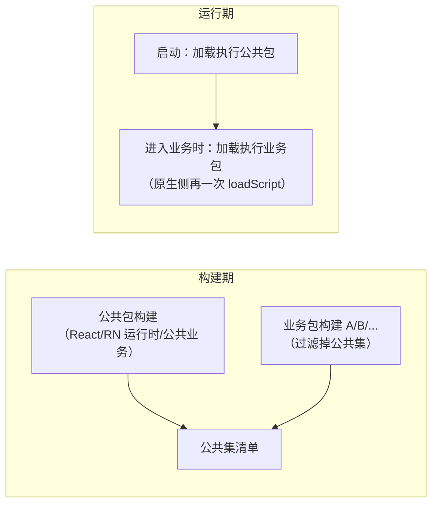

# 包体与启动优化实操（Hermes / 构成分析 / 拆包 / inline requires）

> 01 篇读完了 bundle 结构，03 篇认识了 Metro 的三个定制口子，本篇把它们兑现成**可以照着做的操作流程**：产物是怎么变成 Hermes 字节码的、包里到底装了谁、怎么把它变小、启动时怎么只付"必需模块"的成本。每一节都给命令与判读方法，并解释背后的机制——但先立一条纪律：**所有数字必须来自你自己的测量**，本篇不承诺"优化后快多少"，只给"怎么量、怎么改、为什么有效"。

## 1. 先立靶子：优化的对象到底是什么

"包太大、启动太慢"是两句体感，动工前要翻译成可度量的靶子：

| 靶子 | 度量的是什么 | 怎么量 |
|------|-------------|--------|
| 包体 | JS 产物（bundle/hbc）+ assets + so 的字节数 | 构建产物统计（本篇第 3 节） |
| 启动 | 冷启动 TTI：进程创建 → 首屏内容可交互 | 两端启动打点（模块二 04）+ trace（模块九 05） |
| 磁盘/内存 | 装机占用、首屏前 JS 堆 | 平台工具（模块九 04） |

启动这条链路在模块二拆过，复习一下归因位：


本篇的手段作用于 C/D 两段：**C 段看格式（字节码），D 段看执行了哪些模块（inline requires / 拆包）**。而"包体"与"D 段"高度相关——进包的模块越少，能执行的模块也越少，所以依赖治理是两者的公共解。

> 纪律重复（模块九 01）：先测量后优化，每个处方前后各采一次数。下面的操作流程默认你已经有了 TTI 基线或至少一个"对照包"。

## 2. Hermes 字节码：prod 产物的真实形态

### 2.1 从 JS 文本到 hbc

Hermes 自 RN 0.70 起是双平台默认引擎（模块三 01）。开启 Hermes 的工程，release 构建在 Metro 序列化产出 JS 文本之后，还会多一步编译：


- 这一步由构建链路的打包任务自动执行（01 篇从 serializer 视角讲过它的挂点），不需要手工介入；
- 产物**不再是文本**：用文本编辑器打开 release 的 `index.android.bundle`，开头会是二进制头——那是 hbc 的 magic 与版本字段；
- 为什么启动快：引擎直接映射字节码执行，**跳过整个 parse 阶段**（模块三 03 拆过 hbc 的函数表/字符串表结构）；省的是 CPU，不是磁盘——hbc 与 minify 后的文本相比**不必然更小**，它带指令区、字符串表、函数表；
- sourcemap 要"组合"：hermesc 编译后报错位置落在 hbc 偏移上，需要把"源码→文本 bundle"与"文本 bundle→hbc"两段映射接起来，崩溃符号化（模块九 04）才能落回源码行号。

### 2.2 手动编译一次，看清产物

理解用的小实验（工程构建不需要这么干）：hermesc 就在依赖里。

```bash
# 位置随 RN 版本变化，形如 node_modules/react-native/sdks/hermesc/<平台>-bin/hermesc
node_modules/react-native/sdks/hermesc/osx-bin/hermesc \
  -emit-binary -out demo.hbc demo.js
ls -l demo.js demo.hbc
```

判读两点（具体大小关系以你的文件为准，不设预期数字）：

1. 对比两个文件字节数：体会"hbc 不是压缩"——它是另一种产物形态；
2. 用 `strings demo.hbc | head` 看字符串表：函数名/字符串字面量仍在，**体积没省，省的是运行期解析**。

> 版本注记：Hermes 在持续演进（0.82 起有实验性的新一代工具链、0.84 起转为默认），涉及具体优化选项时以你所用版本的 hermesc 文档与 RN 发布说明为准。

### 2.3 字节码版本：OTA 与引擎升级互斥的根源

hbc 头部带字节码版本，引擎加载时校验，**不匹配则拒绝执行**。这个事实向上解释了两个工程问题：

- **引擎随 RN 升级而升级**，旧版本 hbc 的更新包不保证还能加载——模块八 05 讲的 runtime version 必须把"引擎/Hermes 工具链版本"算进兼容维度，就是这一行校验的工程化；
- 02 篇说"字节码 diff 失真更严重"——hbc 内部有偏移表，源码小改动可能扰动大段偏移，所以差分链路要专门权衡（差分体积 vs 直接全量 hbc）。

dev/prod 差异（对照 01 篇的清单补一行）：**dev 默认不编译 hbc**——Fast Refresh 要按模块替换源码（模块十 04）、报错要源码行号，文本形态是调试链路的需要。这再次印证模块九 01 的告诫：dev 环境的性能结论不可信。

## 3. bundle 构成分析：谁把包撑大的

### 3.1 产出一个"可与线上对照"的包

分析的前提是产物形态对齐生产，dev 产物没有意义：

```bash
npx react-native bundle \
  --platform android --dev false --entry-file index.js \
  --bundle-output out/index.android.bundle \
  --sourcemap-output out/index.android.bundle.map \
  --assets-dest out/res/
```

三个容易失真的点：`--dev false`（否则 dev-only 代码、无压缩产物完全失真）；Hermes 开关与生产一致（否则分析的是文本 bundle）；`--platform` 与目标端一致（平台后缀文件分流，01 篇）。**把这一步挂进 CI**，每次发版留档 bundle + map，体积趋势与"哪次改动把包撑大了"就有据可查。

### 3.2 用 sourcemap 把字节归因回源文件

常用工具是 source-map-explorer（通用 sourcemap 体积分析工具，Metro 产物适用）：

```bash
npx source-map-explorer out/index.android.bundle out/index.android.bundle.map --tsv > sizes.tsv
```

原理：minify 后 bundle 里的每个字节区间都能经 sourcemap 映射回源文件，按文件聚合就得到"谁占多少"。Metro 的 sourcemap 还带模块路径等扩展字段，把文件路径归并到 npm 包名，就得到按依赖的分布。

读图纪律：

- **看大头不看长尾**：经验上前若干个依赖常占绝对份额，长尾的小文件不值得逐个治理；
- 每次只动一项，复测一次——多个改动叠在一起，归因就废了；
- 归因结果回答"谁大"，`npm ls <包名>`（或 `yarn why`）回答"**谁引入了它**"——两个问题分开问，才能决定是"换成按需入口"还是"把引用方改掉"。

### 3.3 常见大户与处置对照

| 大户特征 | 典型现象 | 处置方向 |
|---------|---------|---------|
| 多语言/区域库全量进包 | locale 数据文件成串出现 | 构建期确定目标 locale，只引所需子集 |
| 图标库全量 | 单包数千个图标资产 | 按引用子集化，或换资产管线 |
| 同一依赖多版本 | 同一包名多行、多份拷贝 | `npm ls` 找重复来源，resolutions/overrides 收敛到单版本 |
| 功能等价的重复工具库 | lodash 与 lodash-es 之类并存 | 统一引用面 |
| 庞大库只用一角 | CJS 语义无 tree shaking（01 篇） | 换按需入口/子路径导入；实在不行隔离成独立懒加载页 |

处置完的验收标准就是同一张构成表：**目标依赖的行消失或显著缩小**，且业务回归无损（按需引入最常见的事故是漏了动态引用的 locale/图标）。

### 3.4 一句话补上包体的另外两块

bundle 只是包体的一部分：**assets（图片等）与 so（原生库，含 RN/C++ 运行时）同样计重**。图片走降采样与合适格式（模块九 04 的图片内存算术同样适用于磁盘）；so 体积与架构变体（arm64-v8a 等拆分）有关——官方在移除旧架构代码的工作中明确把"缩减整体体积"列为收益之一，升级 RN 版本本身也可能是包体优化手段。

## 4. inline requires：零拆包成本的"懒执行"

### 4.1 机制：把执行从"模块初始化"挪到"首次使用"

01 篇的 `__d/__r` 运行时里，模块**注册即全量、执行按需**——但注意"执行按需"的单位是"被 require 的时机"。普通写法下，一个模块顶层的 `require('./X')` 会在**这个模块被执行时立刻拉起 X 的整棵依赖子树**。首页执行链上一个 require，就可能把深层依赖全部执行掉。

inline requires 让 Babel 把顶层 require 改写成"用到才 require"（作用于 require 调用；import 会被编译为 require 后同样处理）：

```js
// 转换前
const VeryExpensive = require('./VeryExpensive').default;

// 转换后（示意）
const VeryExpensive = () => require('./VeryExpensive').default;
```

效果：首页路径上不经过的模块（及其子树）的 factory **不执行**——省的是 evaluate 阶段的 CPU，**不是下载体积**（模块仍然全部在包里，对照第 5 节的拆包区别开）。它是 03 篇"无 code-splitting 的替代方案谱系"里成本最低的一项。

### 4.2 现状与配置

- RN CLI 模板工程**默认开启**（对 `node_modules` 同样生效）；Expo 工程默认关闭，需在 Metro 配置显式开启；
- 配置位置在 metro.config.js 的 transformer 段（`getTransformOptions` 返回的 `transform.inlineRequires`）：

```js
// metro.config.js
module.exports = {
  // ...其余配置
  transformer: {
    getTransformOptions: async () => ({
      transform: {
        inlineRequires: {
          blockList: {
            // 这个文件内的 require 不做 inline（依赖 import 副作用时用）
            [require.resolve('./src/sideEffectEntry.js')]: true,
          },
          // 按模块名全局豁免（不 inline 对这些目标的调用）
          nonInlinedRequires: ['react', 'react-native'],
        },
      },
    }),
  },
};
```

### 4.3 陷阱与验证

| 陷阱 | 成因 | 处理 |
|------|------|------|
| 副作用模块"不生效了" | import 时注册全局/打补丁的库被 inline 后，首个"使用"可能永远不发生 | 进 blockList / nonInlinedRequires |
| 初始化顺序假设破裂 | 模块求值时序整体改变，隐式的"A 先于 B 初始化"暴露 | 显式化依赖（在使用处 require），而不是关掉 inline |
| 与热更新/埋点的交互 | 埋点若依赖"模块加载"语义，计数口径变化 | 埋点挂在执行路径而不是模块加载上 |

验证手段：TTI 打点（模块二 04）前后对照是主证据；dev 下可以临时 monkey-patch `__r` 做模块执行计数，对比开关前后首帧前的执行数（实验代码，别带上线）。

## 5. 拆包与按需加载：multi-bundle 工程实操

03 篇给了三件套的名字（稳定 id / 过滤 / 加载顺序），这里给落地代码与决策框架。

### 5.1 先做决策：值不值得

拆包买到两样东西：**启动只执行公共包+首页包**、**更新粒度从全量降到业务包级**（模块二 03）。代价是三个新故障域：

- 模块 id 跨包必须稳定，配置复杂度上升；
- 公共包任何变更 → 所有业务包重新构建/重发，发布矩阵变大；
- 加载时序成为问题（业务包就绪前用户点了进去）。

判断门槛（示意，按自己 App 的量裁剪）：构成分析显示"非首页必需"占比高，或组织上按业务团队分包交付时，收益才开始盖过成本。中小 App 用"单包 + inline requires"通常就够了（模块二 03 的对照表）。

### 5.2 三件套落地

**① 稳定模块 id**（`serializer.createModuleIdFactory`）：

```js
// metro.config.js —— 公共包与业务包的构建共用同一份实现
const path = require('path');
function createStableModuleIdFactory() {
  return (modulePath) => {
    // 以"相对仓库根的路径"为 id：跨包一致的唯一依托
    return path.relative(path.resolve(__dirname, '../..'), modulePath);
  };
}
module.exports = {
  // ...
  serializer: { createModuleIdFactory: createStableModuleIdFactory },
};
```

要点：id 稳定的前提是**解析路径稳定**——不同入口、不同机器构建时，同一模块必须解析到同一路径。03 篇讲 monorepo symlink 解析差异会导致"同一包两份拷贝"，在这里会直接演变成"同一模块两个 id"，业务包 `__r` 找不到公共包里的依赖。公共包与业务包**必须用同一份 id 工厂构建**。

**② 公共/业务分边过滤**（`serializer.processModuleFilter`）：

```js
// 业务包构建：排除"公共包已含"的模块（示意——公共集清单要与公共包构建保持同步）
const COMMON_PREFIXES = [
  path.resolve(__dirname, 'node_modules'),
  path.resolve(__dirname, 'src/common'),
];
module.exports = {
  // ...
  serializer: {
    processModuleFilter: (module) => {
      if (module.path === path.resolve(__dirname, 'business-entry.js')) return true; // 入口保留
      return !COMMON_PREFIXES.some((p) => module.path.startsWith(p));
    },
  },
};
```

两边清单不同步的症状很典型：业务包运行时 `__r` 抛"模块不存在"——依赖被过滤出了业务包，又没进公共包。**把公共集清单收敛成一份共享配置**（两套构建读同一份），比在两个配置里各写一遍更可靠。

**③ 构建与加载顺序**：



运行期加载第二包，两端落点（类名随 RN 版本演进，以所用版本源码/文档为准）：Android 旧架构在 `CatalystInstance` 的执行脚本通道，新架构走 `ReactHost` 的 bundle 加载链路；iOS 复用 `RCTJavaScriptLoader` 对另一个 file URL 的加载。工程上还需要一层 **JS 侧的"业务模块就绪"协议**：业务包末尾广播注册完成事件，导航层在收到之前展示兜底（加载中/失败可重试），避免"用户点进去白屏"。

### 5.3 验收清单

- [ ] 公共包单跑：纯公共能力页面全部可用；
- [ ] 业务包加载后 `__r` 能解析到公共包模块（id 稳定性）；
- [ ] 业务包缺失/损坏：进兜底页并可重试，而不是崩溃；
- [ ] 热更新链路（模块八 05）明确了两类包的更新顺序与原子性（公共包先行，业务包拒绝在公共包未就绪时加载）。

## 6. 与启动链路合流：优化排序

把本篇手段放回模块二 04 的启动优化框架里，排序按"单位收益的成本"从低到高：

1. **测量定位**：TTI 打点 + 模块九 05 的剖析手册，先确认大头在 evaluate 段还是 runApplication 后的首帧渲染段——后者的大头常在数据加载与首屏组件（模块九 03），本篇手段帮不上；
2. **零成本项**：确认 Hermes 开启（已是默认）、inline requires 开启（CLI 工程默认）——存量老工程可能两项都没吃满；
3. **依赖治理**：构成分析 → 砍大户，体积与执行双收益；
4. **重武器最后**：拆包与按需加载，维护成本最高，且把问题从"构建期"挪到"运行期时序"。

## 小结

- release 产物是 hbc 字节码：hermesc 在构建链路末尾编译，启动跳过 parse；**字节码版本与引擎绑定**是 OTA 兼容的硬约束（模块八 05 展开）；
- 构成分析的操作循环：`react-native bundle --dev false` 出对照包 → source-map-explorer 归因 → 砍大户 → 复测；"谁大"与"谁引入"是两个问题，分别用 sourcemap 与 `npm ls` 回答；
- inline requires 把执行成本从"模块初始化"挪到"首次使用"（省执行不省体积），副作用模块走 blockList 豁免；
- 拆包三件套（同一份稳定 id 工厂 / 同一份公共集清单 / 明确的加载时序协议）是 multi-bundle 的工程底线；
- 排序纪律：测量 → 引擎与 inline requires → 依赖治理 → 拆包，越往后越贵。
