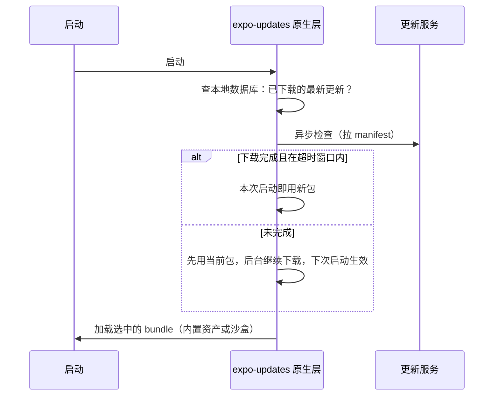
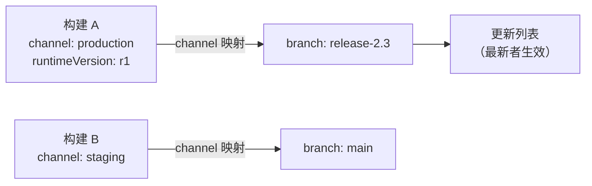
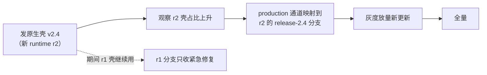

# OTA 更新工程实践（CodePush 之后）

> 02 篇把热更新讲成了五件事：沙盒换读取点、差分、校验、回滚、灰度。本篇讲工程落地：**CodePush 服务退役之后的现实选项、expo-updates 的工作机制、发布通道怎么设计、灰度与回滚怎么操作、原生版本兼容怎么管**。核心观点一句话：原理是稳定的，服务是会死的——OTA 的工程实践，一半在技术，一半在"把更新当成正式发布来管"的纪律。

## 1. CodePush 之后的地形

App Center（CodePush 的托管服务）已于 2025 年 3 月 31 日退役，这是 02 篇"生命周期教训"的现实版。退役之后，可选方案收敛为三类：

| 类别 | 形态 | 适合谁 | 关键风险 |
|------|------|--------|---------|
| 托管服务：EAS Update | expo-updates 客户端 + Expo 托管后端 | 想要开箱即用、发布通道/签名/灰度全套 | 依赖供应商（但 Expo 是 RN 核心生态成员，且客户端开源） |
| 自托管 | 开源的 code-push-server 社区分叉（沿用 CodePush SDK），或基于 expo-updates 的 manifest 协议自建服务端（官方有参考实现） | 数据主权要求高、有能力运维 | 运维与安全责任全在自己 |
| 商用替代 | 第三方 SaaS | 不想自建、不接受 EAS | 生命周期风险重演——按 02 篇的评估框架再过一遍 |

选型第一问不是功能表，而是：**这个服务会不会比你的 App 先死，死了怎么办**。第二问是合规：应用商店政策对 OTA 的边界——**允许修 bug、改内容；不允许借 OTA 实质性地改变应用行为或绕过审核**。这条红线决定了下一节的"能发什么"。

### OTA 能发什么、不能发什么

| 变更类型 | 能否 OTA | 原因 |
|---------|---------|------|
| JS 逻辑、样式、文案 | 能 | 就是 bundle 本身（02 篇沙盒换读取点） |
| 新增/变更静态资源 | 能 | 更新包携带，manifest hash 校验 |
| 新的原生代码/依赖/权限 | **不能** | 原生层在安装包里，OTA 无法触及 |
| JS 与原生接口的契约变更 | **不能**（单端发） | 新 JS 调旧原生会缺方法/缺语义——runtime version 就是挡这件事的 |

第三行是工程上最容易出事的一行：`package.json` 加了新库，构建出的 bundle 调用 `__turboModuleProxy('NewModule')`，线上原生的模块表里没有——只能走完整发版。发布流程里要有一道检查：**更新包的依赖清单与目标原生壳的兼容性**（下文 runtime version 与第 6 节的发布矩阵）。

## 2. expo-updates 的工作机制

expo-updates 可用于任何 RN 工程（不要求 Expo 工程化），是当前官方生态的默认答案。它的启动时序（对着 02 篇"数据库选包"的替换点读）：



机制要点：

- **两段式下载**：先拉 manifest（元数据 + 资产清单），再按清单下载缺失资产——更新包里大部分资产与上一版相同（图片没变），逐文件 hash 比对后只下载差集，这本身就是一种"文件级差分"（比 bsdiff 粗，但工程简单得多）；
- **生效时机是下次启动**：下载不打断当前运行的 JS（02 篇的时序提醒）；有一个可配的启动等待窗口（超时即放弃本次切换，避免"等网络"拖慢启动）；
- **三层兜底**：最新已下载更新 → 更早的已下载更新 → **构建时打进安装包的内置更新**（embedded）。也就是说最坏情况退回发版时的状态，不会无包可用；
- 本地用数据库记录"哪个 channel/runtime 下载了哪些版本"，选包逻辑全在原生层完成——JS 起来之前就要做完决定。

## 3. runtimeVersion：兼容性的生命线

02 篇把"runtime version 匹配"列为硬约束，这里展开成可操作的形态。expo-updates 的 runtimeVersion 有三种典型配置方式：

| 方式 | 语义 | 代价 |
|------|------|------|
| 手写字符串 | 完全人工控制"哪批构建 ↔ 哪批更新" | 忘了改字符串 → 旧壳收到不兼容新包（事故） |
| `appVersion` 策略 | 跟随应用版本号 | 每次发版都开新通道；纯 JS 修复也要等/对齐版本号 |
| `fingerprint` 策略 | 对一切可能影响原生层的配置（原生依赖、RN 版本、工程配置等）做指纹哈希 | 最安全；原生层一动指纹就变，需要构建新版本、新更新分支 |

fingerprint 的原理值得记住：它把"什么会让 bundle 与原生壳不兼容"显式建模成一个**可计算的函数**——原生依赖清单、RN 版本、 Expo 配置、原生工程改动都进哈希。指纹变了 = 兼容域变了 = 旧更新自动与新的构建隔离。这比"人记得改版本号"可靠一个数量级，代价是构建/发布分支更多。

叠加模块八 04 的事实（Hermes 字节码与引擎绑定）：**引擎升级必然产生新的兼容域**——所以"升 RN 版本"和"发 OTA"在时间上要错开：先发版铺新壳，观察新壳占比，再把更新通道切到新 runtime version（第 5 节的通道操作就是干这个的）。

## 4. 发布通道：channel 与 branch

EAS Update 的组织模型是**构建 ↔ 通道 ↔ 分支**三层：



- **channel 绑在构建上**（eas.json 里配）：一个安装包出厂就带着自己的通道身份，客户端只认通道；
- **branch 是更新的容器**：发布到分支，分支上的最新更新对"映射到它的通道"生效；
- 通道可以重新映射到别的分支——这是**发布操作的核心把手**（见下节灰度与回滚）。

典型用法：

```bash
# 发布一条更新到生产分支
eas update --branch release-2.3 --message "fix: checkout crash"

# 把 production 通道整体切到某分支（比如发完新版壳之后）
eas channel:edit production --branch release-2.4

# 查看发布状态
eas update:list
```

纪律：**分支名与原生版本对齐**（release-x.y 一类），让"哪批更新跑在哪个壳上"一眼可查；不要用一个大杂烩分支承载所有历史。

## 5. 灰度与回滚

### 5.1 两种灰度机制

**① 单条更新的百分比放量**：发布时直接指定初始百分比，之后逐步调高：

```bash
eas update --branch release-2.3 --rollout-percentage=10   # 先放 10% 用户
eas update:edit                                            # 调整百分比（10 → 50 → 100）
eas update:revert-update-rollout                           # 撤销：回到控制版本
```

**② 通道级灰度**：把通道按百分比分流到两条分支（新旧各一条），观察后再全量切换或回退：

```bash
eas channel:rollout    # 交互式：production 通道 30% 用户走新分支
```

两种机制的选择：单条更新放量简单直接，适合"一次修复"的节奏；通道分流适合"一批变更 + 可并行迭代"的场景（新分支还能继续发小修，控制版本不动）。注意约束：同一分支/平台/runtime version 上同时只允许一个活跃的放量操作，放量中途不能直接被新发布覆盖。

### 5.2 回滚的两种形态与纪律

| 形态 | 触发 | 机制 |
|------|------|------|
| 自动回退 | 新更新安装后**启动即崩**被服务端检测到 | 客户端退回上一个可用更新/内置更新（以所用版本官方文档为准启用） |
| 人工回滚 | 灰度期发现功能/性能问题 | `eas update:revert-update-rollout`（放量撤销）或通道重新映射到旧分支 |

回滚纪律（02 篇"更新失败 vs 运行失败"的工程版）：

1. **回滚不等于修复**——回滚止血后仍然要定位根因，否则下一包重蹈；
2. 回滚也要过验收：确认回滚动作真的生效（`eas update:list` 的状态 + 监控指标回落），别把"发了回滚命令"当成"用户已恢复"；
3. **崩溃信号要快**：OTA 的爆炸半径以小时计，灰度期盯崩溃率/关键漏斗，异常即止——这依赖模块九 04 的稳定性体系在线上侧就位。

### 5.3 签名：防的是"服务端之外的人"

02 篇讲过签名原理（manifest 携带签名，客户端公钥验签，`expectExpoSignature` 一类开关）。工程落地三件事：

1. 生成密钥对，公钥进 App 配置（随安装包分发），私钥进密钥管理（CI 注入，不落仓库）；
2. 验签失败的更新一律拒绝加载并回退——**宁可更新失败，不可加载来路不明的代码**；
3. 自托管 manifest 服务时同样要自己实现签名校验链路——客户端校验逻辑是公开协议，安全强度取决于你把私钥管得多好。

## 6. 把 OTA 放进发布工程：协同矩阵

OTA 省掉的是"过审时间"，**不能省掉"发布纪律"**。团队级的最低配置：

| 环节 | 要求 |
|------|------|
| 变更分类 | 每个改动先回答：纯 JS？带资源？动了原生接口？（第 1 节的表） |
| 构建与验证 | 更新包必须用与目标壳一致的依赖树构建；release 形态在真机走关键路径回归（模块九 01：dev/prod 失真） |
| 兼容性 | runtime version 策略明确（fingerprint 优先）；引擎升级与新 OTA 发布错峰 |
| 放量 | 固定节奏：内部通道全量 → 生产小比例 → 观察指标 → 逐步调高 |
| 回滚 | 每次放量前确认回滚路径（哪条命令、预期多久生效） |
| 记录 | 更新与原生版本的关系可追溯（分支命名 + 发布记录）——线上问题的第一问永远是"用户跑的是什么组合" |

原生发版与 OTA 的协同时间线（示意）：



## 小结

- CodePush 托管服务退役（2025-03）之后，现实选项是 EAS Update、自托管（code-push-server 分叉或 manifest 协议自建）、商用替代——评估框架仍是 02 篇的生命周期视角；
- expo-updates 机制三要点：两段式下载（manifest → 差集资产）、下次启动生效、内置更新兜底——02 篇"沙盒换读取点"的完整工程化；
- runtimeVersion 是兼容性的生命线：fingerprint 策略把"JS 与原生是否兼容"变成可计算的哈希；引擎升级（模块八 04 的字节码绑定）必然切兼容域；
- 灰度两手：单条更新百分比放量、通道分流；回滚两形态：启动即崩自动回退、人工撤销/重映射——回滚后仍要归因；
- OTA 的边界：JS 与资源可发，原生代码与接口契约不可发；把它当正式发布管（分类、验证、放量、回滚、记录），它才是资产而不是负债。
