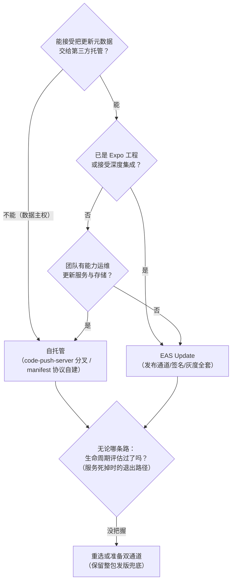
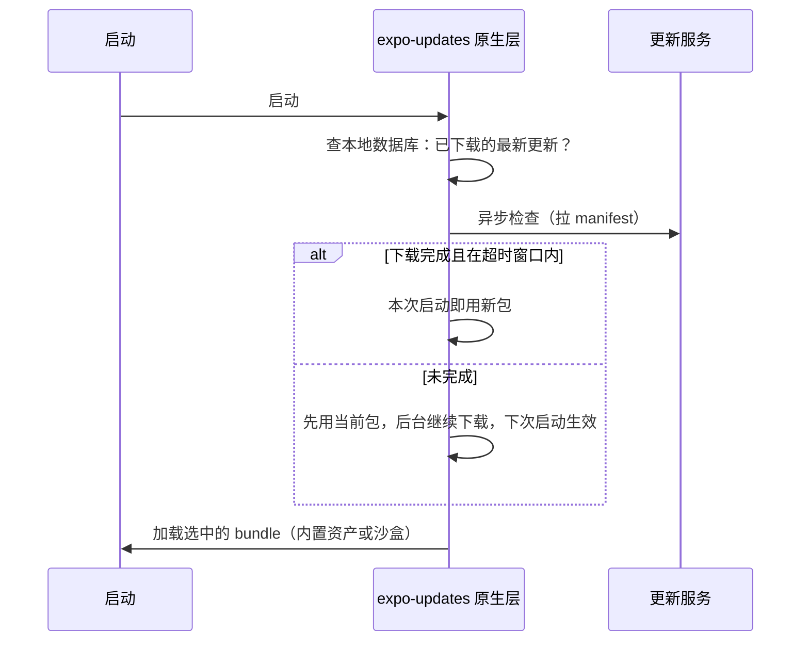
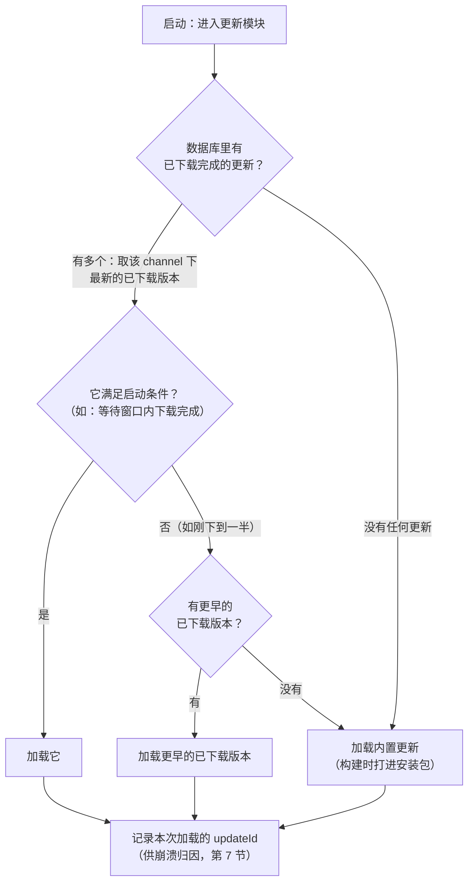
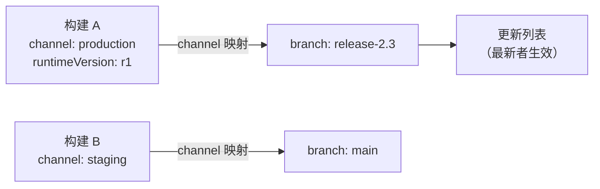
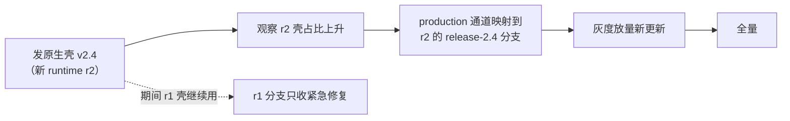

# OTA 更新工程实践（CodePush 之后）

> 02 篇把热更新讲成了五件事：沙盒换读取点、差分、校验、回滚、灰度。本篇讲工程落地：**CodePush 服务退役之后的现实选项、expo-updates 的工作机制、发布通道怎么设计、灰度与回滚怎么操作、原生版本兼容怎么管**。核心观点一句话：原理是稳定的，服务是会死的——OTA 的工程实践，一半在技术，一半在"把更新当成正式发布来管"的纪律。

## 1. CodePush 之后的地形

App Center（CodePush 的托管服务）已于 2025 年 3 月 31 日退役，这是 02 篇"生命周期教训"的现实版。退役之后，可选方案收敛为三类：

| 类别 | 形态 | 适合谁 | 关键风险 |
|------|------|--------|---------|
| 托管服务：EAS Update | expo-updates 客户端 + Expo 托管后端 | 想要开箱即用、发布通道/签名/灰度全套 | 依赖供应商（但 Expo 是 RN 核心生态成员，且客户端开源） |
| 自托管 | 开源的 code-push-server 社区分叉（沿用 CodePush SDK），或基于 expo-updates 的 manifest 协议自建服务端（官方有参考实现） | 数据主权要求高、有能力运维 | 运维与安全责任全在自己 |
| 商用替代 | 第三方 SaaS | 不想自建、不接受 EAS | 生命周期风险重演——按 02 篇的评估框架再过一遍 |

选型第一问不是功能表，而是：**这个服务会不会比你的 App 先死，死了怎么办**。第二问是合规：应用商店政策对 OTA 的边界——**允许修 bug、改内容；不允许借 OTA 实质性地改变应用行为或绕过审核**。这条红线决定了下一节的"能发什么"。

### OTA 能发什么、不能发什么

| 变更类型 | 能否 OTA | 原因 |
|---------|---------|------|
| JS 逻辑、样式、文案 | 能 | 就是 bundle 本身（02 篇沙盒换读取点） |
| 新增/变更静态资源 | 能 | 更新包携带，manifest hash 校验 |
| 新的原生代码/依赖/权限 | **不能** | 原生层在安装包里，OTA 无法触及 |
| JS 与原生接口的契约变更 | **不能**（单端发） | 新 JS 调旧原生会缺方法/缺语义——runtime version 就是挡这件事的 |

第三行是工程上最容易出事的一行：`package.json` 加了新库，构建出的 bundle 调用 `__turboModuleProxy('NewModule')`，线上原生的模块表里没有——只能走完整发版。发布流程里要有一道检查：**更新包的依赖清单与目标原生壳的兼容性**（下文 runtime version 与第 6 节的发布矩阵）。

这道检查可以机械化（CI 步骤，示意）：

```bash
# 发布 OTA 前的依赖比对（示意脚本，放在 CI 的发布流水线里）
# 1) 取出"目标壳对应的那次原生构建"所用的 lockfile（构建时归档）
git show <native-build-commit>:package-lock.json > /tmp/shell-lock.json
# 2) 与当前要发的 lockfile 比对"原生相关"的依赖：
#    - react-native / react / 各含原生代码的库（Podfile/gradle 依赖）
# 3) 任何原生相关依赖有 diff → 阻断发布，提示"需要原生发版或回退依赖"
node scripts/check-ota-compat.js /tmp/shell-lock.json package-lock.json
```

原则：**"能不能 OTA"不由写代码的人临场判断，而由流水线判断**——人会忘，脚本不会。

### 1.1 选型决策流

把第 1 节的三类选项整理成一张决策流：



最后一问不是走过场：把 02 篇的生命周期视角落成条款——**合同里写明数据导出方式、评估供应商的 RN 生态地位、准备"停服切换整包发版"的预案**。这三件事在选型时做，比服务退役时做便宜一个数量级。

## 2. expo-updates 的工作机制

expo-updates 可用于任何 RN 工程（不要求 Expo 工程化），是当前官方生态的默认答案。它的启动时序（对着 02 篇"数据库选包"的替换点读）：



机制要点：

- **两段式下载**：先拉 manifest（元数据 + 资产清单），再按清单下载缺失资产——更新包里大部分资产与上一版相同（图片没变），逐文件 hash 比对后只下载差集，这本身就是一种"文件级差分"（比 bsdiff 粗，但工程简单得多）；
- **生效时机是下次启动**：下载不打断当前运行的 JS（02 篇的时序提醒）；有一个可配的启动等待窗口（超时即放弃本次切换，避免"等网络"拖慢启动）；
- **三层兜底**：最新已下载更新 → 更早的已下载更新 → **构建时打进安装包的内置更新**（embedded）。也就是说最坏情况退回发版时的状态，不会无包可用；
- 本地用数据库记录"哪个 channel/runtime 下载了哪些版本"，选包逻辑全在原生层完成——JS 起来之前就要做完决定。

### 2.1 选包逻辑：一张状态图

把"三层兜底"展开成启动时的完整判定：



读图要点：

- **"最新"与"可用"是两个概念**：下载了一半的最新版不可用，兜底链向下走——这保证启动永远有包可加载，也解释了为什么最坏情况只是"退回发版状态"；
- **选包在原生层**：此刻 JS 还没起来，任何"用 JS 决定加载哪个包"的设计都先天不成立；
- **加载后要留痕**：本次用的 updateId 要能被崩溃上报带上（第 7 节），否则灰度期的崩溃无法归因到更新版本。

### 2.2 两段式下载的工程细节

按 02 篇 manifest 的字段，客户端的下载循环是"清单驱动"的：

1. 拉 manifest（轻请求）；比对 `id`——与本地最新已下载的一致则无事可做；
2. 对 `launchAsset` 与每个 `asset`：本地已有相同 `key`（内容寻址）→ 跳过；否则下载；
3. 全部到位后逐项校验 hash，通过则登记"该更新已就绪"，写库；
4. 任何一项失败：本次下载作废，下次重试（不影响已就绪的旧更新）。

注意这套流程**没有二进制补丁**——省流量的来源只有"内容寻址跳过相同文件"。对图片占比高的 App 这已经够用；bundle 本身频繁变化且巨大时，才需要 02 篇的补丁层（自托管方案可自行叠加）。

## 3. runtimeVersion：兼容性的生命线

02 篇把"runtime version 匹配"列为硬约束，这里展开成可操作的形态。expo-updates 的 runtimeVersion 有三种典型配置方式：

| 方式 | 语义 | 代价 |
|------|------|------|
| 手写字符串 | 完全人工控制"哪批构建 ↔ 哪批更新" | 忘了改字符串 → 旧壳收到不兼容新包（事故） |
| `appVersion` 策略 | 跟随应用版本号 | 每次发版都开新通道；纯 JS 修复也要等/对齐版本号 |
| `fingerprint` 策略 | 对一切可能影响原生层的配置（原生依赖、RN 版本、工程配置等）做指纹哈希 | 最安全；原生层一动指纹就变，需要构建新版本、新更新分支 |

fingerprint 的原理值得记住：它把"什么会让 bundle 与原生壳不兼容"显式建模成一个**可计算的函数**——原生依赖清单、RN 版本、 Expo 配置、原生工程改动都进哈希。指纹变了 = 兼容域变了 = 旧更新自动与新的构建隔离。这比"人记得改版本号"可靠一个数量级，代价是构建/发布分支更多。

叠加模块八 04 的事实（Hermes 字节码与引擎绑定）：**引擎升级必然产生新的兼容域**——所以"升 RN 版本"和"发 OTA"在时间上要错开：先发版铺新壳，观察新壳占比，再把更新通道切到新 runtime version（第 5 节的通道操作就是干这个的）。

runtimeVersion 的常见问答：

| 问题 | 答案 |
|------|------|
| 手写字符串忘记改了怎么办 | 没有兜底——这正是手写策略的代价。用 CI 校验"原生相关依赖变了但 runtime version 没变"就阻断 |
| 纯 JS 修复也要新 runtime version 吗 | appVersion 策略下要（跟版本号走）；fingerprint 策略下不要（指纹没变，同一兼容域内继续发更新） |
| 两个 runtime version 可以共用一个通道吗 | 更新服务按 (channel, runtimeVersion) 联合寻址——同一通道对不同壳发不同更新，这正是"新老壳并存期"的工作方式 |
| 用户永远不升级安装包怎么办 | 老 runtime version 的更新通道继续维护（只收紧急修复），或接受老壳用户停留在最后可用的 JS 版本 |
| fingerprint 变了但原生其实没改 | 指纹是"宁可错杀"的保守函数——误伤的代价是多一个通道，漏判的代价是线上崩溃。方向上选保守 |

### 3.1 手工推演：三代壳并存期的一次 OTA 发布

FAQ 第三行（"两个 runtime version 共用一个通道"）值得用一次真实发布推演到底。设线上有三种壳：v2.5 与 v2.6（fingerprint 相同，同属 r1）、v3.0（原生升级，r2）：

| 步 | 操作 | r1 壳（2.5/2.6）收到什么 | r2 壳（3.0）收到什么 |
|---|---|---|---|
| 1 | 发更新 F1（runtimeVersion=r1）：紧急 JS 修复 | ✅ 命中，启动拉取并应用 | ❌ 按钮不可见——服务端按 (channel, r1) 寻址，r2 壳的请求根本不带 r1 |
| 2 | 发更新 F2（r1）：修复 F1 的回归 | ✅ 覆盖 F1（同通道取最新，F1 被"顶掉"） | ❌ 同上 |
| 3 | 发更新 G1（runtimeVersion=r2）：适配新原生 API 的 JS | ❌ 不下发（r1 壳要它也没用，装上会崩） | ✅ 命中 |
| 4 | 2.5/2.6 用户把安装包升到 v3.0 | 该设备**脱离 r1**：壳换成 r2，下次检查直接走 G1 线 | —— |

三个推论，每个都是一次真实事故的预防针：

1. **一次发布不是"一个包"而是一组 (channel, runtimeVersion) 对**——上表 4 步实际是 3 个发布物。发布清单要按兼容域列全，漏一个域 = 那个域的用户永远收不到修复；
2. **顶掉语义是同域内的**：F2 顶 F1 发生在 r1 域里，绝不波及 r2——"最新者生效"的规则（§2.1 状态图）必须永远带着 runtimeVersion 前提读；
3. 第 4 步是升级铺开的本体：**用户换壳 = 自然换域**，不需要服务端"迁移"任何东西。铺开慢于预期时（第 5 节灰度数据），瓶颈在应用商店，OTA 无能为力——这正是"升引擎必须发版、发版才是切换点"在时间线上的样子。

## 4. 发布通道：channel 与 branch

EAS Update 的组织模型是**构建 ↔ 通道 ↔ 分支**三层：



- **channel 绑在构建上**（eas.json 里配）：一个安装包出厂就带着自己的通道身份，客户端只认通道；
- **branch 是更新的容器**：发布到分支，分支上的最新更新对"映射到它的通道"生效；
- 通道可以重新映射到别的分支——这是**发布操作的核心把手**（见下节灰度与回滚）。

典型用法：

```bash
# 发布一条更新到生产分支
eas update --branch release-2.3 --message "fix: checkout crash"

# 把 production 通道整体切到某分支（比如发完新版壳之后）
eas channel:edit production --branch release-2.4

# 查看发布状态
eas update:list
```

纪律：**分支名与原生版本对齐**（release-x.y 一类），让"哪批更新跑在哪个壳上"一眼可查；不要用一个大杂烩分支承载所有历史。

三层模型各管一段，别混：

| 概念 | 绑定于 | 谁决定 | 回答的问题 |
|------|--------|--------|-----------|
| 构建（含 channel 与 runtimeVersion） | 安装包 | 出厂时烧定 | 这个 App 实例去哪领更新、兼容什么 |
| channel | 构建配置 | 发布时重新映射 | 这批实例现在跟哪个分支 |
| branch | 更新服务 | 每次发布追加 | 当前这批更新的内容序列 |
| 更新（一条） | branch 上的一次发布 | 按量放量 | 用户具体拿到哪个版本 |

一个容易踩的坑：**channel 身份在构建时就定了，测试包与生产包务必不同 channel**——否则"发个内部测试更新"直接打到生产用户。CI 里对构建产物的 channel 做断言（内部通道 ≠ production）是廉价保险。

## 5. 灰度与回滚

### 5.1 两种灰度机制

**① 单条更新的百分比放量**：发布时直接指定初始百分比，之后逐步调高：

```bash
eas update --branch release-2.3 --rollout-percentage=10   # 先放 10% 用户
eas update:edit                                            # 调整百分比（10 → 50 → 100）
eas update:revert-update-rollout                           # 撤销：回到控制版本
```

**② 通道级灰度**：把通道按百分比分流到两条分支（新旧各一条），观察后再全量切换或回退：

```bash
eas channel:rollout    # 交互式：production 通道 30% 用户走新分支
```

两种机制的选择：单条更新放量简单直接，适合"一次修复"的节奏；通道分流适合"一批变更 + 可并行迭代"的场景（新分支还能继续发小修，控制版本不动）。注意约束：同一分支/平台/runtime version 上同时只允许一个活跃的放量操作，放量中途不能直接被新发布覆盖。

### 5.2 回滚的两种形态与纪律

| 形态 | 触发 | 机制 |
|------|------|------|
| 自动回退 | 新更新安装后**启动即崩**被服务端检测到 | 客户端退回上一个可用更新/内置更新（以所用版本官方文档为准启用） |
| 人工回滚 | 灰度期发现功能/性能问题 | `eas update:revert-update-rollout`（放量撤销）或通道重新映射到旧分支 |

回滚纪律（02 篇"更新失败 vs 运行失败"的工程版）：

1. **回滚不等于修复**——回滚止血后仍然要定位根因，否则下一包重蹈；
2. 回滚也要过验收：确认回滚动作真的生效（`eas update:list` 的状态 + 监控指标回落），别把"发了回滚命令"当成"用户已恢复"；
3. **崩溃信号要快**：OTA 的爆炸半径以小时计，灰度期盯崩溃率/关键漏斗，异常即止——这依赖模块九 04 的稳定性体系在线上侧就位。

### 5.3 签名：防的是"服务端之外的人"

02 篇讲过签名原理（manifest 携带签名，客户端公钥验签，`expectExpoSignature` 一类开关）。工程落地三件事：

1. 生成密钥对，公钥进 App 配置（随安装包分发），私钥进密钥管理（CI 注入，不落仓库）；
2. 验签失败的更新一律拒绝加载并回退——**宁可更新失败，不可加载来路不明的代码**；
3. 自托管 manifest 服务时同样要自己实现签名校验链路——客户端校验逻辑是公开协议，安全强度取决于你把私钥管得多好。

### 5.4 自托管时的灰度实现要点

不选 EAS 也要自己实现放量，核心三件事：

1. **分桶要稳定（sticky）**：同一台设备多次检查更新应落进同一桶——用设备匿名标识做 hash 分桶，而不是每次随机（否则用户在同一次会话里"有更新/没更新"横跳）；
2. **放量是服务端开关**：manifest 服务按"桶号 ≤ 当前比例"决定返回新版还是控制版——客户端零改动；
3. **指标按桶回收**：崩溃率、关键漏斗按"控制组/实验组"分开统计，观察窗口结束再做决定。没有对照的放量只是"分段发版"，不是灰度。

自托管的服务端形态（02 篇的 manifest 协议 + 本节的策略层）：

```text
GET /api/manifest?channel=production&runtimeVersion=r1&deviceId=…
  ├─ 查 (channel, runtimeVersion) → 目标更新组
  ├─ hash(deviceId) % 100 < rolloutPercent ? 实验组 : 控制组
  └─ 返回对应版本的 manifest（含签名头）
```

### 5.5 回滚演练

回滚路径不能等到事故当天才第一次走。演练清单：

| 步骤 | 验证什么 |
|------|---------|
| 在内部通道发一个"已知有问题"的更新 | 触发链路真实可走 |
| 执行回滚命令 | 命令可用、权限在位 |
| 客户端拉取 | 回滚后的 manifest 正确指向控制版本 |
| 监控指标 | 崩溃率回落可观测（不是"应该好了"） |
| 记录耗时 | 从决策到生效的时间，写进预案 |

演练结论沉淀成一页 runbook：**谁有权决策、哪条命令、预期多久生效、去哪看指标**。事故时翻文档比翻聊天记录快。

## 6. 把 OTA 放进发布工程：协同矩阵

OTA 省掉的是"过审时间"，**不能省掉"发布纪律"**。团队级的最低配置：

| 环节 | 要求 |
|------|------|
| 变更分类 | 每个改动先回答：纯 JS？带资源？动了原生接口？（第 1 节的表） |
| 构建与验证 | 更新包必须用与目标壳一致的依赖树构建；release 形态在真机走关键路径回归（模块九 01：dev/prod 失真） |
| 兼容性 | runtime version 策略明确（fingerprint 优先）；引擎升级与新 OTA 发布错峰 |
| 放量 | 固定节奏：内部通道全量 → 生产小比例 → 观察指标 → 逐步调高 |
| 回滚 | 每次放量前确认回滚路径（哪条命令、预期多久生效） |
| 记录 | 更新与原生版本的关系可追溯（分支命名 + 发布记录）——线上问题的第一问永远是"用户跑的是什么组合" |

原生发版与 OTA 的协同时间线（示意）：



## 7. 监控与可观测：更新不是发完就完

灰度期的核心问题只有一个：**"用户跑的是什么组合"**。expo-updates 在 JS 侧暴露了运行时信息，把它接到崩溃与埋点上报里：

```js
import * as Updates from 'expo-updates';

// 启动后收集一次，挂到所有上报的公共字段里
const updateContext = {
  channel: Updates.channel,                 // 更新通道（构建身份）
  runtimeVersion: Updates.runtimeVersion,   // 兼容域
  updateId: Updates.updateId ?? 'embedded', // 本次实际加载的更新；无更新时为内置
  createdAt: Updates.createdAt,             // 该更新的发布时间
};

// 接入崩溃上报：崩溃堆栈 + 上下文一起上传
crashReporter.setTags(updateContext);
// 接入业务埋点：漏斗指标按 updateId 分组，灰度对照才有数据
analytics.setGlobalProperties(updateContext);
```

监控看什么（灰度期盯三样）：

| 指标 | 看什么 | 异常动作 |
|------|--------|---------|
| 崩溃率（按 updateId 分组） | 实验组 vs 控制组 | 显著劣化 → 立即回滚 |
| 关键漏斗（登录/支付/核心路径） | 两组转化差 | 劣化超容忍 → 暂停放量、归因 |
| 更新成功率 | 检查→下载→生效的漏损 | 大量"下载失败" → 查 CDN/网络策略 |

第 6 节协同矩阵里"记录"一行的落地形态就是这三张看板——**没有分组监控的放量是盲发**。

## 8. 常见坑速查

| 症状 | 根因 | 出路 |
|------|------|------|
| 测试更新直达生产用户 | 测试包与生产包同 channel | 构建 channel 断言（第 4 节） |
| 更新发布后部分用户"永远收不到" | runtimeVersion 不匹配被静默跳过 | 按 (channel, runtimeVersion) 对账发布矩阵 |
| 新壳上线后老用户 JS 报缺方法 | 新 JS 发到了老壳的通道 | fingerprint 策略；通道切换前观察壳占比 |
| 灰度指标看不出差异 | 上报没带 updateId，两组混在一起 | updateContext 进公共字段（第 7 节） |
| 回滚命令发了但崩溃没降 | 回滚 ≠ 用户已恢复：客户端要下次检查才切 | 以指标回落为准；理解生效时延 |
| 启动变慢 | 启动同步等检查更新 | 等待窗口设小或改异步（02 篇） |
| OTA 发了带原生依赖的改动 | 发布检查缺失 | 依赖比对进 CI（第 1 节） |

## 小结

- CodePush 托管服务退役（2025-03）之后，现实选项是 EAS Update、自托管（code-push-server 分叉或 manifest 协议自建）、商用替代——评估框架仍是 02 篇的生命周期视角；
- expo-updates 机制三要点：两段式下载（manifest → 差集资产）、下次启动生效、内置更新兜底——02 篇"沙盒换读取点"的完整工程化；
- runtimeVersion 是兼容性的生命线：fingerprint 策略把"JS 与原生是否兼容"变成可计算的哈希；引擎升级（模块八 04 的字节码绑定）必然切兼容域；
- 灰度两手：单条更新百分比放量、通道分流；回滚两形态：启动即崩自动回退、人工撤销/重映射——回滚后仍要归因；
- OTA 的边界：JS 与资源可发，原生代码与接口契约不可发；把它当正式发布管（分类、验证、放量、回滚、记录），它才是资产而不是负债。
- 可观测是放量的一部分：updateId/runtimeVersion 进上报公共字段，灰度对照与崩溃归因全靠它。

延伸阅读：

- [02-热更新原理](02-热更新原理.md)：本篇全部操作的原理底座（差分/校验/回滚状态机）；
- [01-Metro三阶段与Bundle结构](01-Metro三阶段与Bundle结构.md) 与 [03-Metro配置与工程化](03-Metro配置与工程化.md)：更新包的生产侧；
- [04-包体与启动优化实操](04-包体与启动优化实操.md)：内置更新与启动路径的关系；
- [../rn-性能优化原理/04-内存与稳定性](../rn-性能优化原理/04-内存与稳定性.md)：崩溃信号体系；
- [../rn-新架构/06-迁移工程实践](../rn-新架构/06-迁移工程实践.md)：原生升级期的版本并存管理。

## 自测

1. CodePush 托管退役后，三类现实选项各自的适用条件与关键风险是什么？
2. OTA 能发什么、不能发什么？第三行（原生代码）为什么是"最容易出事的一行"？如何在流水线里机械化拦截？
3. expo-updates 的"三层兜底"指什么？最坏情况用户处于什么状态？
4. runtimeVersion 三种策略的取舍？fingerprint 为什么方向上"宁可错杀"？
5. channel / branch / 构建三层各自绑定什么？测试包与生产包为什么要不同 channel？
6. 单条更新放量与通道分流两种灰度机制分别适合什么节奏？同一分支上放量有什么约束？
7. 自托管灰度的三个实现要点是什么？为什么分桶必须 sticky？
8. 回滚演练要验证哪五步？为什么说"发了回滚命令"不等于"用户已恢复"？
9. 灰度期监控看哪三样指标？它们分别异常时的动作是什么？
