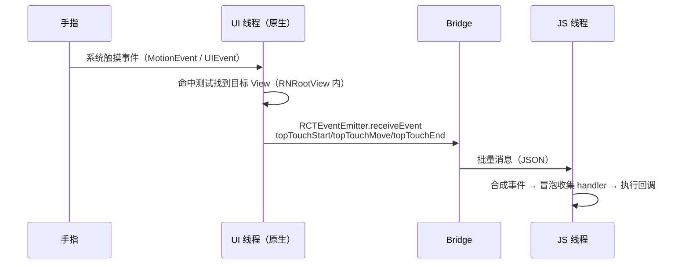
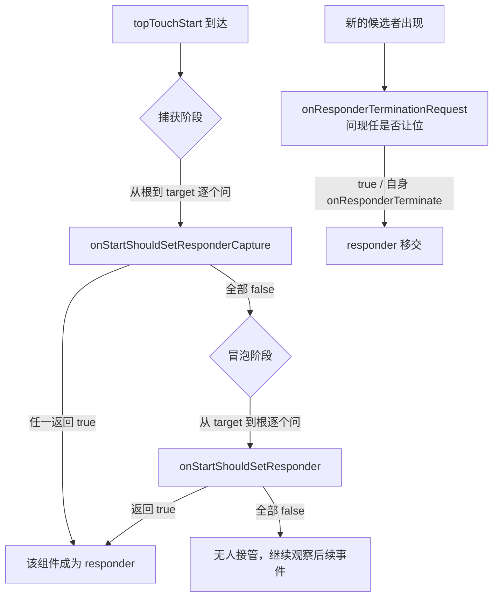
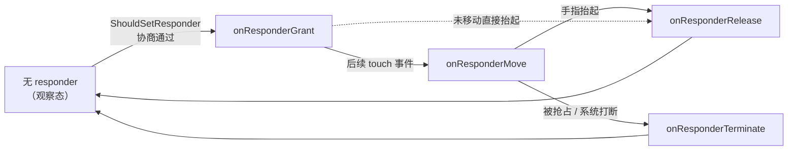
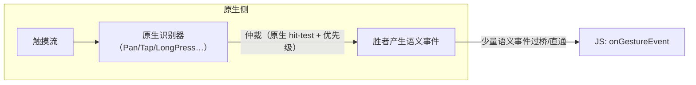

# 触摸事件链路与手势仲裁

> 渲染是"JS → 原生"的方向，事件是回程。本篇拆两件事：一次触摸怎么走到 JS 回调；RN 在没有 DOM 事件流的平台上，如何用 Responder System 模拟出手势仲裁。

## 1. 事件回程：从指尖到回调



要点：

- **触摸在原生侧先做命中测试**（Android `dispatchTouchEvent` / iOS hit-testing），整个 RN 根视图是"一个"原生视图的持有者，细分到哪个组件靠事件携带的 target tag；
- 事件名是 `topTouchStart/Move/End/Cancel`（`Libraries/Renderer/src/ReactFabricEventEmitter` / `ReactNativeEventEmitter`），进 JS 后映射为 `onTouchStart` 等与 `onStartShouldSetResponder` 体系；
- `onPress` 不是原生事件——是 JS 侧 `Pressability`（旧 `Touchable`）根据 touch 序列+时间阈值**合成**的。这解释了为什么旧 Touchable 按压反馈天然有延迟感（等 JS 判定）。

### 1.1 逐步旅程表：一次 topTouchMove 的完整链路

把时序图展开成可逐行对照的步骤表（Android 侧为例，iOS 各步同构、类名不同）：

| 步 | 发生地 | 角色 | 做什么 |
|----|--------|------|--------|
| 1 | 操作系统 | InputChannel / UITouch | 产生原始触摸（坐标、指针 id、动作类型） |
| 2 | 原生 View 树 | ReactRootView / RCTSurfaceView | `dispatchTouchEvent` 到达 RN 根视图 |
| 3 | 原生 View 树 | 命中测试 | 从根往下找最深的可命中视图，得到一个原生 View + 它对应的实例句柄 |
| 4 | RN 原生层 | 事件处理组件（`ReactRootView` 内的 touch 处理 / iOS `RCTTouchHandler`） | 把原生事件翻译成 RN 事件结构：target tag + 触点列表 + 页面/客户坐标 |
| 5 | RN 原生层 | 事件合并器 | 同一 target 的连续 move 事件可合并（coalescing key），只留最新值 |
| 6 | 通道 | 旧架构 Bridge / 新架构 JSI 事件批次 | 序列化后送 JS（旧：JSON 消息入队列；新：事件在事件拍点批量直调 JS） |
| 7 | JS 侧 | 事件分发器 | 依 target tag 在组件树上定位，合成 SyntheticTouch 事件对象 |
| 8 | JS 侧 | 冒泡收集 | 沿树向上收集 `onTouchXxx` 与 responder 回调，逐个执行 |
| 9 | JS 侧 | Pressability / 业务回调 | 合成 press/longpress 语义，setState 触发下一轮渲染 |

两个容易忽略的推论：

- **第 3 步只发生在原生**——JS 侧的"哪个组件被点"完全是 tag 推算出来的；触摸若落在 RN 根视图之外的原生视图上（如原生导航栏），JS 根本看不到这次触摸；
- **第 5 步决定了 touch move 是"可丢失"的**——手势跟踪类逻辑若需要每个中间点，要么在原生做，要么接受丢点（03 篇的滚动合并同理）。

### 1.2 原生入口：两端各一段"翻译官"代码

Android 侧的入口在 `ReactRootView`（`ReactAndroid` 里，简化示意）：

```java
// packages/react-native/ReactAndroid/.../ReactRootView.java（简化）
@Override
public boolean dispatchTouchEvent(MotionEvent ev) {
  dispatchJSTouchEvent(ev);      // ① 旁路：翻译成 RN 事件结构，上送 JS
  super.dispatchTouchEvent(ev);  // ② 原生分发照常：原生子 View（如 ScrollView）仍可消费
  return true;                   // 根视图始终声明"后续事件我都要"
}

// 原生子 View 决定接管手势时（如 ScrollView 判定开始滚动）回调到根视图
@Override
public void onChildStartedNativeGesture(View child, MotionEvent ev) {
  // 通知 JS：这轮触摸被原生拿走了 → JS 侧收到 topTouchCancel
  mJSTouchDispatcher.onChildStartedNativeGesture(ev, eventDispatcher);
}
```

iOS 侧的等价物是 `RCTTouchHandler`——一个挂在根视图上的 `UIGestureRecognizer` 子类（简化示意）：

```objc
// React/Base/RCTTouchHandler.m（简化）
- (void)touchesBegan:(NSSet<UITouch *> *)touches withEvent:(UIEvent *)event {
  [super touchesBegan:touches withEvent:event];
  // 把 UITouch 集合翻译成 RN 的事件 payload：
  // { target, pageX/pageY, locationX/locationY, touches/changedTouches }
  [self _updateAndDispatchTouches:touches eventName:@"touchStart"];
}

- (void)touchesCancelled:(NSSet<UITouch *> *)touches withEvent:(UIEvent *)event {
  // 别的原生识别器（如 UIScrollView 的 pan）胜出时，本识别器被取消 → JS 收到 cancel
  [self _updateAndDispatchTouches:touches eventName:@"touchCancel"];
}
```

看这两段的意义在于确认两件事：

- **RN 在根视图上"旁听"整条触摸流**并翻译给 JS——它没有关掉原生分发，所以原生 ScrollView 能自己滚；
- **原生一旦认领手势，JS 侧收到的是 cancel**（Android 的 `onChildStartedNativeGesture`、iOS 的识别器取消）——第 3 节 Responder 被"抢走"的源头就在这里。

### 1.3 事件封装与批量上行

原生事件不会一个一个过桥，而是**攒批**：

- 旧架构：每帧把待发事件序列化成一个 JSON 数组，一次性发 JS（模块四 01 的消息队列语义）；
- 新架构（Fabric）：事件在**事件拍点（event beat）**上聚合，JSI 直调 JS 的事件处理入口，省掉序列化但**仍是批处理**——单帧内多个事件依旧一起到（模块七 02）；
- 批处理带来的语义变化：JS 回调里看到的 `nativeEvent` 是事件发生时刻的快照，不是回调执行时刻的状态。

### 1.4 事件 payload：JS 侧拿到的字段

合成事件的 `nativeEvent` 字段在两端做了对齐（这正是"翻译官"代码的输出）：

| 字段 | 含义 | 备注 |
|------|------|------|
| `identifier` | 触点编号 | 多指手势靠它区分手指；对应 Android pointer id / iOS touch 的顺序号 |
| `locationX/Y` | 相对**目标组件**的坐标 | 由原生坐标减去目标视图偏移算出 |
| `pageX/Y` | 相对**根视图**的坐标 | 做全局定位（如跟随浮层）用这个 |
| `target` | 目标组件的 tag | 冒泡收集的起点 |
| `timestamp` | 事件时间戳 | 判定双击/长按的时间基准 |
| `touches` | 当前所有触点 | 抬起一只手时它仍包含其余触点 |
| `changedTouches` | 本次变化的触点 | end/cancel 时判断"哪根手指离开" |
| `force` | 压感 | iOS 支持的设备上有值；Android 多数设备不可用 |

两个使用要点：

- **坐标双轨制**：`locationX/Y` 依赖目标组件的布局位置，嵌套滚动中目标动了自己的偏移，前后两帧的 location 不可直接相减做位移量；做拖拽请用绝对坐标或 RNGH 的 `translationX/Y`（累计位移，原生算好）；
- **touches 与 changedTouches 的分工**是正确处理多指手势的关键：判断"该手指的按下/抬起"看 changedTouches，判断"现在还有几指在屏上"看 touches。

## 2. 合成事件：没有 DOM 事件流的"事件流"

Web 有完整的捕获/冒泡协议，RN 只有"原生命中 + tag 树回溯"：

1. 事件携带 `targetTag`（ShadowNode tag）；
2. JS 沿组件树从 target 向上收集 `onTouchXxx` handler（等效冒泡）；
3. 一次性执行，`e.stopPropagation()` 只是停止这次 JS 侧收集循环——**原生侧不感知**。

```jsx
// onPress 的真身：JS 合成手势
<Pressable onPress={...}>   // Pressability: touch 序列 + 阈值判定 → press
<TouchableWithoutFeedback onLongPress={...}> // 同一套合成长按
```

Pressability（`Libraries/Pressability/Pressability.js`）内部维护一个小状态机（idle → pressed → maybe-longpress…），关键阈值都可通过 props 调：

| 参数 | 语义 | 默认行为（定性） |
|------|------|------------------|
| `delayPressIn` | 按下到进入按压态的延迟 | 无额外延迟（但"到 JS"这段延迟躲不掉） |
| `delayPressOut` | 抬起到退出按压态的延迟 | 无额外延迟 |
| `delayLongPress` | 按住多久算长按 | 约 500ms |
| `hitSlop` | 向四周扩大命中区 | 不扩 |
| `pressRetentionOffset` | 手指移出多远仍保持按压态 | 有内置默认偏移 |

对照记忆：**hitSlop 扩大的是命中区（命中测试时生效），但"这算不算一次 press"的判定仍在 JS**；RNGH 的识别器连判定都在原生——同样是"点得中"，后面的链路长度不同。

再补三个 JS 合成层的细节：

- **事件对象是合成的**：`e.nativeEvent` 里才是原生数据；`e.preventDefault()` 基本是空操作，`e.stopPropagation()` 只影响本次 JS 收集——Web 上"阻止默认行为"的能力在 RN 里大多不存在，对应能力要以组件 prop 的形式声明（如下）；
- **命中区域的开关是 `pointerEvents` prop**，它是在原生视图层生效的（不是 JS 判断）：

| pointerEvents | 自身可点 | 子元素可点 | 典型用途 |
|---------------|---------|-----------|---------|
| `auto`（默认） | ✓ | ✓ | — |
| `none` | ✗ | ✗ | 装饰性浮层整体穿透 |
| `box-none` | ✗ | ✓ | 遮罩容器自身不响应、内容可点 |
| `box-only` | ✓ | ✗ | 容器整体响应、内部穿透 |

- **Pressability 的延迟是结构性的**：进入按压态要等 touch start 到 JS + 阈值判定；长按要等计时器。`delayPressIn` 只能调手感，改不了"判定在 JS"这个事实（02 篇的 RNGH 用原生识别器把这条路短路）。

## 3. Responder System：手势仲裁的"议会"

多个组件同时想接手手势（滚动容器 vs 内部滑块 vs 按钮）怎么办？Web 上浏览器 + 指针事件规范解决；RN 的答案（`Libraries/Interaction/ResponderSystem.js`，由 `View` 的 `on*ShouldSetResponder` props 接入）是一次 **JS 侧两阶段协商**：



三个关键回调族：

| 回调 | 时机 |
|------|------|
| `on*ShouldSetResponder(Capture)` | 决定"要不要接管" |
| `onResponderGrant / Move / Release` | 接管后的事件流 |
| `onResponderTerminationRequest / Terminate` | 被抢走（典型：ScrollView 接管滚动） |

### 3.1 走一遍完整协商：ScrollView 里的滑块

设一个典型场景：竖向 ScrollView 内有一个自定义拖拽滑块。协商全过程：

1. 手指搭上滑块：`topTouchStart` 到 JS，capture 阶段无人应答，冒泡阶段滑块 `onStartShouldSetResponder` 返回 true → 滑块成为 responder，收到 `onResponderGrant`；
2. 手指小幅移动：`topTouchMove` 持续投递给滑块（responder 独占），`onResponderMove` 里 setState 更新位置——此时是模块四 03 的闭环；
3. 手指竖向大幅移动：原生 ScrollView 判定"这是滚动"，发起抢占 → 滑块收到 `onResponderTerminationRequest`；返回 true（或不管）→ `onResponderTerminate`，滑块交出 responder，ScrollView 接管滚动；
4. 手指抬起：`topTouchEnd` 只发给 ScrollView，滑块的 grant/release 序列已断。

注意第 3 步的裁决者其实是**原生 ScrollView**——JS 只是被通知。这就是 Responder System 的真实地位：**JS 侧的仲裁协议，跑在原生仲裁的屋檐下**。

### 3.2 移交语义：TerminationRequest 不是否决权

`onResponderTerminationRequest` 返回 false 能保住 responder 吗？分情况：

- 对方是 **JS 侧候选者**（另一个组件想接管）：返回 false 有商量余地——协商在 JS，双方都讲协议；
- 对方是 **原生滚动容器**：抢占由原生发起（`onInterceptTouchEvent` / `cancelContentTouches` 一类机制），JS 的 false 拦不住，`onResponderTerminate` 照样会来。想真的阻止，得在滚动容器一侧处理（如拖拽期间临时 `scrollEnabled={false}`，iOS 上还有 `canCancelContentTouches` 这类开关）或换 RNGH 在原生仲裁。

工程结论：**TerminationRequest 是"礼貌询问"，Terminate 才是既成事实**——清理逻辑（如中止拖拽动画）要放在 `onResponderTerminate` 里，不要指望在 Request 里翻盘。

### 3.3 生命周期总览

把 grant/release/terminate 画成一张图（flowchart 形式）：



阅读要点：

- grant 之后事件流**独占**——非 responder 组件不会再收到 move/end，只会收到一次性的 cancel（若有订阅）；
- release 与 terminate 是**平行出口**，二者不会同时发生；所有"拖拽中"的资源申请，必须在这两个出口都做回收；
- 回到观察态后，下一轮 touch start 重新协商——responder 不是"记忆"的，每次手势从零开始。

### 3.4 PanResponder：Responder 协议的手势封装

业务里很少直接写 `onResponderMove`，更常用的是 `PanResponder`——它在 Responder 协议之上多做了一件事：**把 touch 序列累积成 gestureState**。

```jsx
const pan = useRef(
  PanResponder.create({
    onStartShouldSetPanResponder: () => true,          // 对应 onStartShouldSetResponder
    onMoveShouldSetPanResponder: (e, g) => Math.abs(g.dx) > 4, // move 阶段再申请
    onPanResponderMove: (e, g) => setX(g.dx),          // 每帧过一次 JS（闭环）
    onPanResponderRelease: (e, g) => settle(g.vx),     // 正常结束
    onPanResponderTerminate: () => reset(),            // 被抢占：必须处理
  })
).current;

<View {...pan.panHandlers} />
```

| gestureState 字段 | 含义 |
|-------------------|------|
| `dx / dy` | 自手势开始的累计位移 |
| `vx / vy` | 当前速度（JS 侧按事件时间差估算） |
| `x0 / y0` | 手势起点坐标 |
| `moveX / moveY` | 最近一次 move 的坐标 |
| `numberActiveTouches` | 当前触点数 |

注意速度是 **JS 用事件时间戳算的**：事件在 JS 线程排队时，时间差失真，速度随之抖动——这是 PanResponder 做惯性动画手感不稳的原因，也是 RNGH 把速度估计放在原生的理由（02 篇）。

### 3.5 结构性弱点：仲裁在"线程的另一头"

**旧架构的致命弱点在这条链上**：每个 touch move 都要过桥进 JS，协商也在 JS——**滚动抢手势期间一帧 JS 卡顿，整只手"失灵"**。这是 Gesture Handler 诞生的原因。

把它拆开看（模块三 02 的线程模型），是三段不确定性叠加：

1. **事件下行排队**：touch 事件过桥进 JS，JS 线程忙时排队——手指已经动了，JS 还没收到 start；
2. **协商本身在 JS**：shouldSetResponder 的判定依赖 JS 线程空闲；一帧 GC/长任务，"谁接管"的答案就迟一帧；
3. **抢占通知也在 JS**：滚动容器抢走手势也要 JS 确认，抢占瞬间的 move 事件归属可能闪烁。

这不是 bug，是"仲裁在线程另一头"的结构结果。

## 4. Gesture Handler：把仲裁搬回原生

react-native-gesture-handler 的核心思想：**手势识别发生在原生侧**（Android `GestureDetector` 家族 / iOS `UIGestureRecognizer`），JS 只收到识别完成的语义事件（Began/Changed/Ended）：



收益链：

1. 识别不依赖 JS 线程——就算 JS 卡死，手势照常工作；
2. 事件频率从"每个 touch move"降到"语义状态变化"（几条），桥流量骤减；
3. 配合 Reanimated worklet，手势回调可整体跑在 UI 线程（JS 线程完全不参与）。

语义事件与原始 touch 事件的载荷差异（以 Pan 为例）：

| 维度 | 原始 touch move | Pan 语义事件 |
|------|-----------------|-------------|
| 频率 | 每帧（可被合并） | 状态跃迁时（Began/Active 变化/End） |
| 位移 | 只有绝对坐标，位移要自己累减 | `translationX/Y`（累计位移）、`changeX/Y`（增量）原生算好 |
| 速度 | 无 | `velocityX/Y`（原生按帧间差估计） |
| 手指数 | touches 数组自己数 | `numberOfPointers` 字段 |

一句话：**原始事件是"传感器数据"，语义事件是"识别结论"**——JS 拿结论做业务，不再做信号处理。

识别器本身是原生状态机（UNDETERMINED → BEGAN → ACTIVE → END/FAILED/CANCELLED），配置（`minDistance`、`maxDuration`、`numberOfPointers`…）在 JS 声明、原生执行——状态机的完整展开见 [02-GestureHandler原理化](02-GestureHandler原理化.md)。

### 4.1 新旧架构：事件通道的两代实现

同一条"原生事件 → JS"的回程，两代架构的通道实现不同（模块四/七的分界线）：

| 维度 | 旧架构（Bridge） | 新架构（Fabric + JSI） |
|------|------------------|------------------------|
| 序列化 | JSON 文本，逐字段序列化 | 结构化对象直传（JSI 值对象），无 JSON 税 |
| 批处理 | 每帧消息队列打包 | 事件拍点（event beat）聚合后直调 |
| 调度 | 事件与视图更新各走各的异步队列 | 事件带优先级（离散/连续），可与并发渲染调度配合 |
| JS 侧入口 | `receiveEvent` 分发 | 渲染器事件系统直接派发到对应 fiber |

不变的部分同样重要：**命中测试仍在原生、合成仍在 JS、responder 协议语义兼容**——新架构让回程更快更省，但没有改变"谁负责什么"的分工。所以本篇的仲裁机制在新架构下依然成立，只是协商的"延迟底噪"变小了。

## 5. 事件系统的平台底噪

即便全走语义事件，两端仍有平台差异要做心智准备：

| 差异点 | Android | iOS |
|--------|---------|-----|
| 触摸取消 | `onTouchCancel`（系统抢占，如弹窗） | 同，且转场常触发 cancel |
| 滚动接管 | nested scrolling 协商 | `UIScrollView` 优先命中 |
| scrollEventThrottle | 无此概念（默认够用） | **必须设**，否则 onScroll 每帧节流为 1 次（默认 0=每帧一条也不发） |

两个高频踩坑补在表后（外加两条平台特有的）：

- **cancel 不是异常，是常态**：来电、弹窗、系统手势（返回导航、控制中心下拉）都会把进行中的手势转成 cancel。手势逻辑必须处理 cancel 分支（复位状态、释放资源），只在 end 里收尾的代码在真机上一定会漏；
- **iOS 转场期间的触摸会被系统吞掉**：push/pop 动画进行中，新页面的 touch 常被丢弃——"页面一进来点按钮没反应"多半是这个，延迟响应是正常兜底（用可交互式转场或原生层处理是另一条路）；
- **Android 的系统返回手势会与边缘滑动手势争抢**：全面屏手势导航下，屏幕边缘的横滑先被系统识别——贴边的自定义滑动手势要么让出边缘区域，要么用系统提供的排除区机制（原生层能力）；
- **原生组件会认领手势**：嵌入的原生视图（地图、WebView、视频播放器）自己消费触摸，一旦认领，RN 侧只会收到 cancel——在它们上面叠 RN 手势层时，要靠 `pointerEvents` 或原生侧的手势协商显式约定谁先谁后。

## 6. 常见误区与坑速查

| 症状 | 原因层 | 机理与出路 |
|------|--------|-----------|
| 按压反馈"慢半拍" | JS 合成 | Pressability 判定在 JS；要即时反馈用 RNGH 原生识别器或 `pointerEvents` 层的原生态 |
| `stopPropagation` 不生效 | JS 合成 | 它只停 JS 收集循环，原生分发早已完成；命中控制改用 `pointerEvents` / 结构调整 |
| 滚动中子组件手势"丢事件" | 平台抢占 | 滚动接管后子组件只收到 cancel；需要在原生层协商就上 RNGH（02 篇） |
| 手势在低端机跟手性骤降 | 结构性 | 每个 move 过桥 + JS 排队；闭环下沉原生（模块四 03 的"剪环"） |
| 多指手势错乱 | 事件模型 | 合成层按指针 id 维护 touches/changedTouches；未区分 pointer id 的逻辑多指必错 |
| 真机上按钮"点不中" | 命中测试 | 命中区在原生按视图几何计算：检查 transform 后的实际命中区、负 margin、`hitSlop` |

### 6.1 排查手势问题的顺序

手势类 bug 按"从原生到 JS"的顺序定位，和事件回程的方向一致：

1. **先问命中**：事件到没到这个组件？——在最外层加 `onTouchStart` 打日志，确认 target 是否符合预期（排除遮挡、`pointerEvents`、命中区问题）；
2. **再问归属**：responder 给了谁？——在候选组件的 `onResponderGrant / Terminate` 里打点，看协商结果与抢占时机；
3. **再问线程**：延迟是不是 JS 排队？——用性能工具看 JS 线程在手势期间是否被长任务占住（模块九 01 的线程归因法）；
4. **最后问结构**：这条手势链路是不是闭环（原生事件 → JS → 视图更新）？是就考虑下沉：native driver / RNGH + worklet（04 篇与 02 篇）。

顺序的意义：前两步是"逻辑错"，后两步是"结构慢"——两类问题的解法完全不同，先分类再动手。

## 7. 延伸阅读

- [02-GestureHandler原理化](02-GestureHandler原理化.md)：识别器状态机与原生仲裁场的细节；
- [03-滚动与列表事件](03-滚动与列表事件.md)：ScrollView 抢占手势的另一半故事；
- [../rn-Bridge通信原理/03-Bridge瓶颈量化](../rn-Bridge通信原理/03-Bridge瓶颈量化.md)：事件闭环为何是性能重灾区；
- [../rn-新架构/02-Fabric渲染管线](../rn-新架构/02-Fabric渲染管线.md)：新架构下事件如何走 JSI 快速通道。

## 小结

- 事件回程 = 原生命中测试 → topTouchXxx 消息 → JS 合成事件与冒泡；`onPress` 是 JS 合成物，不是原生事件。
- Responder System 是 JS 议会式仲裁：capture → bubble → termination 三段协商，弱点是"仲裁在线程另一头"。
- Gesture Handler 把识别与仲裁搬回原生，是"事件系统下沉"范式的样板——与新架构的动机同源。
- TerminationRequest 是询问、Terminate 是事实：清理逻辑放后者；cancel 分支必写。
- `pointerEvents` 是原生层开关，`stopPropagation` 只是 JS 层刹车——两层能力不要混用。

## 自测

1. 一次 `topTouchStart` 从 MotionEvent 到 JS 回调要经过哪几步？哪几步在原生、哪几步在 JS？
2. `onPress` 为什么天生有延迟？RNGH 的 Tap 识别器为什么没有？
3. Responder System 的两阶段协商顺序是什么？`onResponderTerminationRequest` 返回 false 一定能保住 responder 吗？分情况说明。
4. `e.stopPropagation()` 在 RN 与 Web 上的语义差异是什么？想控制"谁能被点中"应该用什么？
5. 手势代码只在 `onResponderRelease` 里做收尾会有什么问题？正确的分支结构是什么？
