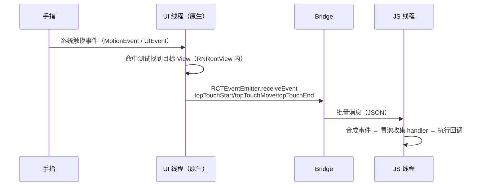
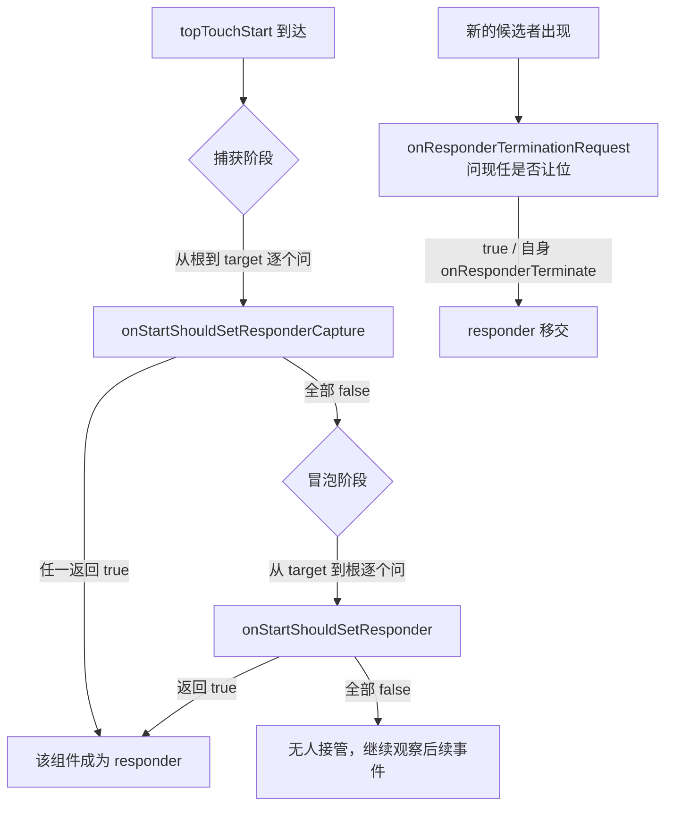
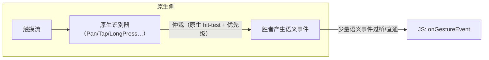

# 触摸事件链路与手势仲裁

> 渲染是"JS → 原生"的方向，事件是回程。本篇拆两件事：一次触摸怎么走到 JS 回调；RN 在没有 DOM 事件流的平台上，如何用 Responder System 模拟出手势仲裁。

## 1. 事件回程：从指尖到回调



要点：

- **触摸在原生侧先做命中测试**（Android `dispatchTouchEvent` / iOS hit-testing），整个 RN 根视图是"一个"原生视图的持有者，细分到哪个组件靠事件携带的 target tag；
- 事件名是 `topTouchStart/Move/End/Cancel`（`Libraries/Renderer/src/ReactFabricEventEmitter` / `ReactNativeEventEmitter`），进 JS 后映射为 `onTouchStart` 等与 `onStartShouldSetResponder` 体系；
- `onPress` 不是原生事件——是 JS 侧 `Pressability`（旧 `Touchable`）根据 touch 序列+时间阈值**合成**的。这解释了为什么旧 Touchable 按压反馈天然有延迟感（等 JS 判定）。

## 2. 合成事件：没有 DOM 事件流的"事件流"

Web 有完整的捕获/冒泡协议，RN 只有"原生命中 + tag 树回溯"：

1. 事件携带 `targetTag`（ShadowNode tag）；
2. JS 沿组件树从 target 向上收集 `onTouchXxx` handler（等效冒泡）；
3. 一次性执行，`e.stopPropagation()` 只是停止这次 JS 侧收集循环——**原生侧不感知**。

```jsx
// onPress 的真身：JS 合成手势
<Pressable onPress={...}>   // Pressability: touch 序列 + 阈值判定 → press
<TouchableWithoutFeedback onLongPress={...}> // 同一套合成长按
```

## 3. Responder System：手势仲裁的"议会"

多个组件同时想接手手势（滚动容器 vs 内部滑块 vs 按钮）怎么办？Web 上浏览器 + 指针事件规范解决；RN 的答案（`Libraries/Interaction/ResponderSystem.js`，由 `View` 的 `on*ShouldSetResponder` props 接入）是一次 **JS 侧两阶段协商**：



三个关键回调族：

| 回调 | 时机 |
|------|------|
| `on*ShouldSetResponder(Capture)` | 决定"要不要接管" |
| `onResponderGrant / Move / Release` | 接管后的事件流 |
| `onResponderTerminationRequest / Terminate` | 被抢走（典型：ScrollView 接管滚动） |

**旧架构的致命弱点在这条链上**：每个 touch move 都要过桥进 JS，协商也在 JS——**滚动抢手势期间一帧 JS 卡顿，整只手"失灵"**。这是 Gesture Handler 诞生的原因。

## 4. Gesture Handler：把仲裁搬回原生

react-native-gesture-handler 的核心思想：**手势识别发生在原生侧**（Android `GestureDetector` 家族 / iOS `UIGestureRecognizer`），JS 只收到识别完成的语义事件（Began/Changed/Ended）：



收益链：

1. 识别不依赖 JS 线程——就算 JS 卡死，手势照常工作；
2. 事件频率从"每个 touch move"降到"语义状态变化"（几条），桥流量骤减；
3. 配合 Reanimated worklet，手势回调可整体跑在 UI 线程（JS 线程完全不参与）。

## 5. 事件系统的平台底噪

即便全走语义事件，两端仍有平台差异要做心智准备：

| 差异点 | Android | iOS |
|--------|---------|-----|
| 触摸取消 | `onTouchCancel`（系统抢占，如弹窗） | 同，且转场常触发 cancel |
| 滚动接管 | nested scrolling 协商 | `UIScrollView` 优先命中 |
| scrollEventThrottle | 无此概念（默认够用） | **必须设**，否则 onScroll 每帧节流为 1 次（默认 0=每帧一条也不发） |

## 小结

- 事件回程 = 原生命中测试 → topTouchXxx 消息 → JS 合成事件与冒泡；`onPress` 是 JS 合成物，不是原生事件。
- Responder System 是 JS 议会式仲裁：capture → bubble → termination 三段协商，弱点是"仲裁在线程另一头"。
- Gesture Handler 把识别与仲裁搬回原生，是"事件系统下沉"范式的样板——与新架构的动机同源。
